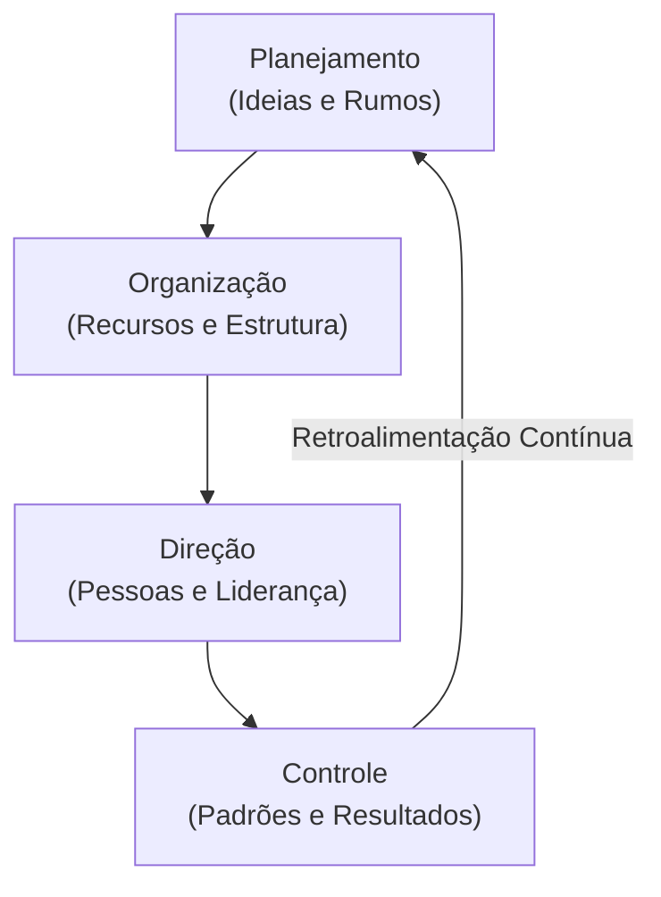
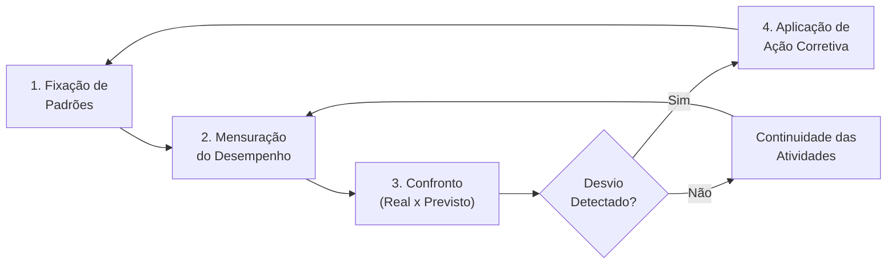
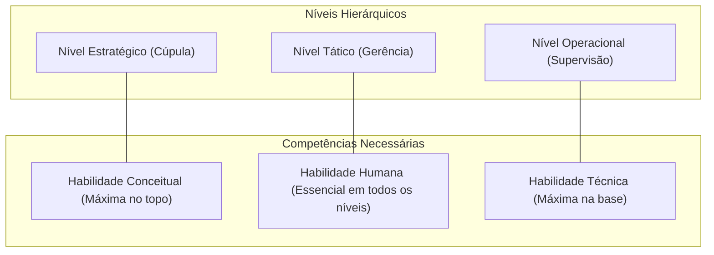

O processo administrativo constitui a espinha dorsal da gestão contemporânea. Toda organização precisa integrar suas ações para converter recursos em entregas efetivas para a sociedade. Em concursos públicos, as bancas exigem o conhecimento detalhado das funções administrativas, suas características cíclicas e as atribuições típicas de cada nível hierárquico. O domínio deste conteúdo permite ao gestor visualizar a organização de forma integrada, atuando com precisão desde a formulação de diretrizes até a fiscalização das operações de campo.

> [!objetivos]
> - Diferenciar as características essenciais das quatro funções do processo administrativo: planejamento, organização, direção e controle.
> - Compreender a evolução do modelo clássico de Henri Fayol para a síntese neoclássica do modelo PODC.
> - Analisar as atribuições da função direção, com ênfase em liderança, motivação e comunicação de equipes.
> - Explicar as quatro etapas consecutivas do controle organizacional, seus princípios gerais e a tipologia dos papéis gerenciais de Mintzberg.

## Conceito e evolução do processo administrativo

A administração não opera por impulsos desconexos, mas por um encadeamento lógico de decisões denominado **processo administrativo**. Segundo Idalberto Chiavenato, administrar é interpretar os objetivos globais da organização e transformá-los em ação concreta por meio do planejamento, da organização, da direção e do controle de todos os recursos disponíveis.

Esse processo reúne três características centrais:
- **Cíclico**: as funções sucedem-se continuamente, de modo que os resultados obtidos realimentam o início de novos planos.
- **Dinâmico e interativo**: as funções ocorrem de forma simultânea no dia a dia, influenciando-se mutuamente.
- **Sistêmico**: uma alteração em qualquer uma das etapas afeta a eficácia de todo o conjunto.

A abordagem funcional iniciou-se com **Henri Fayol**, pioneiro da Teoria Clássica da Administração. No início do século XX, Fayol concebeu a gestão em cinco funções fundamentais, representadas pela sigla **PO3C**:
1. **Prever**: examinar o futuro e traçar o plano de ação institucional.
2. **Organizar**: constituir a estrutura material e social do organismo empresarial.
3. **Comandar**: guiar o corpo funcional e manter a atividade em movimento.
4. **Coordenar**: harmonizar todos os atos e esforços coletivos.
5. **Controlar**: certificar-se de que tudo ocorre conforme as normas e ordens expedidas.

Com o amadurecimento dos estudos organizacionais, os teóricos da Escola Neoclássica (como Harold Koontz, Cyril O'Donnell, William Newman e Ernest Dale) atualizaram o modelo clássico. Os neoclássicos integraram as funções de comando e coordenação sob o conceito abrangente de **direção**, voltado para a liderança e as relações humanas. Ao mesmo tempo, a previsão converteu-se formalmente em **planejamento**, agregando diagnósticos ambientais metódicos.

Consolidou-se assim o modelo universal **PODC**: Planejar, Organizar, Dirigir e Controlar, que serve como referência fundamental nas provas de concurso.

A tabela a seguir compara as formulações clássicas e neoclássicas sobre os elementos do processo administrativo.

| Teórico Principal | Escola de Pensamento | Funções Propostas | Foco Predominante |
| --- | --- | --- | --- |
| Henri Fayol | Teoria Clássica | Prever, Organizar, Comandar, Coordenar e Controlar (PO3C) | Estrutura formal e autoridade |
| Lyndall Urwick | Teoria Clássica | Investigar, Prever, Planejar, Organizar, Coordenar, Comandar e Controlar | Racionalização metódica |
| Harold Koontz e Cyril O'Donnell | Teoria Neoclássica | Planejar, Organizar, Designar o Quadro Funcional, Dirigir e Controlar | Gestão de recursos humanos |
| William Newman | Teoria Neoclássica | Planejar, Organizar, Alocar Recursos, Liderar e Controlar | Liderança e mobilização |
| Ernest Dale | Teoria Neoclássica | Planejar, Organizar, Dirigir e Controlar (PODC) | Síntese funcional universal |

> [!bizu] Mnemônicos das funções em prova
> Quando a questão citar **Henri Fayol**, lembre-se do mnemônico **PO3C** (Prever, Organizar, Comandar, Coordenar e Controlar). Quando o enunciado tratar da visão moderna e da **Teoria Neoclássica**, a resposta certa é a sigla **PODC** (Planejar, Organizar, Dirigir e Controlar).

O diagrama abaixo ilustra a integração contínua do ciclo administrativo.

## Planejamento: a função primária orientada ao futuro

O **planejamento** é a função primária do ciclo gerencial, pois precede e orienta a execução de todas as demais etapas. Não é possível organizar departamentos, comandar equipes ou controlar resultados sem definir antecipadamente as metas institucionais. O planejamento atua no plano das ideias, reduzindo o impacto das incertezas ambientais por meio da racionalidade decisória.

A função planejamento responde a duas perguntas fundamentais:
- **Onde se quer chegar?**: definição de propósitos institucionais, visão de futuro e metas prioritárias.
- **Como chegar lá?**: formulação de diretrizes, programas de trabalho, métodos operacionais e cronogramas orçamentários.

### Níveis do planejamento organizacional

Conforme o alcance temporal e a amplitude de impacto, o planejamento reparte-se em três níveis hierárquicos:

1. **Planejamento Estratégico**:
   - Conduzido pela alta administração institucional.
   - Volta-se para o **longo prazo**, abrangendo a totalidade da organização.
   - Mapeia as relações da entidade com o macroambiente externo, estabelecendo a missão, os valores e os grandes rumos institucionais.
   - Possui menor detalhamento e opera sob maior grau de incerteza.

2. **Planejamento Tático**:
   - Desenvolvido no escalão intermediário por gerentes e chefes de departamento.
   - Orienta-se para o **médio prazo**, focando em unidades setoriais específicas.
   - Converte os rumos globais em planos de ação departamentais (logística, finanças, capacitação funcional).
   - Promove a coordenação e a integração dos recursos setoriais.

3. **Planejamento Operacional**:
   - Elaborado na base operacional por supervisores imediatos e chefes de equipe.
   - Concentra-se no **curto prazo**, detalhando tarefas e rotinas imediatas.
   - Define instruções técnicas de trabalho, procedimentos padronizados e escalas de serviço.
   - Apresenta o mais alto nível de detalhamento e visa à eficiência direta na execução.

A tabela abaixo compara os três níveis do planejamento organizacional.

| Nível de Planejamento | Nível Hierárquico | Horizonte Temporal | Amplitude de Ação | Conteúdo Central |
| --- | --- | --- | --- | --- |
| Estratégico | Alta cúpula institucional | Longo prazo | Organização inteira | Missão, visão e grandes rumos institucionais |
| Tático | Gerência intermediária | Médio prazo | Departamentos e divisões | Planos de ação setoriais e integração departamental |
| Operacional | Supervisão de linha de frente | Curto prazo | Tarefas e procedimentos diários | Escalas de serviço, rotinas e métodos detalhados |

> [!esquema] Síntese dos níveis de planejamento e suas variáveis
> - **Estratégico**: longo prazo + totalidade institucional + macroambiente externo + alta cúpula.
> - **Tático**: médio prazo + unidades departamentais + articulação setorial + gerentes médios.
> - **Operacional**: curto prazo + tarefas e atividades imediatas + procedimentos de rotina + supervisores locais.

## Organização: estruturação de recursos e divisão do trabalho

Após a aprovação dos planos, a função **organização** estabelece a arquitetura material e funcional necessária para viabilizar as metas traçadas. Enquanto o planejamento trabalha com projeções conceituais, a organização foca em recursos tangíveis, ordenamento físico e estrutura formal.

Organizar consiste em agrupar tarefas homogêneas em unidades administrativas, alocar meios financeiros e materiais, e estipular as relações formais de autoridade e responsabilidade.

A função organização compreende quatro decisões estruturais essenciais:
- **Divisão do trabalho**: decomposição das atividades globais em operações menores e especializadas, ampliando a habilidade e a produtividade individual.
- **Departamentalização**: agrupamento metódico de atribuições semelhantes em órgãos ou setores (por função, território, clientela ou processos).
- **Cadeia de comando e autoridade**: delimitação das linhas hierárquicas que determinam quem presta contas a quem e qual o limite de decisão formal de cada chefia.
- **Amplitude de controle**: fixação do número de subordinados vinculados diretamente a um mesmo superior hierárquico.

### Amplitude de controle e formato organizacional

A amplitude de controle molda diretamente a configuração física do organograma corporativo:
- **Estruturas agudas (ou verticais)**: caracterizam-se por amplitude de controle estreita (poucos subordinados sob cada chefia), exigindo muitos escalões intermediários. Favorecem a fiscalização rigorosa, mas encarecem a gestão com excesso de chefias e tornam os fluxos decisórios lentos.
- **Estruturas achatadas (ou horizontais)**: possuem amplitude de controle ampla (muitos liderados respondendo a um mesmo superior), resultando em poucos níveis hierárquicos. Reduzem custos de supervisão e conferem agilidade à comunicação interna, demandando servidores altamente capacitados.

A tabela a seguir contrasta as duas configurações estruturais.

| Dimensão Estrutural | Estrutura Aguda (Vertical) | Estrutura Achatada (Horizontal) |
| --- | --- | --- |
| Amplitude de controle | Estreita (poucos liderados por gestor) | Ampla (muitos liderados por gestor) |
| Número de escalões hierárquicos | Elevado (múltiplas camadas intermediárias) | Reduzido (poucos escalões administrativos) |
| Custo de supervisão intermediária | Alto (grande número de cargos de chefia) | Baixo (reduzida quantidade de chefias) |
| Fluidez da comunicação | Lenta (passa por muitos filtros sucessivos) | Rápida (comunicação direta com o topo) |
| Autonomia das bases operacionais | Reduzida (centralização e controle cerrado) | Elevada (maior delegação de autoridade) |

> [!pegadinha] Distinção sutil entre desenho do trabalho e condução de pessoas
> A banca examinadora costuma confundir o candidato ao tratar da distribuição de tarefas:
> - A **organização** desenha cargos, divide tarefas abstratas, cria departamentos e aloca recursos materiais na estrutura formal.
> - A **direção** orienta indivíduos concretos, soluciona atritos de convivência e motiva servidores na execução do trabalho.
> Se a questão indicar "estruturar funções, definir atribuições e distribuir recursos para órgãos", o gabarito é **organização**. Se indicar "conduzir pessoas, motivar o grupo e harmonizar relações", o gabarito é **direção**.

## Direção: liderança, comunicação e motivação humana

A função **direção** (item 1.9 do edital geral) atua diretamente sobre o comportamento das pessoas na instituição. Ao passo que o planejamento e a organização estruturam meios físicos e diretrizes, a direção mobiliza a energia dos servidores para transformar projetos em realizações concretas.

Dirigir significa orientar condutas, coordenar esforços coletivos e criar um clima de comprometimento mútuo. Ela fundamenta-se em três pilares indispensáveis:

1. **Liderança**:
   - É o exercício da influência interpessoal voltado a inspirar confiança e engajamento espontâneo com os objetivos comuns.
   - Não se confunde com autoridade formal: a chefia provém do cargo ocupado, ao passo que a liderança decorre da credibilidade, da empatia e da capacidade de mobilizar equipes.

2. **Motivação**:
   - Consiste no conjunto de estímulos internos e externos que impulsionam a dedicação e o entusiasmo funcional.
   - Compreender as necessidades das equipes permite criar condições propícias ao alto rendimento e à satisfação no trabalho.

3. **Comunicação interna**:
   - Processo de transmissão clara de diretrizes, dados operacionais e feedback institucional.
   - Deve ser bidirecional, assegurando que as ordens do topo cheguem com nitidez à base e que as necessidades operacionais retornem aos escalões superiores sem distorções.

> [!atencao] Expressões típicas da função direção em provas
> As bancas costumam utilizar expressões comportamentais para identificar a função **direção**:
> - Orientar o comportamento individual e grupal;
> - Liderar equipes e manter o engajamento cooperativo;
> - Motivar servidores e incentivar o alcance de resultados;
> - Conduzir pessoas na realização de atividades programadas.

> [!exemplo] Aplicação das funções na atividade bombeiro militar
> Na preparação do Corpo de Bombeiros Militar para o período de estiagem no sertão pernambucano:
> 1. **Planejamento**: o comando estabelece a meta de reduzir a área queimada em 25% e projeta a alocação de combustíveis e aeronaves.
> 2. **Organização**: criam-se brigadas móveis temporárias, distribuem-se abafadores e motobombas e definem-se as escalas dos pelotões.
> 3. **Direção**: os oficiais coordenam pessoalmente as equipes em campo, motivam a tropa ressaltando o dever cívico e esclarecem instruções táticas por rádio.
> 4. **Controle**: o centro operacional contabiliza a extensão dos focos combatidos, confronta os números com as metas fixadas e reposiciona guarnições nos setores críticos.

## Controle: elementos, princípios gerais e fases do processo

A função **controle** (item 1.11 do edital geral) assegura que as ações executadas correspondam aos planos aprovados. Longe de representar mero expediente punitivo, o controle fornece subsídios analíticos para identificar desvios e introduzir aperfeiçoamentos contínuos na prestação dos serviços públicos.

### As quatro fases sequenciais do controle

O processo de controle cumpre rigorosamente quatro fases consecutivas:

1. **Estabelecimento de padrões de desempenho**:
   - Fixação prévia de critérios e parâmetros mensuráveis de quantidade, qualidade, tempo e custo.
   - Os padrões nascem do planejamento e definem o que deve ser considerado um resultado plenamente aceitável.

2. **Mensuração do desempenho real**:
   - Aferição objetiva das atividades desempenhadas mediante observação direta, indicadores de gestão ou relatórios estatísticos.

3. **Comparação entre o realizado e o planejado**:
   - Confronto metódico do desempenho medido com os padrões previamente fixados, identificando concordâncias ou desvios toleráveis e críticos.

4. **Ação corretiva**:
   - Adoção de providências gerenciais para retificar falhas operacionais ou, quando o erro residir nas premissas iniciais, recalibrar as próprias metas programadas.

O fluxograma a seguir ilustra a sequência lógica das quatro etapas do controle.

### Princípios gerais aplicados ao controle

Para atuar com eficácia sem paralisar as rotinas operacionais, o sistema de controle norteia-se por princípios consagrados:
- **Princípio da exceção**: preceitua que o administrador deve concentrar sua atenção decisória sobre desvios atípicos e ocorrências fora dos padrões normais, deixando as atividades rotineiras sob a responsabilidade dos executores diretos.
- **Princípio da economia**: o custo despendido na manutenção do sistema de fiscalização não pode ultrapassar os ganhos econômicos e operacionais que ele proporciona.
- **Princípio da flexibilidade**: os instrumentos de controle devem adaptar-se a imprevistos e oscilações do ambiente sem exigir a reformulação integral do sistema.
- **Princípio da adequação**: os métodos de fiscalização devem ajustar-se à natureza técnica da atividade e ao nível hierárquico envolvido.

> [!atencao] Princípio da exceção em questões de concurso
> O **princípio da exceção** cai com grande frequência nas provas. Sua premissa é simples: a gestão sênior intervém nas situações anômalas e excepcionais que fujam ao padrão ordinário, garantindo agilidade e economia de tempo.

### Tipos de controle quanto ao momento de atuação

O controle categoriza-se em três modalidades conforme o momento temporal de sua realização:

1. **Controle preventivo (prévio, preliminar ou ex-ante)**:
   - Ocorre **antes** do início das atividades, concentrando-se na qualidade dos insumos e na prevenção de erros. Exemplo: manutenção preventiva de viaturas e vistoria prévia de segurança contra incêndio.
2. **Controle concorrente (simultâneo ou concomitante)**:
   - Dá-se **durante** a execução das tarefas, monitorando processos em tempo real. Exemplo: fiscalização de obras públicas e monitoramento por rádio de uma operação de socorro.
3. **Controle corretivo (posterior ou ex-post)**:
   - Realiza-se **após** o término do ciclo operacional, avaliando as entregas finais. Exemplo: prestação de contas de encerramento de exercício e relatório estatístico anual de ocorrências.

A tabela a seguir compara as três formas temporais de controle.

| Modalidade de Controle | Momento de Realização | Foco Principal | Benefício Operacional |
| --- | --- | --- | --- |
| Preventivo (Prévio) | Antes da execução | Insumos e condições iniciais | Antecipa e previne falhas antes que ocorram |
| Concorrente (Simultâneo) | Durante a execução | Processamento em tempo real | Permite ajustes rápidos no decorrer da atividade |
| Corretivo (Posterior) | Após o término | Produtos finais e resultados | Fornece dados consolidados para novos planos |

## Papéis e competências do administrador

A atuação gerencial requer um repertório diversificado de atitudes e habilidades para dar resposta às pressões do ambiente de trabalho.

### Os dez papéis do administrador de Henry Mintzberg

Pesquisando a prática cotidiana de executivos, Henry Mintzberg constatou que a rotina da liderança caracteriza-se por tarefas breves, ritmo intenso e constantes tomadas de decisão. Ele agrupou essas condutas em dez papéis gerenciais divididos em três grupos:

1. **Papéis Interpessoais**: ligados ao status formal e aos vínculos humanos.
   - **Símbolo (ou Representante)**: representa a instituição formalmente em cerimônias públicas e atos protocolares.
   - **Líder**: orienta, capacita e motiva os subordinados diretos.
   - **Elemento de Ligação**: desenvolve redes de relacionamentos horizontais com entidades externas e outros órgãos.

2. **Papéis Informacionais**: posicionam o gestor como centro de recepção e difusão de conhecimentos.
   - **Monitor**: colhe dados sobre o ambiente e identifica tendências institucionais.
   - **Disseminador**: repassa informações relevantes aos membros de sua equipe de trabalho.
   - **Porta-voz**: comunica formalmente a posição oficial da instituição para públicos externos.

3. **Papéis Decisórios**: aplicam as informações recebidas em escolhas estruturantes.
   - **Empreendedor**: idealiza e introduz inovações e melhorias deliberadas na organização.
   - **Solucionador de Conflitos**: atua para apaziguar crises inesperadas e litígios internos.
   - **Alocador de Recursos**: programa e autoriza a distribuição de verbas, materiais e efetivos.
   - **Negociador**: representa a instituição em acordos contratuais e parcerias relevantes.

A tabela abaixo sintetiza os dez papéis de Henry Mintzberg.

| Grupo de Papéis | Papel Gerencial | Atribuição Principal |
| --- | --- | --- |
| Interpessoal | Símbolo (Representante) | Representar a entidade em atos cívicos e protocolares formais |
| Interpessoal | Líder | Orientar, incentivar e avaliar o trabalho dos colaboradores |
| Interpessoal | Elemento de Ligação | Manter rede de contatos com parceiros externos e outros setores |
| Informacional | Monitor | Coletar ativamente dados e tendências do ambiente de atuação |
| Informacional | Disseminador | Transmitir informações colhidas para os membros da própria equipe |
| Informacional | Porta-voz | Declarar publicamente a posição e os resultados da instituição |
| Decisório | Empreendedor | Planejar e implementar projetos de inovação e modernização |
| Decisório | Solucionador de Conflitos | Conter crises agudas e solucionar controvérsias operacionais |
| Decisório | Alocador de Recursos | Distribuir orçamentos, materiais, tempo e força de trabalho |
| Decisório | Negociador | Intermediar interesses da organização em acordos formais |

### As três habilidades de Robert Katz

Robert Katz sistematizou as competências essenciais do administrador em três categorias:
- **Habilidade técnica**: domínio de ferramentas, métodos e técnicas específicas de uma especialidade (como perícia, atendimento pré-hospitalar ou finanças). Predomina na **base operacional**.
- **Habilidade humana**: capacidade de lidar com pessoas, comunicar ordens, motivar indivíduos e arbitrar divergências. É fundamental em **todos os escalões da hierarquia**.
- **Habilidade conceitual**: capacidade de visualizar a organização como um sistema global e captar suas interações com o meio externo. Atinge seu ápice no **topo decisório**.

O diagrama abaixo resume a distribuição dessas habilidades na pirâmide organizacional.

## Mapa do capítulo

A tabela a seguir resume as quatro funções administrativas, servindo como guia de memorização rápida para o dia da prova.

| Função Administrativa | Palavra-Chave | Objeto Central | Ações Primordiais | Questão Respondida |
| --- | --- | --- | --- | --- |
| Planejamento | Rumo | Ideias e conceitos | Fixar objetivos, traçar diretrizes e antecipar cenários | O que fazer e para onde avançar? |
| Organização | Estrutura | Coisas e recursos | Dividir tarefas, agrupar setores e alocar meios materiais | Como dispor os meios e quem executa? |
| Direção | Liderança | Pessoas e conduta | Orientar equipes, liderar, incentivar e comunicar ordens | Como guiar e entusiasmar os executores? |
| Controle | Conformidade | Padrões e resultados | Medir rendimento, confrontar resultados e corrigir falhas | O trabalho seguiu o padrão previsto? |

### Para fixar
- O processo administrativo é cíclico, interativo e dinâmico, realimentando continuamente as decisões da governança.
- Henri Fayol inaugurou a abordagem funcional mediante as cinco funções do modelo PO3C: prever, organizar, comandar, coordenar e controlar.
- A Teoria Neoclássica sintetizou comando e coordenação na função de direção, consolidando o modelo PODC.
- O planejamento é a função primária que estabelece objetivos e caminhos, desdobrando-se nos níveis estratégico, tático e operacional.
- A organização estrutura os recursos materiais e humanos, definindo a divisão do trabalho, a departamentalização e a autoridade.
- A direção atua exclusivamente sobre o comportamento das pessoas na instituição, apoiando-se em liderança, comunicação e motivação.
- O controle cumpre quatro etapas consecutivas: fixar padrões, mensurar desempenho, confrontar com o previsto e adotar ações corretivas.
- O princípio da exceção no controle estabelece que a chefia deve intervir apenas em desvios atípicos e ocorrências fora do padrão.
- Henry Mintzberg agrupou a rotina gerencial em dez papéis distribuídos nas vertentes interpessoais, informacionais e decisórias.
- Robert Katz classificou as competências administrativas em habilidades técnicas (base), humanas (todos os níveis) e conceituais (topo).
