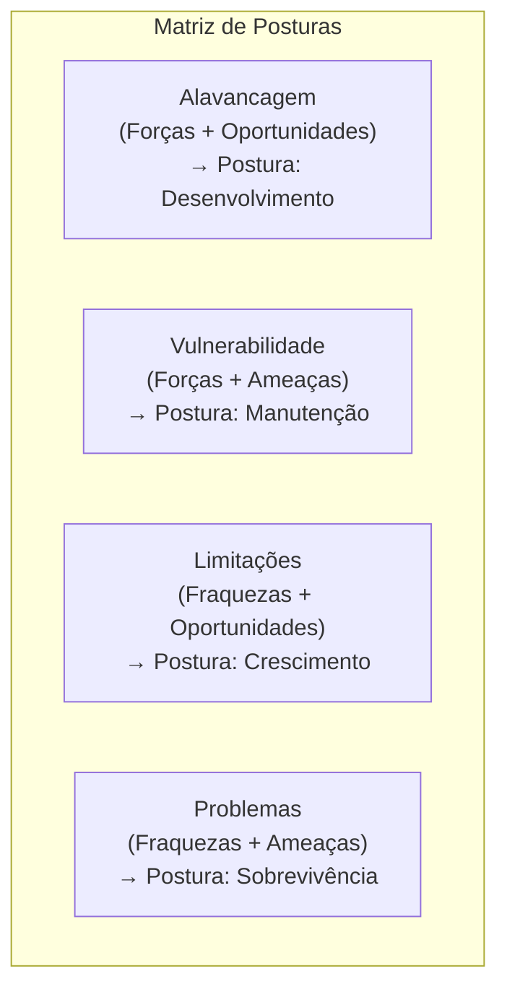
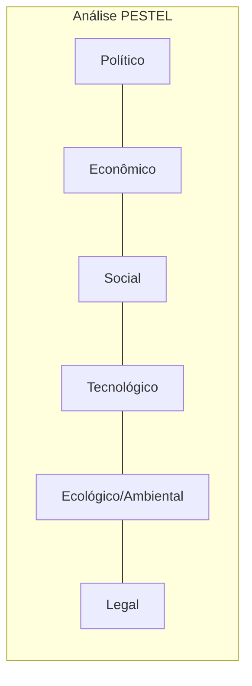

O diagnóstico situacional constitui o alicerce indispensável para a formulação de diretrizes em qualquer instituição. Nenhuma entidade pública ou corporação militar consegue prosperar sem conhecer com exatidão suas forças internas e as pressões provenientes do meio circundante. Nas provas, a análise do ambiente externo e o emprego de matrizes de diagnóstico representam temas recorrentes. Este capítulo aprofunda a Matriz SWOT (FOFA) e a ferramenta PESTEL, capacitando você a mapear cenários, cruzar dados e identificar posturas gerenciais consistentes para a tomada de decisão.

> [!objetivos]
> - Distinguir os componentes do ambiente interno, operacional e macroambiental das organizações.
> - Compreender a estrutura da Matriz SWOT, diferenciando variáveis controláveis de fatores incontroláveis.
> - Analisar a técnica da SWOT cruzada e associar os cenários de alavancagem, limitações, vulnerabilidade e problemas às posturas recomendadas.
> - Aplicar as seis dimensões da ferramenta PESTEL no escaneamento metódico do macroambiente externo.

## O ambiente organizacional e a necessidade de diagnóstico

As organizações modernas operam como sistemas abertos, mantendo contínua troca de insumos, informações e valores com o meio circundante. O comportamento de uma instituição resulta tanto de suas decisões gerenciais quanto das forças externas que incidem sobre ela. A literatura administrativa divide esse contexto em três níveis analíticos fundamentais:

1. **Ambiente Interno**:
   - Abrange todas as variáveis situadas dentro das fronteiras organizacionais.
   - Trata-se de um ambiente **controlável** pela gestão institucional.
   - Compreende a cultura da corporação, a tecnologia instalada, a disponibilidade orçamentária, as instalações físicas, os métodos de trabalho e a qualificação do quadro funcional.
   - É nele que se identificam os pontos fortes e as vulnerabilidades operacionais.

2. **Ambiente Operacional (Microambiente, Competitivo ou Tarefa)**:
   - Reúne os agentes que interagem direta e cotidianamente com as operações da instituição.
   - Apresenta grau moderado de governabilidade, permitindo negociações e ações diretas de influência.
   - Engloba usuários diretos dos serviços, fornecedores de materiais, órgãos fiscalizadores e entidades parceiras.

3. **Macroambiente (Ambiente Geral)**:
   - Congrega as grandes forças estruturais que afetam todas as organizações de forma ampla e indireta.
   - Trata-se de um meio **incontrolável** pela gestão singular de uma entidade.
   - Envolve conjunturas políticas, tendências econômicas mundiais, mutações socioculturais, avanços tecnológicos, fenômenos climáticos e legislações federais.

A tabela a seguir sistematiza as diferenças entre as camadas contextuais da organização.

| Camada Ambiental | Grau de Controle | Escopo de Influência | Elementos Constitutivos |
| --- | --- | --- | --- |
| Ambiente Interno | Totalmente controlável | Restrito à própria instituição | Infraestrutura, finanças, tecnologia própria e capacitação funcional |
| Ambiente Operacional | Parcialmente influenciável | Setorial e direto | Cidadãos atendidos, fornecedores e órgãos de controle externo |
| Macroambiente | Incontrolável | Amplo e difuso | Economia global, demografia, diretrizes políticas e clima |

O diagnóstico organizacional consiste no levantamento metódico dessas variáveis para fornecer subsídios analíticos à cúpula decisória antes de qualquer ação relevante.

## A Matriz SWOT (FOFA): arquitetura e dimensões

A **Matriz SWOT** (acrônimo para *Strengths*, *Weaknesses*, *Opportunities* e *Threats*), também conhecida em língua portuguesa como **Matriz FOFA** (Forças, Oportunidades, Fraquezas e Ameaças), é o instrumento mais consagrado de diagnóstico situacional. Ela organiza os fatores analisados em uma tabela bidimensional de dupla entrada, combinando a origem da variável (interna ou externa) com a sua repercussão (favorável ou desfavorável).

### Dimensão interna: Forças e Fraquezas

A dimensão interna congrega elementos sobre os quais a governança tem poder direto de intervenção:
- **Forças (*Strengths*)**: são competências distintivas, diferenciais competitivos, recursos de excelência e vantagens operacionais controladas pela entidade. Exemplos: patentes exclusivas, tropa altamente treinada, boa reputação cívica e tempo de resposta rápido.
- **Fraquezas (*Weaknesses*)**: são carências, desvantagens competitivas e deficiências técnicas internas que limitam o desempenho institucional. Exemplos: frota defasada, carência de pessoal em setores técnicos, processos burocráticos engessados e canais falhos de comunicação.

### Dimensão externa: Oportunidades e Ameaças

A dimensão externa abrange acontecimentos que se originam fora do domínio imediato da governança:
- **Oportunidades (*Opportunities*)**: conjunturas externas favoráveis que, se identificadas com presteza, permitem alavancar resultados e expandir a atuação social. Exemplos: surgimento de linhas de crédito a fundo perdido, modernização de leis setoriais e avanços digitais acessíveis.
- **Ameaças (*Threats*)**: riscos, hostilidades e transformações ambientais desfavoráveis que podem comprometer os resultados ou a continuidade dos serviços. Exemplos: estiagens severas atípicas, aumento abrupto de custos de insumos e crises financeiras governamentais.

A tabela abaixo exibe a estrutura clássica da matriz de diagnóstico situacional.

| Origem do Fator | Governabilidade | Fatores Positivos (Ajudam) | Fatores Negativos (Atrapalham) |
| --- | --- | --- | --- |
| Ambiente Interno | Variáveis controláveis | **Forças** (vantagens e diferenciais) | **Fraquezas** (fragilidades e carências) |
| Ambiente Externo | Variáveis incontroláveis | **Oportunidades** (cenários favoráveis) | **Ameaças** (desafios e riscos exógenos) |

> [!pegadinha] Classificação de fatores internos versus fatores externos
> Uma das pegadinhas prediletas das bancas consiste em trocar a classificação de variáveis:
> - A falta de viaturas novas em um quartel é **fraqueza** (fator interno), e não ameaça. A instituição pode comprar ou remanejar bens.
> - Uma seca histórica no semiárido é **ameaça** (fator externo), e não fraqueza. A instituição não tem poder para alterar o regime de chuvas.
> - Recursos orçamentários disponíveis no caixa do órgão são **força** (fator interno); uma nova emenda parlamentar destinada ao setor é **oportunidade** (fator externo).
> Memorize: tudo o que a administração pode decidir modificar internamente é força ou fraqueza; o que decorre do meio externo e não pode ser anulado pela vontade da chefia é oportunidade ou ameaça.

## Cruzamento SWOT e posturas de atuação

A confecção do inventário de variáveis não encerra o trabalho de análise. O real valor do diagnóstico revela-se na técnica da **SWOT cruzada**, que confronta os fatores internos com as forças externas. Essa confrontação identifica o cenário específico vivido pela entidade e orienta a escolha de posturas gerenciais consistentes, conforme sistematizado por Djalma de Pinho Rebouças de Oliveira.

O confronto entre os quadrantes gera quatro cenários fundamentais:

1. **Cenário de Alavancagem (Forças + Oportunidades) → Postura de Desenvolvimento**:
   - A instituição reúne diferenciais sólidos e depara-se com um ambiente externo repleto de oportunidades atrativas.
   - Recomenda-se a postura de **desenvolvimento**, caracterizada pela expansão de serviços públicos, conquista de novos setores e criação de programas inovadores.

2. **Cenário de Limitações (Fraquezas + Oportunidades) → Postura de Crescimento**:
   - O meio circundante oferece excelentes oportunidades, mas a entidade possui deficiências internas que a impedem de aproveitá-las isoladamente.
   - Indica-se a postura de **crescimento**, recorrendo a parcerias interinstitucionais, convênios públicos, consórcios e cooperação mútua para superar as fraquezas e viabilizar os ganhos potenciais.

3. **Cenário de Vulnerabilidade (Forças + Ameaças) → Postura de Manutenção**:
   - O ambiente externo apresenta graves riscos e incertezas, porém a organização dispõe de capacidade técnica e robustez interna para se defender.
   - Adota-se a postura de **manutenção**, concentrando esforços na preservação da estabilidade conquistada e na proteção dos ativos institucionais contra os impactos externos.

4. **Cenário de Problemas (Fraquezas + Ameaças) → Postura de Sobrevivência**:
   - A instituição encontra-se diante de ameaças externas contundentes e não possui recursos materiais ou competências suficientes para neutralizá-las.
   - Impõe-se a postura de **sobrevivência**, aplicando corte severo de despesas, desativação de projetos não prioritários e reestruturação emergencial completa.

A tabela a seguir sintetiza o cruzamento dos fatores e as respectivas posturas de ação.

| Cenário Situacional | Combinação Analítica | Situação Institucional | Postura de Ação Indicada |
| --- | --- | --- | --- |
| Alavancagem | Forças + Oportunidades | Vantagens internas frente a condições externas favoráveis | Desenvolvimento (expansão e inovação) |
| Limitações | Fraquezas + Oportunidades | Fragilidades internas bloqueando o proveito de oportunidades | Crescimento (parcerias e convênios) |
| Vulnerabilidade | Forças + Ameaças | Robustez interna resistindo a pressões externas hostis | Manutenção (estabilidade, nicho ou foco) |
| Problemas | Fraquezas + Ameaças | Vulnerabilidade interna agravada por hostilidades externas | Sobrevivência (contenção e reestruturação) |

O diagrama abaixo ilustra o cruzamento das forças e fraquezas com oportunidades e ameaças.

> [!atencao] As três modalidades da postura de manutenção
> Conforme a doutrina de Djalma Oliveira, a postura de **manutenção** desdobra-se em três modalidades práticas:
> - **Estabilidade**: busca a manutenção do equilíbrio presente diante de turbulências ambientais temporárias.
> - **Nicho**: concentra a atuação da organização em um segmento protegido ou específico, blindando-o contra ameaças gerais.
> - **Especialização**: concentra recursos em poucas atividades nucleares nas quais a instituição detém excelência incontestável.

O caso a seguir demonstra a aplicação prática da SWOT cruzada na gestão pública militar.

> [!exemplo] Aplicação da SWOT cruzada no Corpo de Bombeiros Militar
> Imagine a avaliação situacional de um Grupamento de Bombeiros Militar:
> - **Força**: profissionais com capacitação internacional em resgate em escombros.
> - **Fraqueza**: ausência de cães farejadores treinados para buscas em áreas urbanas colapsadas.
> - **Oportunidade**: oferta de convênio com entidades internacionais de resgate para treinamento conjunto.
> - **Ameaça**: intensificação de deslizamentos de encostas provocados por chuvas torrenciais na Região Metropolitana.
> Cruzando fraquezas com oportunidades (Cenário de Limitações), o comando firma convênio externo para obter e treinar cães de busca (Postura de Crescimento). Confrontando suas forças com as ameaças (Cenário de Vulnerabilidade), mobiliza seus peritos para reforçar as ações preventivas nas áreas de risco geológico (Postura de Manutenção).

## Análise PESTEL (PESTAL) do macroambiente

Enquanto a Matriz SWOT examina simultaneamente o interior e o exterior da organização, a ferramenta **PESTEL** (também grafada como PESTAL) dedica-se ao escaneamento contínuo das grandes variáveis do macroambiente. 

Essa metodologia reparte o horizonte externo em seis dimensões interconectadas:

1. **Fatores Políticos (P)**:
   - Envolvem a estabilidade do governo, orientações ideológicas dos governantes, prioridades de políticas públicas e relações institucionais entre poderes.
   - No setor público, determinam a prioridade de investimentos em segurança pública e defesa civil.

2. **Fatores Econômicos (E)**:
   - Abrangem o comportamento do Produto Interno Bruto (PIB), curvas de inflação, taxas de juros, oscilação cambial e limites de arrecadação tributária.
   - Influenciam o teto de gastos orçamentários e a capacidade de investimento do Estado.

3. **Fatores Sociais (S)**:
   - Compreendem a composição demográfica, o envelhecimento populacional, os índices de escolaridade, os padrões de assentamento urbano e as demandas por dignidade humana.
   - Ditam a concentração de demandas em áreas urbanas conurbadas e comunidades vulneráveis.

4. **Fatores Tecnológicos (T)**:
   - Englobam a difusão da internet das coisas, a inteligência artificial, o uso de drones em vistorias, novos equipamentos de proteção individual e a automação de processos.
   - Criam mecanismos de resposta mais rápidos e precisos para o atendimento de ocorrências.

5. **Fatores Ecológicos ou Ambientais (E ou A)**:
   - Dizem respeito às variações climáticas extremas, regimes de enchentes, escassez hídrica, queimadas sazonais e regulamentos de sustentabilidade.
   - Representam o cerne da missão de defesa civil e combate a incêndios do Corpo de Bombeiros Militar.

6. **Fatores Legais (L)**:
   - Compreendem o arcabouço normativo vigente, reformas na legislação de licitações, normas técnicas de segurança contra incêndio e pânico, e estatutos funcionais.
   - Impõem balizas intransponíveis de legalidade estrita para os atos da administração.

A tabela a seguir apresenta os fatores da metodologia PESTEL com suas respectivas aplicações institucionais.

| Dimensão PESTEL | Descrição Geral | Exemplo Típico de Variável | Impacto Prático na Corporação Militar |
| --- | --- | --- | --- |
| Políticos (P) | Diretrizes e prioridades da governança pública | Política estadual de segurança cidadã | Liberação de créditos para reequipamento da corporação |
| Econômicos (E) | Condições fiscais e indicadores macroeconômicos | Crescimento da receita tributária do Estado | Abertura de novos concursos públicos para oficiais |
| Sociais (S) | Dinâmica populacional e padrões de convivência | Densidade habitacional em áreas de morro | Planejamento de rotas de socorro em áreas conurbadas |
| Tecnológicos (T) | Inovações, conectividade e automação | Drones equipados com sensores térmicos | Mapeamento exato de focos de incêndio florestal |
| Ecológicos (E/A) | Clima, regime hidrológico e meio ambiente | Ondas de calor e estiagens prolongadas | Alerta antecipado para combate a incêndios em vegetação |
| Legais (L) | Legislação, decretos e regulamentos vigentes | Lei de Segurança Contra Incêndio e Pânico | Fiscalização e interdição preventiva de imóveis de risco |

O diagrama abaixo sintetiza as seis forças do escaneamento PESTEL.

> [!bizu] Distinção entre PESTEL e SWOT em provas
> Para não errar na prova:
> - A **Análise PESTEL** foca **apenas no macroambiente externo** (Político, Econômico, Social, Tecnológico, Ecológico, Legal), levantando tendências incontroláveis.
> - A **Matriz SWOT** cruza dados **internos** (forças e fraquezas) com dados **externos** (oportunidades e ameaças), orientando a tomada de decisão.
> A ferramenta PESTEL funciona como insumo para identificar com precisão as oportunidades e ameaças da Matriz SWOT.

## Mapa do capítulo

A tabela a seguir reúne os principais instrumentos de diagnóstico situacional estudados, confrontando suas finalidades e alcances analíticos.

| Instrumento | Foco de Investigação | Dimensões Centrais | Utilidade para a Tomada de Decisão |
| --- | --- | --- | --- |
| Matriz SWOT (FOFA) | Ambiente interno e externo | Forças, Fraquezas, Oportunidades e Ameaças | Diagnosticar a situação atual e definir posturas de ação |
| SWOT Cruzada | Integração de variáveis | Alavancagem, Limitações, Vulnerabilidade e Problemas | Definir posturas de desenvolvimento, crescimento, manutenção e sobrevivência |
| Análise PESTEL | Exclusivo no macroambiente | Político, Econômico, Social, Tecnológico, Ecológico e Legal | Mapear grandes forças conjunturais incontroláveis |

### Para fixar
- O ambiente interno abrange fatores controláveis pela gestão institucional, nos quais se manifestam forças e fraquezas.
- O macroambiente é composto por variáveis incontroláveis de amplo alcance, onde surgem oportunidades e ameaças.
- A Matriz SWOT analisa o ambiente interno (pontos fortes e fracos) e o ambiente externo (oportunidades e desafios).
- A administração não pode eliminar diretamente ameaças externas, mas deve adotar medidas para mitigar seus efeitos operacionais.
- O cruzamento de Forças e Oportunidades caracteriza alavancagem, orientando a postura de desenvolvimento.
- Fraquezas combinadas com Oportunidades geram limitações, recomendando a postura de crescimento por meio de parcerias.
- Forças confrontadas com Ameaças indicam vulnerabilidade, exigindo a postura de manutenção por estabilidade, nicho ou foco.
- Fraquezas somadas a Ameaças caracterizam o cenário de problemas críticos, demandando a postura de sobrevivência.
- A Análise PESTEL disseca o macroambiente nas dimensões políticas, econômicas, sociais, tecnológicas, ecológicas e legais.
- A metodologia PESTEL atua como ferramenta preparatória que identifica oportunidades e ameaças para a Matriz SWOT.
