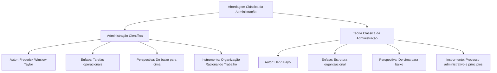
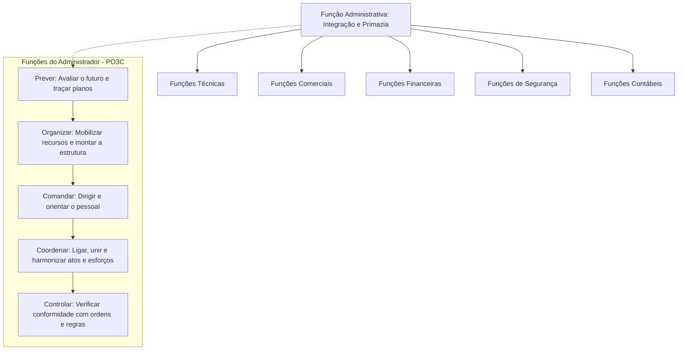
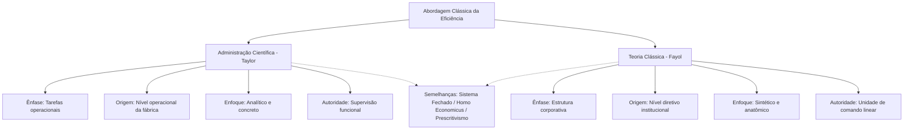
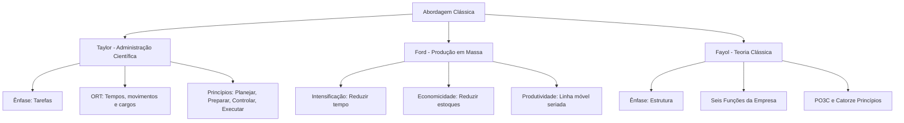

A consolidação da Administração como ciência autônoma ocorreu no início do século XX. O movimento foi impulsionado pela necessidade de superar o empirismo, o desperdício e o improviso nas fábricas da Revolução Industrial. A Abordagem Clássica desdobrou-se em duas correntes pioneiras e complementares. De um lado, a Administração Científica de Frederick Taylor focou as tarefas operacionais no chão de fábrica. De outro, a Teoria Clássica de Henri Fayol orientou-se para a estrutura e a visão global da organização. Dominar os postulados dessas escolas é essencial nas provas de concurso. As bancas examinam com frequência a racionalização do trabalho, as funções administrativas e os princípios clássicos de gestão.

> [!objetivos]
> - Distinguir o escopo da Administração Científica de Taylor e da Teoria Clássica de Fayol.
> - Explicar os fundamentos da Organização Racional do Trabalho (ORT) e o conceito de *homo economicus*.
> - Identificar os quatro princípios fundamentais de Taylor e os três princípios industriais de Ford.
> - Detalhar as seis funções básicas da empresa e as cinco funções administrativas (PO3C) de Fayol.
> - Analisar os catorze princípios gerais da administração e as principais críticas à Abordagem Clássica.

## Origens e fundamentos da Abordagem Clássica

O crescimento das indústrias no fim do século XIX exigiu métodos racionais de coordenação. Antes dessas teorias pioneiras, o trabalho apoiava-se no empirismo e na tradição oral. A produtividade dependia apenas da força física e da boa vontade do operário. Havia remunerações desreguladas e desperdícios contínuos de matéria-prima.

A Abordagem Clássica surge para substituir o improviso por métodos científicos e padronizados. Seu propósito central era alcançar a máxima eficiência organizacional com os recursos disponíveis. As bancas examinadoras tratam a Abordagem Clássica como um gênero com duas espécies principais. A primeira é a Administração Científica, voltada para as tarefas no chão de fábrica. A segunda é a Teoria Clássica, voltada para a estrutura formal da empresa.

O esquema abaixo visualiza a bifurcação da Abordagem Clássica entre suas duas vertentes fundamentais:

Ambas buscavam elevar a produtividade e eliminar desperdícios fabris. Contudo, os pontos de partida metodológicos eram opostos. Taylor partiu da base da fábrica em direção à gerência. Ele analisou detalhadamente os movimentos físicos dos operários. Fayol, por sua vez, partiu da cúpula diretiva em direção à base. Ele desenhou organogramas, linhas de autoridade e atribuições gerais.

## Administração Científica de Taylor e a ORT

Frederick Taylor publicou em 1911 a obra *Princípios de Administração Científica*. Ele diagnosticou três problemas crônicos nas indústrias. Primeiro, a vadiagem sistemática dos operários, que temiam o desemprego decorrente da alta produtividade. Segundo, o desconhecimento da gerência sobre o tempo real necessário para cada serviço. Terceiro, a falta de uniformidade nas técnicas e instrumentos de trabalho.

Para sanar essas falhas, Taylor formulou a Organização Racional do Trabalho (ORT). A ORT substitui o empirismo por métodos metódicos e rigorosamente testados. A formulação apoia-se em oito fundamentos interligados:

1. **Estudo de tempos e movimentos**: decomposição das tarefas em movimentos simples com cronometragem metódica. Foram eliminados gestos inúteis com base nas pesquisas de Frank e Lillian Gilbreth. Fixou-se, assim, o tempo padrão de execução para o operário apto.
2. **Estudo da fadiga humana**: análise dos limites físicos e biológicos do trabalhador. Concluiu-se que intervalos programados evitam o esgotamento muscular e reduzem acidentes de trabalho.
3. **Divisão do trabalho e especialização do operário**: fragmentação de processos complexos em operações rotineiras e repetitivas. Cada operário especializa-se em uma tarefa única. O aprendizado torna-se rápido e a execução ganha velocidade.
4. **Desenho de cargos e tarefas**: especificação prévia do conteúdo e dos métodos de cada posto de trabalho. O cargo torna-se a menor fração estrutural. A gerência planeja e o operário apenas executa.
5. **Incentivos salariais e prêmios de produção**: implantação de remuneração vinculada diretamente à quantidade produzida. Taylor substituiu a diária fixa por bônus crescentes para quem superava a meta diária calculada.
6. **Conceito de homo economicus**: pressuposto de que o indivíduo age de forma exclusivamente racional diante de incentivos financeiros. Taylor acreditava que o medo da carência econômica garantia a dedicação plena do operário.
7. **Condições ambientais de trabalho**: adaptação do espaço fabril em iluminação, ventilação e controle de ruídos. O leiaute e o desenho anatômico das ferramentas reduzem o desgaste físico.
8. **Padronização de métodos e máquinas**: adoção obrigatória de padrões estritos de matérias-primas e ferramentas. A padronização assegura uniformidade de qualidade e previsibilidade nos lotes produzidos.

O esquema a seguir detalha a interdependência dos pilares que compõem a Organização Racional do Trabalho:

Taylor também combateu o comando autocrático tradicional propondo a **supervisão funcional**. Nesse formato, a autoridade não reside em um único contramestre. Ela divide-se entre supervisores especializados por área técnica. Um operário na esteira recebe instruções de múltiplos mestres: manutenção, qualidade, velocidade e abastecimento.

> [!atencao] Supervisão funcional versus unidade de comando
> A supervisão funcional preconizada por Taylor quebra frontalmente o princípio da unidade de comando de Fayol. Enquanto Taylor sustentava que o operário deve receber orientações técnicas de diversos supervisores especializados, Fayol defendia que cada subordinado deve prestar contas a apenas um superior hierárquico. As bancas adoram contrapor esses dois modelos.

### Os quatro princípios fundamentais de Taylor

Para institucionalizar a gestão científica no nível gerencial, Taylor formulou quatro princípios fundamentais. Essas diretrizes transferiram o planejamento da operação exclusivamente para a direção da empresa.

A tabela abaixo resume os quatro princípios de Taylor e suas implicações práticas:

| Princípio | Conceito central | Aplicação na prática |
| --- | --- | --- |
| Planejamento | Substituição do improviso individual pelo método científico testado | A gerência programa o método padrão, eliminando escolhas empíricas do operário. |
| Preparo | Seleção científica do trabalhador conforme suas aptidões físicas | O trabalhador realiza testes prévios e recebe treinamento metódico na função. |
| Controle | Fiscalização rigorosa da execução em relação ao padrão estabelecido | A gerência monitora a linha em tempo real para assegurar conformidade total. |
| Execução | Distribuição disciplinada e equilibrada de atribuições e tarefas | Divisão clara entre quem planeja o trabalho e quem o executa no chão de fábrica. |

Taylor também formulou o **Princípio da Exceção**. Segundo essa regra, o gestor deve concentrar-se apenas nos desvios relevantes dos padrões previstos. As ocorrências rotineiras e padronizadas devem ser decididas autonomamente pelos supervisores imediatos. Isso libera a diretoria para o foco estratégico.

> [!bizu] O princípio da exceção na rotina gerencial
> Não perca tempo gerenciando o que correu dentro do padrão previsto. Se o consumo de combustível da viatura seguiu a média estabelecida, nenhuma medida é necessária; se duplicou ou zerou, a gerência intervém imediatamente. Gerenciar por exceção é focar no desvio.

> [!exemplo] Racionalização do tempo no atendimento do CBMPE
> Considere a rotina de desdobramento de uma guarnição de combate a incêndio urbano. Se cada bombeiro guardasse ferramentas em compartimentos aleatórios, minutos cruciais seriam perdidos no socorro. A corporação padroniza compartimentos e define funções claras (operador da viatura, linha de ataque e apoio). Com isso, cronometra o tempo de resposta e aplica a Organização Racional do Trabalho para salvar vidas com rapidez.

## O modelo de produção em massa de Henry Ford

Henry Ford não criou uma teoria acadêmica formal. Contudo, seu modelo industrial, o **Fordismo**, aplicou as ideias de Taylor com enorme sucesso na indústria automotiva. Ford introduziu a fabricação seriada apoiada na linha de montagem com esteiras móveis. Isso permitiu produzir em grande escala o célebre modelo *Ford T*.

A grande inovação de Ford foi inverter o movimento do trabalho. Em vez de o operário circular pela fábrica, a esteira leva a peça até o posto fixo do trabalhador. Naquele ponto, o operário executa repetidamente uma subtarefa especializada. Com essa técnica, o tempo de montagem de um chassi caiu de doze horas para noventa minutos. O custo de fabricação despencou.

Para orientar a linha fabril, Ford formulou três princípios industriais:

A tabela a seguir discrimina os três princípios industriais de Ford e seus mecanismos operacionais:

| Princípio | Objetivo econômico | Mecanismo de funcionamento |
| --- | --- | --- |
| Intensificação | Diminuir o ciclo total de fabricação | Uso de esteiras automáticas com ritmo constante para acelerar a colocação do produto no mercado. |
| Economicidade | Minimizar os estoques de matérias-primas e peças | Manter estoques mínimos para vender o veículo antes do vencimento das despesas operacionais. |
| Produtividade | Elevar a produção horária por trabalhador | Especialização de movimentos corporais e maquinário avançado para produzir mais unidades por hora. |

Em 1914, Ford fixou o salário diário de cinco dólares e a jornada de oito horas. Esse valor representava o dobro do padrão médio industrial da época. Ford percebeu que precisava reter operários na linha monótona. Ele também entendeu que trabalhadores com maior renda tornam-se consumidores dos próprios veículos produzidos.

## Teoria Clássica de Henri Fayol

Contemporâneo de Taylor, o engenheiro de minas francês Henri Fayol consolidou suas reflexões em 1916 na obra *Administração Industrial e Geral*. Seus postulados nasceram da experiência na recuperação de uma mineradora em crise financeira e abordaram a administração sob uma perspectiva global e estrutural. Enquanto a escola norte-americana investigava a mecânica muscular do operário, a escola francesa dissecava a fisiologia e a anatomia da organização como um todo institucional unificado.

Fayol estabeleceu que toda organização comercial e industrial desempenha seis funções básicas essenciais:

1. **Funções Técnicas**: ligadas diretamente à manufatura, transformação e prestação de bens e serviços.
2. **Funções Comerciais**: direcionadas à compra, venda e permuta de insumos, matérias-primas e mercadorias acabadas.
3. **Funções Financeiras**: dedicadas à captação, alocação e gestão criteriosa de capitais, créditos e recursos econômicos.
4. **Funções de Segurança**: responsáveis pela proteção e integridade do patrimônio predial e das pessoas que integram a organização.
5. **Funções Contábeis**: encarregadas do registro orçamentário, levantamento de balanços, apuração de custos e relatórios patrimoniais.
6. **Funções Administrativas**: posicionadas em patamar de coordenação e comando superior sobre as demais cinco funções, integrando e harmonizando a marcha de todo o organismo corporativo.

O diagrama a seguir exibe a prevalência integradora da função administrativa sobre as demais funções técnicas e de suporte:

Para operacionalizar a função administrativa, Fayol delimitou o processo administrativo clássico, composto pelas cinco funções universais do administrador, sintetizadas na fórmula **PO3C**:

- **Prever (Previsão)**: perscrutar o horizonte futuro e preparar o programa de ação institucional, definindo rumos e metas a médio e longo prazo.
- **Organizar (Organização)**: montar a estrutura material (máquinas, insumos, prédios) e social (cargos, agentes, hierarquia) indispensável ao funcionamento corporativo.
- **Comandar (Comando)**: fazer o corpo social funcionar, liderando os colaboradores e mantendo a atividade orientada ao objetivo comum.
- **Coordenar (Coordenação)**: ligar, unir, sincronizar e harmonizar todos os esforços individuais e coletivos, assegurando concordância entre planos e execuções.
- **Controlar (Controle)**: verificar se todas as ações decorreram em conformidade com o plano adotado, as ordens expedidas e os princípios estabelecidos, corrigindo falhas e prevenindo reincidências.

Nas décadas seguintes, as teorias Neoclássicas revisaram a fórmula PO3C, agregando comando e coordenação na função de **Direção**, o que consolidou o ciclo clássico PODC (Planejar, Organizar, Dirigir e Controlar), amplamente utilizado na administração moderna.

## Os catorze princípios gerais da administração de Fayol

Para orientar a condução das organizações com solidez e flexibilidade, Fayol formulou catorze princípios fundamentais. O autor destacava que essas diretrizes não são dogmas rígidos, devendo ser aplicadas pelo gestor com bom senso, moderação e adaptabilidade diante das circunstâncias reais.

A tabela detalha os catorze princípios gerais da administração estabelecidos por Fayol:

| Princípio de Fayol | Descrição essencial |
| --- | --- |
| Divisão do trabalho | Especialização das tarefas e das pessoas para produzir mais e melhor com o mesmo esforço. |
| Autoridade e responsabilidade | Direito de dar ordens e poder de exigir obediência, acompanhado da obrigação moral de prestar contas. |
| Disciplina | Obediência, assiduidade, dedicação e respeito aos acordos e regras estabelecidos pela chefia. |
| Unidade de comando | Cada colaborador deve receber ordens de apenas um único chefe imediato, evitando conflitos de autoridade. |
| Unidade de direção | Um único chefe e um único programa de ação para um conjunto de operações com o mesmo objetivo. |
| Subordinação do interesse particular ao geral | O interesse da organização ou do serviço público deve sobrepor-se rigorosamente às vontades individuais. |
| Remuneração do pessoal | Pagamento justo e equitativo que proporcione satisfação razoável aos funcionários e à organização. |
| Centralização | Concentração das decisões na cúpula diretiva da instituição, variando o grau conforme a maturidade do quadro. |
| Cadeia escalar | Linha de autoridade hierárquica contínua que vai do escalão mais alto até a base operacional. |
| Ordem | Disposição metódica de recursos físicos e alocação apropriada de pessoas nos postos adequados. |
| Equidade | Tratamento benevolente e justo aplicado aos colaboradores para incentivar lealdade e dedicação. |
| Estabilidade do pessoal | Redução da rotatividade de funcionários, pois o tempo de adaptação prolongado prejudica a eficiência. |
| Iniciativa | Capacidade de conceber e executar um plano de trabalho de forma autônoma e diligente. |
| Espírito de equipe | Harmonia, coesão e união entre os membros da organização para potencializar a força coletiva. |

> [!pegadinha] Unidade de comando versus unidade de direção
> Não confunda essas duas exigências clássicas em provas de concurso. A **unidade de comando** refere-se ao colaborador individual: um funcionário recebe ordens de um único chefe. A **unidade de direção** refere-se ao plano operacional da empresa: um único líder e um único plano para atividades que tenham o mesmo objetivo institucional.

## Comparação sistemática entre Taylor e Fayol

Apesar de convergirem na meta final de ampliar a eficiência das organizações, a Administração Científica de Taylor e a Teoria Clássica de Fayol estruturaram seus postulados sob ópticas distintas. As bancas examinadoras costumam explorar a contraposição entre as características analíticas e sintéticas de cada pensador.

A tabela analítica confronta as duas vertentes clássicas em suas dimensões constitutivas:

| Dimensão de análise | Administração Científica (Taylor) | Teoria Clássica (Fayol) |
| --- | --- | --- |
| Ênfase predominante | Foco nas tarefas operacionais | Foco na estrutura organizacional |
| Ponto de partida | Do chão de fábrica para a cúpula (bottom-up) | Da diretoria para a base da pirâmide (top-down) |
| Natureza do método | Análise minuciosa e detalhista do gesto | Visão sintética, global e anatômica da empresa |
| Desenho da autoridade | Supervisão funcional por especialistas | Unidade estrita de comando linear |
| Instrumento central | Organização Racional do Trabalho (ORT) | Processo administrativo (PO3C) e 14 princípios |
| Papel do trabalhador | Operário ajustado mecanicamente à tarefa | Membro hierarquizado de um corpo estruturado |
| Concepção humana | Homo economicus motivado por bônus salarial | Homo economicus disciplinado na linha de comando |
| Modelo organizacional | Sistema fechado e prescritivo | Sistema fechado e normativo |

Ambas as escolas fundamentaram-se em uma abordagem **prescritiva e normativa**, prescrevendo antecipadamente como o administrador deve agir. Elas estabeleceram receitas gerais tidas como universais para o sucesso de qualquer entidade. Ambas ignoraram as influências mutáveis do ambiente externo, tratando a organização como um sistema hermético e isolado.

O mapa mental a seguir organiza as correspondências e antagonismos entre as duas abordagens:

## Críticas à Abordagem Clássica da Administração

Apesar do inegável legado que estruturou a moderna ciência da administração e permitiu o florescimento das grandes corporações modernas, a Abordagem Clássica sofreu contundentes reparos de correntes posteriores da sociologia e da psicologia do trabalho. O conhecimento dessas críticas é frequentemente cobrado em certames civis e militares.

As principais objeções teóricas e metodológicas apontadas pela doutrina especializada reúnem:

- **Mecanicismo da organização (teoria da máquina)**: a escola tratou a organização como um arranjo mecânico predeterminado. As pessoas eram vistas como meras engrenagens ou peças descartáveis acopladas ao maquinário fabril.
- **Superespecialização e alienação do operário**: a fragmentação excessiva das tarefas em movimentos repetitivos provocou o embotamento intelectual dos trabalhadores. Isso retirou o significado moral e a dignidade intrínseca do ato de criar e produzir.
- **Visão microscópica do ser humano**: a crença irrestrita no modelo do *homo economicus* ignorou que os indivíduos possuem necessidades sociais e laços afetivos. Os trabalhadores possuem anseios de autoestima e carências psicológicas que extrapolam o salário monetário.
- **Abordagem incompleta da organização**: Taylor e Fayol concentraram-se estritamente na organização formal (regras escritas, cargos, hierarquia oficial). Eles ignoraram por completo a **organização informal** (amizades, lideranças espontâneas, grupos de convivência e dinâmicas afetivas não mapeadas no organograma).
- **Abordagem de sistema fechado**: os autores clássicos analisaram as organizações como sistemas estáticos. Eles supunham variáveis inteiramente previsíveis, desconsiderando o ambiente externo, os mercados concorrentes, as oscilações econômicas e as transformações socioculturais.
- **Ausência de comprovação científica e empirismo generalizado**: a despeito do nome "Administração Científica", críticos apontam que muitos postulados de Taylor e os catorze princípios de Fayol nasceram de observações pessoais e intuições empíricas isoladas. Tais princípios careciam de metodologia experimental rigorosa e universal.
- **Extremo racionalismo e prescritivismo normativo**: a formulação de receitas mágicas de gestão gerou uma abordagem que dizia como as coisas "deveriam ser" idealmente. Ela não explicava como as organizações realmente operam na complexidade cotidiana.

> [!pegadinha] Teoria Clássica e a organização informal
> É falso afirmar que a Abordagem Clássica reconheceu a importância dos grupos informais e das redes de amizade no trabalho. A consideração da organização informal é mérito exclusivo da Teoria das Relações Humanas de Elton Mayo. Na visão clássica, tudo o que fugia ao organograma formal era visto como desvio indesejado ou insubordinação.

> [!atencao] Crítica do sistema fechado e o mecanicismo
> As bancas costumam qualificar a Abordagem Clássica como mecanicista justamente porque ela considerava a empresa como um circuito fechado e imune a incertezas externas. Guarde este par conceitual: sistema fechado e teoria da máquina caracterizam a rigidez clássica de Taylor e Fayol.

## Mapa do capítulo

A síntese esquemática a seguir reúne os componentes essenciais da Abordagem Clássica, confrontando os preceitos de Taylor, Ford e Fayol:

### Para fixar
- A Abordagem Clássica da Administração desdobra-se na Administração Científica de Taylor e na Teoria Clássica de Fayol.
- Frederick Taylor priorizou a eficiência operacional no nível das tarefas do chão de fábrica por meio de uma abordagem analítica e ascendente.
- A Organização Racional do Trabalho (ORT) apoia-se no estudo de tempos e movimentos, desenho de cargos, padronização e incentivos salariais.
- O conceito de *homo economicus* considera o trabalhador motivado exclusivamente por recompensas materiais e pelo medo da escassez.
- Taylor enunciou os princípios de planejamento, preparo científico, controle estrito e execução disciplinada, além do princípio da exceção.
- Henry Ford instituiu a fabricação em massa em esteiras rolantes mediante os princípios da intensificação, economicidade e produtividade.
- Henri Fayol enfatizou a estrutura formal da empresa por meio de uma abordagem sintética, anatômica e descendente.
- Fayol definiu seis funções básicas da empresa, concedendo primazia à função administrativa que coordena as demais no ciclo PO3C.
- Taylor defendia a supervisão funcional especializada, enquanto Fayol consagrava a unidade rígida de comando linear.
- A Abordagem Clássica recebeu críticas pelo mecanicismo da teoria da máquina, visão de sistema fechado e omissão da organização informal.
