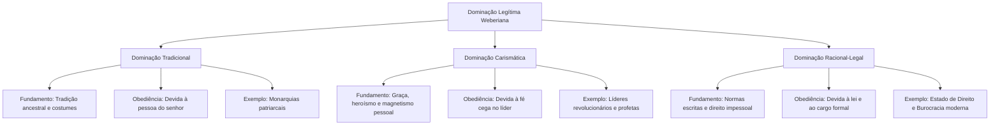
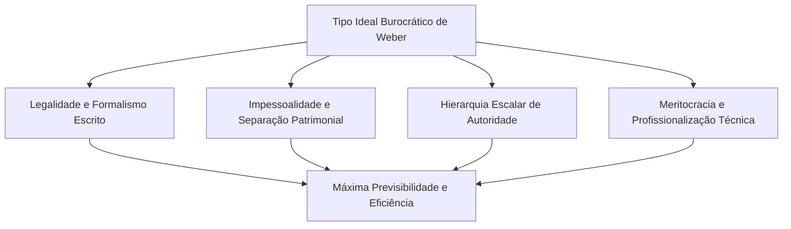
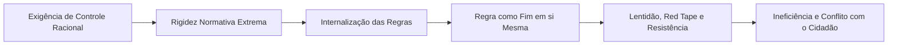
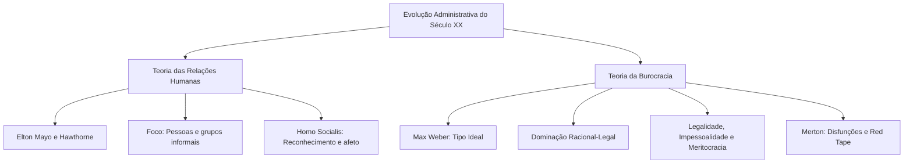

Após o predomínio da Abordagem Clássica, a ciência administrativa avançou com novas reflexões sobre a dinâmica das organizações. Duas correntes fundamentais redefiniram o estudo da gestão no segundo quarto do século XX. De um lado, a Teoria das Relações Humanas colocou as pessoas, os grupos sociais e as motivações psicológicas no centro da administração. De outro lado, a Teoria da Burocracia de Max Weber estruturou um modelo racional-legal baseado em normas escritas, impessoalidade e hierarquia funcional. Compreender o experimento de Hawthorne, as dimensões da autoridade legítima e a distinção entre as virtudes ideais da burocracia e suas disfunções práticas é decisivo para gabaritar questões em certames públicos civis e militares.

> [!objetivos]
> - Compreender a origem, as quatro fases e as conclusões da Experiência de Hawthorne de Elton Mayo.
> - Contrastar os pressupostos da Teoria Clássica com a visão humanística do *homo socialis*.
> - Diferenciar os três tipos puros de dominação legítima formulados por Max Weber.
> - Identificar as características essenciais do tipo ideal burocrático e suas vantagens organizacionais.
> - Distinguir as características ideais da burocracia das disfunções burocráticas identificadas por Merton.

## A virada humanística e a escola de Mayo

A corrente das relações humanas consolidou-se em território norte-americano ao longo dos anos 1930. Seu principal expoente foi o psicólogo australiano Elton Mayo, pesquisador da Universidade de Harvard. O movimento nasceu como uma reação direta e crítica ao mecanicismo da Abordagem Clássica de Taylor e Fayol.

Até então, o trabalhador era tratado como mero apêndice das máquinas industriais. A gerência acreditava que incentivos exclusivamente financeiros garantiam o rendimento ótimo. Essa visão mecanicista provocava desgaste emocional, conflitos sindicais e elevado absenteísmo fabril.

Com a Grande Depressão econômica de 1929, as empresas precisaram humanizar a gestão do trabalho. O desenvolvimento da psicologia industrial e da sociologia revelou que o ambiente social influenciava decisivamente a cooperação no trabalho. A Teoria das Relações Humanas transferiu a ênfase administrativa das tarefas e da estrutura para as **pessoas**.

### A Experiência de Hawthorne e suas fases

A base empírica da escola humanista foi a célebre Experiência de Hawthorne. O estudo ocorreu entre 1927 e 1932 na fábrica da Western Electric Company, no bairro de Hawthorne, em Chicago. A pesquisa foi coordenada por Elton Mayo e seus colaboradores para analisar a correlação entre condições físicas e produtividade operária.

A pesquisa desdobrou-se em quatro fases sucessivas:

1. **Fase dos estudos de iluminação (1927)**: dois grupos de operárias realizavam a mesma montagem de relés telefônicos. Um grupo trabalhou sob intensidade de luz constante; outro sob iluminação variável. Os pesquisadores notaram que a produção aumentava mesmo quando a luz diminuía. Concluiu-se pela existência de um **fator psicológico**: as operárias produziam mais quando se sentiam observadas e valorizadas pela gerência.
2. **Fase da sala de montagem de relés (1927-1928)**: um grupo de seis moças foi isolado em uma sala especial com observador amigável. Foram introduzidas alterações graduais: intervalos de descanso, lanches leves, redução da jornada e sábado livre. A produção subiu continuadamente. O motivo real não foram os descansos físicos, mas a criação de um ambiente social acolhedor, com supervisão branda e espírito comunitário de cooperação.
3. **Fase do programa de entrevistas (1928-1930)**: a gerência realizou entrevistas confidenciais com mais de vinte e um mil funcionários. O objetivo era conhecer suas atitudes, queixas e sentimentos pessoais sobre a empresa. O programa revelou a existência sólida de uma **organização informal**. Os operários mantinham lealdades internas e códigos grupais paralelos à estrutura oficial.
4. **Fase da sala de montagem de terminais (1931-1932)**: nove operadores e inspetores foram observados em uma sala com pagamento por produção do grupo. Notou-se que o próprio grupo operário estabeleceu uma cota diária de produção informal. Os operários que produziam acima da cota sofriam punições sociais dos colegas. O grupo protegia a própria estabilidade para evitar aumento de metas ou demissões pela diretoria.

O fluxograma abaixo esquematiza a progressão analítica das quatro fases de Hawthorne:

### Conclusões centrais da Escola das Relações Humanas

A pesquisa de Hawthorne gerou postulados que alteraram definitivamente a teoria gerencial:

- **O nível de produção decorre da integração social**: o rendimento do trabalhador não é ditado por sua capacidade biológica ou muscular. Ele resulta de sua aceitação e inserção social no grupo de trabalho.
- **Comportamento social dos empregados**: o indivíduo não age de forma isolada na fábrica. Ele responde como membro de um coletivo coeso, respeitando as normas sociais informais de seus pares.
- **Conceito de homo socialis**: os trabalhadores são motivados por necessidades psicológicas, anseios de reconhecimento e aprovação social. Incentivos monetários são secundários diante da busca por dignidade e convivência comunitária.
- **Existência de grupos informais**: a organização da empresa não se limita ao organograma oficial desenhado pela cúpula. Coexiste uma rede espontânea de amizades, simpatias e lealdades que regula a vida real do trabalho.
- **Importância do conteúdo das tarefas**: a extrema fragmentação e especialização empobrece o trabalho humano. Atividades com sentido e autonomia mantêm a motivação e elevam a moral da equipe.
- **Liderança e comunicação participativa**: chefias que dialogam e adotam postura cooperativa alcançam resultados sustentáveis muito superiores aos de chefias autoritárias.

> [!atencao] O conceito de homo socialis
> Guarde bem a oposição entre as concepções humanas nas provas. A Abordagem Clássica baseia-se no *homo economicus*, motivado estritamente por dinheiro e bônus materiais. A Teoria das Relações Humanas fundamenta-se no *homo socialis*, movido por recompensas simbólicas, status, amizade e pertencimento ao grupo.

A tabela compara os contrastes teóricos essenciais entre a Escola Clássica e a Escola Humanística:

| Dimensão | Teoria Clássica | Teoria das Relações Humanas |
| --- | --- | --- |
| Ponto focal | Tarefas fabris e estrutura formal | Pessoas e relacionamentos sociais |
| Metáfora da organização | Máquina mecânica precisa | Sistema social e grupo de pessoas |
| Concepção do ser humano | Homo economicus racional | Homo socialis comunitário |
| Base disciplinar | Engenharia e desenho mecânico | Psicologia industrial e sociologia |
| Linha de autoridade | Centralização e cadeia escalar | Delegação e liderança participativa |
| Tratamento da equipe | Indivíduos isolados na esteira | Membros integrados em grupos sociais |
| Sistema regulador | Normas escritas e regulamentos | Confiança interpessoal e dinâmica de grupo |
| Visão da informalidade | Desvio prejudicial a ser eliminado | Realidade viva e motor da cooperação |

> [!exemplo] Relações humanas e liderança em guarnições do CBMPE
> No âmbito de uma estação de bombeiros militares, o sucesso de uma missão de resgate em desabamento não decorre apenas da hierarquia formal. Ele depende da confiança recíproca forjada diariamente entre os integrantes da equipe. Uma liderança participativa do oficial comandante, atenta ao estado emocional e ao diálogo franco com os praças, consolida laços de coesão que garantem bravura e precisão nas ocorrências mais críticas.

### Críticas à Teoria das Relações Humanas

Apesar de suas contribuições fundamentais, a Escola de Relações Humanas recebeu severas críticas da sociologia organizacional:

- **Romantismo ingênuo e visão paternalista**: a corrente supunha ingenuamente que um trabalhador alegre e acolhido seria automaticamente produtivo, o que a prática desmentiu.
- **Foco exclusivo na organização informal**: ao privilegiar os laços afetivos, a teoria negligenciou os aspectos vitais da organização formal, como planejamento, fluxos financeiros e autoridade legítima.
- **Concepção manipuladora das relações humanas**: críticos apontaram que a criação de um clima amigável servia muitas vezes para mitigar reivindicações salariais legítimas e enfraquecer o movimento sindical operário.
- **Limitação experimental**: as investigações concentraram-se em ambientes fabris restritos, dificultando a generalização universal de suas conclusões para outros tipos de organizações.

## A Teoria da Burocracia de Max Weber

Diante do confronto entre a rigidez mecanicista da Escola Clássica e o romantismo da Escola Humanista, a teoria administrativa buscou um modelo racional, estável e abrangente. A resposta veio das obras do sociólogo e economista alemão Max Weber.

Weber formulou os princípios sociológicos da burocracia por volta de 1909. Contudo, suas ideias foram resgatadas e aplicadas à teoria geral da administração a partir da década de 1940. A burocracia representou um salto qualitativo para gerenciar organizações complexas, afastando o nepotismo, a corrupção e os privilégios pessoais da administração pública e privada.

### Conceito de poder, autoridade e dominação legítima

Para compreender a burocracia weberiana, é indispensável examinar a distinção entre poder e dominação:

- **Poder**: é a probabilidade de impor a própria vontade em uma relação social, mesmo diante de resistências dos subordinados. O poder pode apoiar-se na coerção física ou na ameaça direta.
- **Dominação (Autoridade legítima)**: é o exercício do poder acompanhado da aceitação voluntária por parte dos subordinados. Na dominação, os governados obedecem porque acreditam na legitimidade da ordem e do governante.

Weber identificou três tipos puros de dominação legítima:

1. **Dominação Tradicional**: fundamenta-se nos costumes sagrados, na transmissão hereditária e nas tradições consagradas pelo tempo. Os subordinados obedecem à pessoa do senhor por dever de lealdade patriarcal ou fidelidade pessoal. Exemplos clássicos incluem os clãs antigos, as monarquias absolutistas e o coronelismo rural. O poder é personalista e desprovido de normas técnicas universais.
2. **Dominação Carismática**: baseia-se na devoção extraordinária aos atributos heroicos, proféticos ou excepcionais de um líder individual. A autoridade repousa na fé cega e na identificação emocional dos seguidores. Trata-se de uma forma instável e revolucionária de poder, que não possui regras fixas nem continuidade institucional sem a presença do líder (ex.: chefes guerreiros, líderes messiânicos e revolucionários carismáticos).
3. **Dominação Racional-Legal (Burocrática)**: apoia-se na crença na legalidade de regulamentos estatutários formalmente editados e no direito dos ocupantes de cargos exercerem a chefia. Os subordinados obedecem ao império da **norma legal** abstrata e técnica. A deferência não se dirige à figura física do ocupante temporário do posto. Este é o fundamento dos Estados democráticos modernos, dos tribunais, das forças policiais e das empresas contemporâneas.

O esquema abaixo sintetiza a tipologia weberiana de autoridade legítima:

A tabela comparativa aprofunda as diferenças entre os três modelos de dominação:

| Critério | Dominação Tradicional | Dominação Carismática | Dominação Racional-Legal |
| --- | --- | --- | --- |
| Origem da legitimidade | Herança dos costumes antigos | Dons e virtudes do indivíduo | Normas jurídicas aprovadas |
| Vínculo de obediência | Lealdade pessoal ao senhor | Devoção emocional ao herói | Cumprimento impessoal da regra |
| Estrutura do quadro | Servos, parentes e favoritos | Discípulos e seguidores leais | Funcionários técnicos assalariados |
| Estabilidade no tempo | Elevada e conservadora | Instável e circunstancial | Elevada e perene pelas normas |
| Critério de escolha | Compadrio e laços familiares | Escolha intuitiva pelo líder | Concurso público e meritocracia |

> [!atencao] O poder reside no cargo e não na pessoa
> Na dominação racional-legal, a autoridade não pertence ao indivíduo. Ela pertence exclusivamente ao cargo que ele ocupa temporariamente. O militar ou servidor público dá ordens legítimas amparado nos regulamentos estatutários, e o cidadão ou subordinado obedece ao estatuto formal do Estado.

> [!bizu] As três bases da dominação legítima
> Guarde os fundamentos da obediência em Weber: no modelo tradicional, obedece-se aos costumes e à pessoa do senhor; no modelo carismático, obedece-se à devoção ao líder excepcional; no modelo racional-legal, obedece-se à lei e ao regulamento escrito.

## Características do tipo ideal de Burocracia

Para Max Weber, a burocracia constitui uma forma de organização humana tecnicamente superior a qualquer outra conhecida. Quando implantada de modo puro, a burocracia assegura o máximo de precisão, continuidade, velocidade e previsibilidade das rotinas administrativas. Trata-se de um modelo conceitual concebido para erradicar o patrimonialismo, onde os bens públicos eram apropriados como propriedade pessoal dos governantes.

As características estruturantes do tipo ideal de burocracia reúnem dez pilares fundamentais:

A tabela sintetiza as características fundamentais da burocracia weberiana:

| Característica essencial | Mecanismo operacional | Finalidade gerencial |
| --- | --- | --- |
| Caráter legal das normas | Estatutos e regras escritas prévias e exaustivas | Fixar competências claras e limitar a arbitrariedade. |
| Caráter formal das comunicações | Atos, decisões e relatórios registrados por escrito | Assegurar comprovação jurídica e memória documental. |
| Divisão racional do trabalho | Atividades fragmentadas em cargos especializados | Maximizar a competência técnica de cada função. |
| Impessoalidade nas relações | Direitos e deveres vinculados aos cargos oficiais | Tratar todos igualmente sem favoritismos individuais. |
| Hierarquia funcional | Cargos dispostos em pirâmide de comando | Garantir supervisão permanente do superior sobre o inferior. |
| Rotinas e procedimentos padronizados | Roteiros operacionais rígidos e invariáveis | Assegurar previsibilidade total no funcionamento. |
| Competência técnica e mérito | Seleção por provas e avaliações objetivas | Afastar o nepotismo e premiar o conhecimento real. |
| Especialização da administração | Separação entre patrimônio pessoal e público | Eliminar a apropriação privada dos recursos estatais. |
| Profissionalização dos agentes | Carreira estável com remuneração em dinheiro | Formar especialistas dedicados em tempo integral. |
| Previsibilidade completa | Execução idêntica de atos perante casos análogos | Oferecer segurança jurídica a cidadãos e clientes. |

O esquema a seguir ilustra a intersecção das características que sustentam a previsibilidade e a racionalidade da burocracia:

### Vantagens técnicas da burocracia ideal

Na concepção original de Weber, a burocracia pura proporciona vantagens inquestionáveis sobre outros formatos administrativos:

- **Racionalidade de meios e fins**: desenho de processos voltado exclusivamente para atingir metas com o menor custo de esforço.
- **Rapidez decisória em rotinas**: quando todos os passos estão regulamentados, as decisões são tomadas de pronto, sem hesitação ou debates repetitivos.
- **Univocidade de interpretação**: o regulamento escrito evita interpretações subjetivas ou contraditórias entre diferentes setores.
- **Constância e continuidade**: a substituição de um funcionário não interrompe o serviço público, pois o novo ocupante do cargo segue as mesmas instruções operacionais.
- **Redução de atritos interpessoais**: como cada agente conhece seus limites e atribuições exatas, minimizam-se disputas de competência entre departamentos.

## As disfunções da Burocracia segundo Robert Merton

Embora Max Weber tenha desenhado a burocracia como o ápice da racionalidade e da eficiência, a observação prática ao longo do século XX demonstrou que as burocracias reais costumam sofrer deformações graves. O sociólogo norte-americano Robert K. Merton dedicou-se a investigar as anomalias e consequências imprevistas que sabotam o modelo burocrático original.

Na terminologia sociológica, essas patologias organizacionais são denominadas **disfunções da burocracia**. Elas ocorrem porque a rigidez normativa transforma os instrumentos de controle em fins absolutos, gerando ineficiência, lentidão e insatisfação pública.

As principais disfunções burocráticas identificadas por Merton abrangem:

- **Apego extremo aos regulamentos e internalização das regras**: o funcionário passa a considerar a regra escrita como um valor absoluto. Ele se esquece de que as normas são apenas meios para atingir os objetivos da instituição. A regra vira o objetivo final do trabalho.
- **Excesso de formalismo e proliferação de papelada (*red tape*)**: criação exagerada de formulários, memorandos, pareceres prévios e assinaturas desnecessárias que travam a agilidade dos processos diários.
- **Resistência sistemática a mudanças**: servidores habituados à imutabilidade de suas rotinas sentem-se inseguros diante de inovações tecnológicas ou reestruturações institucionais, sabotando modernizações necessárias.
- **Despersonalização do relacionamento**: o foco desmedido na impessoalidade faz com que cidadãos e colegas sejam tratados como números de protocolo. A perda da empatia gera tratamento frio e hostil ao público.
- **Categorização das decisões**: decisões padronizadas pelo escalão superior sem conhecimento prático do problema concreto. O gestor aplica carimbos genéricos a situações que exigiriam análise individualizada.
- **Superconformidade e exibição de sinais de autoridade**: preocupação excessiva com símbolos exteriores de status hierárquico, como tamanho de mesas, vagas privativas e títulos honoríficos, distanciando a chefia da realidade operacional.
- **Dificuldade de atendimento e perda da visão do cliente/cidadão**: a burocracia fecha-se sobre si mesma (autorreferência). O servidor atende às exigências do regulamento interno e esquece de atender às necessidades reais do cidadão.

O diagrama abaixo visualiza o processo dialético pelo qual a busca de controle gera as disfunções burocráticas:

A tabela a seguir contrasta diretamente cada característica ideal concebida por Weber com a disfunção correspondente observada na prática por Merton:

| Característica ideal de Weber | Disfunção correspondente de Merton |
| --- | --- |
| Normas prévias e regulamentos formais | Apego cego à letra da lei e internalização das regras |
| Comunicação escrita e documentada | Excesso de papelório, carimbos e lentidão processual |
| Impessoalidade no tratamento | Despersonalização fria e falta de empatia com as pessoas |
| Hierarquia funcional rígida | Categorização e perda de iniciativa na base operacional |
| Rotinas e procedimentos padronizados | Resistência extrema a inovações e mudanças estruturais |
| Especialização da autoridade | Exibição vaidosa de símbolos de poder e privilégios |
| Foco em processos e previsibilidade | Perda da visão global e negligência aos anseios do cidadão |

> [!pegadinha] Características ideais versus disfunções da burocracia
> As bancas examinadoras tentam confundir os candidatos afirmando que o excesso de papel, a lentidão e a rigidez são características da burocracia weberiana. Isso é falso. As características ideais de Weber são positivas (legalidade, impessoalidade, meritocracia). Os problemas práticos, como a papelada e a lentidão, são as **disfunções da burocracia** descritas por Robert Merton.

> [!bizu] A inversão entre meios e fins de Merton
> O cerne das disfunções burocráticas reside na inversão entre meios e fins. Em um modelo doente, a norma legal, que deveria ser o meio para servir ao cidadão com justiça, converte-se no fim supremo do funcionário.

## Mapa do capítulo

O quadro estrutural a seguir reúne os pilares comparativos da Teoria das Relações Humanas e da Teoria da Burocracia, ressaltando suas matrizes conceituais:

### Para fixar
- A Teoria das Relações Humanas de Elton Mayo redirecionou a ênfase administrativa para as pessoas e os grupos informais.
- A experiência de Hawthorne revelou que o nível de produção é determinado pela integração social do empregado, e não por sua força física.
- O conceito de *homo socialis* preconiza que os indivíduos são motivados por aprovação, status e laços comunitários no ambiente de trabalho.
- A organização informal expressa redes de convivência e solidariedade espontâneas que coexistem com os organogramas oficiais.
- Max Weber estabeleceu a burocracia como um tipo ideal de organização formal fundado na autoridade racional-legal.
- Os três tipos de dominação de Weber correspondem à tradicional (costumes), carismática (devoção ao líder) e racional-legal (normas estatutárias).
- Na dominação racional-legal, a obediência é devida às leis e ao cargo público, e não à pessoa física do governante.
- O tipo ideal burocrático caracteriza-se por legalidade estrita, formalismo escrito, impessoalidade, hierarquia e meritocracia técnica.
- As disfunções da burocracia formuladas por Robert Merton representam anomalias práticas decorrentes da conversão de regras em fins absolutos.
- Entre as principais disfunções destacam-se a resistência à mudança, o excesso de papelada (*red tape*), a despersonalização e o apego cego às normas.
