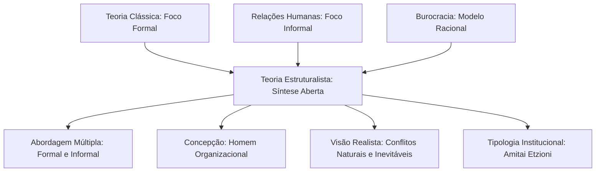
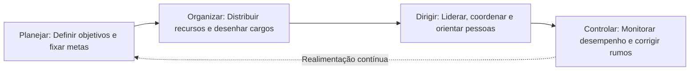
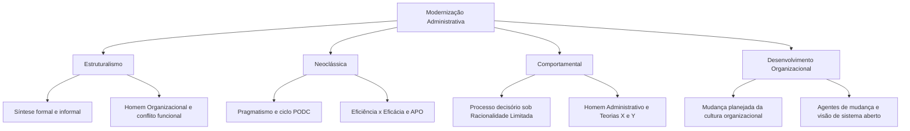

O pós-Segunda Guerra Mundial inaugurou uma fase de integração teórica na ciência da administração. Os modelos anteriores mostravam-se parciais quando analisados isoladamente. A Escola Clássica focava na estrutura formal; as Relações Humanas privilegiavam o grupo informal; a Burocracia prescrevia regras rígidas. Quatro correntes sucessivas buscaram superar essa fragmentação: a Teoria Estruturalista, que unificou as dimensões formal e informal; a Teoria Neoclássica, que resgatou os preceitos clássicos com pragmatismo e foco em resultados; a Teoria Comportamental, que dissecou o processo decisório sob racionalidade limitada; e o Desenvolvimento Organizacional, voltado para a mudança cultural planejada. Compreender essas abordagens recentes é crucial para concursos, nos quais as bancas exploram a tomada de decisão, o ciclo administrativo moderno e as dinâmicas de transformação corporativa.

> [!objetivos]
> - Analisar a síntese integradora da Teoria Estruturalista e o conceito de *homem organizacional*.
> - Diferenciar os princípios da Teoria Neoclássica, distinguindo eficiência de eficácia e delimitando o ciclo PODC.
> - Compreender a Teoria Comportamental de Herbert Simon e os fundamentos da racionalidade limitada no processo decisório.
> - Identificar os pressupostos das Teorias X e Y de McGregor e os objetivos do Desenvolvimento Organizacional (DO).

## Teoria Estruturalista: a síntese integradora da organização

A Teoria Estruturalista consolidou-se no fim da década de 1950. Seu propósito foi construir uma ponte interdisciplinar articulando o formalismo clássico e a dinâmica humanística, absorvendo também os ensinamentos da Burocracia weberiana. Os estruturalistas perceberam que a empresa moderna não é apenas uma máquina formal nem apenas uma confraria social. Ela reúne normas oficiais e laços afetivos em um sistema integrado e multifacetado.

Essa corrente inaugurou a visão de **sistema aberto** na administração. Os modelos clássico e burocrático tratavam a organização como um sistema fechado, voltado para dentro e imune ao meio exterior. O estruturalismo, por sua vez, reconheceu que as instituições sofrem pressões e incertezas do ambiente externo, necessitando de trocas constantes para sobreviver.

O diagrama a seguir exibe a fusão conceitual promovida pela abordagem estruturalista:



### A abordagem múltipla e o Homem Organizacional

O estruturalismo caracteriza-se pela chamada **abordagem múltipla**. Essa perspectiva ampla analisa a organização sob diversos ângulos simultâneos:

- **Organização formal e informal**: exame conjunto das normas estatutárias oficiais e das redes de amizade espontâneas.
- **Incentivos mistos**: reconhecimento de que os trabalhadores necessitam de remuneração salarial material somada a recompensas sociais e simbólicas de prestígio.
- **Diferentes níveis hierárquicos**: análise equilibrada do nível institucional (diretoria de cúpula), do nível gerencial (tático) e do nível operacional (técnico).
- **Diversidade organizacional**: ampliação dos estudos para além das fábricas tradicionais, englobando hospitais, escolas, órgãos públicos e corporações militares.
- **Análise intraorganizacional e interorganizacional**: consideração das dinâmicas internas e das relações da instituição com outras entidades do ambiente.

Para responder a essa complexidade, os estruturalistas formularam o conceito de **homem organizacional**. O homem econômico clássico buscava apenas salário; o homem social humanista buscava apenas aprovação dos colegas. O homem organizacional expressa a maturidade de quem atua simultaneamente em várias instituições modernas (família, trabalho, igreja, Estado).

O homem organizacional reúne quatro traços psicológicos indispensáveis:

1. **Flexibilidade**: capacidade de adaptar-se rapidamente a mudanças de papéis e cenários corporativos.
2. **Tolerância a frustrações**: estabilidade emocional para suportar conflitos institucionais entre necessidades pessoais e exigências da hierarquia.
3. **Capacidade de adiar recompensas**: disposição para abrir mão de ganhos imediatos em prol de benefícios maiores no futuro da carreira.
4. **Desejo permanente de realização**: busca por autoafirmação e crescimento dentro das normas da empresa.

### Conflito organizacional e a tipologia de Amitai Etzioni

Enquanto as teorias anteriores viam o conflito como uma falha gerencial ou desvio indesejado, o estruturalismo considera o **conflito como um fenômeno natural e inevitável**. Para os autores dessa escola, existem tensões estruturais perpétuas entre as aspirações individuais dos colaboradores e os objetivos de lucro e produtividade da organização. Se bem administrados, os conflitos atuam como motores de inovação, rompendo a estagnação e gerando mudanças positivas.

O sociólogo Amitai Etzioni formulou uma influente classificação das organizações. Seu critério baseia-se na forma de poder exercida pelos dirigentes e no tipo de obediência demonstrada pelos participantes:

- **Organizações Coercitivas**: utilizam a força física, a coerção ou a ameaça de punições como instrumento primário de controle. O vínculo dos membros é alienatório e hostil (ex.: penitenciárias e centros correcionais).
- **Organizações Utilitárias**: utilizam o controle material e a remuneração econômica como mecanismo central de poder. Os colaboradores cooperam por interesse financeiro calculista (ex.: empresas privadas, indústrias e bancos comerciais).
- **Organizações Normativas (ou Morais)**: utilizam valores éticos, símbolos morais, prestígio e crenças compartilhadas como alavanca de comando. A adesão dos membros é voluntária e alicerçada em forte convicção moral (ex.: igrejas, partidos e associações beneficentes).

## Teoria Neoclássica: pragmatismo e o ciclo administrativo

A Teoria Neoclássica consolidou-se em meados da década de 1950, liderada por autores consagrados como Peter Drucker, Harold Koontz e Ernest Dale. Ela representa a redenção e a atualização da Teoria Clássica de Fayol em um ambiente corporativo muito maior e mais dinâmico.

Seus traços fundamentais são:

- **Pragmatismo prático**: ênfase na aplicação instrumental da administração voltada para a ação imediata.
- **Reafirmação flexível dos postulados clássicos**: recuperação de conceitos como departamentalização, autoridade e hierarquia, adaptando-os à realidade moderna.
- **Ênfase nos objetivos e nos resultados**: a organização existe para atingir metas concretas, e não para cultuar procedimentos internos.
- **Ecletismo conceitual**: absorção flexível das contribuições humanísticas, estruturalistas e burocráticas.

### Eficiência versus Eficácia

Uma das distinções mais cobradas em concursos refere-se ao binômio eficiência e eficácia:

- **Eficiência**: relaciona-se com os **meios e custos**. Consiste em fazer as coisas da forma correta, otimizando o emprego dos recursos disponíveis e minimizando perdas. Possui foco estritamente interno.
- **Eficácia**: relaciona-se com os **fins e resultados**. Consiste em fazer a coisa certa, atingindo as metas fixadas e satisfazendo demandas externas, independentemente dos recursos mobilizados. Possui foco externo.

A tabela resume as diferenças conceituais entre eficiência e eficácia:

| Dimensão de análise | Eficiência | Eficácia |
| --- | --- | --- |
| Foco operacional | Meios, métodos e processos de trabalho | Fins, resultados e objetivos finais |
| Orientação espacial | Foco interno nas rotinas da organização | Foco externo na satisfação das demandas |
| Indicador central | Menor custo e aproveitamento de recursos | Alcance integral das metas estabelecidas |
| Pergunta gerencial | Como estamos executando a tarefa? | O objetivo pretendido foi alcançado? |

> [!pegadinha] Eficiência versus eficácia na abordagem neoclássica
> A organização pode ser extremamente eficiente e completamente ineficaz ao mesmo tempo. Imagine uma equipe de logística militar que organiza perfeitamente os estoques com custo mínimo, mas entrega suprimentos errados na linha de frente: o trabalho foi eficiente no método, mas ineficaz no alcance da missão. Guarde: eficiência é fazer certo a coisa; eficácia é fazer a coisa certa.

### Princípios da organização formal e o ciclo PODC

A Teoria Neoclássica destacou quatro princípios fundamentais da organização formal:

1. **Divisão do trabalho**: desdobramento de operações detalhadas para elevar o rendimento do quadro social.
2. **Especialização**: atribuição de tarefas e funções específicas para cada órgão e colaborador.
3. **Hierarquia**: ordenamento dos postos em níveis sucessivos de comando para garantir coordenação.
4. **Amplitude administrativa (de comando)**: quantidade de subordinados que um gestor consegue supervisionar com eficácia.

> [!atencao] Amplitude administrativa e a altura da estrutura organizacional
> Há uma relação geométrica inversa entre amplitude de controle e níveis hierárquicos. Quanto menor a amplitude administrativa (poucos subordinados por chefe), maior será o número de chefias intermediárias, tornando a estrutura organizacional verticalizada e alta (*tall structure*). Por outro lado, amplitudes amplas geram estruturas achatadas (*flat structure*), descentralizadas e horizontais.

Os neoclássicos reelaboraram a fórmula clássica PO3C de Fayol, sintetizando o processo administrativo no ciclo **PODC**, universalmente aceito na gestão contemporânea:



Peter Drucker introduziu ainda a **Administração por Objetivos (APO)** em 1954. A APO rompe com o modelo autoritário ao instituir a fixação compartilhada de metas entre superior e subordinado. O colaborador ganha ampla autonomia na escolha dos meios de execução, sendo avaliado periodicamente pelo alcance objetivo dos resultados acordados.

## Teoria Comportamental e o processo decisório

Iniciada com a publicação do livro de Herbert Simon em 1947, a Teoria Comportamental (ou Behaviorista) representou uma renovação conceitual. A escola abandonou os manuais normativos e prescritivos das teorias anteriores para adotar uma postura eminentemente **descritiva e explicativa**. O objetivo central não era prescrever regras artificiais, mas compreender cientificamente como as pessoas realmente se comportam e tomam decisões no trabalho.

Para a Teoria Comportamental, a organização é essencialmente um **amplo sistema de tomada de decisões**. Todos os colaboradores, do diretor ao operário, decidem a cada momento sobre cooperar, executar, inovar ou omitir-se. O processo decisório passa a ser o eixo motor da vida organizacional.

### Racionalidade limitada e o Homem Administrativo

A mais notável contribuição de Herbert Simon para a ciência da administração foi a formulação da teoria da **Racionalidade Limitada**. Simon refutou a premissa da economia clássica de que o gestor atua como um decisor plenamente racional que busca sempre a solução ideal e perfeita (otimização).

Na realidade prática, a tomada de decisão humana depara-se com três barreiras intransponíveis:

- **Acesso incompleto às informações**: o gestor nunca detém a totalidade dos dados sobre o ambiente e os concorrentes.
- **Escassez de tempo e recursos**: os prazos para decidir exigem escolhas céleres, impedindo o levantamento exaustivo de dados.
- **Capacidade cognitiva restrita**: a mente humana não consegue processar simultaneamente centenas de variáveis complexas e futuros incertos.

Por causa dessas limitações, o decisor opera como um **Homem Administrativo**. Ele não busca a alternativa ótima e perfeita; ele seleciona a alternativa **satisfatória**, isto é, aquela que atende satisfatoriamente às exigências mínimas fixadas para resolver o problema concreto.

O fluxograma ilustra o caminho da decisão sob racionalidade limitada:

```mermaid O processo decisório e a racionalidade limitada de Herbert Simon
flowchart TD
  PROB[Constatação do Problema] --> BUSC[Busca Limitada de Informações]
  BUSC --> ALT[Formulação de Cenários Possíveis]
  ALT --> AVAL[Avaliação Cognitiva sob Tempo Escasso]
  AVAL --> DEC{A solução satisfaz os padrões mínimos?}
  DEC -- Sim --> SATIS[Escolha da Solução Satisfatória: Homem Administrativo]
  DEC -- Não --> BUSC
```

> [!bizu] O homem administrativo e a decisão satisfatória de Simon
> Para as provas, decore a regra de Herbert Simon: o homem administrativo não otimiza; ele satisfaz. Diante da escassez de tempo e de informação, o decisor busca a primeira solução razoável que resolva o problema, sem perder tempo procurando a melhor solução imaginável do universo.

### Liderança e teorias de motivação

A corrente comportamental aprofundou as teorias sobre liderança e motivação humana. Douglas McGregor formulou as consagradas **Teorias X e Y**, demonstrando que o estilo de chefia depende das premissas que o gestor mantém sobre a natureza dos liderados:

- **Teoria X (visão mecanicista e negativa)**: assume que os colaboradores são inerentemente preguiçosos, avessos à responsabilidade e motivados apenas pelo salário e pelo medo de sanções. Sob essa crença, a liderança adota um controle rígido, fiscalização ostensiva e ordens autocráticas.
- **Teoria Y (visão orgânica e positiva)**: postula que o trabalho é uma fonte espontânea de satisfação criativa. Os indivíduos buscam assumir desafios, possuem autodireção e são capazes de inovar. Nesse caso, a chefia atua como facilitadora, descentralizando decisões e promovendo autonomia.

A tabela compara a evolução das quatro concepções do ser humano na teoria organizacional:

| Teoria de origem | Concepção humana | Motivação predominante | Padrão decisório |
| --- | --- | --- | --- |
| Escola Clássica | Homo economicus | Ganhos financeiros e bônus materiais | Cumprimento passivo de métodos rígidos |
| Relações Humanas | Homo socialis | Aprovação, consideração e amizade grupal | Conformismo às normas informais do grupo |
| Estruturalismo | Homem organizacional | Equilíbrio entre salário e prestígio social | Flexibilidade e tolerância a frustrações |
| Comportamental | Homem administrativo | Incentivos mistos e clima participativo | Decisão satisfatória sob racionalidade limitada |

> [!pegadinha] Abordagem prescritiva versus abordagem descritiva
> Não erre isso em certames. As Teorias Clássica, das Relações Humanas e da Burocracia possuem abordagem **prescritiva e normativa** (ditam receitas de como gerenciar). A Teoria Comportamental adota abordagem **descritiva e explicativa** (pesquisa, descreve e explica o comportamento humano factual nas organizações).

## Mudança e Desenvolvimento Organizacional (DO)

Como desdobramento direto da Teoria Comportamental com elementos sistêmicos, o Desenvolvimento Organizacional (DO) surgiu no fim dos anos 1960. O DO não se limita a consertar falhas técnicas. Ele constitui uma intervenção deliberada e planejada na **cultura e nos processos** da organização para aprimorar sua adaptabilidade diante de cenários dinâmicos.

Seus autores de destaque incluem Kurt Lewin (criador da dinâmica de grupo), Edgar Schein (estudioso da cultura corporativa) e Warren Bennis (especialista em liderança transformacional).

As variáveis estruturantes do DO concentram-se em quatro níveis:

- **Ambiente externo**: leitura constante de turbulências tecnológicas e sociais.
- **Organização**: renovação das estruturas de governança e comunicação.
- **Grupo social**: fortalecimento do trabalho em equipe e mediação cooperativa de conflitos.
- **Indivíduo**: desenvolvimento de competências comportamentais e inteligência emocional.

O principal objetivo do DO é transformar a **cultura organizacional**, isto é, o conjunto compartilhado de crenças, hábitos, valores e padrões não escritos que moldam a conduta dos membros. Para isso, o processo de intervenção apoia-se em pesquisas de clima, reuniões de diagnóstico com agentes de mudança externos ou internos, dinâmicas vivenciais e planos estruturados de transição.

> [!exemplo] Mudança organizacional e cultura em unidades operacionais do CBMPE
> Considere a transição de um quartel tradicional de bombeiros para um modelo de comando com despacho digital e viaturas integradas por GPS. A introdução de novos equipamentos não garante sucesso se a equipe resistir ao novo formato. Um programa de mudança organizacional atua na conscientização cultural do efetivo, realiza treinamentos conjuntos e valoriza o feedback dos operadores, garantindo a transição pacífica da cultura analógica para a excelência digital.

## Mapa do capítulo

O quadro estrutural a seguir sintetiza a progressão das quatro correntes estudadas, destacando as inovações introduzidas por cada vertente:



### Para fixar
- A Teoria Estruturalista promoveu a síntese entre a organização formal clássica e a organização informal humanística.
- O homem organizacional caracteriza-se por flexibilidade, tolerância a frustrações e capacidade de adiar recompensas imediatas.
- Amitai Etzioni classificou as organizações em coercitivas, utilitárias e normativas segundo o padrão de poder e obediência.
- A Teoria Neoclássica reafirmou os preceitos clássicos com foco pragmático nos objetivos e nos resultados.
- Eficiência foca nos meios e na economia de recursos internos; eficácia foca nos fins e no alcance de resultados externos.
- O ciclo administrativo neoclássico universal consolidou as funções de planejar, organizar, dirigir e controlar (PODC).
- A amplitude administrativa ampla resulta em estruturas achatadas; amplitudes reduzidas produzem estruturas verticais e altas.
- Herbert Simon postulou que a decisão humana opera sob racionalidade limitada, conduzindo o homem administrativo a soluções satisfatórias.
- Douglas McGregor contrastou a visão controladora da Teoria X com o modelo participativo e emancipatório da Teoria Y.
- O Desenvolvimento Organizacional (DO) promove a mudança planejada da cultura corporativa para garantir adaptação a ambientes dinâmicos.
