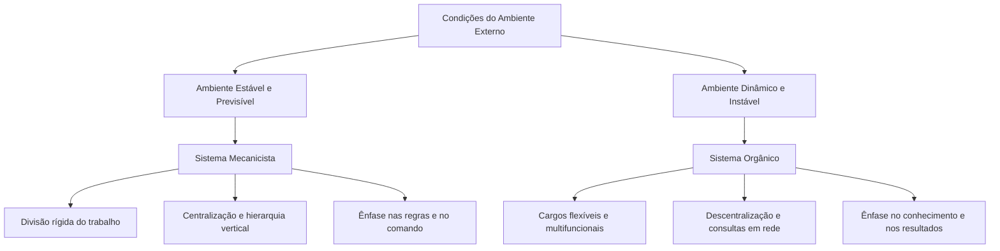
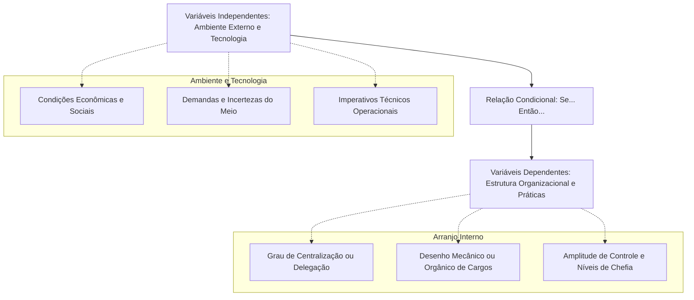
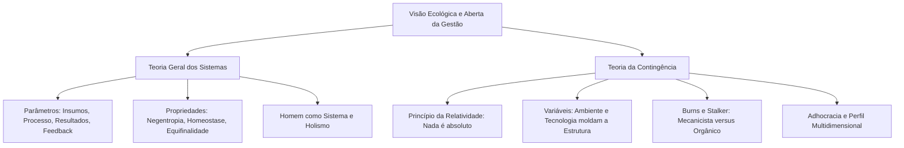

A evolução do pensamento administrativo alcançou seu ápice contemporâneo com a superação definitiva dos modelos fechados e prescritivos. Durante décadas, os teóricos buscaram uma fórmula única e universal para administrar ("the one best way"). Essa visão simplificadora foi superada por duas correntes ecológicas e abertas: a Teoria dos Sistemas e a Teoria da Contingência. A abordagem sistêmica ensinou que a organização é um organismo vivo em simbiose com o ambiente externo. Em seguida, a abordagem contingencial proclamou que não existem fórmulas absolutas, pois a estrutura ideal depende das condições tecnológicas e mercadológicas de cada conjuntura. O domínio desses conceitos é cobrado intensamente em certames públicos, exigindo do candidato capacidade de discernir parâmetros sistêmicos, modelos mecanicistas e orgânicos e a dinâmica das variáveis ambientais.

> [!objetivos]
> - Compreender a Teoria Geral dos Sistemas e os quatro parâmetros do sistema aberto.
> - Explicar os conceitos de entropia negativa, homeostase dinâmica, equifinalidade e sinergia.
> - Comparar detalhadamente a abordagem mecanicista e a abordagem orgânica de Burns e Stalker.
> - Dominar a lógica condicional da Teoria da Contingência e a distinção entre variáveis independentes e dependentes.
> - Identificar as contribuições de Woodward, Lawrence e Lorsch e o conceito de *homem complexo*.

## A Teoria Geral dos Sistemas e a visão aberta das organizações

A Teoria Geral dos Sistemas (TGS) nasceu das formulações do biólogo austríaco Ludwig von Bertalanffy a partir de 1950. A proposta visava romper com o reducionismo mecanicista da ciência clássica. Em vez de dissecar os componentes de modo isolado, a TGS priorizou as relações, as interdependências e as propriedades emergentes do conjunto.

Aplicada à administração, essa corrente derrubou o mito da organização como um circuito fechado e autossuficiente. A empresa passou a ser definida como um sistema sociotécnico aberto, que interage continuadamente com fornecedores, clientes, concorrentes e órgãos governamentais.

Um sistema constitui um conjunto de elementos dinamicamente inter-relacionados que operam em harmonia para atingir um objetivo comum. O funcionamento de qualquer sistema aberto estrutura-se em quatro parâmetros universais:

1. **Entradas (Inputs ou Insumos)**: importação contínua de recursos do ambiente externo para alimentar a operação institucional. Abrange matérias-primas, mão de obra, tecnologia, capital financeiro e informações.
2. **Processamento (Throughput ou Transformação)**: mecanismo interno de conversão. É o trabalho executado pelos colaboradores, maquinários e rotinas para transformar insumos brutos em produtos acabados ou serviços prestados.
3. **Saídas (Outputs ou Resultados)**: exportação dos resultados da transformação de volta para o ambiente externo. Engloba bens produzidos, serviços entregues, resíduos operacionais, relatórios financeiros e impacto social.
4. **Retroalimentação (Feedback ou Realimentação)**: mecanismo de retorno que mede as saídas e fornece dados reguladores. Permite comparar o resultado obtido com o padrão planejado, corrigindo entradas ou ajustando o processamento.

O fluxograma abaixo visualiza a dinâmica do ciclo operacional de um sistema aberto:

A tabela discrimina os quatro parâmetros sistêmicos e suas manifestações concretas nas organizações:

| Parâmetro sistêmico | Definição operacional | Exemplos concretos no setor público |
| --- | --- | --- |
| Entradas (*inputs*) | Captação externa de energia e recursos | Verbas orçamentárias, novos recrutas e viaturas |
| Processamento (*throughput*) | Rotina interna de transformação | Treinamento de combate, perícias e atendimento |
| Saídas (*outputs*) | Produtos e serviços exportados ao meio | Vidas salvas, incêndios extintos e perícias emitidas |
| Retroalimentação (*feedback*) | Retorno de dados para recalibração | Estatísticas de tempo de resposta e vistorias |

### Propriedades fundamentais dos sistemas abertos

As organizações sociais enquanto sistemas abertos possuem propriedades exclusivas que as diferenciam de máquinas inanimadas:

- **Ciclos repetitivos e importação de energia**: o sistema importa insumos, transforma-os em saídas e recebe recursos financeiros ou sociais que viabilizam uma nova importação. O ciclo garante a sobrevivência operacional contínua.
- **Entropia e Entropia Negativa (Negentropia)**: a entropia é a lei física universal que condena sistemas isolados ao desgaste, perda de energia e desintegração final. Para combater a decadência, os sistemas abertos realizam a **entropia negativa**. Eles importam do meio externo mais energia e informação do que consomem, restaurando sua vitalidade estrutural.
- **Homeostase dinâmica e estado firme**: capacidade de autorregulação que assegura o equilíbrio interno da organização. Mesmo diante de crises econômicas ou mudanças políticas no macroambiente, o sistema ajusta suas variáveis internas para manter-se operante.
- **Diferenciação**: propensão contínua à especialização funcional. À medida que a organização cresce, seus órgãos subdividem-se em departamentos cada vez mais especializados para responder a demandas específicas.
- **Equifinalidade**: princípio que estabelece que um sistema aberto pode alcançar o mesmo estado final de êxito partindo de condições iniciais distintas e percorrendo caminhos operacionais diferentes.
- **Limites e fronteiras**: barreiras conceituais que delimitam a área de atuação da organização frente ao ambiente externo. Em sistemas abertos, as fronteiras são altamente permeáveis, permitindo intercâmbio contínuo.
- **Holismo e Sinergia**: postulado de que o todo integrado é qualitativamente superior à simples soma aritmética de suas partes isoladas. Uma modificação em qualquer departamento repercute em toda a estrutura corporativa.

> [!atencao] Entropia versus negentropia na vida organizacional
> Memorize esta distinção para a prova. A **entropia** é o processo de degeneração, esgotamento e morte natural do sistema. A **entropia negativa (negentropia)** é a capacidade salvadora dos sistemas abertos de buscar recursos e informações no ambiente externo para revitalizar sua estrutura e manter-se vivo.

## Abordagem Mecanicista versus Abordagem Orgânica

Em 1961, os sociólogos Tom Burns e G. M. Stalker publicaram uma pesquisa seminal sobre indústrias britânicas. Eles investigaram como a volatilidade do ambiente externo e o ritmo das inovações tecnológicas impactavam a estrutura interna das empresas.

Os pesquisadores concluíram que as organizações adaptam seus modelos de governança conforme a estabilidade de seus mercados, classificando-as em dois polos funcionais:

- **Sistemas Mecanicistas**: adequados para ambientes externos estáveis, previsíveis e com baixo ritmo de inovação técnica. Inspiram-se no formalismo da Escola Clássica e na Burocracia weberiana.
- **Sistemas Orgânicos**: adequados para ambientes externos dinâmicos, turbulentos e submetidos a contínuas mutações tecnológicas. Fundamentam-se na flexibilidade, na autonomia e na Teoria das Relações Humanas.

A tabela comparativa confronta as características estruturais e comportamentais dos dois modelos:

| Dimensão de análise | Sistemas Mecanicistas | Sistemas Orgânicos |
| --- | --- | --- |
| Ambiente externo ideal | Estável, imutável e altamente previsível | Turbulento, instável e em constante mutação |
| Desenho dos cargos | Tarefas rigidamente especializadas e fixas | Funções flexíveis, dinâmicas e redefinidas |
| Local da tomada de decisão | Centralizada no topo da cadeia hierárquica | Descentralizada e delegada à base executora |
| Padrão de autoridade | Hierarquia formal e comando linear único | Autoridade situacional baseada no conhecimento |
| Fluxo de comunicações | Predominantemente vertical e descendente | Horizontal, lateral e em rede aberta de consulta |
| Amplitude administrativa | Estreita, com muitos níveis hierárquicos | Ampla, com poucos níveis e desenho achatado |
| Cultura e controle | Apego estrito a regulamentos escritos | Confiança mútua e compromisso com os fins |
| Configuração correlata | Burocracia clássica e linha de montagem | Adhocracia e equipes multidisciplinares |

O esquema abaixo resume o alinhamento entre o ambiente e o formato institucional:

Burns e Stalker alertaram que nenhum modelo é superior em abstrato. O sistema mecanicista atinge altos níveis de economia e previsibilidade em mercados calmos, mas fracassa em cenários inovadores. Por outro lado, o sistema orgânico oferece elasticidade e rapidez criativa em tempos de mudança, embora custe mais caro em termos de coordenação.

## A Teoria da Contingência e o princípio da relatividade

Consolidada a partir dos anos 1970, a Teoria da Contingência representa o patamar mais maduro e abrangente da teoria administrativa. Essa corrente rejeitou definitivamente a busca por preceitos universais de administração. Seu postulado basilar afirma com clareza: **nada é absoluto na administração; tudo é relativo**.

Uma contingência define-se como um evento cuja ocorrência é possível, mas incerta. Na gestão contingencial, a estrutura e as práticas de uma organização dependem estritamente de suas interações com as circunstâncias do cenário em que ela opera.

A lógica da teoria estrutura-se em uma relação funcional do tipo condicional: **"se... então..."**. Isto é: se determinadas contingências ambientais e tecnológicas manifestarem-se, então determinado modelo de organização revelará maior probabilidade de eficiência e sucesso.

O esquema a seguir discrimina a relação de causalidade entre as variáveis:

### Pesquisas seminais da Teoria da Contingência

A Teoria da Contingência consolidou-se pela confluência de pesquisas empíricas independentes:

- **Joan Woodward (1958)**: pesquisou indústrias e descobriu que a **tecnologia adotada** condiciona diretamente o desenho organizacional. A produção unitária (sob encomenda) e a produção por processo contínuo exigem modelos orgânicos e descentralizados. Já a produção em massa e seriada opera com sucesso sob desenhos mecanicistas e padronizados.
- **Alfred Chandler (1962)**: investigou grandes corporações norte-americanas e estabeleceu que **a estrutura organizacional subordina-se aos planos e rumos institucionais**. À medida que a empresa altera seus planos para conquistar novos mercados, sua anatomia interna precisa mudar para viabilizar as metas.
- **Paul Lawrence e Jay Lorsch (1967)**: criaram a teoria a partir do estudo das tensões entre **diferenciação e integração**. À medida que a empresa enfrenta ambientes heterogêneos e instáveis, ela subdivide-se em departamentos distintos para lidar com cada setor do mercado (diferenciação). Paralelamente, ela necessita de fortes mecanismos de coordenação e liderança para somar os esforços de todas as unidades na mesma direção (integração).

A tabela consolida os pesquisadores fundadores da escola contingencial:

| Pesquisador | Fator contingencial investigado | Conclusão essencial para a gestão |
| --- | --- | --- |
| Joan Woodward | Impacto da tecnologia de produção | A tecnologia utilizada determina a estrutura interna |
| Burns e Stalker | Incerteza e ritmo do ambiente externo | Ambientes estáveis pedem mecanicismo; instáveis pedem organicismo |
| Alfred Chandler | Evolução dos planos e mercados | A estrutura organizacional subordina-se aos rumos e planos da empresa |
| Lawrence e Lorsch | Demandas ambientais e complexidade | O sucesso exige dosagem harmônica de diferenciação e integração |

### A Adhocracia e a concepção humana multidimensional

Em oposição à burocracia rígida, os autores contingenciais desenvolveram o conceito de **Adhocracia** (termo popularizado por Alvin Toffler e Warren Bennis). A adhocracia representa um arranjo flexível e inovador, ideal para ambientes de altíssima incerteza e mutabilidade.

Suas características estruturantes reúnem:

- Composição por equipes temporárias, multidisciplinares e autônomas de trabalho.
- Autoridade amplamente descentralizada e delegada à competência dos especialistas.
- Ausência quase total de regulamentos fixos e papéis pré-determinados.
- Responsabilidades móveis que se reconfiguram conforme as necessidades de cada projeto.

No plano individual, a Teoria da Contingência consagrou o conceito de **homem complexo**. O homem não é mero ser econômico (Taylor), nem apenas animal social (Mayo), nem estritamente funcional (Weber). Ele é um sistema dinâmico e aberto em si mesmo. O indivíduo traz valores, percepções e carências que se transformam de acordo com as situações e fases de sua vida. O gestor moderno precisa modular seus estilos de liderança para motivar personalidades heterogêneas.

> [!pegadinha] Variáveis independentes versus dependentes
> Não confunda a relação causal nas provas de concurso. As **variáveis independentes** localizam-se fora do controle imediato da direção: são as contingências do **ambiente externo** e os imperativos da **tecnologia**. As **variáveis dependentes** são os elementos internos da organização (cargos, amplitude, hierarquia e organograma), que são ajustados para responder ao ambiente.

> [!bizu] O princípio da relatividade contingencial
> Guarde a frase mestra da Teoria da Contingência: não existe uma única e melhor maneira de administrar (*the one best way*). Na administração contingencial, tudo é relativo, tudo depende das condições do ambiente e da tecnologia.

> [!exemplo] Resposta orgânica do CBMPE em grandes desastres
> Na rotina do quartel, o Corpo de Bombeiros adota rotinas mecanicistas eficientes para escalas, vistorias prediais e manutenção preventiva. Contudo, diante de uma catástrofe climática imprevista com deslizamentos múltiplos, a corporação ativa imediatamente o Sistema de Comando de Incidentes. Nesse arranjo temporário e orgânico (adhocrático), a tomada de decisão é descentralizada para os comandantes de setor na encosta, adaptando as ações minuto a minuto às contingências do terreno.

## Mapa do capítulo

O quadro estrutural sintetiza a evolução integrada da Teoria dos Sistemas e da Teoria da Contingência:

### Para fixar
- A Teoria Geral dos Sistemas definiu a organização como um sistema aberto em constante interação com o meio externo.
- Os parâmetros fundamentais dos sistemas abertos compreendem entradas (*inputs*), processamento (*throughput*), saídas (*outputs*) e retroalimentação (*feedback*).
- A entropia negativa (negentropia) consiste na importação de energia e dados do meio para evitar a degeneração natural da instituição.
- A homeostase assegura o equilíbrio interno da organização, enquanto a equifinalidade permite atingir o mesmo objetivo por percursos alternativos.
- Burns e Stalker tipificaram os sistemas mecanicistas para contextos estáveis e os modelos orgânicos para ambientes dinâmicos e incertos.
- A Teoria da Contingência eliminou a busca pelo *one best way*, afirmando que nada é absoluto e tudo é relativo na gestão.
- Na lógica condicional contingencial ("se... então..."), o ambiente externo e a tecnologia atuam como variáveis independentes que moldam as estruturas internas.
- Joan Woodward demonstrou que a tecnologia condiciona a organização, e Chandler provou que a estrutura acompanha os rumos e planos da empresa.
- Lawrence e Lorsch identificaram que o sucesso organizacional depende do equilíbrio dinâmico entre diferenciação interna e integração funcional.
- O conceito de homem complexo reconhece que as motivações humanas são multifacetadas e variam conforme o contexto e a maturidade pessoal.
