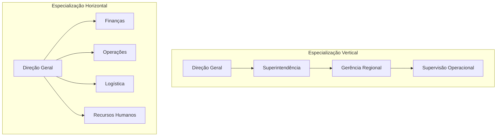

A função organização representa a segunda etapa fundamental do processo administrativo, convertendo os alvos fixados no planejamento em arranjos operacionais concretos. Enquanto planejar significa selecionar metas e formular caminhos futuros, organizar envolve distribuir atribuições, ordenar pessoas, alocar recursos e desenhar a arquitetura das relações funcionais. Em concursos públicos, as bancas examinam com rigor os múltiplos sentidos da palavra organização, os quatro sistemas que sustentam o desenho formal e as consequências práticas da especialização do trabalho. Dominar esses fundamentos estabelece o alicerce indispensável para analisar critérios de departamentalização, cadeias de comando e desenhos estruturais complexos que serão detalhados ao longo deste volume.

> [!objetivos]
> - Distinguir os três sentidos do vocábulo organização no contexto da teoria administrativa.
> - Identificar os quatro componentes essenciais e os três níveis de abrangência da função organizar.
> - Reconhecer os quatro sistemas constitutivos e os quatro condicionantes da estrutura organizacional formal.
> - Explicar os seis parâmetros fundamentais estabelecidos por Stephen Robbins para o projeto da estrutura corporativa.
> - Diferenciar a especialização vertical da horizontal, avaliando os ganhos produtivos e as deseconomias humanas.

## Sentidos do termo e componentes da função organização

No estudo da administração geral, a palavra **organização** assume três acepções distintas. A primeira acepção refere-se à **organização como entidade social** (ou instituição). Sob esse prisma, organização é o agrupamento de indivíduos que conjugam esforços, tecnologias e insumos materiais para atingir metas coletivas, a exemplo de uma corporação privada, de um hospital público ou de um corpo de bombeiros militar.

A segunda acepção define a **organização como função administrativa**. Aqui, o termo designa a atividade gerencial de dividir o trabalho, atribuir responsabilidades, modelar cargos e alocar recursos entre as diversas áreas da instituição. Trata-se da engrenagem que viabiliza o planejamento, criando as condições para que as ações ocorram de modo coordenado. Há ainda uma terceira acepção, de caráter operacional, que associa organização à ideia de **ordem material e arranjo físico** — a disposição metódica de cada recurso em seu espaço apropriado.

Segundo o magistério de Idalberto Chiavenato, a função administrativa de organizar desdobra-se em quatro componentes estruturantes:

1. **Tarefas**: são as frações operacionais resultantes da divisão do trabalho. A atividade ampla da corporação é decomposta em setores, funções e tarefas específicas executadas pelo colaborador.
2. **Pessoas**: representam os colaboradores designados para ocupar cargos formais, reunindo as competências técnicas exigidas pelo posto.
3. **Órgãos**: constituem os agrupamentos de tarefas e colaboradores em unidades formais, tais como departamentos, divisões, seções ou diretorias, estruturados segundo critérios hierárquicos e funcionais.
4. **Relações**: englobam os elos de interação existentes entre cargos e órgãos, abrangendo tanto a cooperação interna quanto o relacionamento com usuários e fornecedores externos.

A atuação da função organização manifesta-se nos três níveis da pirâmide institucional:

| Nível Organizacional | Foco Principal da Organização | Denominação Técnica | Alcance e Resultados Típicos |
| --- | --- | --- | --- |
| **Institucional (Estratégico)** | Abrangência global de toda a empresa | Desenho Organizacional | Criação da macroestrutura, definição do organograma geral e dos sistemas corporativos |
| **Intermediário (Tático)** | Foco em cada unidade ou setor | Desenho Departamental | Departamentalização, distribuição de competências setoriais e coordenação tática |
| **Operacional** | Foco nas tarefas, métodos e rotinas | Modelagem do Trabalho | Descrição de cargos, instruções normativas operacionais e arranjo de postos de trabalho |

> [!exemplo]
> No Corpo de Bombeiros Militar, o nível institucional define o desenho macroestrutural da corporação (Comando Geral e Diretorias Setoriais). No nível intermediário, os comandantes de batalhão organizam suas companhias e seções administrativas (departamentalização). Já no nível operacional, as equipes de socorro recebem atribuições detalhadas para a prontidão diária, especificando a função de cada militar na viatura de resgate.

## A estrutura organizacional formal: sistemas e condicionantes

A **estrutura organizacional formal** é o padrão oficial e deliberado de relações de autoridade, responsabilidades, linhas de subordinação e fluxos de comunicação instituído pela alta administração. Ela funciona como o esqueleto que sustenta o funcionamento cotidiano da instituição, permitindo que os colaboradores compreendam suas obrigações e identifiquem a quem prestar contas. A representação gráfica resumida desse arranjo formal dá-se por meio do **organograma**, diagrama técnico que evidencia os departamentos existentes, as relações escalares de hierarquia e as assessorias técnicas.

A doutrina ensina que a estrutura formal organiza-se ao redor de **quatro sistemas constitutivos**:

- **Sistema de autoridade**: estabelece o direito formal de comandar, emanar ordens, alocar recursos e exigir o cumprimento de metas ao longo dos níveis hierárquicos.
- **Sistema de responsabilidade**: traduz a obrigação funcional e o dever profissional contraído pelo subordinado de executar com zelo as tarefas atribuídas e prestar contas à chefia.
- **Sistema de decisão**: delimita as instâncias e competências formais para deliberar sobre alocação orçamentária, litígios operacionais e diretrizes técnicas.
- **Sistema de comunicação**: define a rede de canais oficiais pelos quais as informações, relatórios, ordens e orientações circulam nas direções vertical, horizontal e diagonal.

Essa arquitetura é moldada por quatro forças denominadas **fatores condicionantes da estrutura organizacional**:

1. **Fator humano**: as competências, aptidões, limitações psicológicas e comportamentos dos membros direcionam o formato estrutural viável.
2. **Fator objetivos, diretrizes e políticas**: a clássica máxima de Alfred Chandler preconiza que a estrutura segue o direcionamento corporativo; metas ousadas exigem estruturas flexíveis, enquanto propósitos de estrito controle requerem arranjos centralizados.
3. **Fator tecnologia**: os sistemas produtivos, as máquinas, os softwares e os métodos tecnológicos empregados determinam o desenho operacional e a divisão de rotinas.
4. **Fator ambiente externo**: a estabilidade ou turbulência do cenário social, político, legal e mercadológico exige arranjos mais rígidos ou adaptáveis.

Stephen Robbins sintetiza que a definição de uma estrutura formal assenta-se em **seis elementos básicos**:

| Elemento Estrutural | Pergunta Central que Responde | Significado Técnico |
| --- | --- | --- |
| **Especialização do Trabalho** | Em que grau as tarefas serão fracionadas? | Divisão do trabalho geral em etapas simples e isoladas executadas por especialistas |
| **Departamentalização** | Qual a base para agrupar as tarefas? | Critério de reunião de funções afins em unidades administrativas (funcional, produto, etc.) |
| **Cadeia de Comando** | A quem os indivíduos e grupos se reportam? | Linha contínua de autoridade escalar que conecta o ápice ao nível mais baixo da pirâmide |
| **Amplitude de Controle** | Quantas pessoas cada chefe comanda com eficácia? | Número de subordinados diretos sob a supervisão imediata de um único gestor |
| **Centralização e Descentralização** | Onde reside a autoridade para decidir? | Grau de concentração do poder decisório no topo ou sua dispersão na base |
| **Formalização** | Até que ponto haverá regras escritas? | Existência de regulamentos, manuais de rotina e normas padronizadas de trabalho |

> [!pegadinha]
> As bancas costumam listar o "sistema informal" como um dos componentes formais da estrutura corporativa. O sistema informal surge de maneira espontânea por meio das afinidades sociais entre os indivíduos, jamais integrando o quarteto formal (autoridade, responsabilidade, decisão e comunicação). Outra armadilha frequente é trocar os níveis da função organização: a modelagem de cargos situa-se no nível operacional, e não no nível tático.

## Especialização do trabalho: eficiência, limites e direções

A **especialização do trabalho** consiste em decompor uma atividade ampla em uma sucessão de operações menores e elementares, atribuindo cada etapa a um executor dedicado. Em vez de um artesão confeccionar individualmente um equipamento do início ao fim, múltiplos colaboradores tornam-se peritos em movimentos específicos do fluxo de montagem.

A especialização intensiva proporciona expressivos ganhos imediatos:

- **Redução do tempo de aprendizado**: ensinar uma tarefa curta e padronizada exige capacitações rápidas e de menor custo.
- **Aperfeiçoamento da destreza**: a repetição constante da mesma tarefa melhora a agilidade manual e mental do operador.
- **Economia de transição**: eliminam-se perdas decorrentes de trocar de ferramenta, mudar de posto ou reiniciar diferentes atividades.
- **Padronização da qualidade**: rotinas uniformes facilitam a supervisão e a substituição ágil de operadores ausentes.

Todavia, quando a especialização ultrapassa determinado ponto ótimo, surgem as chamadas **deseconomias humanas**. A repetição mecânica de movimentos desprovidos de significado global gera tédio extremo, alienação, fadiga física e estresse crônico. Os reflexos organizacionais dessas deseconomias são imediatos: aumento dos erros operacionais, elevação das taxas de absenteísmo, alta rotatividade de pessoal e queda na qualidade percebida pelo público.

Para contornar o desgaste da superespecialização, as instituições empregam a **rotação de cargos** (revezamento periódico de funções), o **alargamento horizontal de tarefas** (atribuição de atividades variadas de mesma complexidade) e o **enriquecimento vertical do cargo** (incorporação de responsabilidades de planejamento e controle pelo próprio executor).

Por fim, a especialização corporativa pode orientar-se em duas direções estruturais distintas:

- **Especialização vertical (diferenciação vertical)**: ocorre pelo desdobramento da autoridade em níveis hierárquicos. Dá-se quando a instituição cria novos escalões de chefia, ampliando os degraus de comando ao longo da cadeia escalar. Aumenta a supervisão formal, mas eleva os custos administrativos e alonga o caminho das comunicações.
- **Especialização horizontal (departamentalização)**: ocorre pelo desdobramento das atividades em unidades no mesmo patamar hierárquico. Verifica-se quando a corporação cria mais departamentos, gerências ou divisões para lidar com tarefas específicas sem acrescentar novos níveis de chefia acima deles.

> [!bizu]
> Guarde a orientação espacial para a prova:
> - **Vertical**: olha para cima e para baixo. Cria degraus hierárquicos e níveis de chefia (cadeia de comando).
> - **Horizontal**: olha para os lados. Cria departamentos e divisões no mesmo patamar (departamentalização).

## Mapa do capítulo

```mermaid Síntese da Função Organização e Estrutura Formal
flowchart TB
  FO[Função Organização] --> AC[Acepções do Termo]
  FO --> CB[Componentes Básicos]
  FO --> NO[Níveis de Abrangência]
  FO --> EF[Estrutura Formal]
  FO --> ET[Especialização do Trabalho]

  AC --> AC1[Entidade Social]
  AC --> AC2[Função Administrativa]
  AC --> AC3[Ordem Material]

  CB --> CB1[Tarefas e Pessoas]
  CB --> CB2[Órgãos e Relações]

  NO --> NO1[Estratégico: Desenho Organizacional]
  NO --> NO2[Tático: Desenho Departamental]
  NO --> NO3[Operacional: Modelagem do Trabalho]

  EF --> EF1[4 Sistemas: Autoridade, Responsabilidade, Decisão, Comunicação]
  EF --> EF2[4 Condicionantes: Humano, Diretrizes, Tecnologia, Ambiente]
  EF --> EF3[6 Parâmetros: Especialização, Departamentalização, Comando, Amplitude, Centralização, Formalização]

  ET --> ET1[Vantagens: Destreza, Rapidez, Padronização]
  ET --> ET2[Limite: Deseconomias Humanas - Tédio e Alienação]
  ET --> ET3[Direções: Vertical - Hierarquia / Horizontal - Departamentalização]
```

### Para fixar
- A palavra organização designa tanto a instituição social quanto a função administrativa de distribuir recursos e tarefas.
- A função organizar converte os rumos do planejamento em rotinas, cargos e departamentos operacionais.
- Os quatro componentes da organização são tarefas, pessoas, órgãos e relações (internas e com o ambiente externo).
- A abrangência da organização desdobra-se nos níveis estratégico (global), tático (departamental) e operacional (cargos e tarefas).
- A estrutura organizacional formal apoia-se em quatro sistemas: autoridade, responsabilidade, tomada de decisão e canais de comunicação.
- O sistema informal nasce de relações espontâneas de convivência, não integrando a estrutura formal.
- Os fatores condicionantes da estrutura compreendem o fator humano, os objetivos e diretrizes, a tecnologia e o ambiente externo.
- Stephen Robbins aponta seis parâmetros essenciais do desenho: fracionamento das tarefas, agrupamento departamental, hierarquia de comando, amplitude gerencial, grau de centralização decisória e regras formais de trabalho.
- O excesso de parcelamento do trabalho gera deseconomias humanas decorrentes do tédio e da alienação do operador.
- A especialização vertical cria novos níveis hierárquicos de chefia, enquanto a especialização horizontal realiza a departamentalização no mesmo degrau escalar.
