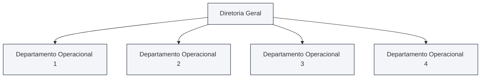
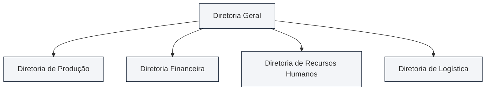
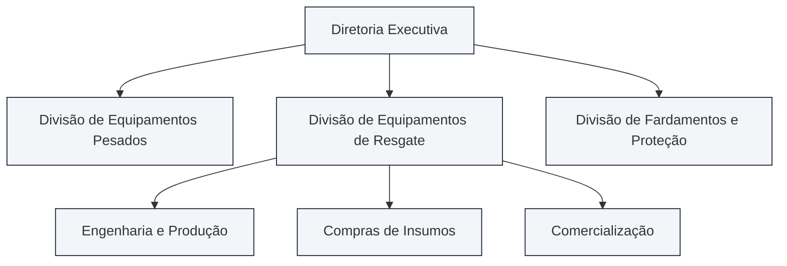
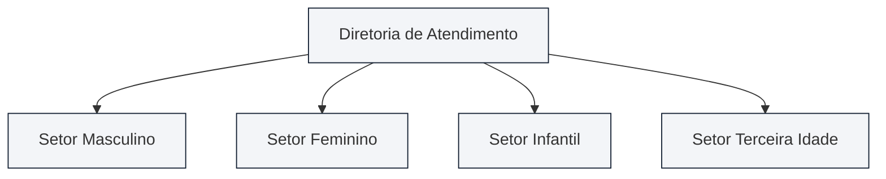

Após a divisão inicial do trabalho operada pela especialização, surge a necessidade indispensável de agrupar tarefas. Esse movimento de agregação horizontal é a departamentalização. Por meio dela, a instituição organiza funções, pessoas e recursos em setores coordenados. Em concursos públicos, especialmente para cargos de gestão e oficiais militares, os critérios tradicionais de departamentalização constituem tema de altíssima cobrança. As bancas avaliam o princípio da homogeneidade, o ambiente externo favorável a cada modelo e as vantagens de escala. Avaliam também os problemas de coordenação interna. Compreender essas distinções garante precisão e segurança na hora de responder às provas de concurso.

> [!objetivos]
> - Compreender o conceito de departamentalização e a aplicação prática do princípio da homogeneidade.
> - Analisar a departamentalização funcional, identificando sua tendência à introversão e seus ganhos de especialização.
> - Examinar a departamentalização por produtos ou serviços, compreendendo o foco no produto e a duplicação de custos.
> - Avaliar a departamentalização por clientes, distinguindo sua extroversão administrativa e seus riscos gerenciais.
> - Identificar a departamentalização por processos, relacionando o fluxo sequencial às vantagens tecnológicas e à rigidez operacional.

## Conceito de departamentalização e princípio da homogeneidade

A **departamentalização** consiste no agrupamento formal de tarefas afins, colaboradores e recursos em unidades administrativas especializadas. Essas unidades recebem nomes variados na prática corporativa, tais como departamentos, gerências, divisões, assessorias ou diretorias. Esse processo decorre diretamente da especialização horizontal. Ele ocorre quando a instituição cria órgãos laterais no mesmo escalão hierárquico. Dessa forma, a corporação absorve a expansão do volume de trabalho sem inflar os degraus de chefia vertical.

Conforme assevera Idalberto Chiavenato, o agrupamento departamental deve obedecer ao **princípio da homogeneidade**. Por esse princípio, as atividades e atribuições devem ser distribuídas conforme a afinidade de seu conteúdo técnico. A finalidade central consiste em maximizar o rendimento das rotinas com economia de insumos materiais e humanos. As atividades consideram-se similares quando demandam conhecimentos afins, métodos operacionais equivalentes, atendem ao mesmo público ou utilizam tecnologias análogas.

A escolha do critério departamental situa-se no nível intermediário (tático) da instituição. Ela deve refletir as diretrizes gerais estabelecidas pela alta direção corporativa. Organizações focadas em controle rigoroso de custos em mercados estáveis adotam o critério funcional. Por sua vez, corporações atuantes em mercados dinâmicos e competitivos preferem estruturas flexíveis voltadas a produtos ou perfis de clientes.

A literatura gerencial demonstra que o desenho departamental não é imutável. À medida que a organização cresce e o ambiente externo se torna mais complexo, a empresa costuma migrar de modelos puramente funcionais para estruturas divisionais ou focadas em projetos específicos. Essa flexibilidade garante sobrevivência e sustentabilidade institucional a longo prazo.

> [!exemplo]
> Uma corporação de segurança pública pode estruturar seus órgãos centrais segundo o critério funcional. Ela cria a Diretoria de Ensino, a Diretoria de Logística e a Diretoria de Recursos Humanos. Paralelamente, pode organizar suas unidades de resgate segundo o perfil das ocorrências. Cria, assim, grupamentos dedicados a salvamento aquático, combate a incêndio urbano e socorro pré-hospitalar.

## Departamentalização funcional: especialização e introversão

A **departamentalização funcional** é o modelo estrutural mais comum nas instituições públicas e corporações privadas. Nele, colaboradores e tarefas são agrupados com base nas funções empresariais clássicas ou na formação profissional dos envolvidos. Exemplos típicos desse arranjo são os departamentos de Finanças, Recursos Humanos, Produção, Compras, Assessoria Jurídica e Vendas.

Esse formato é indicado para empresas inseridas em **ambientes externos estáveis e previsíveis**. É ideal quando a organização executa rotinas padronizadas e duradouras, comercializando poucas linhas de produtos ou serviços. Quando o contexto externo muda pouco, a padronização interna gera grande estabilidade operacional e previsibilidade de custos.

A departamentalização funcional reúne expressivas **vantagens operacionais**:

- **Ganhos de economia de escala**: a reunião de todos os especialistas em uma unidade evita duplicações desnecessárias de máquinas, computadores e equipes de apoio.
- **Desenvolvimento da perícia técnica**: colaboradores da mesma área convivem diariamente no ambiente de trabalho. Isso favorece o aprendizado mútuo, a troca de experiências e o aperfeiçoamento contínuo das habilidades.
- **Concentração eficaz de competências**: facilita o treinamento setorial e simplifica a supervisão hierárquica, pois a chefia imediata domina com profundidade a especialidade técnica da equipe.
- **Estabilidade interna e segurança**: profissionais com formação afim compartilham percepções semelhantes e linguagens comuns, conferindo segurança e clareza às rotinas de trabalho.

Em contrapartida, o modelo funcional gera severas **desvantagens e limitações**:

- **Foco introvertido (introversão gerencial)**: a organização volta-se para si mesma. Preocupa-se mais com a estrutura interna e com o cumprimento estrito de rotinas do que com as mudanças do ambiente externo.
- **Conflito de interesses e proliferação de feudos**: cada setor foca exclusivamente em seus **objetivos funcionais**, esquecendo os propósitos gerais da corporação. Por exemplo, o setor financeiro busca cortar gastos a todo custo, enquanto a produção exige matérias-primas de alta qualidade.
- **Dificuldade de cooperação interdepartamental**: barreiras invisíveis de comunicação horizontal isolam as áreas técnicas. Isso exige que pequenos conflitos cotidianos subam até a cúpula diretiva para resolução.
- **Lentidão em ambientes dinâmicos**: a rigidez dos procedimentos burocráticos reduz a capacidade da empresa de responder com agilidade a inovações externas e demandas imprevistas.
- **Perda da visão sistêmica ampla**: a superespecialização limita o horizonte dos colaboradores, dificultando a formação de gestores generalistas capazes de compreender a empresa como um todo integrado.

> [!atencao]
> Em provas de concurso, a palavra-chave associada à departamentalização funcional é **introversão**. O modelo funcional é excelente para obter economia de escala em cenários estáveis. Contudo, ele apresenta dificuldades graves de articulação interdepartamental quando o mercado muda com rapidez.

## Departamentalização por produtos ou serviços: foco e custos de duplicação

Na **departamentalização por produtos (ou serviços)**, a estrutura corporativa organiza-se em torno das linhas de bens produzidos ou das famílias de serviços oferecidos. Todas as atividades indispensáveis ao ciclo de um produto ficam sob a liderança do mesmo gestor divisional. Isso abrange compras, produção, controle financeiro, marketing e atendimento pós-venda.

Ao contrário do modelo funcional, o agrupamento por produtos é contraindicado para ambientes estáveis com portfólio restrito. Ele é indicado para **ambientes dinâmicos e mutáveis**, com forte concorrência mercadológica e ampla diversidade de produtos. Esse formato gera unidades semiautônomas, capazes de agir com rapidez e versatilidade perante as oscilações do mercado consumidor.

Dentre as principais **vantagens** desse modelo, destacam-se:

- **Foco integral na linha de produto**: a equipe concentra toda a sua atenção no sucesso do item, propiciando elevado índice de inovação tecnológica e criatividade no desenvolvimento.
- **Responsabilização inequívoca por resultados**: cada divisão torna-se um centro de resultados e lucros. A alta cúpula identifica com clareza quais produtos geram retorno positivo e quais devem ser descontinuados do portfólio.
- **Flexibilidade e adaptabilidade departamental**: uma divisão pode crescer ou reduzir seu quadro conforme a aceitação do mercado, sem abalar a estabilidade dos demais setores da corporação.
- **Atendimento veloz às exigências dos clientes**: a autonomia interna permite modificar designs e prazos de entrega com agilidade superior à das estruturas funcionais engessadas.

Em contrapartida, as **desvantagens** são expressivas:

- **Duplicação dispendiosa de recursos e esforços**: cada divisão de produto mantém sua própria equipe de compras, contabilidade e analistas de suporte. Isso eleva significativamente os custos fixos da empresa.
- **Risco de obsolescência técnica**: especialistas de mesma formação ficam isolados em divisões distintas, perdendo a convivência técnica regular com seus pares corporativos.
- **Ansiedade e insegurança nos profissionais**: os empregados temem o desligamento ou a estagnação na carreira caso a linha de produtos sob a qual trabalham entre em declínio comercial prolongado.
- **Dificuldade na fixação de políticas gerais**: a proliferação de unidades autônomas enfraquece a padronização e o controle corporativo uniforme exercido pela matriz central.

> [!exemplo]
> Em uma indústria de transportes, a Divisão de Caminhões opera de maneira independente da Divisão de Ônibus. Cada divisão possui engenheiros próprios, compradores dedicados e equipe de vendas exclusiva. Esse formato permite lançar novos modelos com agilidade, embora multiplique os custos de infraestrutura administrativa.

> [!pegadinha] Coordenação interdepartamental versus intradepartamental
> Muitas questões de concurso trazem assertivas sobre a facilitação da coordenação na departamentalização por produtos. As bancas ora afirmam que ela facilita a coordenação **interdepartamental**, ora dizem que facilita a coordenação **intradepartamental**. Ambas as abordagens decorrem da perspectiva do autor:
> 1. Se a empresa cria **Divisões de Produtos** compostas por departamentos internos (Produção, Vendas e Compras), afirma-se que o modelo facilita a coordenação **interdepartamental** (entre os departamentos que cuidam daquele produto). Essa é a linha clássica mais cobrada em prova.
> 2. Se a empresa cria **Departamentos de Produtos** formados por áreas internas menores, outros autores afirmam que há facilitação da coordenação **intradepartamental** (dentro do departamento daquele produto).
> O cerne da questão é sempre o mesmo: o modelo por produtos favorece a integração harmônica entre as diversas especialidades dedicadas a viabilizar aquele bem específico.

## Departamentalização por clientes: extroversão e segmentação

A **departamentalização por clientes (ou clientela)** ocorre quando o critério primário de agrupamento baseia-se no perfil, nos hábitos e nas necessidades singulares dos usuários aos quais o trabalho se destina. Em vez de perguntar o que a corporação produz internamente, a gestão pergunta **para quem** o serviço é prestado.

Trata-se de um modelo orientado pela **extroversão administrativa**: a corporação ajusta seus processos e linguagem às expectativas dos públicos externos atendidos. Exemplos comuns incluem lojas de confecção divididas em departamentos masculino, feminino e infantil. Outro exemplo são agências bancárias divididas em atendimento a pessoas físicas, microempresas e grandes corporações multinacionais. No âmbito estatal, manifesta-se em secretarias públicas dedicadas a grupos vulneráveis, crianças e idosos.

Principais **vantagens** da departamentalização por clientes:

- **Conhecimento profundo das demandas do usuário**: o departamento especializa-se nos hábitos, comportamentos de compra e exigências peculiares de cada nicho de público atendido.
- **Atendimento personalizado e ágil**: facilita a comunicação direta com o usuário, gerando sensação de valorização e rápida resolução de demandas operacionais.
- **Fidelização e satisfação contínua**: reforça a cultura interna voltada ao contentamento do cliente ou do cidadão atendido pelo serviço prestado.
- **Flexibilidade comercial**: permite ajustar preços, canais de distribuição e campanhas promocionais de acordo com o perfil financeiro de cada grupo.

Principais **desvantagens** e riscos gerenciais:

- **Sacrifício dos objetivos institucionais amplos**: para agradar determinados clientes exigentes, gestores podem abrir mão de metas corporativas de produtividade e de contenção orçamentária.
- **Secundarização de outras atividades essenciais**: atividades técnicas de suporte interno passam a ser vistas como meramente acessórias ou incômodas pelos setores de atendimento.
- **Dependência excessiva do comportamento do consumidor**: oscilações repentinas nos hábitos e na renda do segmento de clientes desestabilizam o funcionamento da unidade departamental.
- **Disputas internas por privilégios corporativos**: os gerentes de cada carteira passam a reivindicar tratamentos orçamentários especiais e prioridade nas entregas, gerando atritos internos na corporação.

> [!bizu]
> - **Funcional**: introversão (olha para dentro, focando na tarefa e na especialidade técnica).
> - **Clientes**: extroversão (olha para fora, focando no usuário e no atendimento customizado).

## Departamentalização por processos: sequência tecnológica e arranjo físico

A **departamentalização por processo (ou por fase do processo)** estrutura as unidades corporativas em conformidade com o encadeamento sequencial e tecnológico do fluxo de operações. As tarefas são agrupadas segundo as etapas ordenadas pelas quais a matéria-prima ou o serviço deve passar até sua finalização completa.

Essa modalidade vincula-se de modo inseparável à tecnologia adotada e ao **arranjo físico dos equipamentos (layout)** nas instalações de trabalho. É empregada quase exclusivamente nos **níveis operacionais** de indústrias manufatureiras e serviços de triagem padronizada. Exemplos clássicos incluem corte de chapas, soldagem, pintura térmica, montagem elétrica e revisão final em uma fábrica de viaturas automotivas.

Diferentemente de uma diretoria funcional tradicional, o processo produtivo constitui uma cadeia horizontal contínua de atividades repetitivas. Cada setor é responsável por um elo intermediário, atuando simultaneamente como cliente interno da fase anterior e fornecedor interno da etapa seguinte.

Principais **vantagens** do modelo por processos:

- **Otimização do arranjo físico e tecnológico**: máxima rentabilidade na utilização de maquinários caros e instalações especializadas, eliminando deslocamentos desnecessários de materiais ao longo da fábrica.
- **Economia de escala operacional**: especialização profunda dos operadores em técnicas específicas de maquinário industrial de alta precisão e automação.
- **Fluxo contínuo e integrado**: interligação imediata entre fases produtivas sucessivas, elevando os índices de produtividade por hora trabalhada.
- **Melhoria da qualidade do produto**: o controle de qualidade é exercido passo a passo, identificando falhas na origem antes do avanço para a etapa posterior.

Principais **desvantagens** e vulnerabilidades:

- **Inflexibilidade absoluta**: os processos são inteiramente dependentes da tecnologia instalada; qualquer alteração no produto fabricado exige mudanças caras no maquinário e no layout físico da planta fabril.
- **Elevadíssimo risco operacional sistêmico**: como as fases são rigidamente encadeadas em sequência, uma falha mecânica em uma única etapa intermediária interrompe imediatamente toda a linha de produção subsequente.
- **Perda da visão sistêmica global**: o operador da etapa de pintura torna-se hiperespecializado em sua operação, ignorando o funcionamento geral da empresa e as demandas finais do consumidor.
- **Exigência de produtos estáveis e permanentes**: o alto custo de implantação da linha de montagem torna o modelo inviável para produtos de ciclo de vida curto ou sujeitos a modismos rápidos.

> [!atencao] Risco operacional em cadeia
> Na departamentalização por processos, a interdependência sequencial cria forte vulnerabilidade sistêmica. Se uma máquina quebra na fase de soldagem, a pintura e a montagem subsequentes ficam imediatamente paralisadas por falta de peças semiacabadas.

## Síntese comparativa dos critérios de departamentalização

A tabela a seguir consolida as características essenciais, a orientação gerencial, os pontos fortes e as fragilidades dos quatro critérios clássicos de departamentalização estudados, ferramenta indispensável para rápida revisão prévia de prova:

| Critério Departamental | Foco Agrupador | Orientação Básica | Principal Ponto Forte | Principal Limitação |
| --- | --- | --- | --- | --- |
| **Funcional** | Funções técnicas e profissionais afins | Introversão (processos internos) | Economia de escala e especialização técnica | Feudos setoriais e fraca cooperação interdepartamental |
| **Por Produtos** | Linhas de mercadorias ou serviços | Extroversão de produto | Foco inovador e responsabilização contábil | Duplicação cara de recursos e de infraestrutura |
| **Por Clientes** | Nichos e perfis de consumidores | Extroversão mercadológica | Customização extrema e satisfação do usuário | Sacrifício de metas de custo e de controle global |
| **Por Processos** | Etapas sequenciais da tecnologia | Sequencial tecnológica | Otimização do layout físico e produtividade fabril | Inflexibilidade tecnológica e alto risco operacional |

Adicionalmente, os fatores ambientais e organizacionais que orientam a escolha do administrador podem ser confrontados no quadro a seguir:

| Critério Departamental | Ambiente Externo Adequado | Tipo de Produto ou Serviço | Nível Organizacional Mais Frequente |
| --- | --- | --- | --- |
| **Funcional** | Estável e previsível | Poucas linhas, itens padronizados e duradouros | Presente em todos os níveis, comum no tático |
| **Por Produtos** | Dinâmico, mutável e competitivo | Amplo portfólio, frequente inovação e ciclo curto | Nível tático e intermediário |
| **Por Clientes** | Diversificado e segmentado | Mercadorias ou serviços ajustados a perfis distintos | Nível operacional e tático comercial |
| **Por Processos** | Estável e de consumo massivo | Produtos homogêneos fabricados em série contínua | Quase restrito ao nível operacional |

## Mapa do capítulo

```mermaid Síntese dos 4 Critérios Tradicionais de Departamentalização
flowchart TB
  DEP[Critérios Tradicionais de Departamentalização] --> FUNC[Funcional]
  DEP --> PROD[Por Produtos ou Serviços]
  DEP --> CLI[Por Clientes]
  DEP --> PROC[Por Processos]

  FUNC --> F1[Base: Funções da empresa e especialidades técnicas]
  FUNC --> F2[Ambiente: Estável e previsível]
  FUNC --> F3[Ponto alto: Economia de escala e perícia técnica]
  FUNC --> F4[Ponto fraco: Introversão e barreiras interdepartamentais]

  PROD --> P1[Base: Linhas de bens ou serviços específicos]
  PROD --> P2[Ambiente: Dinâmico e mutável]
  PROD --> P3[Ponto alto: Flexibilidade e foco em resultados]
  PROD --> P4[Ponto fraco: Duplicação dispendiosa de estruturas]

  CLI --> C1[Base: Perfil e necessidades do usuário externo]
  CLI --> C2[Ambiente: Mercados com públicos diversificados]
  CLI --> C3[Ponto alto: Extroversão e customização no atendimento]
  CLI --> C4[Ponto fraco: Sacrifício de metas corporativas globais]

  PROC --> PR1[Base: Fases tecnológicas do fluxo produtivo]
  PROC --> PR2[Ambiente: Manufatura estável e seriada]
  PROC --> PR3[Ponto alto: Produtividade do maquinário e layout otimizado]
  PROC --> PR4[Ponto fraco: Inflexibilidade e alto risco operacional]
```

### Para fixar
- A departamentalização realiza a especialização horizontal reunindo tarefas homogêneas em unidades administrativas.
- O princípio da homogeneidade estabelece que funções com métodos, matérias ou metas afins devem ser alocadas no mesmo órgão.
- A departamentalização funcional agrupa tarefas segundo as funções empresariais clássicas, sendo recomendada para ambientes estáveis.
- A principal vantagem da modalidade funcional é a economia de escala; sua principal fraqueza é a visão introvertida e paroquial.
- A departamentalização por produtos volta-se para resultados específicos, sendo indicada para ambientes mutáveis e inovadores.
- A desvantagem central do agrupamento por produtos é o aumento de despesas operacionais provocado pela duplicação de equipes.
- A departamentalização por produtos facilita a coordenação entre os diferentes setores dedicados àquele produto específico.
- A departamentalização por clientes apoia-se na extroversão administrativa, priorizando a customização do atendimento ao público-alvo.
- O risco central da estrutura por clientes é secundarizar os demais objetivos da corporação, como controle e produtividade.
- A departamentalização por processos orienta-se pela cadeia tecnológica e arranjo físico fabril, apresentando acentuada rigidez perante mudanças.
