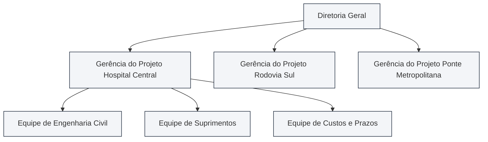
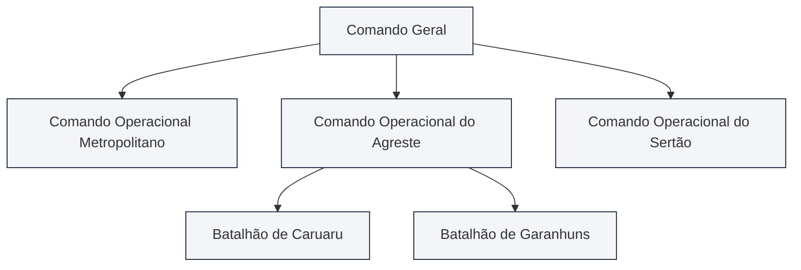
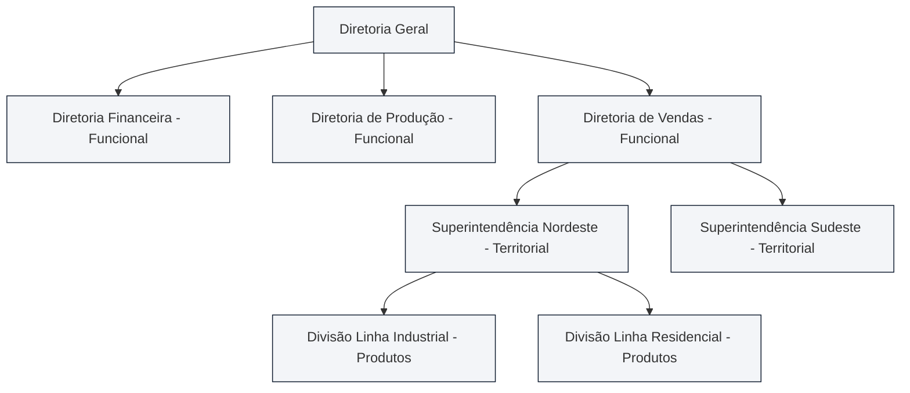
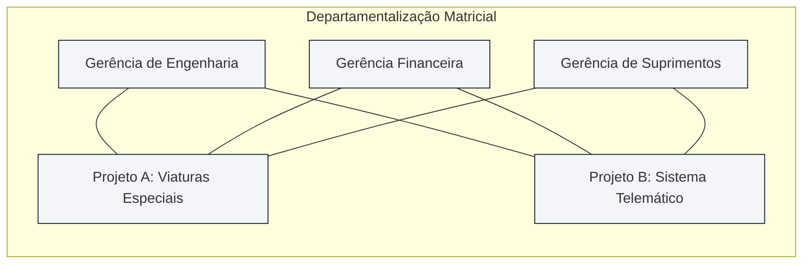

Além dos formatos tradicionais funcionais e setoriais, a dinâmica competitiva contemporânea impulsionou o surgimento de critérios departamentais mais flexíveis e descentralizados. Quando as organizações enfrentam dispersão geográfica, demandas temporárias de grande porte ou a necessidade de conjugar especialização técnica com entregas rápidas, os modelos convencionais mostram-se insuficientes. Nesse cenário, destacam-se a departamentalização por projetos, a departamentalização territorial, as estruturas híbridas e a inovadora departamentalização matricial. Em provas de concurso público, as bancas cobram com frequência a ruptura da unidade de comando na matriz, os custos de duplicação regional e a temporalidade das equipes de projetos.

> [!objetivos]
> - Compreender a natureza dos projetos e as vantagens da departamentalização por projetos para soluções de grande porte.
> - Analisar a departamentalização territorial, avaliando a autonomia regional e os custos de dispersão física.
> - Identificar a departamentalização híbrida ou mista como arranjo prevalente nas instituições multifacetadas.
> - Explicar o funcionamento da departamentalização matricial e a decorrente quebra da unidade de comando clássica.
> - Diferenciar os impactos da autoridade dual na rotina dos colaboradores e no processo decisório da corporação.

## Departamentalização por projetos: foco em resultados temporários

A **departamentalização por projetos** apoia-se no conceito técnico de projeto. Para Djalma Oliveira e Idalberto Chiavenato, um projeto constitui um empreendimento temporário, com datas de início e término previamente fixadas, destinado a criar um produto, serviço ou resultado singular dentro de limites estabelecidos de custos, prazos e recursos. Diferencia-se das rotinas operacionais contínuas porque ocorre apenas uma vez.

Nesse modelo estrutural, as atividades e os recursos corporativos são agrupados em função das saídas (*outputs*) esperadas de cada empreendimento. As pessoas recebem designações temporárias para compor equipes multidisciplinares exclusivas sob o comando unificado de um gerente de projeto. Concluído o projeto e entregue a obra ou produto, a equipe é desfeita. Seus membros são então transferidos para novos projetos ou retornam aos seus órgãos funcionais de origem.

É o critério recomendado para **produtos ou serviços de grande porte e alta sofisticação técnica**, que exigem a convergência intensiva de competências distintas. Exemplos expressivos abrangem a indústria da construção civil pesada (edifícios, pontes, rodovias), os estaleiros navais, o desenvolvimento aeroespacial e a concepção de softwares sob encomenda.

Dentre as principais **vantagens** desse modelo, destacam-se:

- **Convergência total de esforços**: canaliza talentos com diferentes habilidades técnicas diretamente para a consecução de uma entrega concreta e singular.
- **Maior senso de responsabilidade coletiva**: os membros da equipe multidisciplinar compartilham o sucesso ou o fracasso global da obra, superando visões departamentais estreitas.
- **Rigor no cumprimento de prazos e orçamentos**: o gerente de projeto detém autoridade direta para cobrar cronogramas físicos e limites financeiros pactuados com o cliente.
- **Flexibilidade e adaptabilidade contínua**: permite adotar novas tecnologias e modificar rotinas operacionais no decorrer da execução sem burocracias corporativas engessadas.

Em contrapartida, as **desvantagens** são relevantes:

- **Temporalidade e desmobilização**: quando o projeto chega ao fim, a equipe é dissolvida. Se a corporação não conquistar novos contratos no mercado, maquinários caros tornam-se ociosos e surgem despesas com desligamentos.
- **Insegurança e medo de desemprego**: os colaboradores vivenciam ansiedade permanente quanto ao seu futuro profissional após o término da fase contratual.
- **Foco restrito ao projeto com sacrifício do conjunto**: a dedicação fanática ao projeto faz com que a equipe se esqueça das diretrizes amplas da instituição, respondendo unicamente às exigências do cliente contratante.
- **Dificuldade na gestão de grandes contingentes**: à medida que a equipe do projeto cresce, a comunicação interna degrada-se e a flexibilidade gerencial inicial perde força.

> [!exemplo]
> Em uma corporação de bombeiros militares, a construção de um centro de treinamento operacional pode ser estruturada como um projeto. Um oficial comandante de projeto assume a liderança, reunindo arquitetos, engenheiros, especialistas em resgate e gestores de compras. Concluída e inaugurada a pista de treinamento, a equipe desmobiliza-se e cada militar retorna às suas unidades operacionais regulares.

## Departamentalização territorial ou geográfica: dispersão e adaptação local

A **departamentalização territorial (ou geográfica)** organiza as unidades administrativas conforme a localização territorial onde o trabalho é executado ou segundo a área geográfica atendida pela instituição. Todas as atividades realizadas em determinada circunscrição física são agrupadas sob o comando de um líder regional, que opera a unidade com ampla autonomia, como se fosse uma filial independente.

Esse modelo é utilizado por corporações territorialmente dispersas, tais como redes bancárias nacionais, empresas multinacionais, redes varejistas e órgãos públicos prestadores de serviços de segurança e saúde. O ponto de partida é o reconhecimento de que a proximidade física é indispensável para responder às especificidades de cada localidade.

Principais **vantagens** da departamentalização territorial:

- **Abrangência panorâmica da chefia regional**: o administrador territorial preocupa-se com o sucesso e a estabilidade da região como um todo, desenvolvendo uma visão muito mais ampla do que um chefe funcional setorial.
- **Adaptação às particularidades culturais e econômicas**: confere agilidade para sintonizar a atuação corporativa com as preferências, leis municipais, clima e costumes de cada mercado.
- **Rapidez no atendimento e descentralização física**: a proximidade física com os usuários permite despachar socorros ou mercadorias com extrema agilidade, reduzindo custos de transporte.
- **Melhoria no processo decisório regional**: quem decide está no terreno, conhecendo de perto as lideranças comunitárias e os gargalos reais da operação.

Principais **desvantagens** e custos associados:

- **Duplicação onerosa de estruturas e instalações**: cada superintendência regional mantém seus próprios departamentos de apoio (finanças, compras, recursos humanos), gerando despesas redundantes.
- **Dificuldade de controle institucional pela matriz**: a distância física e a autonomia concedida aos gestores locais dificultam a fiscalização centralizada pelo nível de topo da instituição.
- **Desequilíbrio no processo gerencial**: a liderança regional costuma priorizar as áreas de atendimento e produção, deixando os sistemas de controle e auditoria em segundo plano.
- **Disputas de poder inter-regionais**: diretorias que cobrem áreas de maior densidade populacional passam a concentrar maior poder político e orçamentário, prejudicando regiões periféricas.

> [!atencao]
> A departamentalização territorial destaca-se pela **extroversão regional**: o gestor adapta-se às peculiaridades do terreno. Contudo, essa autonomia local cobra um preço elevado em duplicação de instalações e perda de alinhamento uniforme com a sede da instituição.

## Departamentalização híbrida ou mista: a realidade das grandes organizações

Na prática concreta da administração moderna, dificilmente encontra-se uma grande organização estruturada com base em um único critério puro e isolado de departamentalização. A multiplicidade das operações impõe a adoção da **departamentalização híbrida (ou mista)**, modelo no qual a instituição adota mais de um critério departamental para desenhar a sua arquitetura formal.

A hibridização permite combinar diferentes critérios em múltiplos patamares da pirâmide hierárquica, aproveitando os pontos fortes de cada um onde eles se mostram mais convenientes:

1. **No topo da corporação (nível institucional)**: adota-se comumente a departamentalização funcional, garantindo o controle centralizado de Finanças, Jurídico e Planejamento.
2. **No nível intermediário (nível tático)**: utiliza-se a divisão territorial para distribuir superintendências regionais, ou a divisão por produtos para gerenciar grandes linhas de negócios.
3. **Na base da pirâmide (nível operacional)**: o trabalho organiza-se frequentemente por processos técnicos contínuos ou por projetos específicos de clientes.

> [!bizu]
> - Estrutura pura: usa um só critério em toda a empresa (raríssima na prática).
> - Estrutura mista ou híbrida: combina dois ou mais critérios em diferentes níveis hierárquicos. É o desenho mais comum no mundo corporativo e estatal.

## Departamentalização matricial: dupla subordinação e cooperação lateral

A **departamentalização matricial (ou em grade)** constitui um dos temas mais cobrados e refinados da teoria organizacional. Trata-se de uma forma híbrida avançada que sobrepõe simultaneamente duas lógicas estruturais distintas sobre os mesmos indivíduos e setores, habitualmente combinando a **departamentalização funcional** com a **departamentalização por projetos (ou por produtos)**.

O traço definidor e revolucionário da matriz é a **deliberada quebra do princípio clássico da unidade de comando**, formulado por Henri Fayol na Escola Clássica. Na estrutura matricial, o colaborador fica subordinado simultaneamente a dois chefes com prerrogativas equivalentes de autoridade:

- O **gerente funcional**: supervisiona o departamento de especialidade técnica de origem (como Engenharia, Finanças ou Recursos Humanos). É o responsável pela carreira do colaborador, pelas metodologias científicas adotadas e pela preservação do padrão técnico da profissão.
- O **gerente de projeto (ou de produto)**: coordena o empreendimento específico no qual o colaborador atua temporariamente. É quem define o cronograma de trabalho, monitora os custos, distribui as tarefas da entrega e cobra o cumprimento dos prazos pactuados.

Graficamente, a matriz representa-se como uma grade bidimensional de eixos perpendiculares. As linhas horizontais retratam os departamentos funcionais permanentes, enquanto as colunas verticais representam os projetos temporários em andamento na corporação.

Principais **vantagens** da departamentalização matricial:

- **Otimização máxima de especialistas raros**: profissionais altamente qualificados são compartilhados entre múltiplos projetos, eliminando a contratação supérflua de especialistas exclusivos para cada contrato.
- **Coordenação lateral e cooperação interdisciplinar**: a comunicação horizontal flui diretamente entre técnicos e gestores no ambiente diário de trabalho, superando entraves hierárquicos.
- **Equilíbrio entre técnica e resultado**: assegura simultaneamente o rigor metodológico da área técnica e o foco estrito no prazo e no orçamento do projeto.
- **Estímulo ao conflito construtivo**: a tensão natural de interesses entre o gestor técnico e o gerente do projeto fomenta debates maduros que aprimoram a qualidade da solução final.

Principais **desvantagens** e tensões estruturais:

- **Conflito de autoridade e disputas pelo poder**: a existência de dois superiores concorrentes propicia atritos constantes quanto à prioridade no uso do tempo do colaborador.
- **Conflito de papéis e estresse do operador**: o colaborador recebe ordens divergentes ao mesmo tempo de chefias distintas, sentindo insegurança e sobrecarga psicológica.
- **Lentidão em tomadas de decisões polêmicas**: a exigência de consenso entre gerentes obriga a realização de infindáveis reuniões de alinhamento para resolver impasses rotineiros.
- **Dificuldade na definição de responsabilidades**: quando ocorrem atrasos ou falhas na entrega, gerentes funcionais e gestores de projetos tendem a culpar mutuamente o outro lado da matriz.

> [!pegadinha] A quebra da unidade de comando
> A afirmação de que "a organização matricial preserva a unidade de comando de Fayol" é um dos erros clássicos fabricados pelas bancas examinadoras. A essência definidora da matriz reside justamente na **dupla subordinação (autoridade dual)**. O colaborador responde concomitantemente a duas instâncias de liderança formal.

## Síntese comparativa dos quatro modelos contemporâneos

A evolução dos critérios de departamentalização evidencia que nenhuma fórmula isolada resolve todos os dilemas de coordenação, autoridade e custo enfrentados pelos administradores. Enquanto os projetos concentram energias em obras de término previsto e a divisão territorial busca sintonia com o terreno, a matriz e os arranjos mistos tentam conciliar estabilidade técnica com dinamismo operacional.

Compreender o mecanismo nuclear de cada modelo e reconhecer suas tensões operacionais capacita o candidato a identificar de imediato a intenção da banca organizadora nas questões de prova. O quadro analítico a seguir confronta os quatro modelos abordados neste capítulo, destacando seus mecanismos estruturantes, o padrão de autoridade vigente, suas maiores fortalezas e seus pontos de vulnerabilidade gerencial:

| Modelo Departamental | Critério Estruturante | Relação de Subordinação | Principal Vantagem | Principal Ponto Fraco |
| --- | --- | --- | --- | --- |
| **Por Projetos** | Entregas com data de início e fim | Unidade de comando temporária | Foco integral em entregas de grande porte | Medo de desemprego e ociosidade de máquinas |
| **Territorial** | Dispersão geográfica das operações | Unidade de comando regional | Agilidade e sintonia cultural local | Duplicação cara de órgãos e infraestrutura |
| **Híbrida** | Múltiplos critérios combinados | Múltiplas conforme o nível | Flexibilidade sob medida para cada setor | Dificuldade no alinhamento de diretrizes |
| **Matricial** | Grade funcional cruzada com projetos | **Dupla subordinação** (autoridade dual) | Compartilhamento ótimo de especialistas | Conflitos crônicos de comando e ambiguidade |

Ao analisar esse comparativo, percebe-se que a matriz é o único arranjo que transgride formalmente o princípio clássico da unidade de comando. Todos os outros critérios mantêm linhas diretas e unívocas de autoridade, demonstrando a singularidade inovadora e desafiadora da modelagem matricial no ambiente corporativo contemporâneo.

## Mapa do capítulo

```mermaid Síntese da Departamentalização Contemporânea
flowchart TB
  DC[Departamentalização Contemporânea] --> DP[Por Projetos]
  DC --> DT[Territorial ou Geográfica]
  DC --> DH[Híbrida ou Mista]
  DC --> DM[Matricial em Grade]

  DP --> DP1[Foco: Saídas temporárias com início, meio e fim]
  DP --> DP2[Ponto alto: Convergência de esforços multidisciplinares]
  DP --> DP3[Ponto fraco: Temporalidade e ansiedade com desmobilização]

  DT --> DT1[Foco: Dispersão espacial das atividades]
  DT --> DT2[Ponto alto: Adaptação cultural e proximidade do mercado]
  DT --> DT3[Ponto fraco: Duplicação de instalações e perda de controle central]

  DH --> DH1[Foco: Combinação de critérios em múltiplos níveis]
  DH --> DH2[Ponto alto: Flexibilidade e personalização estrutural]
  DH --> DH3[Ponto fraco: Coordenação de políticas globais equilibradas]

  DM --> DM1[Foco: Grade funcional cruzada com projetos]
  DM --> DM2[Traço central: Quebra da unidade de comando / Autoridade dual]
  DM --> DM3[Ponto alto: Uso compartilhado de talentos escassos]
  DM --> DM4[Ponto fraco: Conflitos de poder e ambiguidade de papéis]
```

### Para fixar
- O projeto constitui esforço temporário multidisciplinar destinado à produção de um resultado singular com prazo e custos delimitados.
- A departamentalização por projetos reúne equipes sob comando exclusivo, sendo indicada para obras e produtos de grande porte.
- A temporalidade e a insegurança dos colaboradores perante a desmobilização constituem a principal desvantagem do modelo por projetos.
- A departamentalização territorial organiza as unidades segundo a dispersão espacial das atividades da corporação.
- A proximidade física no modelo territorial propicia rápida adaptação às demandas locais, mas acarreta onerosa duplicação de instalações.
- A departamentalização híbrida harmoniza múltiplos critérios em diferentes patamares hierárquicos da organização.
- A departamentalização matricial conjuga o arranjo funcional estável com o dinamismo das equipes de projetos em uma grade bidimensional.
- A matriz institucionaliza a quebra do princípio clássico da unidade de comando ao instaurar a dupla subordinação do trabalhador.
- A cooperação interdisciplinar lateral e a otimização de especialistas raros representam as forças centrais da arquitetura matricial.
- O choque de autoridade entre gerentes e a ambiguidade de papéis do colaborador configuram as maiores tensões da matriz.
