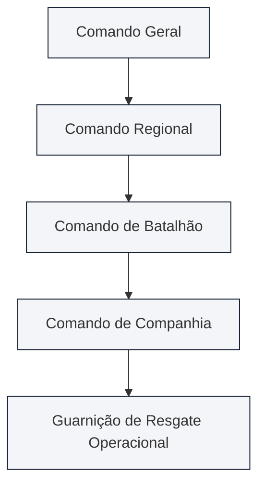
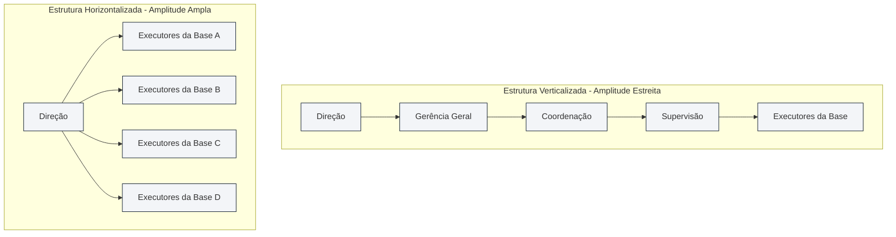
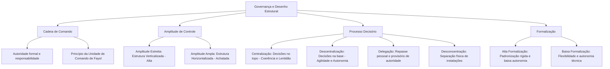

A sustentação da ordem corporativa e a governança das deliberações dependem da definição precisa dos mecanismos de autoridade, responsabilidade e comando. No desenho das organizações formais, três vetores inter-relacionados condicionam o funcionamento cotidiano: a cadeia escalar de comando, a amplitude administrativa que determina a estatura física do organograma e a distribuição do poder decisório entre centralização e descentralização. Em concursos públicos para carreiras militares e cargos de gestão, esse conteúdo é cobrado com elevadíssima intensidade. As bancas avaliam o processo decisório, a controvérsia sobre a delegação de responsabilidade e as diferenças cruciais entre descentralização, delegação e desconcentração física.

> [!objetivos]
> - Compreender os conceitos de cadeia de comando, autoridade formal e o princípio da unidade de comando.
> - Analisar a amplitude de controle e seu impacto direto na configuração vertical ou horizontal da estrutura.
> - Avaliar as vantagens e as limitações da centralização e da descentralização no processo decisório.
> - Distinguir com rigor técnico os conceitos de descentralização, delegação e desconcentração na administração geral.
> - Compreender a divergência doutrinária sobre a transferência de responsabilidade na delegação e o papel da formalização.

## Cadeia de comando, autoridade e unidade de comando

A **cadeia de comando** (também denominada linha de autoridade escalar) constitui a linha contínua e formal de autoridade que interliga todos os cargos da instituição, estendendo-se desde o topo da alta administração até o patamar mais elementar da base operacional. Trata-se da espinha dorsal que esclarece as relações de subordinação formal, evidenciando de modo inequívoco a quem cada colaborador deve prestar contas e de onde emanam as diretrizes oficiais de ação.

Dois conceitos indissociáveis sustentam o funcionamento da cadeia escalar:

- **Autoridade formal**: corresponde ao direito institucional concedido ao ocupante de determinado cargo para tomar decisões, dar ordens, alocar recursos e esperar obediência de seus subordinados. A autoridade decorre estritamente da legitimidade do cargo na estrutura, e não das características pessoais ou carismáticas de quem o ocupa temporariamente.
- **Responsabilidade**: representa a obrigação profissional e o dever de prestar contas contraído pelo colaborador perante a instituição, comprometendo-se com o cumprimento diligente das tarefas que lhe foram formalmente confiadas.

No modelo clássico concebido por Henri Fayol, a cadeia de comando articula-se obrigatoriamente com o princípio da **unidade de comando**. Por essa regra tradicional, cada colaborador deve possuir apenas um superior imediato, de quem recebe ordens diretas e a quem se reporta de forma exclusiva. A unidade de comando preserva a disciplina interna, previne ordens contraditórias e evita a sobreposição caótica de chefias.

> [!exemplo]
> Em uma estrutura militar de bombeiros, a cadeia de comando manifesta-se de maneira rígida e linear. O soldado integrante de uma guarnição reporta-se diretamente ao cabo chefe de equipe. Este recebe ordens do sargento comandante de socorro, que se subordina ao oficial de dia e ao comandante da companhia. Nenhuma ordem pula intermediários sem justificativa formal, garantindo que as linhas de responsabilidade permaneçam nítidas.

## Amplitude de controle e a estatura da estrutura organizacional

A **amplitude de controle** (também conhecida como amplitude administrativa ou de comando) define o número de subordinados que um gestor consegue dirigir, orientar e supervisionar de maneira direta, eficaz e segura. Essa variável quantitativa condiciona diretamente a conformação física do organograma, determinando a quantidade de níveis hierárquicos necessários para governar a instituição.

A relação entre a amplitude de supervisão e a estatura da organização desdobra-se em duas configurações estruturais polares:

1. **Estrutura verticalizada (estrutura alta ou aguda)**: decorre de uma **amplitude de controle estreita** (poucos subordinados diretos por gestor). Para comandar o mesmo volume global de pessoas, a instituição é obrigada a multiplicar escalões intermediários de chefia, resultando em uma pirâmide longa e pontiaguda.
2. **Estrutura horizontalizada (estrutura achatada ou plana)**: resulta de uma **amplitude de controle ampla** (muitos subordinados diretos sob a supervisão de cada chefe). A instituição opera com pouquíssimos níveis intermediários de chefia, apresentando um perfil piramidal rebaixado.

A escolha entre amplitudes estreitas ou amplas constitui uma decisão contingencial que depende da complexidade do trabalho e do grau de maturidade da equipe. O quadro a seguir sintetiza as principais diferenças operacionais entre essas duas abordagens:

| Dimensão de Análise | Estrutura Verticalizada (Aguda) | Estrutura Horizontalizada (Achatada) |
| --- | --- | --- |
| **Amplitude de Supervisão** | Estreita (poucos subordinados diretos) | Ampla (grande número de subordinados) |
| **Níveis Hierárquicos** | Numerosos escalões intermediários | Reduzidos degraus de chefia |
| **Custo com Chefias** | Muito elevado (muitos cargos de gerência) | Reduzido (menor quantidade de executivos) |
| **Fluxo da Comunicação** | Lento, burocrático e sujeito a distorções | Rápido, direto e com menor ruído vertical |
| **Grau de Supervisão** | Cerrada, rígida e minuciosa | Focada em resultados e na autonomia |
| **Capacidade de Decisão** | Centralizada e dependente de autorizações | Descentralizada com ampla delegação |

Amplitudes amplas reduzem despesas de folha com cargos de gerência e aceleram o trâmite de informações. Contudo, se a amplitude for expandida além de determinado limite saudável, o gestor perde a capacidade de orientar sua equipe, gerando sobrecarga de trabalho, descoordenação e queda na qualidade final do serviço.

> [!atencao]
> Guarde a correlação matemática para a prova:
> - Maior amplitude de controle = menos níveis hierárquicos = estrutura horizontalizada (baixa).
> - Menor amplitude de controle = mais níveis hierárquicos = estrutura verticalizada (alta).

## Centralização versus descentralização no processo decisório

A distribuição do poder de tomar decisões ao longo da cadeia escalar define o grau de centralização ou descentralização corporativa. Esse elemento conecta-se diretamente ao estudo do **processo decisório** nas organizações:

### Centralização decisória

A **centralização** ocorre quando a faculdade de tomar decisões situa-se concentrada no ápice institucional da instituição. Os escalões intermediários e a base operacional limitam-se a cumprir estritamente as ordens e procedimentos expedidos pela cúpula diretiva.

Principais **vantagens** da centralização:

- **Alinhamento e coerência global**: as decisões refletem fielmente os objetivos corporativos amplos traçados pela alta direção.
- **Uniformidade de procedimentos**: garante tratamento padronizado em todas as filiais e unidades, eliminando disparidades regulatórias internas.
- **Melhor aproveitamento de especialistas da cúpula**: deliberações complexas são conduzidas por profissionais de alta qualificação corporativa.
- **Economia e controle orçamentário**: evita duplicações desnecessárias de compras e centraliza a gestão financeira sob fiscalização rígida.

Principais **desvantagens** da centralização:

- **Lentidão extrema nas respostas**: como as decisões precisam percorrer toda a cadeia de comando até o topo para receber autorização, a instituição perde prazos oportunos de ação.
- **Distanciamento da realidade local**: os dirigentes da cúpula decidem com base em relatórios abstratos, desconhecendo as particularidades concretas do terreno operacional.
- **Sobrecarga da alta administração**: os diretores afogam-se em detalhes corriqueiros da rotina diária, comprometendo o tempo necessário ao planejamento de longo prazo.
- **Desmotivação da equipe operacional**: a ausência de autonomia decisória gera passividade, dependência psicológica e desestímulo à criatividade dos servidores da base.

### Descentralização decisória

A **descentralização** manifesta-se quando a autoridade para decidir é formalmente dispersada e delegada aos escalões hierárquicos inferiores, aproximando a solução do local em que os problemas concretos emergem.

Principais **vantagens** da descentralização:

- **Rapidez e tempestividade**: decisões são tomadas de imediato no ponto de atendimento ao cidadão ou cliente, sem depender de morosas consultas burocráticas à sede.
- **Adequação às realidades locais**: quem decide conhece de perto as demandas específicas do público atendido e as peculiaridades do mercado regional.
- **Desafogamento da alta cúpula**: liberta os dirigentes máximos da sobrecarga cotidiana, permitindo dedicação integral às diretrizes institucionais prioritárias.
- **Motivação e desenvolvimento de líderes**: a concessão de autonomia estimula o comprometimento funcional e capacita novos líderes dentro da instituição.

Principais **desvantagens** da descentralização:

- **Risco de decisões conflitantes**: unidades descentralizadas podem adotar entendimentos divergentes sobre matérias idênticas, comprometendo a harmonia institucional.
- **Visão fragmentada ou paroquial**: gestores locais tendem a priorizar as conveniências de seu departamento, ignorando os impactos negativos de suas deliberações sobre o conjunto da empresa.
- **Custos adicionais de capacitação**: exige investimentos contínuos em treinamento para assegurar que os gestores de base desenvolvam maturidade para decidir com prudência.

A tabela a seguir confronta os dois modelos no âmbito do processo decisório:

| Critério de Comparação | Modelo Centralizado | Modelo Descentralizado |
| --- | --- | --- |
| **Localização do Poder** | Cúpula estratégica (alta administração) | Espalhado pelos níveis tático e operacional |
| **Velocidade de Resposta** | Lenta, dependente de aval hierárquico | Ágil e adaptada ao momento da ocorrência |
| **Grau de Uniformidade** | Máxima padronização corporativa | Menor uniformidade, com variações locais |
| **Qualidade da Informação** | Abstrata e sujeita a ruídos nos relatórios | Direta, rica e em contato com a realidade |
| **Perfil da Gestão** | Comando e controle hierárquico estrito | Participativa, com foco em confiança e resultados |

> [!pegadinha]
> As bancas costumam afirmar que "a descentralização retira completamente da alta cúpula o controle das atividades". Isso é incorreto! Na descentralização autêntica, a cúpula transfere o poder de deliberação operacional, mas retém o controle final dos resultados mediante auditorias, metas de desempenho e indicadores de qualidade.

## Descentralização, delegação e desconcentração: distinções conceituais

No estudo da teoria administrativa, é fundamental não confundir três institutos que possuem significados técnicos específicos, distinguindo-se das definições adotadas pelo Direito Administrativo:

- **Descentralização**: consiste na redistribuição formal e permanente da autoridade de decisão para níveis hierárquicos mais baixos. Trata-se de um processo ligado ao **cargo** e ao desenho da própria estrutura organizacional. Atinge múltiplos escalões e confere estabilidade às rotinas institucionais.
- **Delegação**: é o ato pelo qual um superior hierárquico transfere temporariamente determinado nível de autoridade decisória a um subordinado direto específico, incumbindo-o de executar tarefas pelas quais o gestor responde originariamente. Possui caráter **pessoal**, aplica-se entre chefia e subordinado direto e não altera a macroestrutura formal da empresa.
- **Desconcentração**: refere-se exclusivamente à distribuição física e espacial das atividades e das equipes de trabalho em diferentes prédios, cidades ou instalações materiais, sem envolver necessariamente transferência de autoridade decisória.

| Parâmetro de Diferenciação | Descentralização | Delegação | Desconcentração |
| --- | --- | --- | --- |
| **Natureza Principal** | Estrutural e institucional | Interpessoal e pontual | Espacial e física |
| **Objeto Transferido** | Poder decisório pelo cargo | Autoridade operacional para a ação | Divisão física de atividades |
| **Vínculo Básico** | Ligado ao cargo e à função | Ligado à pessoa do subordinado | Ligado a prédios e instalações |
| **Estabilidade Temporal** | Duradoura e permanente | Provisória e revogável a qualquer tempo | Conforme a necessidade logística |
| **Impacto Estrutural** | Altera o desenho do organograma | Mantém inalterada a macroestrutura | Distribui unidades no território |

### A controvérsia doutrinária sobre a delegação de responsabilidade

Um dos tópicos mais controversos em questões de concurso reside na transferência da responsabilidade no processo de delegação:

1. **Visão de Idalberto Chiavenato**: para esse autor, a delegação envolve tanto a transferência de autoridade quanto a transferência de responsabilidade para o subordinado. O colaborador assume o compromisso pessoal de realizar a tarefa para a qual foi designado.
2. **Visão de Djalma Oliveira e da doutrina clássica**: para essa corrente majoritária, **a autoridade se delega, mas a responsabilidade última jamais se delega**. O gestor transfere o poder de agir, mas permanece integralmente co-responsável perante seus superiores pelo sucesso ou pelas falhas cometidas pelo subordinado delegado.

> [!bizu]
> - Em questões conceituais amplas: lembre-se de que o gestor que delega **nunca se exime** de sua responsabilidade perante a instituição. A responsabilidade última permanece compartilhada.
> - Se a questão citar expressamente a linha de Idalberto Chiavenato, considere válida a proposição que define a delegação como transferência conjunta de poder decisório e atribuições para escalões subalternos da hierarquia.

## Formalização e padronização do comportamento

A **formalização** representa o grau em que as rotinas, procedimentos, descrições de cargos e normas de conduta da organização encontram-se explicitamente registrados em documentos e regulamentos escritos. Constitui o sexto parâmetro estrutural apontado por Stephen Robbins.

Quando uma instituição apresenta **elevada formalização**, o comportamento dos colaboradores é estritamente previsível. Manuais detalhados especificam o que deve ser feito, em qual sequência temporal e com quais ferramentas exatas. Nessa situação, o executor possui reduzida margem de discricionariedade ou liberdade de escolha. Esse padrão é essencial em linhas de montagem perigosas e em operações militares que exigem rígida obediência a protocolos de segurança.

Por outro lado, em instituições com **baixa formalização**, as regras escritas são mínimas e flexíveis. Os profissionais contam com liberdade para definir como executar suas metas, pautando-se pelo discernimento próprio e pela criatividade. Esse desenho é típico de agências de publicidade e laboratórios de pesquisa científica.

> [!atencao] Burocracia e excesso de regras
> A formalização excessiva gera patologias administrativas graves, como a perda de espontaneidade e a lentidão diante de imprevistos. O apego cego ao regulamento escrito pode fazer com que o servidor público priorize a forma do processo em detrimento da solução célere do problema do cidadão.

A governança contemporânea busca o ponto de equilíbrio na formalização. A ausência completa de manuais gera desordem operacional e insegurança técnica. Contudo, o excesso asfixiante de regras engessa a instituição, gerando buropatologias marcadas pelo apego cego aos regulamentos em detrimento das necessidades reais da sociedade.

## Mapa do capítulo

### Para fixar
- A cadeia de comando consubstancia a linha contínua de autoridade que percorre a estrutura corporativa do topo à base.
- O princípio da unidade de comando preconiza que cada subordinado deve possuir apenas um chefe imediato.
- A amplitude de controle expressa o número de subordinados diretamente orientados por um único administrador.
- Amplitudes estreitas geram estruturas verticais pontiagudas, com supervisão cerrada e custos gerenciais elevados.
- Amplitudes amplas originam estruturas horizontais achatadas, com comunicação ágil e ampla autonomia operacional.
- A centralização concentra o processo decisório na alta administração, propiciando uniformidade de condutas e lentidão nas respostas.
- A descentralização distribui a autoridade decisória para a base, gerando rapidez nas ações locais e alívio para a cúpula diretiva.
- A delegação ocorre entre pessoas hierarquicamente vinculadas, transferindo autoridade operacional sem eximir o gestor da responsabilidade final.
- A desconcentração consiste na divisão e dispersão física de atividades materiais em múltiplos locais geográficos.
- A formalização mede a intensidade com que normas, manuais e regulamentos escritos delimitam o comportamento dos colaboradores.
