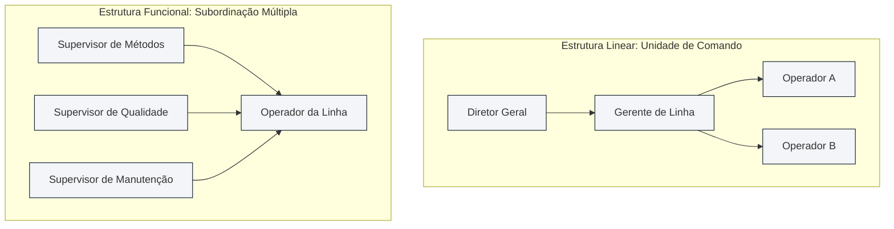
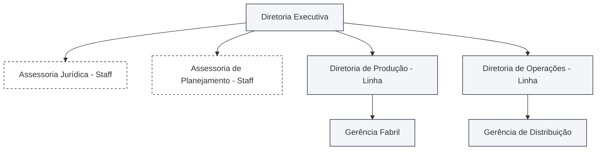
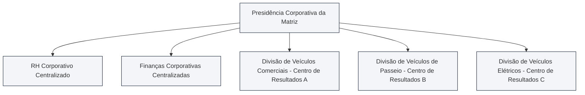
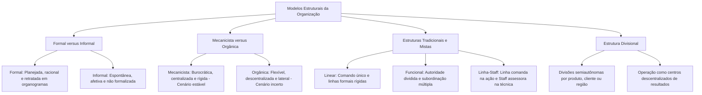

A arquitetura de uma instituição define como cargos, linhas hierárquicas e unidades de apoio interagem para transformar planos em entregas operacionais. Na ciência da administração, o estudo das estruturas organizacionais desdobra-se na convivência entre os arranjos formais e informais, nas abordagens contingenciais mecanicista e orgânica e nos desenhos estruturais clássicos e divisionais. Em provas de concursos públicos, com ênfase nas carreiras de gestão e oficialato militar, as bancas examinam com rigor os traços da autoridade de linha e de assessoria (*staff*), a ruptura da unidade de comando na estrutura funcional e a lógica dos centros de resultados criados por Alfred Sloan nas divisões corporativas.

> [!objetivos]
> - Distinguir as características constitutivas da organização formal daquelas observadas na organização informal.
> - Analisar os modelos mecanicista e orgânico de Burns e Stalker, correlacionando-os às demandas de estabilidade e instabilidade do ambiente.
> - Compreender a estrutura linear militar e a estrutura funcional taylorista, avaliando suas implicações na unidade de comando.
> - Identificar as especificidades da estrutura linha-staff, diferenciando a autoridade de comando da autoridade consultiva de assessoria.
> - Examinar a estrutura divisional contemporânea, seu funcionamento por centros de resultados e seus custos de duplicação.

## Organização formal versus organização informal

Toda instituição humana comporta duas dimensões estruturais concomitantes: a dimensão formal e a dimensão informal. A **organização formal** é aquela deliberadamente planejada, estruturada e oficializada pela alta administração da empresa. Assenta-se na lógica da racionalidade, na divisão técnica do trabalho e na definição explícita de cargos, atribuições e níveis de autoridade. Sua configuração gráfica oficial é exibida publicamente pelo organograma e formalizada em estatutos, regimentos e manuais normativos internos.

Em contraposição, a **organização informal** emerge de maneira espontânea e natural a partir das interações sociais, simpatias, afinidades pessoais e interesses comuns que se desenvolvem entre os colaboradores no cotidiano. Ela não possui desenho prévio, não obedece a regulamentos escritos e jamais aparece retratada no organograma corporativo. A organização informal manifesta-se em conversas de corredor, grupos de apoio mútuo, redes de solidariedade funcional e lideranças espontâneas que independem da patente ou do cargo hierárquico ostentado pelo indivíduo.

A doutrina contemporânea enfatiza que a organização informal não deve ser reprimida pela administração. Pelo contrário: quando compreendida e respeitada pelas chefias, a rede informal acelera a circulação de informações úteis, eleva o moral e o sentimento de pertencimento da equipe, ameniza tensões decorrentes da rigidez burocrática e complementa lacunas inevitáveis dos regulamentos formais.

A Teoria da Contingência aprofunda essa dinâmica por meio dos conceitos de **diferenciação e integração**, propostos por Paul Lawrence e Jay Lorsch. À medida que uma instituição expande suas operações, ela vivencia a necessidade de se diferenciar internamente em departamentos especializados para responder a diferentes aspectos do ambiente (diferenciação). Simultaneamente, para evitar a fragmentação caótica, a corporação precisa mobilizar esforços coordenados de integração, assegurando que todos os subsistemas operem em harmonia rumo aos propósitos institucionais comuns.

| Dimensão de Comparação | Organização Formal | Organização Informal |
| --- | --- | --- |
| **Origem e Criação** | Deliberada, racional e planejada pela direção | Espontânea e natural das relações sociais |
| **Padrão de Relações** | Fixado por regras, regulamentos e organogramas | Baseado em simpatias, amizades e afinidades |
| **Estrutura e Cargos** | Cargos formais, níveis escalares e chefias oficiais | Redes fluidas, sem cargos ou hierarquias formais |
| **Canais de Comunicação** | Canais formais, verticais e oficiais de comunicação | Rede informal, ágil e horizontal de boatos e diálogos |
| **Finalidade Básica** | Consecução das metas oficiais da corporação | Satisfação das necessidades sociais dos indivíduos |

> [!atencao]
> As bancas costumam afirmar que "a organização informal prejudica invariavelmente os objetivos da organização formal". Isso é falso! A organização informal pode, sim, resistir a mudanças mal conduzidas, mas também constitui poderoso vetor de motivação, cooperação espontânea e agilidade operacional no ambiente de trabalho.

## Abordagem mecanicista versus abordagem orgânica

Na década de 1960, os sociólogos Tom Burns e G. M. Stalker conduziram pesquisas empíricas pioneiras na indústria britânica para compreender como o ambiente externo molda a estrutura interna das instituições. Essa investigação consolidou a tipologia clássica que divide as organizações em dois modelos polares: a **abordagem mecanicista** (ou mecanicística) e a **abordagem orgânica**.

A **organização mecanicista** apoia-se nos princípios da burocracia clássica e na divisão minuciosa e estrita do trabalho. Caracteriza-se por uma hierarquia rígida de comando único, decisões amplamente centralizadas na cúpula diretiva, canais verticais e formais de comunicação e uma amplitude administrativa estreita, que gera estruturas altas com muitos níveis escalares. Os cargos são preenchidos por especialistas que cumprem rotinas padronizadas e inflexíveis descritas em manuais minuciosos. Esse modelo é altamente eficiente e previsível quando inserido em **ambientes externos estáveis e previsíveis**, nos quais a tecnologia e as preferências dos usuários mudam muito pouco ao longo do tempo.

Em contraste absoluto, a **organização orgânica** é concebida para operar em **ambientes externos dinâmicos, turbulentos e incertos**. Apresenta estruturas elásticas e flexíveis com reduzida divisão rígida de atribuições. Os cargos são continuamente redefinidos pela interação cotidiana entre as equipes multidisciplinares. As decisões encontram-se descentralizadas e delegadas aos executores da base operacional, que possuem ampla autonomia técnica. A comunicação flui predominantemente na direção horizontal e lateral por meio do ajustamento mútuo, dispensando a intermediação morosa de degraus escalares. A amplitude de controle é ampla, resultando em estruturas achatadas e horizontalizadas com menor quantidade de escalões de chefia.

O quadro analítico a seguir sintetiza as divergências estruturais entre esses dois modelos contingenciais:

| Parâmetro Estrutural | Organização Mecanicista | Organização Orgânica |
| --- | --- | --- |
| **Ambiente Externo Típico** | Estável, previsível e rotineiro | Dinâmico, mutável e incerto |
| **Estrutura Básica** | Burocrática, verticalizada e rígida | Flexível, horizontalizada e achatada |
| **Divisão do Trabalho** | Minuciosa, fragmentada e hiperespecializada | Ampla, fluida e com equipes multidisciplinares |
| **Tomada de Decisão** | Centralizada na alta cúpula administrativa | Descentralizada e delegada à base operacional |
| **Cadeia de Comando** | Hierarquia escalar rígida com comando único | Rede flexível com prevalência de relações laterais |
| **Amplitude de Controle** | Estreita (muitos níveis hierárquicos) | Ampla (poucos níveis hierárquicos) |
| **Formalização das Normas** | Elevada (regras e manuais detalhados) | Reduzida (ajustamento mútuo e confiança) |
| **Fundamento Teórico** | Teoria Clássica e Modelo Burocrático | Teoria das Relações Humanas e Contingência |

> [!pegadinha]
> Em questões de prova, a banca frequentemente tenta rotular o modelo mecanicista como uma estrutura ultrapassada, anacrônica e inútil. Fique atento: o modelo mecanicista continua sendo o arranjo mais eficiente e indicado para ambientes estáveis que demandam padronização rigorosa em larga escala, como a produção fabril contínua e as rotinas financeiras de órgãos públicos. Nenhum modelo é superior em abstrato; a eficácia depende do alinhamento contingencial com o ambiente externo.

## Estruturas tradicionais: linear e funcional

Historicamente, a ciência da administração consolidou duas estruturas tradicionais básicas que serviram de ponto de partida para a modelagem corporativa no início do século XX: a estrutura linear e a estrutura funcional.

### Estrutura Linear

A **estrutura linear** é a modalidade mais antiga, simples e elementar de desenho organizacional formal. Inspirou-se diretamente na conformação dos antigos exércitos e das ordens eclesiásticas, razão pela qual também é identificada em manuais técnicos como **estrutura militar**.

Seus traços definidores repousam na aplicação estrita do princípio da **unidade de comando**: cada subordinado mantém um único chefe imediato, de quem recebe ordens imperativas e a quem presta contas de forma exclusiva. A autoridade linear é absoluta, total e desce em linha reta e vertical desde o topo até a base. As comunicações transitam obrigatoriamente pelos degraus hierárquicos intermediários, sem atalhos laterais. A centralização é quase total na cúpula, operando com baixa amplitude de controle e forte verticalização piramidal.

Dentre suas **vantagens**, destacam-se a extrema simplicidade de compreensão, a nitidez absoluta das linhas de responsabilidade e a facilidade de manutenção da disciplina interna em pequenas organizações inseridas em ambientes estáveis. Contudo, suas **desvantagens** são a rigidez paralisante diante de inovações, a lentidão extrema nas comunicações e a pesada sobrecarga imposta aos líderes, que são forçados a atuar como chefes generalistas conhecedores de todos os ramos da produção, sem respaldo pericial especializado.

### Estrutura Funcional

A **estrutura funcional** nasceu das proposições de Frederick Taylor sobre a supervisão funcional nas oficinas industriais. Em vez de submeter o operário a um único chefe generalista, Taylor propôs fracionar a autoridade conforme as especialidades técnicas da produção (como controle de qualidade, manutenção, abastecimento e métodos).

O traço definidor da estrutura funcional é a **subordinação múltipla** decorrente da **autoridade funcional (ou dividida)**. Cada colaborador responde simultaneamente a múltiplos supervisores especializados, cada um detendo poder direto de mando em sua respectiva área de conhecimento técnico. As comunicações são diretas e imediatas entre os executores e os especialistas, eliminando a intermediação escalar burocrática. A descentralização das decisões técnicas é ampla, com forte foco na perícia e na divisão entre planejamento analítico e execução no chão de fábrica.

As principais **vantagens** residem na maximização da especialização técnica, no suporte altamente qualificado da supervisão e na separação nítida entre estudo metódico e tarefas operacionais. Por outro lado, as severas **desvantagens** incluem a quebra da unidade de comando, a confusão de papéis do trabalhador diante de ordens simultâneas e conflitantes emitidas por diferentes supervisores, a perda do controle disciplinar e o surgimento de rivalidades desgastantes entre especialistas.

> [!exemplo]
> Em uma oficina mecânica linear tradicional, o mecânico recebe todas as orientações exclusivamente do mestre da oficina. Se a mesma oficina adotar a estrutura funcional taylorista, o mecânico receberá ordens técnicas do supervisor de cronogramas, do supervisor de calibração de ferramentas e do supervisor de inspeção de segurança do trabalho, reportando-se a múltiplos superiores técnicos no mesmo dia.

## Estrutura linha-staff: harmonia entre comando e assessoria

Para solucionar as limitações da estrutura linear (que carecia de suporte pericial) e da estrutura funcional (que destruía a disciplina pelo comando múltiplo), a teoria administrativa desenvolveu a **estrutura linha-staff** (também rotulada como organização linha-assessoria ou mista). Trata-se do formato mais prevalente nas grandes corporações e órgãos governamentais modernos.

Sua arquitetura assenta-se na combinação harmoniosa entre duas naturezas funcionais distintas de órgãos corporativos:

- **Órgãos de Linha**: atuam diretamente vinculados às **atividades-fim** da corporação, ou seja, à produção de bens e à prestação direta de serviços que justificam a existência da instituição. Detêm **autoridade linear (hierárquica)**, exercendo poder direto e imperativo de mando sobre os subordinados ao longo da cadeia escalar.
- **Órgãos de Assessoria (*Staff*)**: atuam dedicados às **atividades-meio** de apoio, consultoria técnica, pesquisa, elaboração de pareceres, assessoria jurídica, planejamento e controle de qualidade. Detêm unicamente **autoridade funcional ou de assessoria (autoridade de conhecimento)**. Eles prestam aconselhamento e suporte pericial aos gestores de linha, mas não possuem poder hierárquico direto de mando sobre os executores da linha.

Um aspecto fundamental frequentemente examinado em certames públicos é que os órgãos de *staff* podem estar presentes em qualquer nível hierárquico da instituição. Na cúpula estratégica, atuam como assessoria de planejamento e consultoria jurídica; no nível intermediário tático, funcionam como auditorias setoriais; e no nível operacional, prestam suporte de calibração ou medicina ocupacional.

Principais **vantagens** da estrutura linha-staff:

- **Preservação da unidade de comando com inovação técnica**: os gerentes executivos de linha continuam com a prerrogativa única de dar ordens, mantendo a disciplina, enquanto contam com o respaldo pericial de técnicos altamente qualificados.
- **Divisão equilibrada de encargos**: desonera as chefias operacionais de estudos regulatórios ou jurídicos exaustivos, permitindo que foquem na gestão prática do trabalho.

Principais **desvantagens** e tensões estruturais:

- **Atritos e conflitos crônicos entre linha e staff**: profissionais de linha costumam enxergar o assessor de *staff* como um teórico distante da realidade que dá opiniões sem assumir riscos operacionais. Por outro lado, especialistas de *staff* ressentem-se quando seus pareceres técnicos e estudos minuciosos são ignorados pelos chefes operacionais.
- **Elevação dos custos indiretos**: a contratação de equipes periciais e assessorias especializadas encarece substancialmente as despesas administrativas da empresa.
- **Dificuldade de equilíbrio institucional**: risco permanente de os órgãos de assessoria ultrapassarem sua função consultiva e tentarem usurpar o poder de mando dos órgãos de linha.

> [!bizu]
> - **Linha decide e comanda**: atua nas atividades-fim com autoridade hierárquica imperativa.
> - **Staff aconselha e sugere**: atua nas atividades-meio com autoridade de conhecimento e suporte técnico, sem comando direto sobre a linha.

## Estrutura divisional: centros de resultados e diversificação

A **estrutura divisional** emergiu historicamente para superar as dificuldades de coordenação vivenciadas pelas corporações industriais gigantescas diante do crescimento desmedido e da diversificação de mercados. Foi introduzida e consagrada pelo célebre executivo Alfred Sloan na reorganização da montadora General Motors na década de 1920.

Nesse modelo, a corporação divide-se em unidades operacionais semiautônomas chamadas de **divisões**, estruturadas segundo critérios de produtos, linhas de clientes ou territórios regionais. Cada divisão comporta sua própria estrutura interna de engenharia, compras, fabricação e comercialização para operar de forma completa o seu segmento de mercado.

O traço marcante da estrutura divisional é o funcionamento de cada unidade como um autêntico **centro de resultados (ou centro de lucros)**. A divisão goza de autonomia para gerir seus processos cotidianos, devendo apurar autonomamente suas receitas, despesas e margens de rentabilidade de forma descentralizada.

Todavia, essa descentralização não é absoluta: a alta cúpula da matriz corporativa preserva a centralização das deliberações institucionais de longo prazo, a alocação de orçamentos de capital e o controle estrito dos indicadores de desempenho global. Além disso, setores corporativos essenciais — como auditoria geral, jurídico corporativo e diretrizes amplas de recursos humanos — são mantidos centralizados na sede para dar suporte uniforme a todas as divisões.

Dentre as principais **vantagens** da estrutura divisional, figuram a excepcional flexibilidade perante as mutações do mercado, a facilidade de avaliar com precisão contábil o desempenho financeiro de cada unidade de negócio e o foco exclusivo no atendimento ao consumidor do setor.

Em contrapartida, as principais **desvantagens** são o encarecimento das operações provocado pela proliferação de órgãos duplicados em cada divisão, a concorrência destrutiva entre departamentos da mesma companhia por investimentos da matriz e o risco de os interesses setoriais das divisões sobreporem-se aos propósitos institucionais da corporação como um todo.

> [!atencao] Centros de resultados e autonomia relativa
> Na estrutura divisional, as divisões não são empresas completamente independentes. Elas desfrutam de autonomia operacional e contábil descentralizada para gerir seus negócios, mas permanecem subordinadas às diretrizes institucionais, orçamentos globais e auditorias da presidência da matriz corporativa.

## Quadro comparativo das quatro estruturas corporativas

A tabela a seguir consolida as características essenciais, o modelo de autoridade adotado, o mecanismo de comando e as principais indicações práticas das quatro arquiteturas organizacionais examinadas:

| Modelo Estrutural | Padrão de Autoridade | Princípio de Comando | Ambiente Favorável | Principal Força e Fraqueza |
| --- | --- | --- | --- | --- |
| **Linear** | Autoridade linear única e centralizada | Unidade de comando estrita de Fayol | Estável, rotineiro e pequeno porte | Simplicidade e disciplina; rigidez e sobrecarga da cúpula |
| **Funcional** | Autoridade funcional dividida por matéria | Subordinação múltipla taylorista | Estável com forte especialização técnica | Excelência técnica; conflito de ordens e quebra da disciplina |
| **Linha-Staff** | Linha (comando) conjugada com staff (apoio) | Unidade de comando preservada na linha | Médio e grande porte, dinâmica intermediária | Suporte técnico perito; atritos velados entre linha e staff |
| **Divisional** | Relativamente descentralizada em divisões | Unidade de comando em centros de lucros | Dinâmico, competitivo e diversificado | Flexibilidade e centros de lucro; duplicação cara de despesas |

## Mapa do capítulo

### Para fixar
- A organização formal é concebida racionalmente pela administração e oficializada no organograma da entidade.
- A organização informal nasce espontaneamente das relações humanas e dos laços de simpatia no ambiente de trabalho.
- Burns e Stalker associam a abordagem mecanicista a ambientes estáveis e a abordagem orgânica a cenários dinâmicos.
- A estrutura linear apoia-se na autoridade linear verticalizada e na unidade estrita de comando concebida por Fayol.
- A estrutura funcional de Taylor adota a supervisão funcional com autoridade dividida e subordinação múltipla.
- A principal fraqueza do arranjo funcional reside na confusão de comando provocada pela convivência com múltiplos supervisores.
- A estrutura linha-staff harmoniza a autoridade imperativa de comando dos órgãos de linha com o aconselhamento do staff.
- Os órgãos de linha atuam nas atividades-fim, enquanto os órgãos de staff prestam apoio consultivo nas atividades-meio.
- Os órgãos de assessoria técnica (staff) podem estar situados em qualquer patamar da hierarquia corporativa.
- A estrutura divisional articula unidades semiautônomas que operam como centros de lucros sob a coordenação geral da matriz.
