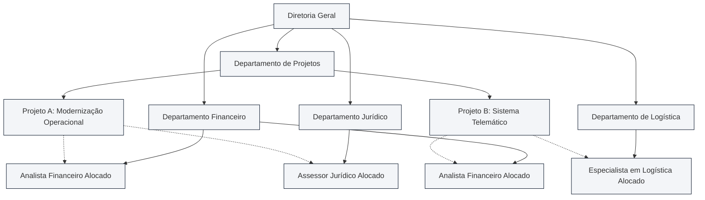
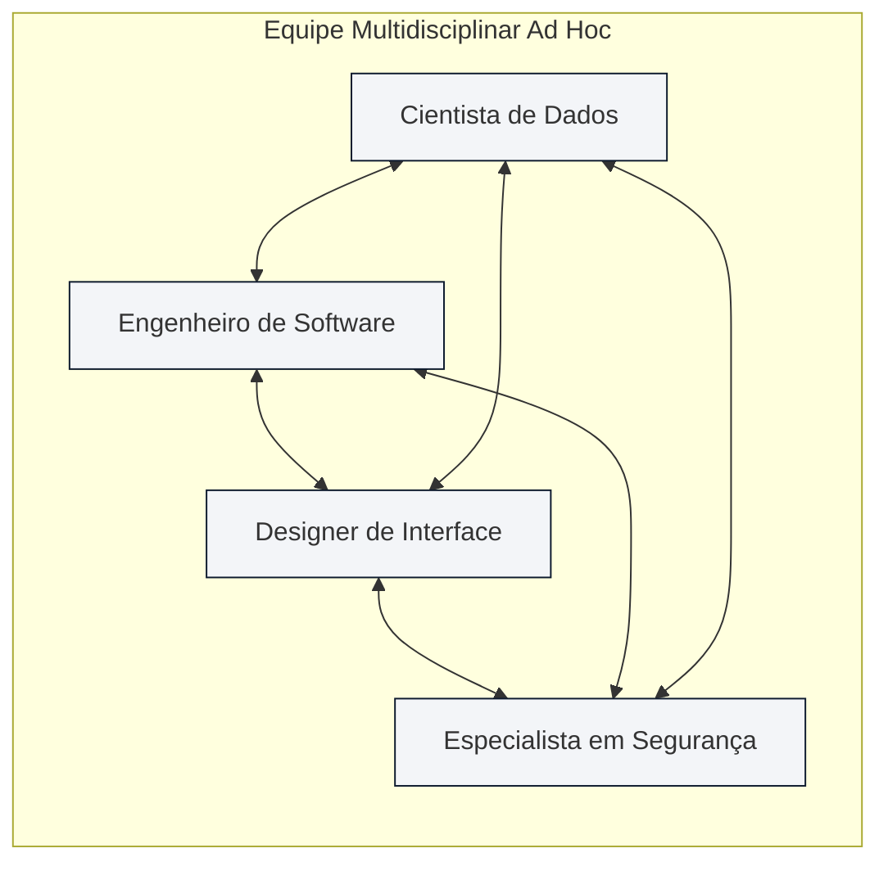
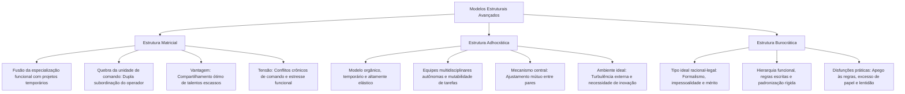

A busca por equilíbrio entre eficiência, previsibilidade e inovação levou a teoria administrativa a conceber modelos estruturais contrastantes. De um lado, situa-se o modelo clássico da burocracia de Max Weber. Ele foi erigido sobre a impessoalidade, o formalismo e a padronização metódica das rotinas. De outro lado, despontam as abordagens recentes da organização, com destaque para a adhocracia. A adhocracia volta-se para a inovação acelerada por meio de equipes temporárias e ajustamento mútuo. Entre esses extremos, consolida-se a estrutura matricial, que funde a especialização funcional com o dinamismo dos projetos. Em certames para cargos públicos e lideranças militares, esse conjunto constitui matéria de peso decisivo. As bancas exigem a distinção entre as características ideais da burocracia e suas disfunções práticas. Exigem também o domínio da autoridade dual na matriz.

> [!objetivos]
> - Compreender o funcionamento da estrutura matricial e a dinâmica da dupla subordinação hierárquica.
> - Caracterizar a estrutura adhocrática dentro das abordagens recentes da organização, identificando o ajustamento mútuo.
> - Analisar a organização burocrática concebida por Max Weber a partir da formalidade, impessoalidade e profissionalismo.
> - Diferenciar as características essenciais do modelo burocrático de suas disfunções patológicas cotidianas.
> - Comparar os três modelos estruturais segundo suas exigências ambientais e formas de coordenação do trabalho.

## Estrutura matricial: a bidimensionalidade entre função e projeto

A **estrutura matricial (ou em grade)** combina duas modalidades estruturais distintas sobre os mesmos colaboradores e setores. Na configuração mais disseminada, ocorre o cruzamento perpendicular da **estrutura funcional** com a **estrutura por projetos ou produtos**. A primeira opera de forma permanente e vertical, fornecendo suporte de especialização técnica. A segunda atua de maneira temporária e horizontal, orientada à entrega de metas específicas.

O traço definidor dessa arquitetura reside na **quebra deliberada do dogma da unidade de comando**, formulado por Henri Fayol na Escola Clássica. Na matriz, o profissional está submetido a uma **dupla subordinação (autoridade dual)** concomitante:

- O **gerente funcional**: responde pela gestão de longo prazo da área técnica (como Finanças, Engenharia ou Recursos Humanos). É quem avalia o desenvolvimento profissional do colaborador. Também fixa padrões técnicos e garante a excelência metodológica.
- O **gerente de projeto (ou de produto)**: lidera a equipe multidisciplinar destacada para cumprir uma entrega singular. É quem define cronogramas de execução. Monitora custos, delega tarefas operacionais e cobra o cumprimento dos prazos pactuados.

Graficamente, o modelo é representado por uma matriz cartesiana bidimensional. As linhas horizontais correspondem aos órgãos funcionais estáveis. As colunas verticais representam os múltiplos projetos desenvolvidos concomitantemente pela corporação.

Principais **vantagens** da estrutura matricial:

- **Otimização de recursos escassos**: peritos e analistas de ponta são compartilhados entre diferentes iniciativas. Isso elimina a contratação redundante de profissionais exclusivos para cada contrato.
- **Coordenação lateral e cooperação interdisciplinar**: derruba barreiras departamentais. Promove comunicação direta entre especialistas de áreas diversas no dia a dia.
- **Equilíbrio entre excelência técnica e foco em resultados**: preserva a padronização metodológica da área funcional. Ao mesmo tempo, garante o cumprimento ágil de prazos do projeto.
- **Flexibilidade perante ambientes dinâmicos**: permite mobilizar e desmobilizar equipes temporárias conforme as exigências do mercado.

Principais **desvantagens** e vulnerabilidades:

- **Conflito de comando e disputas de poder**: tensão frequente entre gerentes funcionais e gestores de projetos pela prioridade no uso do tempo dos membros da equipe.
- **Conflito de papéis e estresse do operador**: o colaborador recebe cobranças divergentes e prazos concorrentes de chefias distintas, gerando sobrecarga emocional.
- **Lentidão em deliberações controversas**: a necessidade de consenso entre lideranças impõe excesso de reuniões de alinhamento, retardando decisões urgentes.
- **Diluição de responsabilidades**: dificuldade de apontar responsáveis por falhas ou atrasos, propiciando acusações recíprocas entre os lados da matriz.

> [!atencao]
> A estrutura matricial não é indicada para ambientes estáticos ou para organizações com lideranças despreparadas. Ela requer elevado grau de maturidade no trato entre pessoas e flexibilidade de conduta. Exige também confiança mútua entre as chefias para que a autoridade dual funcione como cooperação, e não como disputa de poder.

## Estrutura adhocrática: a flexibilidade orgânica total

O termo **adhocracia** foi cunhado pelo sociólogo Warren Bennis e celebrizado por Alvin Toffler e Henry Mintzberg. Sua etimologia deriva da expressão latina *ad hoc*, que significa "para esta finalidade específica". A adhocracia insere-se com destaque entre as **abordagens recentes da organização**. Ela representa a antítese absoluta do modelo burocrático rígido, constituindo uma arquitetura organizacional altamente orgânica, elástica e temporária.

Esse modelo foi concebido para atender instituições inseridas em **ambientes externos turbulentos e imprevisíveis**. É indicado quando a empresa demanda inovação técnica ininterrupta e respostas sob medida para problemas singulares. Exemplos clássicos abrangem agências de publicidade, produtoras audiovisuais, laboratórios de pesquisa espacial e empresas desenvolvedoras de softwares inovadores.

Os traços essenciais da estrutura adhocrática reúnem:

- **Equipes multidisciplinares temporárias (*ad hoc*)**: grupos de tamanho variável constituídos por especialistas de diversas formações para solucionar um problema singular. Concluída a missão, o grupo é imediatamente dissolvido e seus integrantes são realocados em novas frentes de trabalho.
- **Tarefas mutáveis e rotativas**: os postos não são rígidos nem permanentes; o trabalho molda-se conforme as competências singulares de cada indivíduo e a evolução do projeto.
- **Descentralização total da autoridade**: o poder decisório desloca-se da hierarquia formal para onde reside o conhecimento técnico; as próprias equipes de trabalho são autogerenciáveis.
- **Baixíssima formalização**: operam com regras escritas mínimas, sem manuais engessados ou descrições minuciosas de cargos.
- **Ajustamento mútuo como mecanismo central de coordenação**: a integração do trabalho ocorre por meio da comunicação informal contínua, do diálogo horizontal direto e da negociação espontânea entre os próprios executores, sem supervisão hierárquica impositiva.

> [!exemplo]
> Em uma produtora audiovisual contratada para produzir um documentário, não há organogramas piramidais ou chefias tradicionais. O diretor, os roteiristas, os câmeras e os editores de som formam uma equipe temporária autônoma. Eles ajustam as cenas por meio do diálogo informal contínuo (ajustamento mútuo). Concluída e entregue a obra, a equipe desfaz-se e cada profissional assume outros desafios.

> [!atencao] Ajustamento mútuo e ausência de chefia tradicional
> Na adhocracia, o mecanismo primordial de controle é o **ajustamento mútuo**. A coordenação não depende de ordens de um superior hierárquico nem de manuais escritos de procedimentos. O sucesso repousa na capacidade de diálogo horizontal imediato entre especialistas de alta qualificação técnica.

## A organização burocrática de Max Weber: o tipo ideal racional-legal

A **organização burocrática** é a mais célebre e influente formulação teórica sobre as estruturas formais modernas. Formulada pelo sociólogo alemão Max Weber no início do século XX, a burocracia não foi concebida como sinônimo de lentidão. Pelo contrário: Weber desenhou-a como o **tipo ideal** mais racional, estável e tecnicamente eficiente de organização humana.

Weber identificou que as sociedades modernas apoiam-se na **autoridade racional-legal**. Nessa forma de dominação, a obediência não decorre do carisma individual nem da tradição hereditária. Ela decorre do respeito impessoal às leis e normas estabelecidas legitimamente por procedimentos racionais. O especialista Antonio Cesar Amaru Maximiano ensina que o modelo burocrático assenta-se em uma tríade fundamental:

- **Formalidade**: todas as ações, deveres, competências e procedimentos são expressamente fixados em normas legais escritas e comunicações documentadas.
- **Impessoalidade**: as relações funcionais pautam-se estritamente pelos cargos e regulamentos, e não pelas pessoas físicas que os ocupam temporariamente.
- **Profissionalismo**: os participantes são especialistas técnicos assalariados, admitidos por mérito e dedicados a uma carreira formal e estável.

O quadro analítico a seguir detalha as características constitutivas da burocracia racional-legal weberiana:

| Característica Essencial | Significado e Alcance na Teoria de Weber | Finalidade Prática no Desenho Estrutural |
| --- | --- | --- |
| **Legalidade das Normas** | A organização apoia-se em regulamentos escritos detalhados e exaustivos | Estabelece autoridade legítima e define com clareza o que é permitido e vedado |
| **Formalidade das Comunicações** | Todas as decisões, atos administrativos e rotinas são registrados por escrito | Garante comprovação documental, continuidade histórica e segurança jurídica |
| **Racionalidade e Divisão do Trabalho** | As tarefas são decompostas de modo sistemático e distribuídas por funções | Evita duplicações de encargos e assegura máxima especialização operacional |
| **Impessoalidade nas Relações** | O tratamento funcional ocorre de acordo com o cargo e não com base em simpatias | Elimina arbitrariedades, favoritismos subjetivos e discriminações pessoais |
| **Hierarquia Funcional** | Estrutura piramidal rígida de chefia e subordinação fixada por normas | Delimita com rigor as linhas de comando e os limites da autoridade de cada posto |
| **Padronização e Previsibilidade** | Procedimentos idênticos são executados de maneira uniforme em casos iguais | Torna os resultados previsíveis e afasta decisões casuísticas ou contraditórias |
| **Meritocracia e Competência Técnica** | Admissão e promoção de servidores baseiam-se em exames objetivos e títulos | Garante que os postos sejam ocupados pelos profissionais tecnicamente mais aptos |
| **Especialização da Gestão** | Separação rigorosa entre o patrimônio público e os bens do gestor | Impede a apropriação privada da instituição pelo administrador de turno |
| **Profissionalização dos Membros** | Servidores recebem salários regulares, possuem estabilidade e seguem carreira | Transforma a administração em ofício especializado e desvinculado de paixões |

> [!pegadinha] Características ideais versus disfunções da burocracia
> As bancas de concurso recorrem reiteradamente à confusão entre as **características originais da burocracia** e suas **disfunções práticas**:
> - Se a questão perguntar pelas **características da burocracia de Max Weber**, assinale os traços positivos e racionais do modelo ideal: formalismo legal, impessoalidade, hierarquia, meritocracia, padronização e profissionalismo.
> - Só aponte aspectos negativos (como excesso de papelada, rigidez asfixiante, resistência a mudanças e lentidão no atendimento) se o enunciado mencionar expressamente os termos **disfunções**, **críticas**, **anomalias** ou **dilemas** da burocracia.

## As disfunções da burocracia: patologias e distorções práticas

Se o modelo burocrático de Max Weber pretendia ser uma máquina social racionalmente perfeita, a prática cotidiana encarregou-se de revelar profundas distorções humanas e estruturais. O sociólogo norte-americano Robert Merton e outros teóricos dedicaram-se a catalogar essas falhas operacionais, batizando-as de **disfunções da burocracia** (ou buropatologias).

As disfunções decorrem do exagero cego na aplicação dos próprios princípios burocráticos. Quando os meios administrativos tornam-se mais importantes do que os fins institucionais, a máquina emperra e manifesta severas patologias:

- **Internalização das regras e apego exagerado às normas**: as normas, criadas para servir como instrumentos viabilizadores de metas, passam a ser veneradas como alvos em si mesmas. O funcionário torna-se um mero cumpridor cego de artigos e parágrafos, esquecendo-se da finalidade pública de seu trabalho.
- **Excesso de formalismo e proliferação de papelada**: a exigência de registrar tudo por escrito degenera em volumes colossais de formulários inúteis, despachos protocolares e carimbos que paralisam o andamento dos processos.
- **Resistência obstinada a mudanças**: acostumado à rotina padronizada e imutável, o servidor burocrata sente pânico e insegurança perante inovações tecnológicas ou reestruturações de métodos, sabotando melhorias operacionais.
- **Despersonalização dos relacionamentos**: o excesso de impessoalidade faz com que o colaborador enxergue seus colegas e os cidadãos não como seres humanos dotados de necessidades reais, mas como números frios de prontuários ou expedientes.
- **Categorização rígida como base da decisão**: as deliberações são tomadas exclusivamente com base no degrau hierárquico ocupado pela autoridade ("quem tem o cargo mais alto decide"), e não pelo domínio real do assunto técnico, gerando decisões anacrônicas e afastadas da realidade local.
- **Exibição excessiva de sinais de autoridade**: o culto à hierarquia formal impõe o uso exagerado de símbolos exteriores de prestígio e *status* (tamanho e localização de salas, vagas privativas, tipos de mesa e uniformes vistosos) para demarcar distâncias sociais entre chefes e subordinados.
- **Dificuldade de atendimento ao público**: o funcionário burocrata volta-se para dentro da repartição e para a conformidade das regras internas, tratando o cidadão-usuário que busca atendimento com indiferença e frieza procedimental.

A tabela a seguir confronta o propósito racional do modelo ideal concebido por Weber com a anomalia prática diagnosticada por Merton:

| Princípio Teórico de Weber | Propósito Racional Pretendido | Disfunção Prática Observada (Merton) |
| --- | --- | --- |
| **Legalidade e Regras** | Segurança jurídica e previsibilidade | Apego cego às normas e perda de foco nos resultados |
| **Comunicação Formal** | Registro e controle documental | Excesso asfixiante de papelada e morosidade burocrática |
| **Impessoalidade** | Tratamento igualitário e justiça | Despersonalização fria e descaso com o cidadão |
| **Hierarquia e Comando** | Disciplina e linhas de subordinação | Categorização decisória e exibição de símbolos de status |
| **Padronização de Rotinas** | Eliminação de erros e uniformidade | Rigidez extrema e incapacidade de reagir a imprevistos |

> [!bizu]
> - **Weber (Teoria)**: previsibilidade, meritocracia, impessoalidade e racionalidade (tudo funciona com perfeição no tipo ideal).
> - **Merton (Prática)**: disfunções, buropatologia, lentidão, apego cego às regras e foco no processo em vez de resultados.

## Síntese comparativa: Matricial, Adhocrática e Burocrática

Para fechar o estudo dos modelos analisados, é essencial contrastar suas lógicas estruturais em uma visão integrada, permitindo ao candidato responder com agilidade a questões comparativas de prova:

| Parâmetro de Análise | Estrutura Burocrática | Estrutura Matricial | Estrutura Adhocrática |
| --- | --- | --- | --- |
| **Ambiente Externo** | Estável e previsível | Instável, mutável e dinâmico | Altamente turbulento e imprevisível |
| **Mecanismo de Coordenação** | Padronização de processos e regras | Negociação lateral e liderança dual | **Ajustamento mútuo** e diálogo direto |
| **Cadeia de Comando** | Hierarquia linear de comando único | **Dupla subordinação** (autoridade dual) | Ausência de hierarquia formal fixa |
| **Grau de Formalização** | Altíssimo (manuais rígidos) | Intermediário (regras e contratos) | Mínimo (flexibilidade total) |
| **Composição de Equipes** | Departamentos fixos funcionais | Especialistas compartilhados | Equipes temporárias autônomas |
| **Principal Ponto Forte** | Previsibilidade e precisão técnica | Compartilhamento ótimo de recursos | Inovação ágil e flexibilidade criativa |
| **Principal Ponto Fraco** | Rigidez extrema e buropatologias | Conflitos crônicos de autoridade | Insegurança e descontinuidade temporal |

## Mapa do capítulo

### Para fixar
- A estrutura matricial cruza transversalmente departamentos funcionais permanentes com equipes temporárias de projetos.
- A matriz institucionaliza a quebra da unidade de comando ao consagrar a dupla subordinação hierárquica do colaborador.
- A coordenação lateral e a otimização de especialistas raros representam as forças centrais da arquitetura matricial.
- A adhocracia insere-se nas abordagens recentes da organização como modelo altamente orgânico e flexível para inovação.
- Na adhocracia prevalecem equipes temporárias multidisciplinares, coordenação por ajustamento mútuo e baixa formalização.
- Desaparece no modelo adhocrático a fronteira rígida entre chefias de linha e órgãos de assessoria técnica.
- A burocracia de Max Weber fundamenta-se na autoridade racional-legal, impessoalidade, formalismo e profissionalismo.
- O modelo burocrático weberiano é concebido como um tipo ideal positivo e altamente eficiente para ambientes estáveis.
- As disfunções da burocracia surgem do apego cego às regras, transformando os meios regulatórios em fins exclusivos.
- A despersonalização dos relacionamentos e a categorização decisória constituem buropatologias clássicas descritas por Merton.
