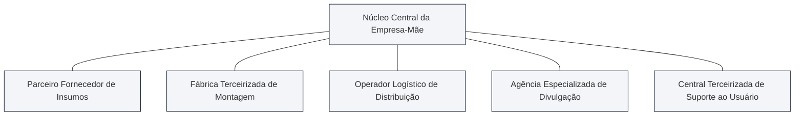
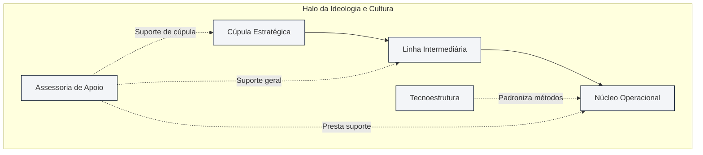

As intensas transformações tecnológicas das últimas décadas forçaram as corporações a buscar arranjos estruturais cada vez mais desfronteirizados, ágeis e conectados. Ao lado dos modelos tradicionais, consolidaram-se as abordagens recentes da organização, com destaque para as estruturas em rede, as organizações virtuais e os desenhos sem fronteiras. Paralelamente, para explicar como forças internas e ambientais se equilibram na prática, Henry Mintzberg estruturou um dos esquemas teóricos mais sofisticados da administração, mapeando as partes constitutivas, os mecanismos de coordenação e as configurações fundamentais das organizações. Em concursos públicos, as bancas examinam com grande frequência as características das redes contemporâneas e a correspondência exata entre o ponto-chave e o mecanismo de controle em cada configuração de Mintzberg.

> [!objetivos]
> - Caracterizar as abordagens recentes da organização: estruturas em rede, organizações virtuais e desenhos sem fronteiras.
> - Identificar as seis partes constitutivas fundamentais da anatomia organizacional segundo Henry Mintzberg.
> - Analisar os seis mecanismos primordiais de coordenação do trabalho humano nas corporações.
> - Compreender as seis configurações estruturais de Mintzberg, relacionando cada tipo ao seu ponto-chave e ambiente típico.
> - Distinguir os desenhos mecanísticos dos desenhos orgânicos na classificação consolidada por Idalberto Chiavenato.

## Estruturas contemporâneas: organizações em rede e virtuais

Inseridas nas **abordagens recentes da organização**, as **estruturas em rede (ou organizações modulares)** representam uma ruptura profunda com a tradição de manter todas as etapas produtivas sob a mesma propriedade jurídica e física. No modelo fabril clássico, as companhias buscavam a verticalização total, tornando-se donas de minas de matéria-prima, frotas de transporte, fábricas de componentes e redes próprias de varejo. Na estrutura em rede contemporânea, a corporação central (empresa-mãe) conserva sob seu domínio direto apenas o núcleo indispensável de inteligência institucional e desenvolvimento de competências centrais (*core business*).

Todas as demais atividades operacionais secundárias — como manufatura pesada, logística de distribuição, campanhas de divulgação comercial e suporte técnico ao usuário — são transferidas para empresas parceiras independentes interligadas por contratos de cooperação. A corporação central posiciona-se no vértice de uma teia de alianças horizontais. As decisões são tomadas de modo compartilhado e as unidades externas funcionam como centros autônomos de resultados, operando com base na mútua interdependência e na confiança recíproca.

Essa dinâmica desverticalizada proporciona grande adaptabilidade. Se as vendas de determinada linha de mercadorias despencam, a empresa-mãe não precisa fechar fábricas próprias nem arcar com indenizações vultosas de pessoal. Basta renegociar ou encerrar os contratos de fornecimento externo com os parceiros modulares.

Principais **vantagens** da organização em rede:

- **Extraordinária flexibilidade e adaptabilidade**: capacidade de adicionar ou substituir fornecedores com extrema rapidez para responder a mudanças abruptas de mercado.
- **Custos fixos drasticamente reduzidos**: como a instituição não imobiliza capital em plantas industriais gigantescas ou depósitos próprios, suas despesas estruturais permanentes mantêm-se em patamares reduzidos.
- **Foco absoluto na competência distintiva**: os gestores dedicam toda a energia corporativa à inovação tecnológica, ao design de novas soluções e ao fortalecimento da marca no mercado.
- **Capacidade global de escala**: empresas de médio porte conseguem competir internacionalmente conectando-se a fornecedores de classe mundial situados em múltiplos continentes.

Principais **desvantagens** e riscos gerenciais:

- **Menor controle sobre componentes críticos**: a dependência de fornecedores externos expõe a instituição a falhas de pontualidade, greves de terceiros e oscilações na qualidade do produto final.
- **Vulnerabilidade tecnológica e segredos industriais**: o compartilhamento contínuo de projetos com terceirizados eleva o risco de vazamento de informações confidenciais para a concorrência.
- **Fragilidade da lealdade organizacional**: os parceiros comerciais podem rescindir contratos ou priorizar demandas de empresas rivais que paguem remunerações superiores.
- **Coordenação interorganizacional exigente**: alinhar sistemas de informação, culturas corporativas distintas e padrões de governança entre dezenas de empresas parceiras demanda imenso esforço diplomático.

Uma modalidade radical de rede é a **organização virtual**. Essa estrutura opera quase exclusivamente no ambiente telemático e digital, dispensando sedes físicas imponentes ou estoques materiais permanentes. A empresa virtual articula temporariamente competências dispersas globalmente para aproveitar uma oportunidade efêmera de mercado, desmobilizando-se após o encerramento do ciclo de demanda.

> [!exemplo]
> Na indústria cinematográfica contemporânea, os grandes estúdios quase não mantêm atores, cenógrafos ou operadores em quadro fixo e permanente. Para cada filme, contrata-se uma rede virtual de produtoras independentes, técnicos de efeitos especiais e distribuidoras. Lançada a produção, a rede desfaz-se com baixíssimo custo fixo residual.

## Organizações sem fronteiras e desenhos baseados em equipes

A **organização sem fronteiras (*boundaryless organization*)** foi uma formulação gerencial popularizada por Jack Welch durante sua liderança na General Electric. O propósito central desse modelo é erradicar três barreiras tradicionais que engessam o funcionamento corporativo:

1. **Fronteiras verticais**: eliminação dos múltiplos degraus da cadeia escalar por meio do alargamento da amplitude de controle e do achatamento da pirâmide hierárquica. Reduz-se a distância entre os diretores da cúpula e os colaboradores operacionais do chão de fábrica.
2. **Fronteiras horizontais**: supressão dos feudos departamentais isolados, substituindo setores fechados por equipes multidisciplinares e integradas. Derrubam-se os muros que tradicionalmente separam finanças, engenharia e vendas.
3. **Fronteiras externas**: quebra de desconfianças entre a instituição e seus fornecedores e clientes, promovendo integração telemática contínua em tempo real. A empresa compartilha bancos de dados e previsões de estoques com seus parceiros para eliminar desperdícios.

Paralelamente, a **estrutura baseada em equipes** utiliza grupos autogerenciáveis de trabalho como a unidade primária de coordenação e execução das atividades corporativas. As decisões operacionais são totalmente delegadas aos colaboradores reunidos em times, que precisam dominar simultaneamente habilidades generalistas de cooperação e conhecimentos periciais profundos.

| Modelo Estrutural Emergente | Padrão de Funcionamento | Mecanismo Central | Principal Vantagem | Principal Ponto Fraco |
| --- | --- | --- | --- | --- |
| **Organização em Rede** | Núcleo institucional com terceirização ampla | Contratos formais e parcerias | Baixo custo fixo e flexibilidade | Menor controle sobre etapas terceirizadas |
| **Organização Virtual** | Empresa sem instalações físicas substanciais | Redes telemáticas digitais | Agilidade extrema e escala global | Dependência total da infraestrutura digital |
| **Organização sem Fronteiras** | Eliminação de barreiras verticais e horizontais | Equipes integradas e desverticalização | Fluidez veloz da comunicação | Ambiguidade e ansiedade por falta de regras |
| **Estrutura de Equipes** | Times autônomos substituem departamentos | Descentralização e autogestão | Alta motivação e sinergia de pares | Conflitos internos e necessidade de maturidade |

> [!atencao]
> As estruturas emergentes não eliminam a necessidade de liderança institucional. O papel da alta direção deixa de ser o comando punitivo direto e passa a ser a articulação de parcerias e a fixação de padrões éticos e metas globais.

## As seis partes básicas da organização segundo Henry Mintzberg

Para compreender com rigor científico a anatomia das instituições, Henry Mintzberg concebeu um consagrado modelo analítico. Para o autor, toda organização humana madura compõe-se de **seis partes básicas constitutivas**:

- **Cúpula Estratégica (Ápice Estratégico)**: é o vértice superior da corporação, onde se situam o presidente, diretores executivos e conselheiros. Tem a responsabilidade de assegurar que a instituição cumpra sua missão global e responda com eficácia às transformações do ambiente externo. Desenvolve a visão ampla e aloca os orçamentos globais de investimento.
- **Linha Intermediária**: constitui a cadeia escalar de administradores e chefes que interliga o ápice estratégico ao núcleo operacional. Sua função é traduzir as diretrizes amplas da cúpula em metas setoriais e supervisionar a execução cotidiana no terreno.
- **Núcleo Operacional**: engloba os colaboradores da base que realizam o trabalho essencial de fabricação de mercadorias e prestação direta de serviços (operários industriais, médicos, docentes, bombeiros e soldados). É o local onde ocorre a transformação prática de insumos em entregas sociais.
- **Tecnoestrutura**: é formada pelos analistas e especialistas técnicos que atuam fora da linha hierárquica de comando direto. Sua missão consiste em desenhar, planejar, normatizar e padronizar os processos e métodos de trabalho executados pelas outras partes da organização (analistas de processos, engenheiros de produção, contadores e planejadores de treinamento).
- **Assessoria de Apoio (*Staff* de Apoio)**: reúne as unidades auxiliares indiretas que prestam suporte à rotina institucional fora do fluxo de produção direta (como assessoria jurídica, relações públicas, serviço de copa, portaria e manutenção predial).
- **Ideologia**: representa a cultura viva, os valores compartilhados, mitos e tradições da corporação, funcionando como um halo protetor que envolve e harmoniza todos os membros em torno de um ideal compartilhado.

Mintzberg ressalta que essas seis partes não operam em isolamento passivo. Entre elas desenvolve-se uma dinâmica contínua de forças e tensões estruturais: a cúpula pressiona por centralização do comando; a linha intermediária busca autonomia para suas unidades de negócio; a tecnoestrutura exige padronização rigorosa dos métodos; o núcleo operacional defende autonomia técnica e liberdade pericial; e a assessoria de apoio busca reconhecimento de sua relevância funcional.

> [!bizu]
> Guarde a distinção fundamental entre tecnoestrutura e staff de apoio:
> - **Tecnoestrutura**: padroniza, planeja e normatiza o trabalho alheio (analistas de métodos e cronometristas).
> - **Assessoria de apoio**: presta serviços auxiliares indiretos que facilitam a rotina institucional (jurídico, limpeza, refeitório).

## Os seis mecanismos de coordenação do trabalho

Mintzberg postula que toda atividade humana organizada decorre de duas exigências complementares: a divisão do trabalho em tarefas distintas e a subsequente **coordenação** dessas tarefas. Para assegurar essa integração, as organizações utilizam **seis mecanismos fundamentais de coordenação**:

1. **Ajustamento mútuo**: a coordenação realiza-se pelo diálogo informal direto e horizontal entre os próprios trabalhadores envolvidos na tarefa, sem intervenção de chefias intermediárias.
2. **Supervisão direta**: uma chefia assume a responsabilidade de coordenar o trabalho dos demais, emitindo ordens diretas de serviço e monitorando as ações no terreno.
3. **Padronização dos processos de trabalho**: os procedimentos e rotinas são previamente detalhados em instruções escritas e manuais de operação elaborados pela tecnoestrutura.
4. **Padronização de resultados (*outputs*)**: a coordenação assenta-se na fixação prévia de metas numéricas, cotas de entrega ou parâmetros de qualidade a serem alcançados pelas unidades de trabalho.
5. **Padronização de habilidades e conhecimentos**: o próprio operador é padronizado antes de ingressar no serviço, internalizando conhecimentos e técnicas mediante rigorosa formação acadêmica e capacitação prévia.
6. **Padronização de normas**: os membros compartilham crenças éticas, dogmas e doutrinas que orientam de forma espontânea e uniforme suas deliberações cotidianas.

À medida que o trabalho corporativo ganha complexidade, os mecanismos de coordenação tendem a transitar por uma espiral evolutiva. Em pequenos grupos iniciantes, utiliza-se o ajustamento mútuo; com o crescimento do grupo, adota-se a supervisão direta; ampliando-se a escala fabril, recorre-se sucessivamente à padronização de processos, de saídas e de saberes; e em situações de complexidade e inovação extrema, a corporação retorna ao ajustamento mútuo.

| Mecanismo de Coordenação | Foco Central do Controle | Exemplo Prático de Aplicação |
| --- | --- | --- |
| **Ajustamento Mútuo** | Comunicação informal entre pares | Equipe de cientistas desenhando um projeto inovador |
| **Supervisão Direta** | Ordens verbais e fiscalização da chefia | Mestre de obras orientando operários em uma construção |
| **Padronização de Processos** | Especificação minuciosa do modo de fazer | Linha de montagem industrial de veículos |
| **Padronização de Resultados** | Metas, saídas e cotas pré-fixadas | Gerente de vendas com meta de expandir faturamento em 15% |
| **Padronização de Habilidades** | Formação técnica e treinamento do operador | Cirurgião e anestesista operando em hospital |
| **Padronização de Normas** | Valores, crenças e doutrinação comum | Voluntários de instituições humanitárias ou religiosas |

## As configurações organizacionais de Mintzberg

A combinação sistemática entre as seis partes básicas, os seis mecanismos de coordenação e as condições do ambiente externo dá origem às célebres **configurações estruturais de Henry Mintzberg**. Em sua formulação original, o autor identificou cinco configurações fundamentais, acrescentando posteriormente uma sexta forma estrutural (a organização missionária).

### As características detalhadas das configurações

1. **Estrutura Simples**: é a forma enxuta e centralizada dos pequenos negócios. A parte principal é a **cúpula estratégica** e o mecanismo coordenador é a **supervisão direta**. Quase não há tecnoestrutura ou órgãos de apoio, e a hierarquia é reduzida a dois ou três níveis. Opera com agilidade em ambientes simples e dinâmicos.
2. **Burocracia Mecanizada**: constitui a encarnação industrial da burocracia clássica. O ponto-chave é a **tecnoestrutura** (que padroniza procedimentos) e o mecanismo central é a **padronização dos processos de trabalho**. Apresenta regras rígidas, divisão minuciosa do trabalho e rotinas de linha de montagem em ambientes simples e estáveis.
3. **Burocracia Profissional**: estrutura altamente especializada comum em universidades, tribunais e hospitais. O ponto-chave é o **núcleo operacional** (médicos, docentes, juízes) e o mecanismo coordenador é a **padronização de habilidades**. Os profissionais desfrutam de ampla autonomia técnica para decidir em suas especialidades, apoiados por extenso corpo de assessoria de apoio, em ambientes complexos e estáveis.
4. **Forma Divisionalizada**: arranjo típico dos grandes conglomerados diversificados. O ponto-chave é a **linha intermediária** (gerentes de divisões semiautônomas) e o mecanismo regulador é a **padronização de resultados**. A cúpula estabelece metas e controla o rendimento financeiro de cada unidade de negócio descentralizada.
5. **Adhocracia**: modelo orgânico e multidisciplinar desenhado para a inovação. Seu ponto-chave situa-se na **assessoria de apoio** (onde se encontram os especialistas e cientistas) e seu mecanismo coordenador é o **ajustamento mútuo**. Opera sem formalismos em ambientes dinâmicos e de elevada complexidade técnica.
6. **Estrutura Missionária**: organização impulsionada por valores, causas e dogmas compartilhados. O ponto-chave é a **ideologia** e a coordenação decorre da **padronização de normas**. O poder decisório é amplamente descentralizado entre os membros que compartilham a mesma fé ou causa comunitária.

O quadro analítico a seguir sintetiza as correlações cobradas com rigor pelas bancas examinadoras:

| Configuração Estrutural | Parte Principal (Ponto-Chave) | Mecanismo Central de Coordenação | Ambiente Externo Adequado | Exemplo Típico |
| --- | --- | --- | --- | --- |
| **Estrutura Simples** | Cúpula Estratégica | Supervisão direta da chefia | Simples e dinâmico | Pequenas empresas, negócios familiares |
| **Burocracia Mecanizada** | Tecnoestrutura | Padronização dos processos | Simples e estável | Fábricas de montagem, empresas postais |
| **Burocracia Profissional** | Núcleo Operacional | Padronização de habilidades | Complexo e estável | Hospitais gerais, universidades |
| **Forma Divisionalizada** | Linha Intermediária | Padronização de resultados | Diversificado e relativamente estável | Conglomerados industriais com filiais |
| **Adhocracia** | Assessoria de Apoio | **Ajustamento mútuo** horizontal | Complexo e dinâmico | Produtoras de cinema, laboratórios |
| **Estrutura Missionária** | Ideologia | Padronização de normas e valores | Simples e estável | Entidades voluntárias, ordens religiosas |

Idalberto Chiavenato sintetiza essas formulações dividindo as configurações de Mintzberg em dois grandes grupos teóricos:

- **Desenhos Mecanísticos**: abrangem a Burocracia Mecanizada, a Burocracia Profissional e a Forma Divisionalizada, nas quais prevalece a padronização e o controle institucional estruturado.
- **Desenhos Orgânicos**: englobam a Estrutura Simples e a Adhocracia, marcadas pela elasticidade estrutural, prevalência de relações interpessoais e rápida capacidade de inovação.

> [!pegadinha] O hospital na visão de Mintzberg
> Questão clássica de concurso: a banca pergunta qual a configuração estrutural de um hospital. Jamais marque "burocracia mecanizada"! O hospital é o exemplo clássico da **Burocracia Profissional**. Seu ponto-chave é o **núcleo operacional** (médicos e enfermeiros) e seu mecanismo de coordenação é a **padronização de habilidades e saberes técnicos** internalizados na formação universitária, com ampla autonomia decisória para os profissionais.

## Mapa do capítulo

```mermaid Síntese de Mintzberg e Estruturas Contemporâneas
flowchart TB
  MEC[Estruturas Contemporâneas e Mintzberg] --> REDES[Estruturas em Rede e Virtuais]
  MEC --> PARTES[Seis Partes Básicas da Organização]
  MEC --> COORD[Seis Mecanismos de Coordenação]
  MEC --> CONF[Configurações Estruturais de Mintzberg]

  REDES --> R1[Em Rede: Núcleo central com terceirização ampla de apoio]
  REDES --> R2[Virtual: Desfronteirização e operação em rede digital]
  REDES --> R3[Sem Fronteiras: Supressão de barreiras verticais e horizontais]

  PARTES --> P1[Cúpula Estratégica, Linha Média e Núcleo Operacional]
  PARTES --> P2[Tecnoestrutura, Staff de Apoio e Ideologia]

  COORD --> C1[Ajustamento Mútuo e Supervisão Direta]
  COORD --> C2[Padronização de Processos, Saídas, Habilidades e Normas]

  CONF --> CF1[Estrutura Simples: Cúpula + Supervisão Direta]
  CONF --> CF2[Burocracia Mecanizada: Tecnoestrutura + Processos]
  CONF --> CF3[Burocracia Profissional: Núcleo Operacional + Habilidades]
  CONF --> CF4[Divisionalizada: Linha Média + Resultados]
  CONF --> CF5[Adhocracia: Staff de Apoio + Ajustamento Mútuo]
```

### Para fixar
- A estrutura em rede articula uma sede enxuta com parceiros independentes mediante alianças contratuais.
- A organização virtual opera predominantemente no ciberespaço, integrando competências globais sem instalações fabris físicas.
- A organização sem fronteiras erradica barreiras verticais, separações departamentais e distâncias externas com fornecedores.
- Mintzberg identifica seis partes básicas: cúpula estratégica, linha intermediária, núcleo operacional, tecnoestrutura, staff de apoio e ideologia.
- A tecnoestrutura é responsável pela padronização e planejamento das rotinas operacionais executadas por terceiros.
- Os mecanismos de coordenação abrangem ajustamento mútuo, supervisão direta e as padronizações de processos, resultados, saberes e normas.
- A burocracia mecanizada assenta-se na tecnoestrutura e coordena-se pela padronização dos processos fabris.
- A burocracia profissional tem como ponto-chave o núcleo operacional, coordenando-se pela padronização prévia de habilidades.
- A forma divisionalizada apoia-se na linha média de gerentes e coordena-se pelo controle padronizado de resultados.
- A adhocracia apoia-se no ajustamento mútuo e na assessoria técnica, operando como modelo orgânico para inovação acelerada.
