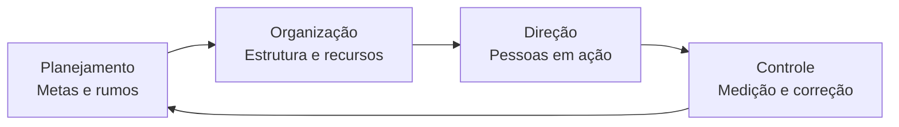
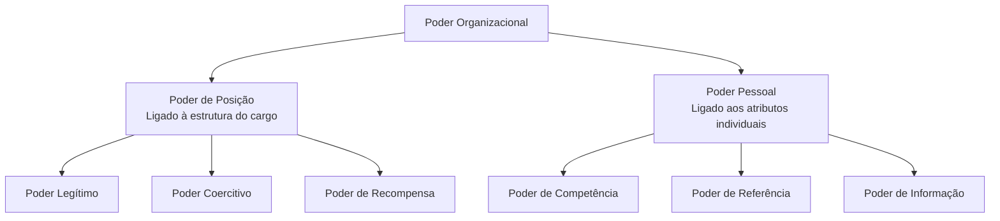
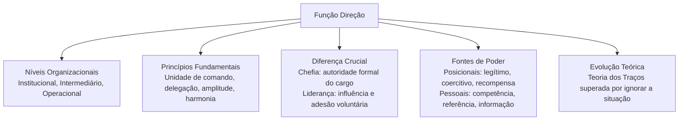

A função direção representa o componente dinâmico e humano do processo administrativo. Enquanto o planejamento define os objetivos e a organização desenha os órgãos e cargos, a direção mobiliza as pessoas para que as atividades planejadas se transformem em realizações concretas. Nas organizações modernas, compreender a direção exige distinguir com clareza o exercício da autoridade formal da influência legítima entre os membros da equipe, bem como dominar as diversas fontes de poder e as bases teóricas que explicam a condução de equipes.

> [!objetivos]
> - Compreender o papel da função direção nos três níveis organizacionais e seus princípios orientadores.
> - Distinguir com precisão os conceitos de chefia formal e liderança de equipe.
> - Identificar as bases do poder organizacional segundo a tipologia de French e Raven.
> - Analisar criticamente os postulados e as limitações da teoria dos traços de personalidade.

## Conceito e abrangência da função direção

No modelo clássico do processo administrativo, a administração desdobra-se em quatro funções cíclicas: planejamento, organização, direção e controle. O planejamento estabelece as metas e os caminhos para alcançá-las. A organização agrupa as tarefas em departamentos, estabelece as relações hierárquicas e distribui os recursos físicos e financeiros. Contudo, essas duas primeiras funções operam em um plano abstrato e estrutural. Uma organização não funciona apenas com tabelas, mapas funcionais e organogramas bem desenhados. São as pessoas que colocam a estrutura em movimento.

É nesse ponto que intervém a **função direção**. A direção consiste em orientar, guiar, motivar, liderar e coordenar os membros da organização rumo aos fins pretendidos. Trata-se de uma função de contato humano direto. Enquanto as demais funções administrativas lidam com processos, recursos e estruturas, a direção atua com os indivíduos, seus anseios, suas diferenças, seus conflitos e seus talentos.

A direção está presente em todos os níveis da instituição, variando o escopo de atuação e o horizonte temporal:

1. **Nível institucional**: corresponde à cúpula da organização, composta por diretores e pelo comando geral. Nesse patamar, a direção foca a organização como um todo e o relacionamento externo. O horizonte temporal é de longo prazo, articulando diretrizes amplas e a cultura institucional.
2. **Nível intermediário**: abrange os gerentes de divisão e chefes de departamentos. Esse nível faz a ponte entre as diretrizes globais e a execução diária. A direção aqui busca integrar as áreas funcionais e articular metas de médio prazo.
3. **Nível operacional**: situa-se na base executiva, onde supervisores e chefes de seção coordenam diretamente as equipes de trabalho. O horizonte é de curto prazo, focado no cumprimento das tarefas diárias e na observância de procedimentos técnicos.

A tabela a seguir compara a função direção em cada um dos três níveis organizacionais.

| Nível Organizacional | Posições Típicas | Escopo de Atuação | Horizonte Temporal | Foco Principal da Direção |
| --- | --- | --- | --- | --- |
| Institucional | Presidente, Diretores, Comandante-Geral | Toda a organização | Longo prazo | Visão global, políticas amplas e cultura institucional |
| Intermediário | Gerentes de Departamento, Comandantes de Batalhão | Unidades de negócio ou divisões | Médio prazo | Articulação entre setores e alocação tática de equipes |
| Operacional | Supervisores, Chefes de Seção, Encarregados | Grupos e tarefas específicas | Curto prazo | Orientação direta da rotina e execução técnica de tarefas |

Dirigir não significa apenas expedir ordens imperativas. O processo de direção moderno envolve a integração de três mecanismos fundamentais: a **liderança**, que gera adesão voluntária; a **motivação**, que canaliza o esforço e a persistência dos indivíduos; e a **comunicação**, que assegura a clareza das mensagens.

## Princípios fundamentais da função direção

Para que a condução de pessoas seja eficiente, a teoria administrativa consolidou um conjunto de princípios norteadores que orientam o exercício do comando.

O primeiro deles é o **princípio da unidade de comando**, formulado inicialmente por Henri Fayol. De acordo com essa regra, cada colaborador deve prestar contas e receber instruções de um único superior hierárquico. A quebra desse princípio gera ordens contraditórias, diluição de responsabilidades e ansiedade na equipe.

O segundo preceito essencial é o **princípio da delegação**. A delegação consiste na transferência de autoridade e atribuições operacionais de um superior para um subordinado, visando conferir agilidade às decisões. O ponto central para concursos públicos reside na distinção entre autoridade e responsabilidade. O gestor pode delegar a faculdade de decidir e agir, mas a **responsabilidade final** perante a organização permanece com quem delegou.

> [!atencao] Responsabilidade na delegação
> A autoridade para executar uma tarefa pode ser delegada pelo superior. Contudo, a responsabilidade final pelo resultado nunca se transfere de modo absoluto. O gestor que delega continua respondendo pela supervisão e pelo resultado.

O terceiro elemento estruturante é o **princípio da amplitude de controle** (ou amplitude administrativa). Esse princípio expressa o número de subordinados que um gestor consegue supervisionar diretamente com qualidade. Amplitudes estreitas resultam em estruturas verticais, com muitos escalões intermediários e comunicações lentas. Amplitudes largas produzem estruturas achatadas, exigindo maior autonomia dos colaboradores.

O quarto preceito é o **princípio da harmonia de objetivos**. Os indivíduos ingressam nas organizações com aspirações próprias de carreira e reconhecimento. A entidade possui seus próprios propósitos de eficácia e expansão. A tarefa do dirigente consiste em conciliar esses dois vetores, demonstrando que o alcance das metas institucionais viabiliza o atendimento dos anseios individuais.

A tabela abaixo sintetiza os quatro princípios fundamentais da direção e seus reflexos operacionais.

| Princípio | Conceito Central | Finalidade Prática | Risco da Inobservância |
| --- | --- | --- | --- |
| Unidade de Comando | Cada indivíduo responde a um único chefe | Evitar ordens divergentes e conflito de papéis | Ansiedade, estresse e paralisia operacional |
| Delegação | Transferência de autoridade e atribuição técnica | Dar agilidade às decisões e formar liderados | Sobrecarga do chefe ou perda do controle dos resultados |
| Amplitude de Controle | Número de subordinados diretos por chefe | Adequar a supervisão à complexidade do trabalho | Custos excessivos de gestão ou desorientação da equipe |
| Harmonia de Objetivos | Alinhamento entre metas individuais e da empresa | Fortalecer o engajamento e a dedicação voluntária | Desmotivação, rotatividade e conflitos de interesse |

> [!exemplo] Aplicação no serviço operacional
> Em uma operação de resgate em rodovia, o capitão do posto delega ao tenente a coordenação da triagem de vítimas. O tenente possui plena autoridade técnica para definir as prioridades de evacuação médica. No entanto, perante o comando do batalhão, o capitão permanece como o responsável pelo sucesso de toda a operação.

## Distinção entre chefia e liderança

A confusão entre as figuras do chefe e do líder é uma das fontes mais comuns de falhas na gestão e de questões de concurso. Embora ambas as funções conduzam grupos humanos, suas bases de sustentação são diferentes.

O **chefe** apoia sua atuação na autoridade formal concedida pelo cargo que ocupa no organograma. Trata-se de uma prerrogativa institucional imposta de cima para baixo. O chefe possui o direito legal de ordenar e fiscalizar porque as normas regulamentares lhe atribuem essa competência. Sua principal preocupação volta-se para a manutenção do *status quo*, o respeito à hierarquia, a previsibilidade dos métodos e o cumprimento estrito das normas regimentais.

Em contrapartida, a **liderança** configura um processo de influência mútua e espontânea. O líder não impõe sua vontade pela força do regulamento; ele mobiliza as pessoas por meio do convencimento, da empatia, da confiança e da adesão aos valores comuns. Enquanto a chefia apoia-se no poder do cargo, a liderança brota de qualidades reconhecidas pela equipe. Os membros seguem o líder não por imposição de portaria, mas porque acreditam em sua visão.

> [!pegadinha] Chefe versus líder em enunciados
> Questões de concurso costumam afirmar que todo chefe é automaticamente um líder ou que a liderança só pode ser exercida por quem ocupa cargo de chefia. Ambas as assertivas são incorretas. Há chefes que não possuem ascendência moral sobre seus comandados, assim como há líderes informais sem qualquer cargo formal.

O cenário ideal para qualquer entidade pública ou privada é a presença do **gestor-líder**: aquele profissional investido de autoridade formal que também desenvolve habilidades socioemocionais para inspirar voluntariamente seus colaboradores. Contudo, observam-se com frequência chefes desprovidos de liderança e líderes naturais sem cargo de comando.

A tabela comparativa a seguir detalha as diferenças essenciais entre o administrador tradicional e o líder de equipe.

| Dimensão de Análise | Chefia / Gerência Tradicional | Liderança Interpessoal |
| --- | --- | --- |
| Origem da influência | Autoridade formal concedida pelo cargo e organograma | Ascendência moral, confiança e relacionamento |
| Vetor de legitimação | Imposto de cima para baixo por ato administrativo | Concedido de baixo para cima pelo respeito do grupo |
| Foco prioritário | Sistemas, processos, métodos e estabilidade | Pessoas, valores, visão e horizontes da organização |
| Postura perante o erro | Busca de culpados e aplicação estrita de sanções | Oportunidade de aprendizado e aperfeiçoamento |
| Reação a mudanças | Defesa da ordem constituída e aversão a incertezas | Estímulo à inovação e desafio do *status quo* |
| Horizonte temporal | Curto prazo e resultados operacionais imediatos | Longo prazo e sustentabilidade dos propósitos |

Segundo as pesquisas sintetizadas por Idalberto Chiavenato, a liderança pode ser compreendida sob quatro ângulos conceituais complementares:

- **Fenômeno de influência mútua**: a liderança ocorre em função das relações humanas, exigindo comunicação para convergência de propósitos.
- **Processo de redução da incerteza**: o líder atua como um guia em momentos de crise, auxiliando a equipe a tomar decisões difíceis sob pressão.
- **Relação funcional com a equipe**: a liderança atende às necessidades psicológicas dos membros e media tensões internas.
- **Processo situacional e dinâmico**: o ato de liderar varia segundo a interação de três forças: o líder, os liderados e a situação enfrentada.

Douglas McGregor destacou que a liderança não é uma propriedade estática encastelada no indivíduo, mas sim uma relação social dinâmica. Essa compreensão demonstra que a liderança pode ser aprendida e desenvolvida profissionalmente.

> [!bizu] Cargo versus ascendência moral
> Lembre-se para a prova: o chefe tem subordinados e apoia-se no crachá; o líder tem seguidores e apoia-se na confiança. A chefia é concedida pela instituição; a liderança é conquistada perante as pessoas.

## Tipologias e bases do poder organizacional

O conceito de poder é indissociável da função direção e da liderança. O poder pode ser definido como a capacidade potencial que uma pessoa ou grupo detém para influenciar o comportamento e as decisões de outros indivíduos. Todos os gestores utilizam o poder em alguma medida, mas a eficácia da gestão depende da fonte em que esse poder se apoia.

O modelo teórico desenvolvido por John French e Bertram Raven categoriza as fontes de poder a partir de suas raízes estruturais e comportamentais.

As principais fontes de poder organizam-se da seguinte forma:

1. **Poder Legítimo**: decorre da posição hierárquica ocupada pelo indivíduo na estrutura formal. Os subordinados acatam as decisões porque reconhecem a validade institucional da investidura do chefe.
2. **Poder Coercitivo**: baseia-se na capacidade de aplicar sanções, penalidades, advertências disciplinares ou demissões. O elemento motriz dessa base é o receio da punição.
3. **Poder de Recompensa**: fundamenta-se na capacidade de conceder vantagens, elogios públicos, folgas remuneradas ou promoções. A adesão ocorre pela expectativa de obter um ganho concreto.
4. **Poder de Competência (Perícia ou Especialização)**: apoia-se na posse de conhecimentos técnicos, habilidades operacionais raras ou experiência comprovada. As pessoas acatam a orientação do perito por reconhecerem seu domínio técnico.
5. **Poder de Referência (Carismático)**: brota da atração pessoal e da empatia do condutor. Os membros da equipe identificam-se com a postura do líder e buscam emulá-lo voluntariamente.
6. **Poder de Informação**: deriva do acesso exclusivo e do controle sobre dados relevantes ou fluxos de comunicação indispensáveis para a tomada de decisões.

As fontes de poder dividem-se em dois grandes blocos: o **poder de posição** e o **poder do indivíduo**. O poder de posição engloba as bases legítima, coercitiva e de recompensa. Ele pertence ao cargo e cessa quando a função é deixada. O poder do indivíduo reúne as bases de competência e de referência, além do poder de informação. Ele reside nos talentos individuais e acompanha o profissional independentemente de títulos hierárquicos.

A tabela a seguir consolida as bases de poder, indicando sua categoria, o mecanismo central de influência e a reação típica da equipe.

| Base de Poder | Categoria | Mecanismo Central | Reação Típica dos Liderados | Limitações e Riscos |
| --- | --- | --- | --- | --- |
| Legítimo | Posição | Autoridade conferida pelo cargo formal | Conformidade aceitável por dever funcional | Limita-se ao escopo formal das atribuições legais |
| Coercitivo | Posição | Ameaça de punição ou penalidade disciplinar | Resistência velada e hostilidade passiva | Destrói o clima, eleva o estresse e gera desmotivação |
| Recompensa | Posição | Concessão de vantagens e incentivos materiais | Adesão focada na obtenção do benefício | Perde efeito se as recompensas cessarem ou forem triviais |
| Competência | Pessoal | Conhecimento técnico e perícia prática | Confiança técnica e cooperação sincera | Restringe-se à área de especialização do profissional |
| Referência | Pessoal | Carisma, ética e identificação afetiva | Comprometimento profundo e engajamento | Exige consistência ética contínua do condutor |
| Informação | Pessoal | Posse de dados cruciais para a ação | Dependência da orientação do informante | Torna-se obsoleto com a ampla circulação dos dados |

> [!atencao] Os efeitos colaterais do poder coercitivo
> Embora a coerção seja necessária em circunstâncias excepcionais para conter faltas disciplinares graves, o seu uso rotineiro é o menos eficaz. O poder coercitivo gera conformidade aparente enquanto o chefe está por perto, mas fomenta clima de medo e retaliações veladas quando a fiscalização diminui.

> [!exemplo] Bases de poder em ação real
> Pense em um capitão que comanda um grupamento de salvamento. O fato de assinar as escalas decorre do poder legítimo. Quando aprova a dispensa regulamentar dos militares mais dedicados, usa o poder de recompensa. No entanto, durante o atendimento a uma emergência complexa, quando os socorristas acatam com precisão suas instruções táticas, eles o fazem primariamente pelo poder de competência, pois reconhecem a vasta perícia técnica daquele instrutor.

## A abordagem dos traços de personalidade e suas limitações

A primeira tentativa formal de explicar por que certas pessoas conseguem conduzir equipes foi a **Teoria dos Traços de Personalidade**, surgida no início do século XX e dominante até meados da década de 1940.

A premissa basilar dessa corrente teórica estabelece que os líderes já nascem prontos. De acordo com essa abordagem, a liderança seria um dom biológico: certos indivíduos herdam características inatas que os predestinam ao comando, enquanto os demais nascem para seguir.

Os pesquisadores dedicaram décadas na tentativa de isolar um catálogo universal de traços físicos, mentais e morais que explicasse a liderança:

- **Traços físicos**: vigor biológico, aparência marcante, tom de voz firme e energia física.
- **Traços intelectuais**: elevado coeficiente de inteligência, julgamento rápido, fluência verbal e raciocínio lógico.
- **Traços socioemocionais**: autoconfiança, assertividade, estabilidade perante tensões e facilidade de relacionamento.
- **Traços ligados à tarefa**: motivação para realização, ambição profissional, persistência e iniciativa.

Apesar da ampla divulgação inicial dessa teoria, investigações empíricas desmontaram suas pretensões de universalidade. Revisões bibliográficas rigorosas, como as conduzidas por Ralph Stogdill, comprovaram que a teoria apresentava falhas conceituais insanáveis.

A primeira crítica decisiva foi a **impossibilidade de encontrar traços universais**. Nenhum traço mostrou-se comum a todos os líderes bem-sucedidos. Figuras históricas de liderança incontestável possuíam temperamentos e personalidades completamente diferentes e até contraditórias.

A segunda limitação reside no **desprezo pela situação e pelo contexto**. A teoria dos traços assumia que o indivíduo dotado de certos traços seria um líder em qualquer circunstância. A experiência prática provou o oposto: um executivo austero pode funcionar bem em uma crise financeira, mas fracassar em um ambiente criativo que exige diálogo e autonomia.

A terceira fraqueza consiste na **desconsideração dos liderados**. A liderança não ocorre de forma isolada. As características dos liderados, suas expectativas e competências moldam decisivamente a atuação do gestor.

Por fim, a teoria dos traços adotava uma postura fatalista ao postular que a liderança não poderia ser aprendida. Se o indivíduo não nascesse com tais traços, jamais se tornaria líder. Essa conclusão perdeu sustentação com o avanço da ciência da administração, que comprovou que a liderança reúne competências e atitudes passíveis de desenvolvimento mediante treinamento e experiência.

> [!pegadinha] A armadilha do líder nato
> As bancas costumam afirmar que a moderna teoria da administração comprova que os traços inatos de personalidade garantem o sucesso definitivo do líder. Fique atento: a teoria dos traços é uma abordagem superada. A presença de certos traços pode facilitar o surgimento do líder, mas de modo algum garante a sua eficácia prática.

A superação da teoria dos traços abriu caminho para a **escola comportamental**, que transferiu o foco da pesquisa da identificação de quem é o líder para a análise daquilo que o líder efetivamente faz ao gerir sua equipe.

## Mapa do capítulo

A tabela a seguir resume as principais pontes conceituais estudadas neste capítulo, servindo de roteiro rápido de revisão.

| Tópico Central | Ideia Central | Termo-Chave de Prova | Implicação Prática |
| --- | --- | --- | --- |
| Função Direção | Mobilização e condução do elemento humano | Processo interpessoal | Transforma o planejamento abstrato em execução concreta |
| Princípios da Direção | Regras estruturantes de relacionamento e comando | Unidade de comando e amplitude | Delega-se a autoridade decisória, mantendo a responsabilidade final |
| Chefia versus Liderança | Distinção entre autoridade formal e ascendência moral | Cargo versus pessoa | O chefe impõe obediência por norma; o líder inspira cooperação voluntária |
| Bases de Poder | Mecanismos de influência comportamental | Poder de posição versus pessoal | O poder pessoal gera compromisso duradouro; a coerção gera resistência |
| Teoria dos Traços | Primeira tentativa científica de mapear a liderança | Líder nato (superado) | Falhou por ignorar o contexto situacional e as demandas dos liderados |

### Para fixar

- A direção é a função administrativa que mobiliza e orienta as pessoas para a concretização dos planos corporativos.
- Ao contrário do planejamento e do controle, que são impessoais, a direção constitui um processo marcadamente interpessoal.
- O princípio da unidade de comando preconiza que cada funcionário receba orientações de apenas um superior direto.
- Na delegação administrativa, transfere-se a autoridade para agir, mas a responsabilidade final pelo resultado permanece com quem delegou.
- A chefia fundamenta-se na autoridade formal do cargo; a liderança baseia-se na influência interpessoal e na confiança voluntária.
- As bases de poder estruturais abrangem os poderes legítimo, coercitivo e de recompensa, vinculados à posição hierárquica.
- As bases de poder do indivíduo reúnem os poderes de competência e de referência, pertencentes aos atributos singulares do líder.
- O poder coercitivo gera conformidade superficial e foca na punição, sendo ineficaz para construir compromisso de longo prazo.
- A teoria dos traços foi superada por conceber a liderança como dom inato universal, ignorando as variáveis da situação e dos liderados.
