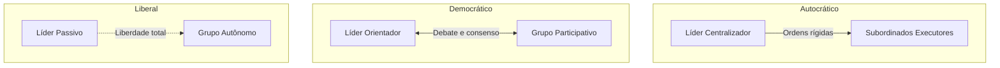
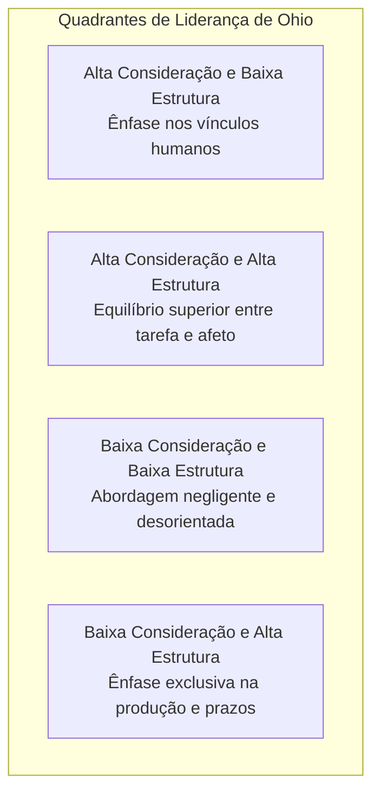
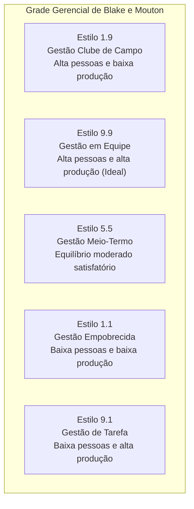
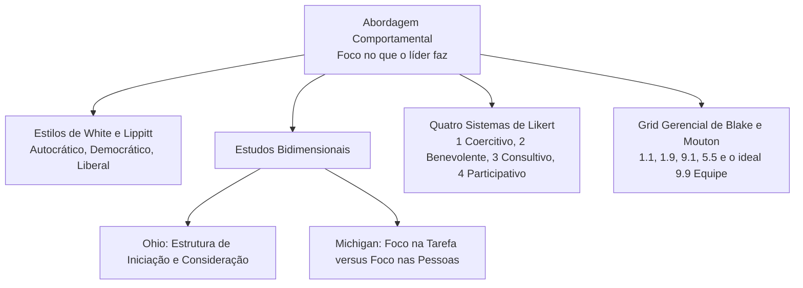

As teorias comportamentais de liderança marcaram uma revolução conceitual na ciência da administração a partir da década de 1940. Em contraposição à visão estática da teoria dos traços, a abordagem comportamental defendeu que a liderança não é um dom inato restrito a poucos indivíduos iluminados, mas sim um conjunto dinâmico de atitudes cotidianas que podem ser aprendidas, treinadas e desenvolvidas. Este capítulo examina os estilos clássicos de liderança, as pesquisas bidimensionais das universidades de Ohio e Michigan, os quatro sistemas administrativos de Likert e o modelo da Grade Gerencial de Blake e Mouton.

> [!objetivos]
> - Comparar os três estilos clássicos de liderança formulados por White e Lippitt e seus impactos no clima e na produtividade.
> - Compreender as dimensões comportamentais independentes identificadas pelas pesquisas de Ohio e Michigan.
> - Diferenciar os quatro sistemas gerenciais de Rensis Likert e reconhecer seus contextos de aplicação prática.
> - Analisar a matriz bidimensional do Grid Gerencial de Blake e Mouton e identificar seus cinco estilos notáveis.

## Da busca por traços ao estudo dos comportamentos

Durante as primeiras décadas do século XX, os pesquisadores tentaram isolar atributos inatos que determinassem o sucesso do líder. Acreditava-se que certas pessoas nasciam com um conjunto especial de qualidades biológicas e psicológicas que as predestinavam fatalmente ao comando. Contudo, quando as evidências empíricas demonstraram que grandes condutores históricos não compartilhavam traços homogêneos e que o contexto situacional exercia papel decisivo, a teoria dos traços perdeu fôlego no meio acadêmico.

Nasceu, então, a **abordagem comportamental** da liderança. Em vez de insistir em quem é o líder em termos de personalidade fixa, os pesquisadores passaram a investigar o que os líderes eficazes efetivamente fazem no exercício diário da gestão. Essa transição teórica representou uma mudança de paradigma com repercussões profundas para a gestão de pessoas nas organizações públicas e privadas:

1. A liderança deixou de ser tratada como um privilégio biológico imutável para se tornar um repertório de práticas observáveis e passíveis de mensuração objetiva.
2. Abriu-se a possibilidade real de capacitar gestores por meio de treinamento e aperfeiçoamento contínuo de competências de comunicação, tomada de decisão e relacionamento interpessoal. Em vez de apenas selecionar talentos natos, as corporações passaram a investir na formação de seus quadros diretivos.

Os estudos comportamentais estruturaram-se em duas grandes vertentes de investigação científica: a primeira dedicou-se à análise dos **estilos gerais de liderança**, examinando como o poder decisório é distribuído entre o chefe e os colaboradores; a segunda concentrou-se na **orientação bidimensional**, investigando como os gestores equilibram a ênfase técnica nas tarefas operacionais e a valorização socioemocional dos seres humanos.

## Os três estilos clássicos de White e Lippitt

A pesquisa pioneira sobre estilos de liderança foi conduzida por Ralph White e Ronald Lippitt, sob a coordenação do psicólogo Kurt Lewin, na Universidade de Iowa, no final da década de 1930. O experimento analisou o comportamento de grupos de jovens submetidos a três padrões distintos de condução na realização de tarefas manuais: o estilo autocrático, o estilo democrático e o estilo liberal (*laissez-faire*).

Os três estilos diferenciam-se pelo modo como o gestor toma decisões, distribui tarefas, programa o trabalho e interage com a equipe:

### Liderança Autocrática

Na liderança autocrática, o poder de decisão concentra-se totalmente no chefe. O condutor fixa diretrizes sem consultar a equipe, determina o que cada membro deve fazer e escolhe os pares de trabalho de maneira impositiva. O líder autocrático é dominador e pessoal em suas avaliações, elogiando ou censurando o indivíduo em vez da tarefa técnica executada.

Sob autocracia, o grupo revelou forte tensão psicológica, frustração, agressividade reprimida e submissão aparente. Foram frequentes reações de hostilidade velada e criação de bodes expiatórios entre os próprios colegas. A produtividade quantitativa foi elevada no início, mas o trabalho apresentou baixa qualidade e ausência completa de inovação. Além disso, a produção só ocorria com a presença física do chefe; no momento em que ele se ausentava da sala, as atividades eram imediatamente interrompidas, revelando ausência de comprometimento espontâneo.

### Liderança Democrática

Na liderança democrática, as diretrizes são debatidas e decididas coletivamente com o apoio e o estímulo do gestor. O líder funciona como orientador e facilitador do debate, acolhendo sugestões e incentivando a iniciativa individual. A divisão das atribuições e a escolha dos colegas cabem ao próprio grupo. As críticas e os elogios emitidos pelo líder são objetivos, focados exclusivamente nos fatos técnicos e nos padrões de qualidade acordados.

O clima organizacional caracterizou-se por moral elevado, entusiasmo, companheirismo e cooperação mútua espontânea. A produção manteve-se equilibrada e consistente, com padrão qualitativo claramente superior ao obtido na autocracia. O ponto mais relevante residiu na sustentabilidade: mesmo na ausência física do gestor, a equipe prosseguiu trabalhando com regularidade, ritmo firme e responsabilidade compartilhada.

### Liderança Liberal (*Laissez-Faire*)

O estilo liberal traduz-se pela total concessão de liberdade à equipe, assumindo o gestor um papel passivo e meramente expectador. O chefe não fixa diretrizes, não programa as etapas de trabalho e não acompanha a execução, fornecendo informações apenas se expressamente requisitado pelos colaboradores. Não há qualquer controle ou avaliação sistemática sobre o progresso das tarefas.

Essa omissão provocou desordem, desagregação grupal, desorientação e discussões estéreis entre os membros. Diante da falta de rumo, os colaboradores dispersaram-se em disputas de poder informais. A produção foi inexpressiva tanto em quantidade quanto em qualidade, com forte desperdício de tempo e recursos materiais, gerando frustração generalizada.

A tabela comparativa a seguir sintetiza os traços fundamentais dos três estilos clássicos de White e Lippitt em relação às quatro dimensões de análise organizacional.

| Dimensão de Análise | Estilo Autocrático | Estilo Democrático | Estilo Liberal (*Laissez-Faire*) |
| --- | --- | --- | --- |
| Tomada de Decisões | Centralizada exclusivamente no chefe | Debatida e deliberada pelo grupo com o líder | Liberdade total do grupo sem intervenção |
| Programação das Ações | Ditada pelo líder sem explicar o conjunto | Delineada pelo grupo com apoio do gestor | Decidida pelos membros sem coordenação |
| Divisão de Tarefas | Imposta pelo chefe, que escolhe os pares | Definida pelo grupo com diálogo aberto | Totalmente informal a cargo de cada um |
| Postura do Condutor | Dominadora e pessoal nas avaliações | Orientadora e objetiva perante fatos | Passiva, intervindo apenas se solicitado |

> [!pegadinha] A produtividade aparente da autocracia
> A autocracia atinge alto volume quantitativo imediato sob fiscalização direta, mas a liderança democrática produz maior qualidade técnica, maior satisfação da equipe e constância de rendimento mesmo na ausência do gestor.

O estudo concluiu que nenhum estilo é perfeito em caráter universal. O administrador moderno e flexível precisa calibrar sua postura segundo as demandas concretas da conjuntura operacional, variando o grau de autoridade e de participação conforme a maturidade do grupo e a urgência das entregas.

> [!exemplo] Os três estilos na rotina corporativa
> Em uma operação de socorro com desabamento, o capitão adota postura autocrática, emitindo ordens diretas e imediatas de corte de energia e contenção de escombros, pois o risco iminente exige resposta unificada. Em uma reunião de planejamento preventivo para o verão, adota postura democrática, debatendo rotas com os oficiais para enriquecer o plano. Ao orientar peritos em software de ponta na área de comunicação, atua de forma liberal, concedendo plena autonomia técnica aos especialistas.

## Estudos bidimensionais: Ohio e Michigan

A compreensão de que a liderança reúne múltiplas facetas comportamentais impulsionou pesquisas empíricas simultâneas na Universidade Estadual de Ohio e na Universidade de Michigan a partir do pós-guerra.

### Pesquisas da Universidade Estadual de Ohio

Os pesquisadores de Ohio aplicaram questionários a centenas de líderes em organizações militares, industriais e educacionais para identificar os fatores determinantes do comportamento gerencial. A análise estatística isolou duas variáveis centrais e independentes:

- **Estrutura de Iniciação**: refere-se à extensão em que o líder organiza o trabalho, define metas objetivas, delimita atribuições funcionais, estabelece canais formais de comunicação e cobra cumprimento rigoroso de prazos e métodos operacionais. Um líder com alta estrutura de iniciação concentra-se em disciplinar a execução da tarefa.
- **Consideração**: reflete a extensão em que o líder constrói relações de confiança recíproca, demonstra respeito sincero pelas ideias da equipe, valoriza o bem-estar dos subordinados e manifesta empatia e calor humano no trato diário. O líder com alta consideração apoia os liderados em suas dificuldades profissionais e pessoais.

Como são dimensões independentes, o gestor pode pontuar alto ou baixo em ambas simultaneamente. O modelo de Ohio desmistificou a crença simplista de que a exigência técnica de tarefas precisaria anular a atenção humana aos colaboradores.

### Pesquisas da Universidade de Michigan

Coordenados inicialmente por Rensis Likert no Centro de Pesquisas Sociais da Universidade de Michigan, os estudos buscaram correlacionar o comportamento do líder ao nível de desempenho produtivo. Foram catalogadas duas orientações básicas:

- **Orientada para a tarefa (produção)**: foca nos aspectos técnicos do serviço, na padronização mecânica dos processos e no rendimento quantitativo. Os funcionários são tratados como instrumentos materiais indispensáveis para atingir as metas.
- **Orientada para os colaboradores (pessoas)**: valoriza o relacionamento interpessoal equilibrado, a delegação de autonomia, a segurança psicológica e o apoio ao desenvolvimento individual da equipe.

Embora Michigan tenha concebido inicialmente essas duas orientações como polos opostos de um mesmo continuum, as evidências empíricas demonstraram que os gestores orientados para os colaboradores conseguiam alcançar maior produtividade sustentada no longo prazo, acompanhada de maior satisfação no trabalho e menor índice de rotatividade funcional.

A tabela a seguir compara os achados conceituais das universidades de Ohio e Michigan.

| Critério de Comparação | Universidade Estadual de Ohio | Universidade de Michigan |
| --- | --- | --- |
| Dimensões Identificadas | Estrutura de Iniciação e Consideração | Orientação para Tarefa e Orientação para Pessoas |
| Relação entre as Dimensões | Variáveis independentes (visão bidimensional) | Inicialmente vistas como polos de um mesmo continuum |
| Foco da Primeira Dimensão | Organização de métodos, prazos e controle de metas | Rendimento técnico e tratamento mecanicista do trabalho |
| Foco da Segunda Dimensão | Confiança recíproca, respeito e apoio socioemocional | Satisfação das necessidades humanas dos membros |
| Conclusão Empírica | O líder pode pontuar alto em ambas as dimensões | A ênfase nas pessoas sustenta melhor desempenho |

> [!bizu] Estrutura versus Consideração
> Memorize para a prova: **Estrutura** liga-se a estruturar o trabalho (metas, tarefas, processos e prazos). **Consideração** liga-se a ter consideração pelas pessoas (respeito, empatia e confiança mútua).

## Os quatro sistemas administrativos de Likert

Rensis Likert desenvolveu uma consagrada tipologia que classifica as organizações em quatro perfis gerenciais, examinando quatro variáveis fundamentais: processo decisório, fluxo de comunicação, relacionamento interpessoal e sistema de incentivos.

Likert observou que as organizações diferem profundamente na maneira como utilizam a autoridade hierárquica e constroem a cultura interna. A interação entre as quatro variáveis permite mapear a maturidade das instituições e prever seu nível de eficiência de longo prazo.

### Sistema 1: Autoritário-Coercitivo

É o modelo autocrático fechado e arbitrário. O processo decisório concentra-se inteiramente na cúpula. A comunicação flui exclusivamente de cima para baixo na forma de ordens imperativas, sem canais de retorno ascendente. As relações interpessoais informais são terminantemente vedadas por serem encaradas pela direção como ameaça à disciplina. O sistema de motivação ampara-se no medo, em ameaças veladas, em admoestações e em punições disciplinares severas.

### Sistema 2: Autoritário-Benevolente

Constitui uma versão atenuada do sistema autocrático. O poder decisório segue concentrado no topo, mas a alta gestão permite uma pequena delegação de decisões repetitivas e rotineiras aos escalões intermediários. A comunicação é predominantemente descendente, tolerando tímido retorno formal por meio de relatórios padronizados. As relações informais são vistas com desconfiança, mas toleradas sob vigilância. O sistema de incentivos utiliza ameaças combinadas a algumas recompensas materiais e salariais.

### Sistema 3: Consultivo

A gestão aproxima-se ativamente da participação. A cúpula formula políticas gerais, mas consulta formalmente os escalões inferiores antes de deliberar e delega decisões setoriais aos níveis táticos. A comunicação transita de forma aberta nos sentidos descendente, ascendente e lateral. Relações interpessoais são incentivadas como força positiva, e as recompensas materiais e simbólicas predominam sobre sanções punitivas.

### Sistema 4: Participativo

Representa o ápice da maturidade gerencial e da democracia organizacional. O processo decisório é totalmente descentralizado e baseado no consenso coletivo; a cúpula atua definindo apenas diretrizes institucionais amplas. As comunicações fluem livremente em todas as direções da estrutura. O trabalho em equipe apoia-se em confiança mútua irrestrita. As punições disciplinares são raras e decididas pelo próprio grupo de trabalho, predominando recompensas morais, reconhecimento social e autorrealização.

A tabela a seguir detalha os quatro sistemas gerenciais de Likert e seus ambientes de aplicação típicos no mercado e no setor público.

| Sistema Gerencial | Processo Decisório | Fluxo de Comunicação | Relações Interpessoais | Sistema de Recompensas | Ambiente Típico de Mercado |
| --- | --- | --- | --- | --- | --- |
| **1. Autoritário-Coercitivo** | Totalmente centralizado na cúpula | Descendente e impositivo; sem retorno | Vedadas e tidas como ameaça | Ameaças, medo e punições severas | Mão de obra intensiva e tecnologia rudimentar (ex.: construção civil pesada) |
| **2. Autoritário-Benevolente** | Centralizado, com delegação de rotinas | Descendente, com tímido retorno formal | Toleradas sob estreita vigilância | Recompensas materiais e punições | Indústrias fabris tradicionais com operações padronizadas |
| **3. Consultivo** | Consulta prévia com decisão na cúpula | Aberto em fluxos ascendente e descendente | Clima de cooperação e confiança média | Recompensas materiais e sociais | Instituições financeiras bancárias e empresas comerciais |
| **4. Participativo** | Totalmente descentralizado por consenso | Livre e aberto em todas as direções | Relações orgânicas e mútua confiança | Recompensas simbólicas e morais | Consultorias técnicas, agências de inovação e empresas de ponta |

> [!exemplo] Os quatro sistemas em cenários práticos
> Em uma pedreira com ferramentas manuais e mão de obra rústica, predomina o **Sistema 1**, focado em ordens estritas e fiscalização física constante. Em uma fábrica têxtil com linhas de montagem padronizadas, observa-se o **Sistema 2**, com metas de produção fabril e prêmios salariais. Em uma agência bancária comercial, adota-se o **Sistema 3**, onde os gestores consultam equipes sobre planos de atendimento ao público. Por fim, em uma empresa de consultoria de engenharia ou desenvolvimento de software, vigora o **Sistema 4**, caracterizado por deliberação consensual e ampla autonomia técnica.

> [!atencao] A recomendação evolutiva de Likert
> Likert demonstrou que a migração progressiva do Sistema 1 em direção ao Sistema 4 eleva a produtividade sustentável, o moral da equipe e a capacidade inovadora da organização. O Sistema 4 constitui a meta recomendada para entidades que dependem de conhecimento técnico intensivo.

Para integrar as unidades organizacionais no Sistema 4, Likert concebeu o conceito dos **elos de ligação** (*linking pins*): certos profissionais atuam simultaneamente como líderes de sua equipe imediata e membros subordinados da equipe do nível imediatamente superior, integrando a comunicação corporativa de forma coesa.

## O Grid Gerencial de Blake e Mouton

Robert Blake e Jane Mouton sintetizaram os achados comportamentais no modelo da **Grade Gerencial** (*Managerial Grid*). O instrumento projeta uma matriz gráfica de 9 por 9 posições, totalizando 81 combinações possíveis de conduta, cruzando duas variáveis fundamentais:

1. **Preocupação com a produção**: escala de 1 a 9 no eixo horizontal, medindo a ênfase em metas, eficiência técnica, cronogramas, custos operacionais e procedimentos formais.
2. **Preocupação com as pessoas**: escala de 1 a 9 no eixo vertical, medindo a atenção dedicada ao moral da equipe, segurança psicológica, justiça, desenvolvimento profissional e necessidades individuais.

Cinco posições notáveis destacam-se na literatura e nas questões de concurso:

### Estilo 1.1: Gestão Empobrecida (Líder Negligente)

O administrador aplica o esforço estritamente mínimo indispensável para manter o emprego e evitar atritos com a hierarquia formal. Não demonstra interesse genuíno pela produção nem pelas pessoas, gerando apatia crônica e desorganização setorial.

### Estilo 1.9: Gestão Clube de Campo (Líder Pessoa)

Atenção máxima às necessidades humanas e ambiente descontraído, com interesse quase nulo pelos resultados operacionais. O chefe evita qualquer atrito ou cobrança formal, tolerando baixa disciplina e atrasos contínuos nas entregas.

### Estilo 9.1: Gestão de Tarefa / Autoridade-Obediência (Líder Tarefa)

Foco obsessivo na produção e no cumprimento estrito de metas, tratando os subordinados como meras peças mecânicas do maquinário produtivo. O estilo gera rendimento quantitativo a curto prazo, mas provoca alto índice de desgaste funcional, adoecimento e rotatividade.

### Estilo 5.5: Gestão Meio-Termo (Organização Humana)

Equilíbrio intermediário entre metas aceitáveis e moral da equipe. O administrador adota postura conciliatória baseada em acomodação mútua, sem alcançar a excelência produtiva nem o pleno entusiasmo e inovação dos liderados.

### Estilo 9.9: Gestão em Equipe (Líder Equipe)

Dedicação máxima tanto à produção quanto à valorização humana da equipe. Blake e Mouton postulam categoricamente que o estilo 9.9 é o **estilo ideal de liderança**. A alta produtividade é alcançada por meio de colaboradores engajados que encontram realização e significado no cumprimento de objetivos desafiadores compartilhados.

A tabela a seguir consolida os cinco estilos notáveis da Grade Gerencial.

| Estilo Notável | Eixo Produção | Eixo Pessoas | Denominação Doutrinária | Postura Central do Gestor |
| --- | --- | --- | --- | --- |
| **1.1** | 1 (Mínimo) | 1 (Mínimo) | Gestão Empobrecida (Negligente) | Cumpre o esforço estritamente mínimo para não perder o cargo |
| **1.9** | 1 (Mínimo) | 9 (Máximo) | Gestão Clube de Campo (Playground) | Prioriza a harmonia interna, negligenciando disciplina e prazos |
| **9.1** | 9 (Máximo) | 1 (Mínimo) | Gestão de Tarefa (Autoridade-Obediência) | Foca apenas na produção, tratando subordinados como instrumentos |
| **5.5** | 5 (Médio) | 5 (Médio) | Gestão Meio-Termo (Organização Humana) | Busca conciliação pragmática e conformidade com resultados medianos |
| **9.9** | 9 (Máximo) | 9 (Máximo) | Gestão em Equipe (Estilo Ideal) | Integra dedicação a metas exigentes e valorização humana mútua |

> [!pegadinha] O estilo ideal segundo Blake e Mouton
> As bancas costumam afirmar que o estilo ideal de liderança é o 5.5 (meio-termo). Para Blake e Mouton, o estilo ideal é o **9.9 (Gestão em Equipe)**. O modelo propõe o ápice em ambas as dimensões, e não a mediania de concessões do ponto 5.5.

Blake e Mouton conceberam a Grade Gerencial como base de programas abrangentes de Desenvolvimento Organizacional (DO), visando conduzir os gestores progressivamente rumo ao quadrante 9.9 por meio de seminários, análise intergrupal e definição de planos corporativos ideais.

## Mapa do capítulo

A tabela abaixo resume as teorias comportamentais estudadas no capítulo, destacando autores, dimensões e implicações para a prova.

| Modelo Teórico | Principais Autores | Dimensões ou Estilos | Conclusão Fundamental para Prova |
| --- | --- | --- | --- |
| Estilos Clássicos | White, Lippitt e Lewin | Autocrático, Democrático e Liberal | A democracia gera melhor qualidade e moral elevado; o estilo ideal varia com o cenário |
| Estudos de Ohio | Pesquisadores de Ohio | Estrutura de Iniciação e Consideração | Variáveis independentes; o líder pode pontuar alto em ambas as dimensões |
| Estudos de Michigan | Rensis Likert e equipe | Foco na Tarefa e Foco nas Pessoas | Gestores orientados para os funcionários alcançam maior produtividade sustentável |
| Sistemas de Gestão | Rensis Likert | Sistemas 1 (Coercitivo) a 4 (Participativo) | O Sistema 4 baseia-se em consenso, ampla confiança e recompensas morais |
| Grade Gerencial | Robert Blake e Jane Mouton | Matriz de 1 a 9 em Produção e Pessoas | O estilo 9.9 (Gestão em Equipe) é preconizado como o modelo ideal de excelência |

### Para fixar

- As teorias comportamentais investigam as condutas do líder no dia a dia, demonstrando que a liderança pode ser aprendida.
- Na liderança autocrática, as ordens são impostas sem consulta, gerando tensão interna e volume imediato sob fiscalização.
- Na liderança democrática, as diretrizes são construídas pelo coletivo com apoio do gestor, assegurando alta qualidade e constância.
- O estilo liberal concede liberdade desmedida à equipe e costuma provocar desordem, desagregação e produtividade inexpressiva.
- A Universidade de Ohio estabeleceu duas variáveis independentes: estrutura de iniciação (tarefas) e consideração (pessoas).
- A Universidade de Michigan contrapôs a orientação para a produção à orientação para as pessoas e o apoio individual.
- O Sistema 1 de Likert é autoritário-coercitivo e punitivo; o Sistema 4 é participativo, aberto e pautado pela confiança mútua.
- No Grid Gerencial de Blake e Mouton, o ponto 9.1 foca puramente nas tarefas e o ponto 1.9 nas relações fraternais.
- O ponto 9.9 do Grid Gerencial representa a gestão em equipe, sendo o modelo ideal de excelência preconizado pelos autores.
