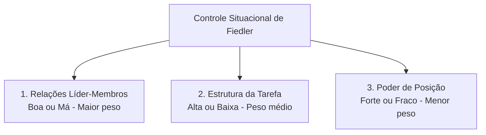
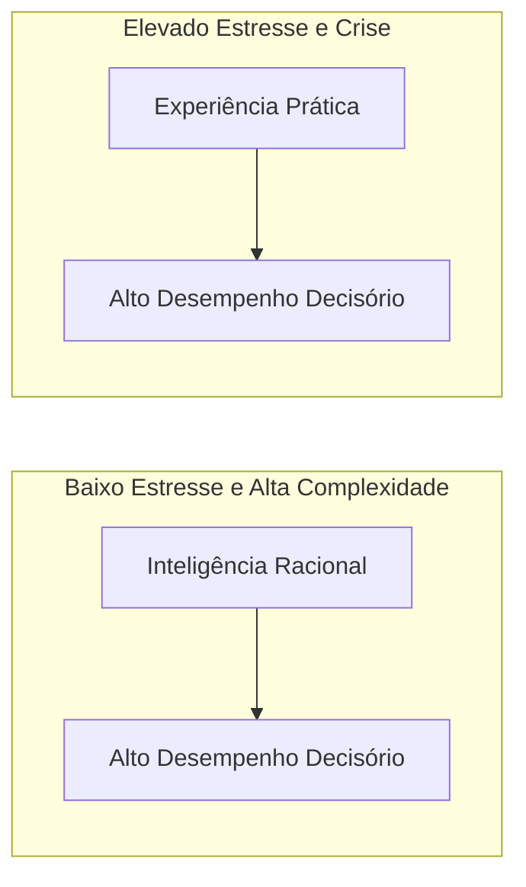
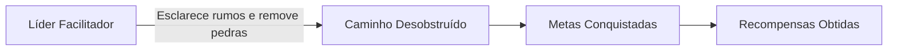
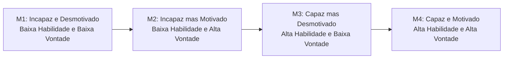
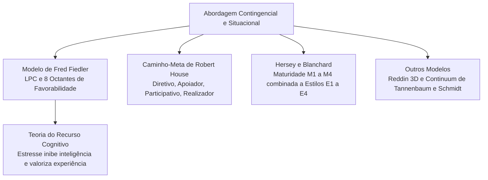

No âmbito da função administrativa de direção, as limitações das teorias comportamentais demonstraram que nenhum estilo de comando é eficaz em todas as circunstâncias. A função direção exige flexibilidade para orientar os colaboradores conforme as variáveis de cada momento. A partir da década de 1960, a ciência da administração consolidou a abordagem contingencial e situacional, postulando que o sucesso da liderança na direção de equipes depende do ajuste harmonioso entre o comportamento do líder, as características dos liderados e o contexto organizacional. Este capítulo examina o modelo pioneiro de Fred Fiedler, a teoria do recurso cognitivo, o caminho-meta de Robert House, o modelo situacional de Hersey e Blanchard e o continuum de Tannenbaum e Schmidt.

> [!objetivos]
> - Compreender a lógica contingencial e as três variáveis de favorabilidade do modelo de Fred Fiedler.
> - Analisar o impacto do estresse e da complexidade na teoria do recurso cognitivo.
> - Diferenciar os quatro comportamentos de liderança da teoria caminho-meta de Robert House.
> - Aplicar a matriz situacional de Hersey e Blanchard correlacionando maturidade e estilo de liderança.

## O paradigma contingencial na liderança

Tanto a teoria dos traços quanto a abordagem comportamental cometeram o equívoco de procurar uma fórmula universal de liderança. Os defensores dos traços buscavam o líder perfeito por natureza; os teóricos comportamentais procuravam o melhor estilo de liderança para qualquer empresa. Contudo, pesquisas de campo comprovaram que líderes autocráticos obtinham sucesso excepcional em crises graves, enquanto líderes democráticos fracassavam quando atuavam com equipes desprovidas de qualquer qualificação técnica.

Surgiu, assim, o **paradigma contingencial**. O postulado basilar dessa corrente estabelece que não existe um estilo único, universal e perfeito de liderança. A eficácia da condução de equipes decorre de uma relação de contingência: o estilo adotado precisa ser congruente com as demandas da situação enfrentada, as competências dos colaboradores e a cultura da organização.

Na literatura administrativa, os termos "contingencial" e "situacional" costumam ser empregados como sinônimos em provas de concurso. Quando a doutrina busca diferenciá-los, considera que a abordagem contingencial foca em fatores ambientais mais amplos e estáveis, enquanto a liderança situacional concentra-se nas variações dinâmicas de curto prazo entre o líder e sua equipe imediata.

## O modelo contingencial de Fred Fiedler

Desenvolvido a partir de 1967 pelo psicólogo Fred Fiedler, este foi o primeiro modelo formal a associar a eficácia da liderança às características da situação. A teoria de Fiedler apoia-se em uma premissa controversa e marcante: o autor defendia que o estilo fundamental de liderança de um indivíduo é um traço fixo e estável de sua personalidade, sendo extremamente difícil modificá-lo por meio de treinamento rápido.

Para mensurar o estilo do líder, Fiedler criou o questionário do **Colega Menos Preferido** (*Least Preferred Co-worker* - LPC). O gestor avalia, por meio de adjetivos bipolares (como agradável/desagradável, cooperativo/hostil), a pessoa com quem teve maior dificuldade de trabalhar ao longo de sua carreira profissional:

- **Alto LPC (líder orientado para relacionamentos)**: o respondente descreve o colega menos preferido em termos benevolentes e compreensivos. Esse gestor valoriza os vínculos interpessoais, busca aprovação social e prioriza a harmonia humana no trabalho.
- **Baixo LPC (líder orientado para tarefas)**: o respondente descreve o colega de forma negativa e rigorosa. Esse líder foca no cumprimento mecânico de metas, na eficiência técnica e no controle operacional, mantendo postura pragmática.

### As três dimensões de controle situacional

Após determinar o estilo do líder pelo LPC, Fiedler avalia o grau de controle e favorabilidade da situação organizacional com base em três variáveis críticas:

1. **Relações líder-membros**: mede o nível de confiança recíproca, lealdade, respeito e estima que a equipe dedica ao condutor. É a dimensão mais importante do modelo. Pode ser classificada como boa ou má.
2. **Estrutura da tarefa**: mede o grau em que as metas, as etapas de execução e os procedimentos técnicos são formalizados e padronizados. Pode ser classificada como alta (tarefa estruturada) ou baixa (tarefa não estruturada e ambígua).
3. **Poder de posição**: expressa o grau de autoridade formal inerente ao cargo ocupado pelo gestor para admitir, demitir, punir ou conceder aumentos salariais. Pode ser classificado como forte ou fraco.

O cruzamento dessas três variáveis produz **oito combinações possíveis de situações** (denominadas octantes), ordenadas da mais favorável à mais desfavorável ao líder.

A tabela a seguir apresenta os oito octantes do modelo de Fred Fiedler e indica o estilo de liderança mais eficaz para cada cenário.

| Octante | Relações Líder-Membros | Estrutura da Tarefa | Poder de Posição | Grau de Favorabilidade | Estilo de Líder mais Eficaz |
| --- | --- | --- | --- | --- | --- |
| **I** | Boa | Alta | Forte | Muito Favorável | Orientado para a Tarefa (Baixo LPC) |
| **II** | Boa | Alta | Fraco | Muito Favorável | Orientado para a Tarefa (Baixo LPC) |
| **III** | Boa | Baixa | Forte | Muito Favorável | Orientado para a Tarefa (Baixo LPC) |
| **IV** | Boa | Baixa | Fraco | Moderadamente Favorável | Orientado para Relacionamento (Alto LPC) |
| **V** | Má | Alta | Forte | Moderadamente Favorável | Orientado para Relacionamento (Alto LPC) |
| **VI** | Má | Alta | Fraco | Moderadamente Favorável | Orientado para Relacionamento (Alto LPC) |
| **VII** | Má | Baixa | Forte | Moderadamente Favorável | Orientado para Relacionamento (Alto LPC) |
| **VIII** | Má | Baixa | Fraco | Muito Desfavorável | Orientado para a Tarefa (Baixo LPC) |

As conclusões centrais da pesquisa de Fiedler estabelecem que:

- Os **líderes orientados para a tarefa (baixo LPC)** obtêm desempenho superior nas **situações extremas**: quando a situação é altamente favorável (octantes I, II e III) ou quando a situação é amplamente desfavorável (octante VIII).
- Os **líderes orientados para relacionamentos (alto LPC)** obtêm resultados superiores nas **situações intermediárias ou moderadas** de controle (octantes IV, V, VI e VII).

A classificação do octante VII acima segue os resultados originais de Fiedler. Parte dos manuais (como o de Robbins) agrupa os octantes de outra forma: I a III favoráveis, IV a VI moderados, VII e VIII desfavoráveis. Por isso, a prova cobra a regra geral, e não o número do octante: tarefa nos extremos, relacionamento no meio.

> [!pegadinha] A rigidez do líder em Fiedler
> Como Fiedler sustentava que o estilo do líder é fixo, existem apenas dois caminhos para restaurar a eficácia gerencial quando há descompasso: substituir o líder por outro com perfil adequado ou modificar as variáveis da situação (por exemplo, reestruturar tarefas ou ampliar o poder formal do cargo). A banca tenta induzir o candidato ao erro afirmando que Fiedler propunha que o líder modificasse seu estilo comportamental.

> [!bizu] O macete dos extremos de Fiedler
> Para acertar na prova: lembre-se de que o **líder de tarefa (baixo LPC)** vence nos **extremos** (muito favorável ou muito desfavorável). O **líder de pessoas (alto LPC)** vence no **meio** (situações moderadas).

## A Teoria do Recurso Cognitivo de Fiedler e Garcia

Em 1986, Fred Fiedler e Joe Garcia refinaram a teoria contingencial original ao formular a **Teoria do Recurso Cognitivo**. O objetivo era explicar por que líderes com elevado coeficiente intelectual nem sempre alcançam decisões de qualidade superior em ambientes de trabalho reais.

O modelo investiga a interação entre quatro variáveis principais:

- **Recursos cognitivos do líder**: a inteligência racional e a experiência prática pregressa.
- **Fatores da situação**: o nível de estresse ambiental e o grau de complexidade das tarefas.

As conclusões empíricas de Fiedler e Garcia apontam duas regras operacionais cruciais:

1. **Em situações de baixo estresse e alta complexidade**: a inteligência do gestor correlaciona-se positivamente com a qualidade das deliberações. Com tranquilidade psicológica, o cérebro processa informações abstratas e gera soluções criativas. Nesse cenário tranquilo, a experiência prática pouco acrescenta ao rendimento.
2. **Em situações de elevado estresse e tensão aguda**: a ansiedade inibe a capacidade intelectual analítica do gestor. Em meio ao pânico ou à escassez extrema de tempo, a inteligência é neutralizada. Nesse contexto estressante, o fator decisivo para o sucesso é a **experiência prática acumulada**, pois o líder recorre a reflexos condicionados e rotinas testadas com êxito em eventos passados.

A tabela a seguir consolida as diretrizes da Teoria do Recurso Cognitivo.

| Condição Situacional | Nível de Tensão Emocional | Recurso Cognitivo Eficaz | Motivo Comportamental |
| --- | --- | --- | --- |
| Tarefa complexa com tempo hábil | Baixo estresse | Inteligência analítica | Capacidade de raciocínio lógico e processamento de dados |
| Crise aguda e perigo iminente | Alto estresse | Experiência prática pregressa | Ansiedade bloqueia a reflexão; prevalecem reflexos consolidados |

> [!exemplo] O recurso cognitivo em salvamento
> Pense em uma emergência de vazamento químico em um polo industrial: o estresse é extremo, com risco iminente de explosão. Nesse momento crítico, um capitão experiente com quinze anos de operações práticas decide com maior segurança do que um jovem oficial recém-formado com notas brilhantes, pois a experiência prática orienta a ação imediata sem hesitação analítica. Por outro lado, no planejamento tático anual de aquisição de equipamentos (baixo estresse), a capacidade intelectual analítica do jovem oficial produz relatórios técnicos superiores.

## A Teoria Caminho-Meta de Robert House

Formulada por Robert House no início da década de 1970, a **Teoria Caminho-Meta** (também denominada Teoria Caminho-Objetivo ou dos Passos Gradativos) fundamenta-se nos conceitos da teoria motivacional da expectativa de Victor Vroom.

A premissa central de House estabelece que a principal função do líder consiste em **facilitar o caminho** dos colaboradores para que alcancem seus objetivos pessoais e as metas organizacionais. O gestor atua como um desobstruidor de trajetórias: esclarece rumos, remove obstáculos burocráticos, fornece recursos materiais e atrela o cumprimento das tarefas ao recebimento de recompensas valorizadas pelos membros.

Diferentemente de Fred Fiedler, Robert House assume que o comportamento do líder é **flexível**. Um mesmo gestor pode adotar posturas distintas a depender da maturidade da equipe e das exigências da tarefa.

House identificou quatro estilos comportamentais básicos de liderança:

### Líder Diretivo

O líder informa com exatidão o que espera da equipe, programa o cronograma de trabalho, estabelece padrões rígidos de desempenho e determina os métodos operacionais. Esse estilo é eficaz quando as tarefas são ambíguas, complexas ou novas para os funcionários, reduzindo incertezas. Contudo, torna-se disfuncional e redundante quando aplicado a subordinados altamente qualificados.

### Líder Apoiador

O gestor adota conduta amigável, acessível e demonstra consideração genuína pelo bem-estar e pelas necessidades individuais dos subordinados. O estilo apoiador é indicado diante de tarefas monótonas, frustrantes, perigosas ou psicologicamente estressantes, pois funciona como amortecedor do desgaste emocional.

### Líder Participativo

O líder consulta ativamente os membros da equipe, solicita opiniões e acolhe sugestões antes de tomar qualquer deliberação definitiva. Esse estilo demonstra alta eficácia quando os colaboradores possuem bom domínio técnico e manifestam desejo de exercer autonomia sobre seus próprios métodos.

### Líder Orientado para a Conquista (Realizador)

O gestor fixa metas ambiciosas e desafiadoras, cobra padrões contínuos de excelência e expressa plena confiança na capacidade de realização da equipe. Esse padrão é indicado para profissionais motivados e autônomos que buscam autorrealização no trabalho.

A tabela comparativa a seguir sintetiza os quatro estilos da teoria caminho-meta, indicando as variáveis ambientais e dos colaboradores que tornam cada abordagem eficaz.

| Estilo de Liderança | Características do Comportamento | Ambiente da Tarefa Indicado | Características dos Liderados |
| --- | --- | --- | --- |
| **Diretivo** | Define metas claras, métodos e cronogramas rígidos | Ambígua, complexa ou não estruturada | Inexperientes, com locus de controle externo |
| **Apoiador** | Atitude calorosa, amigável e foco nas necessidades | Repetitiva, monótona, estressante ou perigosa | Frustrados, ansiosos ou com carência de apoio social |
| **Participativo** | Consulta a equipe e incorpora sugestões nas decisões | Desafiadora, com interdependência de setores | Competentes, experientes e com locus de controle interno |
| **Orientado para Conquista** | Fixa metas elevadas e incentiva a busca de excelência | Não repetitiva, dinâmica e desafiadora | Confiantes, com alta necessidade de realização pessoal |

> [!atencao] A redundância do estilo diretivo
> O estilo diretivo é muito proveitoso para orientar novatos. Entretanto, quando aplicado a profissionais experientes que realizam tarefas perfeitamente padronizadas, a diretividade é percebida como fiscalização arrogante e desnecessária, gerando queda imediata na motivação da equipe.

## A Teoria Situacional de Hersey e Blanchard

Desenvolvida por Paul Hersey e Kenneth Blanchard, a **Teoria da Liderança Situacional** consolidou-se como um dos modelos mais aplicados em programas corporativos de treinamento gerencial. A genialidade da formulação consistiu em colocar o foco primordial da liderança sobre os **liderados**, e não sobre o chefe.

Hersey e Blanchard argumentam que são os colaboradores que aceitam ou rejeitam o condutor. Por essa razão, a eficácia do comando depende da capacidade do líder em diagnosticar com precisão o nível de **maturidade** (ou prontidão) da equipe para executar uma tarefa específica, adaptando seu comportamento gerencial em conformidade.

A maturidade não deve ser confundida com idade cronológica ou estabilidade de caráter. Ela compõe-se de duas variáveis conjugadas:

- **Capacidade funcional (habilidade)**: posse dos conhecimentos técnicos, treinamento prático e experiência necessários para realizar a tarefa sem supervisão direta.
- **Disposição motivacional (vontade)**: nível de autoconfiança, motivação e disposição psicológica para assumir responsabilidades e cumprir metas.

Cruzando-se essas duas variáveis, obtêm-se **quatro estágios progressivos de maturidade**:

1. **Maturidade 1 (M1)**: Baixa Capacidade e Baixa Motivação. O colaborador não sabe executar a tarefa e sente-se inseguro ou desmotivado perante o desafio.
2. **Maturidade 2 (M2)**: Baixa Capacidade e Alta Motivação. O colaborador ainda não domina os métodos técnicos, mas demonstra entusiasmo, curiosidade e disposição para aprender.
3. **Maturidade 3 (M3)**: Alta Capacidade e Baixa Motivação. O colaborador possui amplo domínio técnico para realizar a atividade com perfeição, mas encontra-se desmotivado, hesitante ou inseguro perante a chefia.
4. **Maturidade 4 (M4)**: Alta Capacidade e Alta Motivação. O colaborador detém competência técnica consolidada e manifesta pleno entusiasmo, segurança e autonomia funcional.

Para atender a cada um desses estágios, Hersey e Blanchard prescrevem **quatro estilos de liderança**, equilibrando a conduta voltada para a tarefa (orientação técnica) e a conduta voltada para o relacionamento (apoio socioemocional):

- **Estilo 1 - Determinar / Dirigir (E1)**: Alta Tarefa e Baixo Relacionamento. Indicado para liderados no estágio **M1**. O gestor precisa definir detalhadamente o que, quando e como fazer, fiscalizando a execução de perto.
- **Estilo 2 - Persuadir / Vender (E2)**: Alta Tarefa e Alto Relacionamento. Indicado para liderados no estágio **M2**. O líder orienta a realização do trabalho e, simultaneamente, fornece apoio emocional constante para sustentar a motivação.
- **Estilo 3 - Compartilhar / Participar (E3)**: Baixa Tarefa e Alto Relacionamento. Indicado para liderados no estágio **M3**. O gestor não precisa ensinar a tarefa, pois o funcionário já domina o serviço; sua missão é motivar o colaborador, abrindo espaço para que ele participe das decisões.
- **Estilo 4 - Delegar (E4)**: Baixa Tarefa e Baixo Relacionamento. Indicado para liderados no estágio **M4**. Como o colaborador é altamente capaz e engajado, o líder delega a decisão e concede total autonomia técnica.

A tabela a seguir apresenta o alinhamento definitivo entre o nível de maturidade do subordinado e o estilo de liderança prescrito por Hersey e Blanchard.

| Nível de Maturidade | Capacidade Técnica | Disposição Motivacional | Estilo de Liderança Prescrito | Comportamento do Gestor |
| --- | --- | --- | --- | --- |
| **M1** | Baixa (Incapaz) | Baixa (Inseguro / Desmotivado) | **E1: Determinar (Dirigir)** | Alta Tarefa e Baixo Relacionamento; prescreve ordens e fiscaliza |
| **M2** | Baixa (Incapaz) | Alta (Confiante / Motivado) | **E2: Persuadir (Vender)** | Alta Tarefa e Alto Relacionamento; ensina o trabalho e apoia a moral |
| **M3** | Alta (Capaz) | Baixa (Hesitante / Desmotivado) | **E3: Compartilhar (Participar)** | Baixa Tarefa e Alto Relacionamento; estimula a decisão e resgata o ânimo |
| **M4** | Alta (Capaz) | Alta (Seguro / Motivado) | **E4: Delegar** | Baixa Tarefa e Baixo Relacionamento; delega autoridade com ampla liberdade |

> [!exemplo] A evolução da maturidade na corporação
> Um soldado recém-incorporado que nunca manuseou um desencarcerador veicular encontra-se em **M1**: o sargento adota **E1 (Determinar)**, demonstrando passo a passo a operação com vigilância estrita. Três semanas depois, o soldado aprendeu noções básicas e quer operar tudo com entusiasmo, mas ainda erra posições de corte (**M2**): o sargento adota **E2 (Persuadir)**, corrigindo a técnica e elogiando o empenho. Anos mais tarde, esse militar é um resgatista experiente, mas desanima-se com a burocracia (**M3**): o oficial aplica **E3 (Compartilhar)**, convidando-o a reformular os manuais da unidade. Quando o resgatista recupera o ânimo e domina amplamente o setor (**M4**), o comando adota **E4 (Delegar)**, deixando-o coordenar as vistorias técnicas com autonomia.

> [!pegadinha] A maturidade é específica da tarefa
> Um mesmo colaborador pode apresentar níveis de maturidade totalmente distintos para tarefas diferentes. Um oficial pode estar em M4 para comandar uma linha de combate a incêndio urbano, mas estar em M1 ao ser incumbido pela primeira vez de elaborar o orçamento contábil do batalhão. A maturidade situacional nunca é um atributo genérico do indivíduo, mas sim uma prontidão vinculada a uma atividade pontual.

## Outros modelos contingenciais: Reddin e Tannenbaum & Schmidt

Para além dos modelos mais frequentes, a teoria administrativa contempla formulações situacionais adicionais que costumam pontuar em certas bancas de concurso:

### A Teoria 3D de William Reddin

William Reddin introduziu uma terceira dimensão nos estudos bidimensionais clássicos: a **eficácia gerencial**. Para o autor, a eficácia representa a extensão em que o gestor alcança os resultados esperados para o seu cargo.

Cruzando a orientação para tarefas e a orientação para relações humanas, Reddin identificou quatro estilos centrais:

- **Integrado**: alta ênfase nas pessoas e na tarefa.
- **Relacionado**: alta ênfase nas pessoas e baixa na tarefa.
- **Dedicado**: alta ênfase na tarefa e baixa nas pessoas.
- **Separado**: baixa ênfase tanto nas tarefas quanto nas pessoas.

Cada um desses quatro estilos pode ser empregado de modo eficaz ou ineficaz a depender da situação, gerando oito tipologias operacionais distintas no modelo tridimensional de Reddin.

### O Continuum de Liderança de Tannenbaum e Schmidt

Robert Tannenbaum e Warren Schmidt demonstraram que a liderança corporativa se manifesta ao longo de um gradiente contínuo de condutas, oscilando entre a liderança focada na autoridade do chefe e a liderança concentrada na autonomia dos subordinados. No extremo autocrático, o administrador decide sozinho e comunica; no extremo democrático, o gestor delimita parâmetros amplos e delega a deliberação integral ao grupo.

A determinação do ponto ótimo ao longo desse continuum exige do gestor o exame de **três forças contingenciais simultâneas**:

A tabela a seguir apresenta as três forças que condicionam a escolha do padrão de liderança no continuum de Tannenbaum e Schmidt.

| Conjunto de Forças | Fatores Componentes | Efeito na Escolha do Estilo |
| --- | --- | --- |
| **Forças no Administrador** | Valores pessoais, histórico profissional, grau de segurança e confiança na equipe | Determinam a propensão do chefe em centralizar ou compartilhar poder |
| **Forças nos Subordinados** | Qualificação técnica, necessidade de independência e tolerância à incerteza | Se a equipe for madura, o gestor desloca o estilo rumo à autonomia |
| **Forças na Situação** | Cultura da instituição, pressão de tempo, relevância e complexidade do problema | Crises graves com pouco tempo exigem decisões centralizadas na autoridade |

## Mapa do capítulo

A tabela abaixo resume as principais teorias contingenciais abordadas no capítulo, destacando autores, conceitos centrais e implicações para a resolução de provas de concurso.

| Modelo Teórico | Autores Principais | Variáveis Centrais | Conclusão Fundamental para Prova |
| --- | --- | --- | --- |
| Modelo Contingencial | Fred Fiedler | Estilo LPC (fixo); Relação, Tarefa e Poder | Líder de tarefa vence nos extremos; líder de pessoas nas situações moderadas |
| Recurso Cognitivo | Fiedler e Joe Garcia | Inteligência, Experiência e Estresse | O estresse agudo inibe a inteligência e confere primazia à experiência prática |
| Caminho-Meta | Robert House | Quatro estilos flexíveis; barreiras e metas | O líder atua facilitando o caminho dos liderados para alcançarem suas metas |
| Liderança Situacional | Hersey e Blanchard | Maturidade técnica e motivacional (M1 a M4) | Ajusta o estilo (E1 a E4) ao nível de prontidão específico para cada tarefa |
| Continuum de Liderança | Tannenbaum e Schmidt | Autoridade do chefe versus liberdade do grupo | Escolha do estilo condicionada a forças no líder, nos subordinados e na situação |

### Para fixar

- As teorias contingenciais afirmam que a eficácia da liderança depende da harmonia entre o líder, a equipe e o contexto.
- Fred Fiedler postula que o estilo de liderança é fixo, sendo medido pelo questionário do Colega Menos Preferido (LPC).
- As três dimensões de favorabilidade situacional de Fiedler são: relações líder-membros, estrutura da tarefa e poder de posição.
- Líderes de tarefa (baixo LPC) têm melhor desempenho nos extremos; líderes de relacionamentos (alto LPC) vencem em situações moderadas.
- Na teoria do recurso cognitivo, o estresse inibe a inteligência e torna a experiência prática o fator decisivo para o sucesso.
- A teoria caminho-meta de House concebe o líder como facilitador que remove obstáculos, utilizando quatro estilos flexíveis.
- Hersey e Blanchard centram a liderança na maturidade do subordinado, conjugando capacidade técnica e disposição motivacional.
- Os quatro estilos de Hersey e Blanchard alinham-se aos níveis de maturidade: E1 para M1, E2 para M2, E3 para M3 e E4 para M4.
- No continuum de Tannenbaum e Schmidt, a liderança oscila entre autoridade e liberdade, condicionada por forças no líder, no grupo e na situação.
