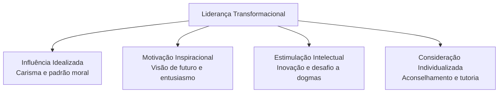
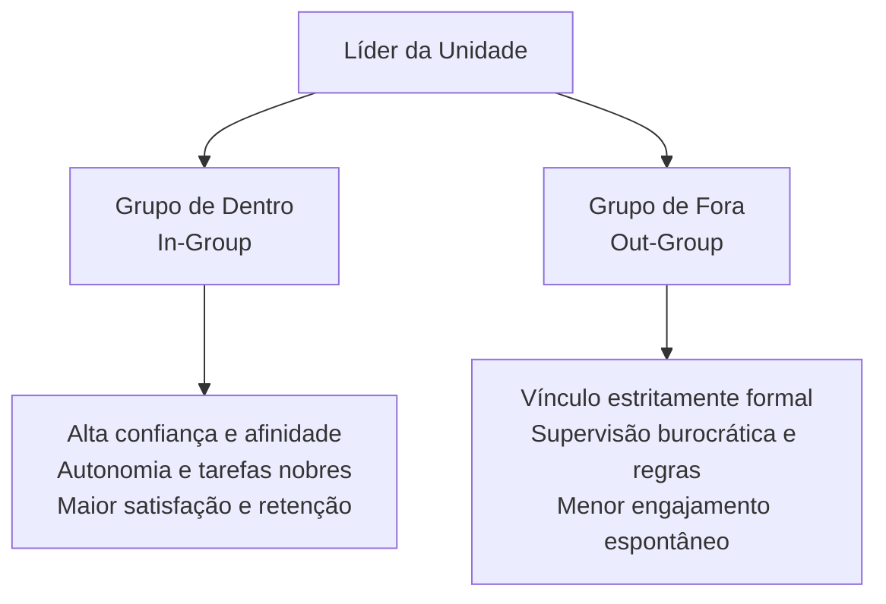
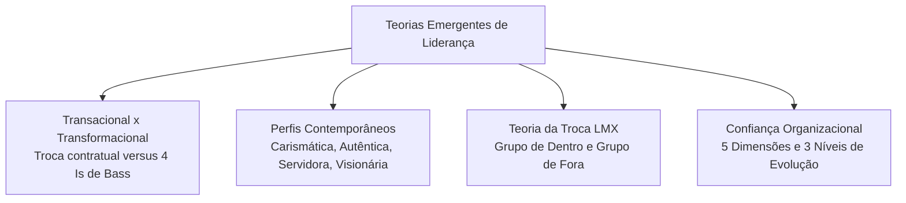

No âmbito da função administrativa de direção, as transformações dinâmicas da sociedade moderna impuseram a superação dos modelos tradicionais focados puramente em controle burocrático e autoridade formal. A direção de pessoas nas organizações contemporâneas exige inspiração ética, autenticidade, capacidade visionária e fortalecimento contínuo da confiança recíproca. Este capítulo aborda as teorias contemporâneas de liderança, examinando a distinção entre abordagens transacionais e transformacionais, os perfis emergentes, a teoria da troca entre líderes e liderados e os alicerces da confiança nas instituições.

> [!objetivos]
> - Diferenciar a liderança transacional da liderança transformacional e identificar as dimensões de Bass.
> - Caracterizar os perfis emergentes de liderança: carismática, autêntica, servidora e visionária.
> - Compreender a dinâmica da teoria da troca entre líder e liderados (LMX).
> - Analisar as cinco dimensões e os três níveis de maturidade da confiança organizacional.

## Liderança transacional e liderança transformacional

Um dos debates mais centrais e cobrados na moderna teoria da administração reside na contraposição e complementaridade entre a liderança transacional e a liderança transformacional, modelos consolidados a partir das obras de James MacGregor Burns e Bernard Bass.

A **liderança transacional** assenta-se em uma lógica de intercâmbio objetivo e contratual entre o condutor e os liderados. O gestor atua esclarecendo as responsabilidades de cada cargo, especificando as metas a serem atingidas e indicando quais incentivos ou recompensas materiais serão concedidos em contrapartida ao cumprimento do dever. O foco da transação reside na estabilidade e na eficiência das rotinas vigentes.

De acordo com Bernard Bass, o líder transacional atua por meio de quatro abordagens operacionais:

- **Recompensa contingente**: o gestor negocia abertamente a concessão de benefícios, bônus ou elogios em troca do esforço despendido e do cumprimento de metas preestabelecidas.
- **Administração por exceção ativa**: o líder monitora proativamente os processos diários, antecipando-se a eventuais desvios das normas para corrigi-los antes que afetem a entrega final.
- **Administração por exceção passiva**: o condutor intervém de forma reativa, aplicando medidas corretivas apenas depois que a falha já se consumou ou quando o padrão de qualidade não foi alcançado.
- **Postura liberal (*laissez-faire*)**: o chefe esquiva-se de tomar decisões formais, abdica de suas atribuições de comando e deixa a resolução de impasses a cargo da própria equipe.

Em contrapartida, a **liderança transformacional** transcende a lógica da troca mercantil de favores. O líder transformacional atua como um agente de renovação profunda, mobilizando a equipe para que supere seus interesses individuais e imediatos em favor da causa coletiva da instituição. Esse condutor inspira, eleva o moral e altera os valores dos colaboradores.

Bernard Bass estruturou a liderança transformacional em **quatro dimensões fundamentais (os quatro Is de Bass)**:

1. **Influência Idealizada (Carisma)**: o líder converte-se em padrão moral e ético irretocável, despertando admiração profunda, orgulho institucional e respeito voluntário dos comandados.
2. **Motivação Inspiracional**: o gestor comunica uma visão envolvente de futuro com otimismo contagiante, utilizando símbolos expressivos para mobilizar os esforços coletivos em torno de propósitos elevados.
3. **Estimulação Intelectual**: o condutor incita a equipe a questionar velhos paradigmas, encorajando a criatividade técnica, a autonomia de raciocínio e a busca de soluções inovadoras para problemas rotineiros.
4. **Consideração Individualizada**: o líder dispensa atenção sob medida a cada liderado, ouvindo necessidades pessoais, atuando como orientador dedicado e promovendo o desenvolvimento profissional de cada talento.

A tabela comparativa a seguir sintetiza as diferenças estruturais entre a abordagem transacional e a abordagem transformacional.

| Critério de Análise | Liderança Transacional | Liderança Transformacional |
| --- | --- | --- |
| Mecanismo de Ação | Intercâmbio de recompensas por cumprimento de metas | Inspiração de propósitos nobres e renovação de valores |
| Foco Primordial | Cumprimento de processos, rotinas e estabilidade | Inovação, desenvolvimento de potenciais e transformação |
| Vínculo com a Equipe | Transacional, econômico e delimitado por normas | Psicológico, afetivo e baseado em ideais compartilhados |
| Estilos Típicos | Recompensa contingente e administração por exceção | Influência idealizada, motivação e estímulo intelectual |
| Impacto nos Liderados | Conformidade funcional ao padrão esperado | Superação de metas e engajamento extraordinário |

> [!pegadinha] A complementaridade entre os modelos
> As bancas costumam afirmar que a liderança transformacional exclui a liderança transacional ou que são posturas antagônicas. Na realidade, Bernard Bass comprovou que os dois modelos se complementam. A liderança transformacional constrói-se sobre a base transacional: os condutores mais eficazes dominam as transações operacionais de recompensa e utilizam os atributos transformacionais para extrair desempenho extraordinário de suas equipes.

## Perfis emergentes: carismática, autêntica, servidora e visionária

Ao lado do modelo transformacional, a literatura administrativa contemporânea delineou perfis complementares de liderança que ganharam proeminência nas instituições públicas e privadas:

### Liderança Carismática

A liderança carismática apoia-se no reconhecimento, por parte da equipe, de que o condutor possui habilidades extraordinárias e quase heroicas. Segundo Jay Conger e Rabindra Kanungo, o líder carismático reúne cinco atributos comportamentais: formula uma visão idealizada superior ao presente; articula essa visão com clareza contagiante; assume sacrifícios e riscos individuais substanciais; demonstra extrema sensibilidade perante os sentimentos alheios; e adota condutas inovadoras não convencionais que desafiam o conformismo burocrático. O carisma moderno não é encarado como um dom místico inato, mas como um conjunto de atitudes comunicativas que podem ser aprimoradas.

### Liderança Autêntica

O líder autêntico ancora-se na solidez moral, na ética inegociável e no autoconhecimento. Ele compreende exatamente quais valores norteiam sua conduta e atua em conformidade com suas crenças, demonstrando total coerência entre o discurso público e as práticas diárias. O condutor autêntico compartilha informações com transparência, incentiva a comunicação aberta e acolhe opiniões divergentes sem recorrer a artifícios de manipulação. A equipe desenvolve profunda fé em suas intenções por reconhecer sua integridade de caráter.

### Liderança Servidora

Concebida originalmente por Robert Greenleaf, a liderança servidora inverte a pirâmide tradicional de comando corporativo. O líder servidor compreende que sua missão primordial reside em servir à equipe, e não em ser servido por ela. O gestor atua com desprendimento e humildade, focando na satisfação das necessidades legítimas dos colaboradores, removendo obstáculos ao seu progresso e promovendo seu crescimento ético e profissional. Ao fortalecer a dignidade dos subordinados, o líder servidor conquista adesão sincera e constrói comunidades de trabalho sólidas.

### Liderança Visionária

A liderança visionária traduz-se na capacidade singular de conceber, articular e disseminar uma visão realista, confiável e atraente do futuro da organização. Enquanto a gestão rotineira ocupa-se do presente, o líder visionário enxerga adiante, antecipa tendências e convence os liderados de que o esforço dispendido hoje é indispensável para construir o amanhã pretendido. A visão atua como uma bússola motivadora que direciona a energia de todos rumo aos objetivos fundamentais.

A tabela a seguir consolida os quatro perfis emergentes de liderança, suas ênfases centrais e suas marcas comportamentais distintivas.

| Perfil Emergente | Autor de Referência | Foco de Atuação | Marca Comportamental Distintiva |
| --- | --- | --- | --- |
| **Carismática** | Conger e Kanungo | Inspiração por presença magnética | Disposição para correr riscos individuais e postura inovadora |
| **Autêntica** | Luthans e Avolio | Ética, integridade e transparência | Autoconhecimento sólido e coerência irrestrita entre fala e ação |
| **Servidora** | Robert Greenleaf | Desenvolvimento e apoio à equipe | Inversão do poder: prioridade absoluta em servir aos liderados |
| **Visionária** | Stephen Robbins | Articulação do futuro da empresa | Criação de horizontes claros que canalizam a energia coletiva |

> [!bizu] Carisma versus Autenticidade
> Para diferenciar na hora da prova: o **líder carismático** atrai pela projeção magnética de heroísmo e riscos pessoais assumidos. O **líder autêntico** conquista pela retidão ética, transparência no diálogo e fidelidade firme a seus princípios.

> [!exemplo] Perfis emergentes no cotidiano de serviço
> Pense em um oficial que comanda um grupamento de busca e salvamento em áreas florestais. Ele atua como **líder visionário** ao planejar e implantar o uso de drones com câmeras térmicas, convencendo a equipe de que a tecnologia revolucionará o resgate nos próximos anos. Ao mesmo tempo, atua como **líder servidor** quando verifica a qualidade dos equipamentos de proteção individual dos soldados antes de cuidar de suas próprias necessidades e permanece no terreno até a recuperação segura do último bombeiro.

## Teoria da Troca entre Líder e Liderados (LMX)

A grande maioria das teorias de liderança parte da premissa ingênua de que o gestor trata todos os membros de sua equipe de maneira uniforme. Em contraposição a essa visão homogeneizadora, a abordagem **Leader-Member Exchange (LMX)** sustenta que o líder estabelece laços relacionais heterogêneos com diferentes liderados.

Em razão de limitações de tempo e afinidade psicológica, o condutor classifica tacitamente sua equipe em dois grupos distintos:

- **Grupo de Dentro (*In-Group*)**: composto por subordinados que demonstram alta competência técnica, postura pró-ativa ou afinidade de valores com o condutor. Esses membros conquistam a confiança íntima do líder, desfrutam de ampla autonomia decisória, recebem delegação de tarefas nobres e têm acesso facilitado a informações estratégicas. As pesquisas empíricas indicam que os integrantes do *in-group* apresentam maior satisfação no trabalho, recebem melhores avaliações funcionais e revelam menor rotatividade.
- **Grupo de Fora (*Out-Group*)**: formado por colaboradores que mantêm um vínculo estritamente burocrático com a instituição. Suas interações com a chefia limitam-se ao cumprimento formal das cláusulas regulamentares do cargo. Recebem menor atenção individualizada, menos elogios e atuam sob fiscalização rotineira pautada na autoridade formal.

> [!atencao] Os perigos da clivagem LMX
> Embora a formação de um grupo de dentro seja uma decorrência natural da convivência humana, a fixação de barreiras intransponíveis é perigosa. A percepção de favoritismo arbitrário deteriora o moral do grupo de fora, gera ciúmes internos e enfraquece a coesão global da unidade de trabalho.

## Dimensões e níveis da confiança organizacional

A confiança configura o alicerce psicológico fundamental sobre o qual se ergue qualquer processo moderno de liderança. Stephen Robbins define a confiança como uma expectativa positiva de que a outra pessoa não agirá de maneira oportunista, seja por palavras, decisões ou condutas manifestas. Sem confiança mútua, a liderança degenera em mera fiscalização policialesca.

Robbins catalogou **cinco dimensões constitutivas da confiança**:

1. **Integridade**: expressa a honestidade, veracidade e retidão moral do indivíduo. É considerada a dimensão primordial: se a integridade for colocada em dúvida, nenhuma outra competência sustentará a relação de liderança.
2. **Competência**: engloba o conhecimento técnico comprovado, a habilidade prática e o tirocínio profissional necessários para executar as atribuições funcionais.
3. **Consistência**: traduz-se na previsibilidade de reações, no equilíbrio de julgamento e na estabilidade de conduta do gestor perante dilemas do cotidiano.
4. **Lealdade**: expressa a disposição autêntica para resguardar a dignidade, os direitos e o bem-estar dos membros da equipe perante terceiros.
5. **Abertura**: manifesta-se na acessibilidade, na disposição para ouvir críticas e na transparência no compartilhamento de dados relevantes.

A confiança organizacional evolui ao longo de **três níveis progressivos**:

- **Confiança baseada na intimidação (ou dissuasão)**: alicerça-se exclusivamente no receio de punições disciplinares, sanções contratuais ou retaliações perante o descumprimento de acordos. É uma modalidade frágil e precária: na primeira oportunidade em que a fiscalização fraquejar ou a ameaça de punição diminuir, a adesão desmorona.
- **Confiança baseada no conhecimento**: fundamenta-se na previsibilidade comportamental acumulada ao longo de um histórico consistente de interações prévias. O indivíduo conhece a postura do colega de forma suficiente para antecipar com segurança como ele agirá em situações críticas. É o padrão que rege a maioria dos relacionamentos corporativos equilibrados.
- **Confiança baseada na identificação**: constitui o patamar mais elevado e maduro de relacionamento. Apoia-se na profunda sintonia de princípios, valores morais e intenções comuns. As partes conectam-se de tal modo que uma pode atuar como legítima mandatária da outra, dispensando fiscalizações burocráticas e controles formais de lealdade.

A tabela a seguir compara os três níveis da confiança organizacional.

| Nível de Confiança | Base de Sustentação | Grau de Fragilidade | Nível de Fiscalização Exigido |
| --- | --- | --- | --- |
| **Intimidação (Dissuasão)** | Medo de sanções, punições e penalidades | Altamente frágil e de curto fôlego | Fiscalização constante e autoritária |
| **Conhecimento** | Histórico de convivência e previsibilidade | Moderada, estável e baseada em dados | Acompanhamento periódico de metas |
| **Identificação** | Sintonia profunda de propósitos e valores | Altamente sólida, duradoura e leal | Autonomia plena; dispensa controle formal |

> [!pegadinha] A fragilidade da confiança por intimidação
> Algumas bancas afirmam que a confiança por intimidação é a mais segura por estar amparada na autoridade formal do regulamento. Cuidado: essa modalidade é a mais frágil e superficial de todas. Ela depende inteiramente da ameaça de sanção e cessa assim que o controle direto é relaxado.

## Mapa do capítulo

A tabela abaixo sintetiza os principais conceitos estudados neste capítulo, oferecendo uma revisão consolidada para provas de concurso público.

| Tópico Central | Fundamento Doutrinário | Conceito-Chave | Implicação para Prova |
| --- | --- | --- | --- |
| Liderança Transacional | Bernard Bass | Recompensa contingente e exceção | Foca no cumprimento de metas contratuais e estabilidade |
| Liderança Transformacional | Bernard Bass | Quatro Is (Carisma, Motivação, Estímulo, Consideração) | Transcende interesses individuais e potencializa o modelo transacional |
| Liderança Carismática | Conger e Kanungo | Risco individual e conduta inovadora | Seguidores atribuem qualidades heroicas ao condutor |
| Liderança Autêntica | Fred Luthans | Ética, transparência e autoconhecimento | Líderes coerentes entre valores pessoais e discursos públicos |
| Liderança Servidora | Robert Greenleaf | Servir aos liderados com humildade | Coloca o bem-estar e o progresso da equipe em primeiro lugar |
| Teoria LMX | Pesquisadores da troca | Grupo de dentro versus grupo de fora | Relações heterogêneas geram círculos de confiança e privilégio |
| Confiança Organizacional | Stephen Robbins | Intimidação, conhecimento e identificação | A integridade é a dimensão mais crítica; a identificação é o nível mais elevado |

### Para fixar

- A liderança transacional apoia-se na troca de metas por recompensas e na administração por exceção ativa ou passiva.
- A liderança transformacional mobiliza a equipe a superar interesses individuais em favor de propósitos elevados.
- Os quatro Is de Bass reúnem influência idealizada, motivação inspiracional, estimulação intelectual e consideração individualizada.
- A liderança transacional e a transformacional não são excludentes, mas sim abordagens complementares de gestão.
- O líder carismático destaca-se por visão arrojada, forte articulação e disposição voluntária para suportar riscos pessoais.
- O líder autêntico ancora-se na solidez ética, na transparência dialógica e na fidelidade firme aos seus valores.
- O líder servidor inverte a lógica do poder corporativo, priorizando o atendimento das necessidades da equipe.
- A teoria LMX demonstra que o líder constrói relações de alta confiança com o grupo de dentro e laços formais com o grupo de fora.
- As cinco dimensões da confiança abrangem integridade, competência, consistência, lealdade e abertura, sendo a integridade a mais crítica.
- Os níveis de confiança progridem da intimidação punitiva, passando pelo conhecimento histórico, até a identificação mútua de valores.
