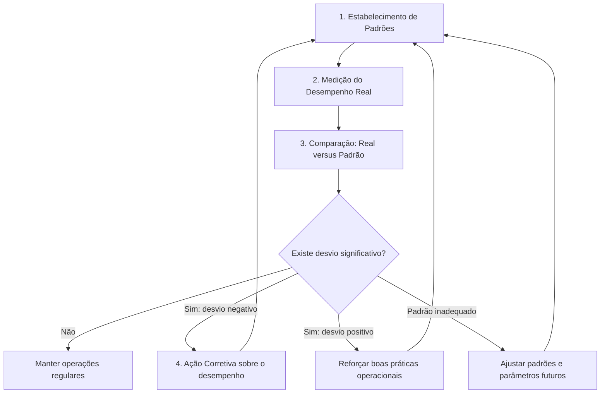

O controle é a função administrativa responsável por monitorar as atividades da organização. Ele fecha o ciclo clássico de gestão composto por planejamento, organização, direção e controle. Sem mecanismos de acompanhamento, o gestor não consegue saber se os objetivos definidos no planejamento foram atingidos. Controlar não significa punir ou engessar o trabalho das equipes. Pelo contrário, trata-se de um instrumento orientador que visa manter a instituição no rumo correto, ajustando eventuais desvios e reforçando as boas práticas identificadas durante a execução.

> [!objetivos]
> - Compreender o conceito, a finalidade e a natureza da função administrativa controle.
> - Identificar os três objetivos fundamentais do controle organizacional.
> - Reconhecer as onze características de um sistema de controle eficaz segundo a doutrina.
> - Dominar a sequência lógica das quatro etapas do processo de controle.

## Conceito, finalidades e objetivos da função controle

Na teoria geral da administração, a função controle consiste em acompanhar, medir e avaliar o desempenho organizacional. Essa avaliação tem como referência direta os objetivos e as metas estabelecidos na fase de planejamento. O planejamento define onde a organização deseja chegar e quais caminhos pretende trilhar. O controle, por sua vez, verifica se a organização está realmente seguindo esses caminhos e se os resultados alcançados correspondem ao padrão esperado.

Na concepção de Idalberto Chiavenato, controlar compreende o acompanhamento metódico das operações para verificar o rendimento do trabalho e regular descompassos em tempo hábil. O propósito central consiste em garantir que as diretrizes corporativas e os compromissos desenhados pela liderança alcancem pleno êxito prático. Para Djalma de Pinho Rebouças de Oliveira, o controle atua como metodologia de comparação com padrões preestabelecidos. Ele gera informações úteis que realimentam os tomadores de decisão para corrigir rumos ou potencializar desempenhos bem-sucedidos.

Historicamente, o termo controle despertava temores, pois era associado a práticas puramente fiscalizatórias, repressivas e punitivas. Na gestão pública contemporânea, contudo, o controle assumiu um papel construtivo, dialógico e educativo. O objetivo não é perseguir erros individuais, mas identificar falhas processuais, carências de treinamento ou metas mal dimensionadas.

A doutrina destaca três objetivos primordiais da função controle:

1. **Assegurar o cumprimento dos objetivos:** garantir que os resultados planejados sejam efetivamente concretizados pela organização.
2. **Ajustar e corrigir desvios negativos:** identificar falhas, atrasos e desperdícios operacionais para restabelecer o curso planejado das ações.
3. **Reforçar desvios positivos:** mapear práticas inovadoras e desempenhos acima da média para torná-los novos referenciais de excelência institucional.

> [!pegadinha]
> As bancas costumam afirmar que o controle serve exclusivamente para corrigir falhas e punir responsáveis. Isso é incorreto. O controle moderno possui natureza positiva: ele serve para corrigir desvios negativos, mas também para reforçar desvios positivos e disseminar boas práticas.

Para ilustrar esses objetivos na atividade pública, imagine a gestão de uma unidade de atendimento pré-hospitalar.

> [!exemplo]
> O comando do batalhão de bombeiros fixou como meta o tempo médio de resposta de oito minutos para ocorrências em determinado município. No primeiro mês, a equipe alfa atingiu tempo médio de onze minutos. Isso configurou um desvio negativo, demandando intervenção gerencial para readequar a distribuição geográfica das viaturas. No mesmo período, a equipe beta alcançou média de seis minutos ao adotar um novo método de comunicação digital. Isso configurou um desvio positivo, que foi documentado e expandido para todas as demais guarnições do Estado.

## Características de um sistema de controle eficaz

Para produzir resultados práticos sem paralisar as atividades rotineiras da organização, o sistema de controle precisa atender a requisitos técnicos específicos. Autores clássicos como Idalberto Chiavenato e Antonio Cesar Amaru Maximiano estruturam as seguintes características essenciais:

1. **Orientação estratégica para resultados:** o controle deve focalizar as atividades primordiais da organização. Ele apoia os planos institucionais de longo prazo e evita gastar energia com detalhes irrelevantes.
2. **Compreensão e inteligibilidade:** o sistema de controle deve empregar linguagem simples, direta e acessível. Relatórios herméticos e dados truncados geram desinformação e dificultam a tomada de decisão.
3. **Orientação rápida para exceções:** o sistema deve apontar desvios substanciais de forma imediata. Pelo princípio da exceção, o gestor não precisa analisar o que transcorre na normalidade, mas apenas os eventos críticos.
4. **Flexibilidade:** o mecanismo de controle deve comportar ajustes diante de mudanças conjunturais imprevistas, novos cenários econômicos ou alterações legislativas.
5. **Autocontrole:** o arranjo fiscalizatório deve incentivar a participação, a transparência e o compromisso ético dos próprios operadores, reduzindo a necessidade de vigilância externa constante.
6. **Natureza positiva:** o controle deve priorizar o desenvolvimento de competências e a melhoria dos processos, minimizando o apelo a penalidades disciplinares e punições sumárias.
7. **Economia e economicidade:** os benefícios decorrentes do controle devem superar amplamente os custos operacionais de sua implantação e manutenção.
8. **Clareza e objetividade:** as métricas e critérios de avaliação precisam ser imparciais, precisos e livres de juízos subjetivos do avaliador.
9. **Aceitação:** os padrões de conformidade precisam ser considerados legítimos e justos pelas pessoas submetidas ao processo de acompanhamento.
10. **Rapidez e tempestividade:** a informação avaliativa deve chegar ao gestor no momento adequado, possibilitando intervenções antes que os desvios se agravem.
11. **Precisão:** os dados coligidos precisam ser acurados e confiáveis, evitando distorções que induzam a decisões administrativas equivocadas.

A tabela a seguir sistematiza as características fundamentais de um sistema de controle eficaz e seus respectivos focos de aplicação prática:

| Característica | Foco principal da característica | Impacto prático na gestão |
| --- | --- | --- |
| Foco estratégico | Atividades vitais e metas institucionais | Direciona esforços para resultados corporativos de grande impacto |
| Inteligibilidade | Clareza e simplicidade das informações | Facilita a interpretação dos dados por todos os envolvidos |
| Foco nas exceções | Detecção célere de variações críticas | Poupa tempo do gestor ao dispensar análise da rotina regular |
| Flexibilidade | Capacidade de adaptação a mudanças | Permite ajustes rápidos perante cenários imprevistos |
| Autocontrole | Confiança mútua e responsabilidade | Estimula o engajamento e a autonomia dos colaboradores |
| Natureza positiva | Aperfeiçoamento contínuo e orientação | Substitui a cultura punitiva pelo aprendizado organizacional |
| Economicidade | Relação favorável de custo-benefício | Impede gastos desproporcionais com estruturas fiscalizatórias |
| Objetividade | Critérios mensuráveis e impessoais | Garante avaliações técnicas, justas e imunes a favoritismos |
| Aceitação | Legitimidade perante os executores | Reduz atritos e resistências internas durante as auditorias |
| Tempestividade | Velocidade na entrega das informações | Possibilita a intervenção preventiva ou corretiva imediata |
| Precisão | Veracidade e exatidão dos registros | Assegura diagnósticos seguros para subsidiar novas diretrizes |

> [!atencao] Princípio da economia no controle
> O princípio da economia determina que um mecanismo de controle nunca pode ser mais caro do que o benefício gerado por sua operação. Se a auditoria de um pequeno almoxarifado custa vinte mil reais por mês para evitar perdas eventuais de quinhentos reais, esse controle é disfuncional e antieconômico.

## As quatro etapas do processo de controle

A doutrina administrativa converge no entendimento de que o controle se desenvolve por meio de um processo sequencial e cíclico. Esse processo desdobra-se em quatro etapas fundamentais e interdependentes:

1. Estabelecimento de padrões de desempenho;
2. Medição do desempenho real;
3. Comparação do desempenho real com o padrão estabelecido;
4. Implementação de ação corretiva e retroalimentação.

### Estabelecimento de padrões de desempenho

A primeira fase consiste na fixação de objetivos, parâmetros e critérios quantitativos ou qualitativos que definem o desempenho desejado. Os padrões traduzem as metas gerais do planejamento em indicadores operacionais claros. Sem a prévia estipulação de um referencial de conformidade, torna-se inviável julgar se o trabalho transcorre de forma adequada.

Os padrões organizacionais podem envolver quatro dimensões principais:
- Padrões de tempo: prazos para atendimento de chamados, tramitação de processos ou finalização de cursos.
- Padrões de custo: tetos orçamentários por projeto, custo por hora de instrução ou despesas com combustível.
- Padrões de quantidade: número de inspeções técnicas executadas, contingente capacitado ou autos lavrados.
- Padrões de qualidade: índices de satisfação dos cidadãos, conformidade com normas técnicas e percentual de erros eliminados.

### Medição do desempenho real

Uma vez estabelecidos os padrões, a segunda etapa dedica-se à coleta regular de dados e ao acompanhamento metódico das atividades em curso. Trata-se de levantar o que a organização está realmente executando no terreno dos fatos. Essa medição pode ocorrer por meio de observação visual direta, painéis gerenciais informatizados, relatórios de serviços, amostragem estatística ou registros de ponto eletrônico.

A medição deve ser oportuna e confiável. Mensurar o desempenho de maneira descompassada ou com dados adulterados compromete todas as decisões subsequentes da gestão.

### Comparação do desempenho real com o padrão

Na terceira etapa, o gestor confronta os resultados efetivamente colhidos na operação com os parâmetros previamente definidos. Essa comparação analítica visa verificar se existe conformidade, superação da meta ou desvio indesejado.

Nem toda divergência exige alarme institucional. As organizações trabalham com limites de tolerância predeterminados. Quando a variação registrada oscila dentro dessa faixa aceitável, o processo é considerado sob controle, dispensando intervenções intempestivas. Todavia, se a oscilação romper a faixa tolerada, fica configurada a necessidade de atuação administrativa formal.

### Ação corretiva e retroalimentação

A quarta etapa encerra o ciclo operacional promovendo os ajustes necessários para harmonizar a realidade com as metas institucionais. Ao constatar desvios negativos relevantes, o administrador pode adotar diferentes caminhos:
- Manter o desempenho e o padrão: quando os resultados situam-se dentro da margem de tolerância normal.
- Corrigir o desempenho real: quando as falhas derivam de desvios operacionais, problemas mecânicos, lacunas de qualificação da equipe ou falhas de supervisão.
- Ajustar os padrões estabelecidos: quando se percebe que a meta original era irrealista, excessivamente rigorosa ou desatualizada perante novos desafios ambientais.

Além de solucionar problemas pontuais, a ação corretiva desempenha o papel vital de retroalimentação (*feedback*). As informações aprendidas durante a fiscalização alimentam novos ciclos de planejamento e aprimoram as futuras diretrizes institucionais.

A tabela a seguir resume as quatro etapas do processo de controle, destacando sua finalidade e sua aplicação no âmbito institucional:

| Etapa do controle | Finalidade principal | Pergunta central da etapa | Exemplo prático de aplicação |
| --- | --- | --- | --- |
| 1. Fixação de padrões | Determinar metas e parâmetros claros de conformidade | Qual resultado esperamos alcançar? | Estabelecer o consumo máximo de 12 litros por hora de viatura |
| 2. Medição do desempenho | Coletar dados e aferir o desempenho efetivo | Qual resultado estamos produzindo? | Registrar a telemetria do consumo de combustível nas missões |
| 3. Comparação de dados | Confrontar o real com o padrão e apurar variações | O resultado real atende ao planejado? | Comparar os 15 litros consumidos com o padrão de 12 litros |
| 4. Ação corretiva | Intervir para sanar falhas ou readequar metas | Como corrigir o desvio identificado? | Revisar os bicos injetores do motor e retreinar motoristas |

> [!bizu]
> Guarde o mnemônico **PMCC** para memorizar a sequência das quatro fases do controle: **P**adrões, **M**edição, **C**omparação e **C**orreção. A banca costuma inverter a ordem ou suprimir a fase de comparação. Lembre-se: primeiro fixam-se os padrões, depois mede-se a realidade, em seguida comparam-se os dados e, por fim, executa-se a correção.

## Mapa do capítulo

### Para fixar

- O controle é a função administrativa que monitora, afere e ajusta as atividades corporativas.
- O controle depende obrigatoriamente do planejamento, pois este fornece os padrões para avaliação.
- O controle moderno tem três objetivos: atingir metas, corrigir falhas e reforçar práticas exitosas.
- A função de controle não é exclusivamente repressiva, incorporando caráter positivo e orientador.
- Pelo princípio da economia, os ganhos gerados pelo controle devem superar seus custos operacionais.
- O foco nas exceções preconiza que o gestor examine prioritariamente as variações fora do padrão.
- A inteligibilidade exige relatórios claros e simples para evitar conclusões precipitadas.
- O processo sequencial do controle compreende quatro fases: padrões, medição, comparação e correção.
- Os padrões podem avaliar as dimensões de tempo, custo, quantidade e qualidade do serviço.
- A ação corretiva pode intervir no processo operacional ou promover o reajuste das próprias metas.
