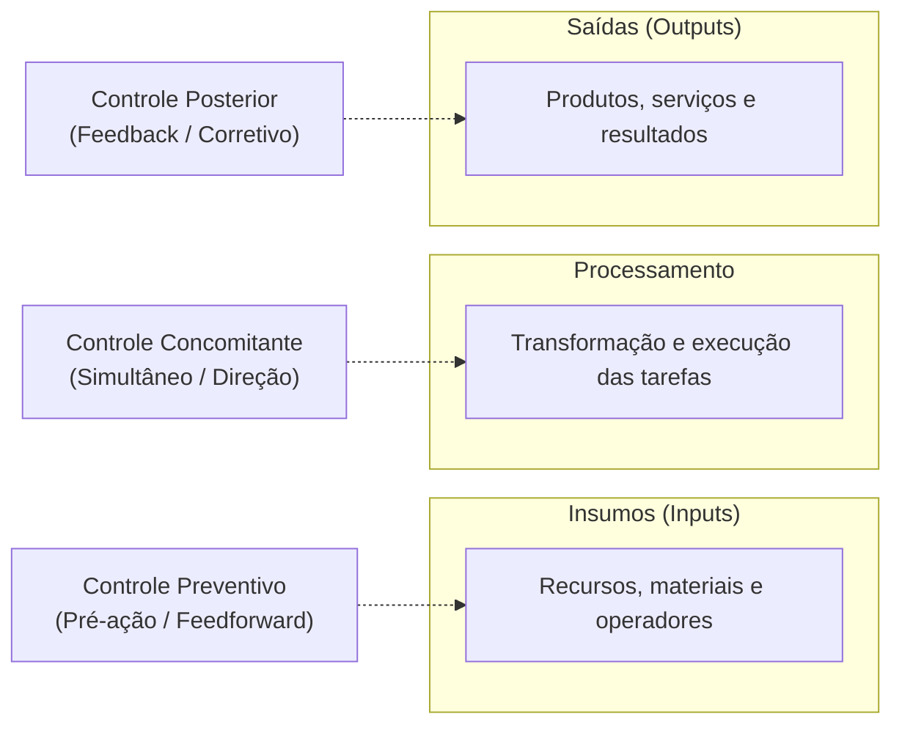
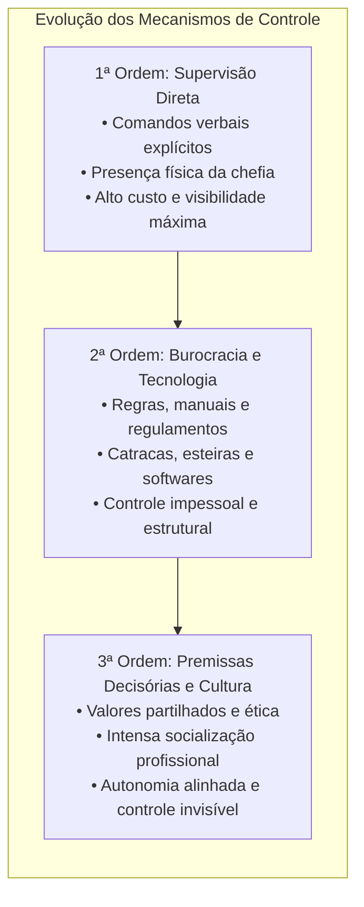

O controle não se manifesta de forma idêntica em todos os setores de uma instituição. Para acompanhar o funcionamento da máquina pública e das empresas privadas, os sistemas avaliativos precisam distribuir-se pelos diferentes patamares hierárquicos e atuar em momentos temporais distintos. Enquanto a alta cúpula acompanha o cumprimento da missão institucional perante o macroambiente, as chefias intermediárias monitoram o orçamento dos departamentos e a base cuida da execução das tarefas diárias. Além dessa estratificação por níveis e momentos, a ciência da administração desenvolveu classificações que analisam a orientação normativa, os tipos societários e as dimensões constitucionais do controle público.

> [!objetivos]
> - Distinguir os controles nos níveis estratégico, tático e operacional segundo horizonte temporal, amplitude e detalhamento.
> - Compreender a divergência doutrinária sobre o enquadramento do controle orçamentário.
> - Classificar os mecanismos de controle quanto ao momento de atuação em preventivo, concorrente e posterior.
> - Identificar as três ordens de controle na sociologia organizacional de Charles Perrow.
> - Analisar os modelos de controle empresarial de Josir Gomes e as modalidades de controle constitucional público.

## Níveis organizacionais de controle

Assim como as funções de planejamento, organização e direção desdobram-se em patamares hierárquicos específicos, o controle distribui-se pela pirâmide organizacional em três níveis clássicos: estratégico, tático e operacional. Essa correspondência é lógica e direta. Cada patamar de planejamento exige um mecanismo de controle calibrado com o mesmo horizonte temporal e com idêntico grau de abstração.

### Controle estratégico ou institucional

O controle estratégico localiza-se na cúpula da instituição, sendo exercido por diretores, comandantes-gerais e secretários de Estado. Sua abrangência é holística: ele analisa a organização em sua totalidade, sem se prender a minúcias departamentais. 

As características marcantes do controle estratégico são:
- **Horizonte temporal de longo prazo:** avalia metas concebidas para horizontes de três, cinco ou dez anos, como os planos plurianuais.
- **Forte orientação externa:** monitora as relações mantidas com o macroambiente econômico, demográfico, tecnológico e político.
- **Conteúdo sintético e genérico:** opera com relatórios consolidados, resumos executivos e indicadores agregados de desempenho.
- **Finalidade norteadora:** fornece subsídios para que a alta liderança tome decisões sobre os rumos institucionais globais.

São exemplos clássicos de instrumentos do controle estratégico: o balanço institucional consolidado, auditorias de sustentabilidade financeira, pesquisas de satisfação dos usuários e a análise do retorno sobre o investimento em infraestrutura.

### Controle tático ou intermediário

O controle tático situa-se no nível intermediário da estrutura, correspondendo à atuação de gerentes departamentais, chefes de divisões e comandantes de batalhões. Seu foco recai sobre unidades específicas da organização, atuando como elo articulador entre os grandes direcionamentos institucionais da cúpula e as atividades da base.

As principais características do controle tático compreendem:
- **Horizonte temporal de médio prazo:** acompanha ciclos anuais, metas trimestrais ou cronogramas de planos setoriais.
- **Foco setorial e departamental:** examina o desempenho de unidades isoladas, como a diretoria de logística, a divisão de ensino ou o setor de recursos humanos.
- **Conteúdo menos genérico e moderadamente detalhado:** trabalha com dados analíticos da unidade, sem descuidar da coerência com a política corporativa global.
- **Finalidade articuladora:** assegura que cada departamento execute suas atribuições para viabilizar os objetivos maiores da organização.

O instrumento mais emblemático do nível tático é o **controle orçamentário setorial**, acompanhado da apuração da contabilidade de custos departamentais.

> [!pegadinha]
> O enquadramento do controle orçamentário gera divergência doutrinária importante em concursos públicos. Idalberto Chiavenato defende que o controle orçamentário pertence ao nível tático, pois monitora a aplicação dos tetos financeiros distribuídos entre os vários departamentos. Por outro lado, Filipe Sobral e Alketa Peci sustentam que o orçamento é uma ferramenta do nível operacional, voltada para a execução prática dos recursos. Em provas, quando a banca descrever o acompanhamento de despesas departamentais ao longo de um exercício financeiro, adote a posição majoritária de Chiavenato, classificando-o como controle tático.

### Controle operacional

O controle operacional ocupa a base da pirâmide administrativa, correspondendo ao terreno da execução direta das tarefas rotineiras. Ele acompanha as atividades cotidianas realizadas por equipes técnicas, operadores de máquinas, analistas e praças nas linhas de serviço.

Destacam-se como traços centrais do controle operacional:
- **Horizonte temporal de curto prazo:** abrange períodos imediatos, como dias, semanas ou turnos de plantão.
- **Foco estrito em tarefas e processos específicos:** avalia o método de trabalho, o cumprimento de protocolos padronizados e o consumo pontual de insumos.
- **Conteúdo altamente detalhado e analítico:** apoia-se em planilhas detalhadas, registros horários, marcações de telemetria e conferências físicas unitárias.
- **Preocupação marcante com a eficiência:** busca assegurar que os meios e recursos materiais sejam aplicados sem desperdícios, com foco estrito na execução correta.

Constituem exemplos típicos desse patamar o controle de inventário físico de almoxarifados, folhas de ponto eletrônico, listas de checagem pré-voo de aeronaves e escalas diárias de prontidão em unidades de combate.

A tabela a seguir compara as particularidades dos três níveis organizacionais de controle:

| Nível de controle | Patamar hierárquico | Horizonte temporal | Amplitude e foco | Grau de detalhamento | Instrumentos típicos |
| --- | --- | --- | --- | --- | --- |
| Estratégico | Cúpula institucional | Longo prazo | Organização como um todo | Sintético e genérico | Balanço geral, auditoria de sustentabilidade e imagem |
| Tático | Gerências e chefias | Médio prazo | Unidades e departamentos | Moderadamente detalhado | Controle orçamentário setorial e apuração de custos |
| Operacional | Base da execução | Curto prazo | Tarefas e rotinas específicas | Analítico e minucioso | Inventários físicos, ponto e ordens de serviço diárias |

Para visualizar a distribuição funcional desses três patamares em uma corporação militar, analise o caso prático a seguir.

> [!exemplo]
> No Corpo de Bombeiros Militar de Pernambuco, o controle estratégico é desempenhado pelo Comando Geral e pelo Estado-Maior, que avaliam anualmente se as diretrizes de expansão do serviço operacional no interior atendem ao Plano Plurianual do Estado. O controle tático é exercido pela Diretoria de Logística, que monitora trimestralmente os tetos orçamentários e os gastos com manutenção de viaturas de cada Grupamento de Bombeiros. Já o controle operacional ocorre na ponta da linha, quando o comandante da guarnição de socorro confere a lista de verificação de prontidão dos equipamentos de mergulho antes do início do turno de serviço.

## Classificação do controle quanto ao momento de atuação

Sob o ponto de vista temporal, a doutrina classifica os controles a partir de sua posição na linha do tempo do fluxo produtivo. Todo processo administrativo organiza-se em três tempos sucessivos: a chegada das entradas ou insumos (*inputs*), a transformação durante o processamento das tarefas e a geração das saídas ou produtos acabados (*outputs*). A depender do ponto em que incide a vigilância gerencial, teremos controle preventivo, controle concomitante ou controle posterior.

### Controle preventivo ou prévio

Também denominado controle preliminar, pré-ação, antecipado ou *feedforward*, esse mecanismo atua **antes** que as atividades entrem em fase de execução efetiva. Sua premissa reside na prevenção e na proatividade: o gestor procura identificar riscos, antever gargalos e eliminar as causas potenciais de desvios antes que eles provoquem prejuízos reais.

Como o trabalho produtivo ainda não foi deflagrado, o controle preventivo incide com força sobre os **insumos**. Ele avalia a qualidade das matérias-primas recebidas de fornecedores, a capacitação técnica dos profissionais escalados, a calibragem dos maquinários e a conformidade legal dos editais.

Suas principais vantagens operacionais são a elevada economicidade e a segurança, pois impede o desperdício de materiais caros e preserva a integridade das equipes. Trata-se, contudo, de uma modalidade que exige planejamento meticuloso e sistemas confiáveis de previsão de cenários.

### Controle concomitante ou simultâneo

Conhecido como controle simultâneo, em tempo real ou de direção, essa modalidade processa-se **durante** a execução das atividades. As operações são acompanhadas no momento exato em que estão ocorrendo no terreno dos fatos.

O foco recai diretamente sobre o **processo de transformação**. O avaliador monitora fluxos de trabalho, posturas operacionais e índices de velocidade enquanto o serviço acontece. Isso possibilita intervir prontamente para corrigir anomalias antes que um lote inteiro de produtos seja inutilizado ou antes que um incidente se torne catastrófico.

São exemplos de controle concomitante a supervisão direta exercida por um encarregado no canteiro de obras, a telemetria que apura a velocidade de uma viatura em trânsito de emergência e a comunicação por rádio entre a mesa de operações e as equipes empenhadas no teatro de operações.

### Controle posterior ou corretivo

Denominado controle por realimentação, retroativo, pós-ação ou *feedback*, esse instrumento ocorre **depois** que a atividade foi completamente finalizada. O objeto avaliado não são os insumos nem o processo, mas as **saídas e os resultados consolidados**.

O controle posterior compara o produto entregue ou o serviço prestado com os padrões de qualidade e prazos estipulados no planejamento inicial. Ele mede índices de aprovação dos cidadãos, apura custos consolidados e analisa relatórios de auditoria financeira.

> [!atencao] Foco pedagógico do controle posterior
> O controle posterior incide sobre fatos consumados. Ele não tem o poder de alterar o passado ou remediar a falha daquela atividade específica que já foi concluída. Sua verdadeira utilidade reside em identificar as causas raízes dos desvios para corrigir planejamentos futuros e aperfeiçoar os próximos ciclos operacionais.

A tabela comparativa a seguir sintetiza as distinções cruciais entre os três momentos do controle:

| Modalidade temporal | Posição no tempo | Foco no fluxo produtivo | Postura gerencial | Principal vantagem | Exemplo prático corporativo |
| --- | --- | --- | --- | --- | --- |
| Preventivo *(feedforward)* | Antes da execução | Insumos e recursos iniciais | Proativa e antecipatória | Evita a ocorrência do erro e poupa gastos | Vistoria técnica de freios e pneus antes da saída da viatura |
| Concomitante *(simultâneo)* | Durante a execução | Processo e transformação | Ativa e em tempo real | Permite correção imediata do rumo operacional | Monitoramento por rádio do consumo de oxigênio em incêndio |
| Posterior *(feedback)* | Depois da execução | Saídas e resultados finais | Reativa e pedagógica | Gera aprendizado para planos futuros | Elaboração do relatório de pós-ocorrência após o resgate |

## Níveis de controle segundo Charles Perrow

Na sociologia das organizações, o autor Charles Perrow propôs uma categorização inovadora sobre os mecanismos fiscalizatórios. Em vez de focar apenas no momento ou na hierarquia, Perrow analisou a **forma de influência** que a organização exerce sobre a conduta dos trabalhadores, estruturando três ordens sucessivas de controle:

### Controle de primeira ordem

O controle de primeira ordem fundamenta-se na **supervisão direta** e na vigilância pessoal e ostensiva. Trata-se da forma mais básica e visível de autoridade, típica de estruturas simples e pequenas empresas.

Nesse modelo, o superior hierárquico emite comandos verbais contínuos, dizendo pessoalmente aos comandados o que fazer, como fazer e em que momento parar. A presença física do chefe é o elemento central que induz a disciplina. Embora seja um formato direto, apresenta elevado custo financeiro e operacional, além de sobrecarregar as chefias e gerar tensões interpessoais pelo excesso de fiscalização.

### Controle de segunda ordem

O controle de segunda ordem substitui a vigilância interpessoal pela **padronização burocrática e por sistemas tecnológicos**. A disciplina não depende mais da presença do chefe, mas de normas formais e desenhos de processos previamente estruturados.

Esse patamar manifesta-se por duas vertentes principais:
- **Vertente burocrática:** manuais de procedimentos operacionais padrão, regulamentos disciplinares, formulários de tramitação e descrições detalhadas de funções.
- **Vertente tecnológica:** linhas de montagem industriais, catracas de ponto eletrônico, semáforos, bloqueios de segurança em sistemas corporativos e cronômetros de linha.

Ao transferir o controle para regras impessoais e máquinas, a organização ganha previsibilidade, reduz conflitos individuais e consegue coordenar contingentes expressivos de colaboradores.

### Controle de terceira ordem

O controle de terceira ordem representa o estágio mais sutil, maduro e sofisticado de regulação comportamental. Ele não atua por ordens físicas nem por regulamentos coercitivos, mas mediante a **interiorização de premissas decisórias**.

Nesse patamar, a força condutora é a **cultura organizacional**. Por meio de processos intensos de seleção, treinamento doutrinário e socialização profissional, o trabalhador assimila os valores, a ética e os princípios da instituição de tal modo que passa a decidir espontaneamente de acordo com o interesse corporativo. Não há necessidade de chefe vigiando nem de manuais abertos a todo instante: o próprio indivíduo exerce o autocontrole ético sobre suas condutas.

> [!bizu]
> Memorize as três ordens de Charles Perrow pela fórmula simples: **Primeira** é a pessoa do chefe (supervisão direta); **Segunda** é o papel e a máquina (burocracia e tecnologia); **Terceira** é a cabeça e o coração (cultura e premissas decisórias internalizadas).

A tabela a seguir organiza as três ordens de Perrow, detalhando seus mecanismos operacionais e seus reflexos no ambiente institucional:

| Ordem de controle | Mecanismo predominante | Grau de visibilidade | Fonte de autoridade | Impacto no comportamento |
| --- | --- | --- | --- | --- |
| Primeira ordem | Supervisão pessoal direta | Ostensiva e imediata | Cargo e presença física do chefe | Obediência imediata sob vigilância |
| Segunda ordem | Burocracia e tecnologia | Estrutural e impessoal | Regras escritas e maquinários | Conformidade a fluxos e rotinas |
| Terceira ordem | Premissas decisórias e cultura | Sutil e invisível | Valores morais compartilhados | Autonomia guiada por ética comum |

## Modelos de controle de Josir Gomes e controle comportamental

A literatura em administração desenvolveu modelos analíticos para compreender como o porte da empresa, o ambiente de negócios e as relações humanas influenciam as práticas de controle.

### Modelos de controle organizacional de Josir Gomes

O pesquisador Josir Simeone Gomes estratificou o controle de gestão em quatro modelos básicos, associando cada modalidade às características estruturais da entidade:

1. **Controle familiar:** comum em micro e pequenas empresas sob gestão dos próprios fundadores. Caracteriza-se por forte informalidade, inexistência de processos mapeados e laços de lealdade consanguínea ou afetiva direcionados à pessoa do dono.
2. **Controle burocrático:** típico de grandes corporações industriais ou órgãos públicos tradicionais. Fundamenta-se em regulamentos rígidos, hierarquia vertical, impessoalidade estrita e centralização das decisões na figura dos chefes formais.
3. **Controle por resultados:** adotado por organizações complexas que atuam em mercados altamente dinâmicos e competitivos. A estrutura descentraliza-se em divisões autônomas ou centros de responsabilidade, conferindo liberdade aos gerentes locais e cobrando deles apenas metas objetivas e índices de retorno.
4. **Controle *ad hoc*:** característico de organizações intensivas em conhecimento e inovação contínua, a exemplo de institutos de pesquisa de ponta, escritórios de consultoria técnica e agências especializadas. Os mecanismos são fluidos, pautados no autocontrole e em deliberações colegiadas de profissionais com alto grau de escolaridade.

### Classificação do controle sobre o comportamento humano

Antonio Cesar Amaru Maximiano categoriza as forças de controle que atuam diretamente sobre as atitudes das pessoas no ambiente de trabalho:

- **Controle formal:** exercido por intermédio da autoridade racional-legal inerente ao cargo ocupado pelo superior. Opera por meio de incentivos funcionais, promoções, elogios formais ou sanções disciplinares previstas em estatuto.
- **Controle social:** decorre da pressão moral exercida pelo próprio grupo de trabalho sobre seus membros. Para obter aceitação e evitar o isolamento, o indivíduo molda sua vestimenta, seu vocabulário e sua dedicação às normas sociais da equipe (conformidade social).
- **Controle técnico:** imposto por sistemas mecânicos, tecnológicos ou físicos que condicionam o ritmo humano sem intervenção de julgamentos pessoais. O painel luminoso que comanda a fila de atendimento ou o tacógrafo da viatura exercem controle técnico objetivo.

A tabela abaixo sintetiza os modelos de Josir Gomes e os tipos de controle comportamental de Maximiano:

| Autor e classificação | Categoria estudada | Características fundamentais | Cenário corporativo típico |
| --- | --- | --- | --- |
| Josir Gomes | Controle familiar | Informal, centrado no dono, laços de afeto | Pequenas empresas familiares |
| Josir Gomes | Controle burocrático | Regras formais rígidas, hierarquia, impessoalidade | Órgãos públicos e indústrias clássicas |
| Josir Gomes | Controle por resultados | Centros de responsabilidade, descentralização | Empresas em mercados competitivos |
| Josir Gomes | Controle *ad hoc* | Autocontrole profissional e órgãos colegiados | Consultorias e centros de tecnologia |
| Maximiano | Controle formal | Autoridade legal, recompensas e sanções oficiais | Relação de chefia estatutária |
| Maximiano | Controle social | Pressão de pares em busca de conformidade grupal | Cultura do pelotão ou equipe de trabalho |
| Maximiano | Controle técnico | Conduzido por máquinas, rotinas de software e linhas | Esteiras de triagem e telemetria |

## Classificações constitucionais e institucionais do controle público

No âmbito do Estado e do Direito Administrativo, o controle sobre os atos da administração reveste-se de garantias republicanas indispensáveis. As bancas de concurso cobram reiteradamente as distinções entre a natureza do controlador, a origem institucional e a iniciativa da fiscalização.

### Quanto à natureza do órgão controlador

- **Controle administrativo:** exercido pela própria Administração Pública sobre suas condutas operacionais. Alinha-se ao poder de autotutela, permitindo à autoridade anular atos ilegais ou revogar atos inoportunos por razões de conveniência.
- **Controle judicial:** desempenhado exclusivamente pelo Poder Judiciário em sua função jurisdicional típica. No Brasil vigora o sistema de jurisdição una (sistema inglês), segundo o qual o Judiciário é o único poder com capacidade institucional para proferir decisões definitivas, amparadas pela autoridade da coisa julgada.
- **Controle legislativo:** exercido pelo Poder Legislativo (Senado, Câmara, Assembleias e Câmaras Municipais), abrangendo o julgamento político e a fiscalização orçamentária e financeira, com o auxílio técnico dos Tribunais de Contas.

### Quanto à origem do órgão fiscalizador

- **Controle interno:** manifesta-se quando a unidade fiscalizadora e a unidade fiscalizada integram o mesmo Poder ou a mesma pessoa jurídica. É o caso da auditoria interna e da Corregedoria do órgão.
- **Controle externo:** ocorre quando um Poder autônomo fiscaliza as atividades de outro Poder. Ocorre, por exemplo, quando o Tribunal de Contas audita a execução financeira dos batalhões do Poder Executivo estadual.
- **Controle popular ou social:** desempenhado diretamente pelo corpo de cidadãos ou por associações representativas da sociedade civil, fiscalizando a aplicação do dinheiro público.

> [!lei] CF, art. 74, § 2º
> Qualquer cidadão, partido político, associação ou sindicato é parte legítima para, na forma da lei, denunciar irregularidades ou ilegalidades perante o Tribunal de Contas da União.

Essa garantia constitucional consagra o controle social direto, outorgando legitimidade universal a qualquer pessoa do povo para provocar a jurisdição do Tribunal de Contas contra desmandos administrativos.

### Quanto à iniciativa da atuação

- **Controle de ofício ou espontâneo:** deflagrado por iniciativa da própria Administração Pública no cumprimento de seu dever legal de autotutela, sem necessidade de provocação de terceiros.
- **Controle provocado:** instaurado a partir de provocação externa, como recursos administrativos de servidores, representações de órgãos de classe ou ações judiciais movidas por cidadãos lesados.

A tabela a seguir consolida as modalidades do controle na esfera pública:

| Critério de divisão | Modalidade | Órgão ou sujeito atuante | Fundamento ou exemplo prático |
| --- | --- | --- | --- |
| Natureza do órgão | Administrativo | A própria Administração | Poder de autotutela sobre os atos |
| Natureza do órgão | Judicial | Poder Judiciário | Princípio da inafastabilidade e coisa julgada |
| Natureza do órgão | Legislativo | Parlamento e Tribunais de Contas | Fiscalização contábil, financeira e política |
| Origem institucional | Interno | Órgão do mesmo Poder | Corregedorias e auditorias internas setoriais |
| Origem institucional | Externo | Órgão de Poder independente | Tribunal de Contas fiscalizando o Executivo |
| Origem institucional | Popular | Cidadãos, sindicatos e entidades | CF, art. 74, § 2º (denúncias e audiências) |
| Iniciativa | De ofício | Impulso espontâneo do órgão | Auditoria programada do plano de fiscalização |
| Iniciativa | Provocado | Demanda de terceiro interessado | Recurso administrativo e denúncia cidadã |

## Mapa do capítulo

```mermaid Panorama integrado das classificações do controle
flowchart TD
  ROOT[Classificações do Controle Organizacional] --> NIVEIS[Nível Organizacional]
  ROOT --> MOMENTO[Momento Temporal]
  ROOT --> PERROW[Ordens de Perrow]
  ROOT --> PUBLICO[Controle Público]

  NIVEIS --> E1[Estratégico: longo prazo, sintético e global]
  NIVEIS --> E2[Tático: médio prazo, departamental e orçamentário]
  NIVEIS --> E3[Operacional: curto prazo, tarefas e detalhado]

  MOMENTO --> M1[Preventivo: insumos e proatividade antecipada]
  MOMENTO --> M2[Concomitante: processos e correção em tempo real]
  MOMENTO --> M3[Posterior: saídas e aprendizado para o futuro]

  PERROW --> P1[1ª Ordem: supervisão direta e comando pessoal]
  PERROW --> P2[2ª Ordem: normas burocráticas e tecnologia]
  PERROW --> P3[3ª Ordem: premissas decisórias e valores culturais]

  PUBLICO --> PB1[Interno vs Externo vs Popular CF art. 74 §2º]
  PUBLICO --> PB2[Administrativo vs Judicial vs Legislativo]
  PUBLICO --> PB3[De ofício vs Provocado]
```

### Para fixar

- O controle estratégico foca na totalidade da organização, possui orientação para o longo prazo e conteúdo sintético.
- O controle tático atua no nível departamental em médio prazo, tendo no controle orçamentário sua ferramenta típica.
- O controle operacional concentra-se nas tarefas e rotinas diárias com alto nível de detalhamento analítico.
- O controle preventivo avalia insumos antes da execução, adotando postura proativa para evitar o erro.
- O controle concomitante incide sobre os processos durante a execução das atividades, corrigindo anomalias em tempo real.
- O controle posterior avalia resultados e saídas com foco pedagógico de aprendizado para ciclos futuros.
- Charles Perrow divide o controle em três ordens: supervisão direta, padronização burocrático-tecnológica e premissas culturais.
- Josir Gomes cataloga quatro modelos empresariais: controle familiar, burocrático, por resultados e *ad hoc*.
- Pelo critério comportamental de Maximiano, identificam-se o controle formal da chefia, o social do grupo e o técnico dos sistemas.
- A Constituição Federal consagra o controle popular no art. 74, § 2º, legitimando cidadãos e sindicatos a denunciar falhas perante o TCU.
