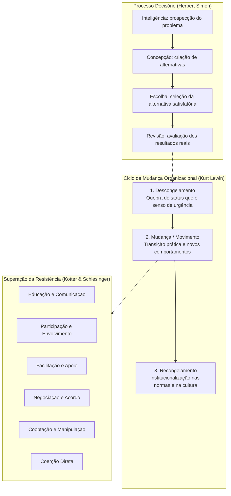

A tomada de decisão e a gestão da mudança constituem dois dos temas mais cobrados nas provas de administração pública. Toda organização pública ou privada existe em função de decisões contínuas tomadas por seus gestores e colaboradores. Conforme sintetizou Herbert Simon, administrar é sinônimo de tomar decisões. Paralelamente, em um ambiente dinâmico e sujeito a inovações tecnológicas e demandas sociais, as instituições precisam transformar seus métodos e sua cultura interna. Compreender as fases do processo decisório, seus modelos teóricos e as etapas de transição organizacional de Kurt Lewin permite entender como as corporações evoluem com eficiência.

> [!objetivos]
> - Compreender o conceito, os seis elementos e as etapas racionais da tomada de decisão.
> - Dominar as quatro fases do processo decisório segundo Herbert Simon.
> - Diferenciar decisões programadas e não programadas e as condições ambientais de certeza, risco e incerteza.
> - Distinguir os modelos de tomada de decisão e os quatro estilos gerenciais.
> - Analisar o modelo de mudança de Kurt Lewin e as seis táticas de Kotter e Schlesinger para superar resistências.

## Conceito, elementos e etapas do processo decisório

O processo decisório é a sequência lógica de etapas por meio da qual o gestor identifica problemas ou oportunidades, formula alternativas de ação, avalia riscos e escolhe a diretriz a ser adotada. Na teoria administrativa, a decisão não é um ato isolado ou fortuito, mas o desfecho de um processo estruturado.

Herbert Simon, laureado com o Prêmio Nobel de Economia e expoente da Teoria Comportamental, consolidou o entendimento de que a organização é um sistema abrangente de deliberações e decisões. Para Simon, a tomada de decisão permeia todos os patamares da estrutura, desde a definição de políticas gerais na cúpula até a escolha de ferramentas operacionais na base da corporação.

### Os seis elementos da tomada de decisão

Segundo Idalberto Chiavenato e Herbert Simon, toda decisão é composta por seis elementos estruturais:
1. **Tomador de decisão:** a pessoa, equipe ou colegiado que faz a opção entre cursos concorrentes de ação.
2. **Objetivos:** as finalidades, metas ou estados futuros que se pretende alcançar com a resolução escolhida.
3. **Preferências:** os critérios de valor, princípios éticos e prioridades que orientam a escolha do tomador de decisão.
4. **Linha de ação:** o caminho prático ou plano operacional selecionado para empregar os recursos disponíveis.
5. **Situação ou ambiente:** o conjunto de variáveis internas e externas que cercam o tomador de decisão, muitas das quais fora de seu controle direto.
6. **Resultado:** a consequência concreta advinda da linha de ação adotada em determinado cenário.

### As etapas do processo decisório racional

Embora a literatura apresente ligeiras variações de nomenclatura, as bancas de concurso consagram uma sequência de seis etapas racionais para o processo decisório:

1. **Identificação do problema ou oportunidade:** reconhecimento de uma discrepância entre a situação real e a situação desejada, ou a percepção de uma oportunidade de melhoria.
2. **Diagnóstico e análise das causas:** investigação aprofundada dos fatores determinantes do problema, suas raízes e as restrições de recursos existentes.
3. **Desenvolvimento de alternativas:** criação e mapeamento de diferentes caminhos e soluções possíveis para enfrentar a demanda diagnosticada.
4. **Avaliação das alternativas:** exame comparativo dos custos, riscos, benefícios e viabilidade técnica de cada opção formulada.
5. **Escolha da alternativa:** seleção da opção considerada mais vantajosa ou satisfatória para a instituição.
6. **Implementação e avaliação:** execução prática da decisão no ambiente de trabalho e monitoramento contínuo dos resultados alcançados para promover ajustes (*feedback*).

Na formulação seminal de Herbert Simon, essas etapas condensam-se em **quatro fases sequenciais**: inteligência (prospecção e diagnóstico), concepção (desenho e criação de alternativas), escolha (seleção da alternativa) e revisão (avaliação pós-decisória).

A tabela a seguir relaciona as etapas do processo racional com as fases clássicas de Simon:

| Etapa do processo decisório | Fase correspondente de Herbert Simon | Acontecimento prático na gestão pública |
| --- | --- | --- |
| 1. Identificação do problema | Inteligência (prospecção) | Constatação do aumento de tempo de resposta em ocorrências urbanas |
| 2. Diagnóstico da situação | Inteligência (prospecção) | Análise de dados de tráfego, manutenções mecânicas e escalas de pessoal |
| 3. Desenvolvimento de alternativas | Concepção (desenho) | Mapeamento de novas rotas, descentralização de bases ou compra de motos |
| 4. Avaliação das opções | Concepção e escolha | Comparação dos custos orçamentários e ganhos de velocidade de cada via |
| 5. Escolha da alternativa | Escolha | Decisão pelo posicionamento descentralizado de viaturas em pontos focais |
| 6. Implementação e monitoramento | Revisão (pós-decisão) | Posicionamento das guarnições nos novos postos e aferição dos tempos reais |

> [!bizu]
> Guarde o mnemônico **ICER** para lembrar as quatro fases do processo decisório de Herbert Simon: **I**nteligência (procura do problema), **C**oncepção (criação de alternativas), **E**scolha (seleção da opção) e **R**evisão (avaliação dos resultados passados).

## Tipos, níveis e condições de tomada de decisão

As decisões organizacionais diferenciam-se profundamente quanto ao grau de rotina, ao nível hierárquico em que ocorrem e à previsibilidade do ambiente que as envolve.

### Decisões programadas versus não programadas

A classificação mais recorrente em provas, introduzida por Herbert Simon, divide as decisões em dois grandes grupos:

- **Decisões programadas (estruturadas ou rotineiras):** aplicam-se a problemas rotineiros, bem estruturados, repetitivos e previsíveis. Como a organização já enfrentou essas situações diversas vezes no passado, a resposta é dada por regras preestabelecidas, manuais de procedimentos operacionais padrão, leis, regulamentos internos ou rotinas automáticas de software. Predominam no nível operacional da instituição.
- **Decisões não programadas (não estruturadas ou inéditas):** destinam-se a problemas mal estruturados, novos, atípicos e heterogêneos, para os quais não existem respostas prévias nos manuais. Exigem julgamento autônomo, intuição, criatividade, análise personalizada e capacidade de liderança. São características do nível institucional ou estratégico.

A tabela a seguir detalha as diferenças essenciais entre as duas categorias de decisão:

| Aspecto de comparação | Decisões programadas | Decisões não programadas |
| --- | --- | --- |
| Natureza do problema | Rotineiro, repetitivo, previsível e bem estruturado | Inédito, atípico, ambíguo e mal estruturado |
| Base de sustentação | Regras formais, manuais operacionais e rotinas | Julgamento crítico, criatividade e visão gerencial |
| Nível predominante | Nível operacional (base executiva) | Nível estratégico (alta administração) |
| Cenário temporal | Curto prazo e horizonte imediato | Longo prazo e impacto institucional duradouro |
| Exemplo corporativo | Concessão de férias ou despacho padrão de insumos | Criação de um novo batalhão especializado ou plano de crise |

### Condições ambientais de tomada de decisão

O grau de previsibilidade que o tomador de decisão possui sobre as variáveis futuras define quatro condições ambientais distintas:

1. **Condição de certeza:** o gestor dispõe de informações completas e confiáveis sobre o problema, conhece todas as alternativas viáveis e tem garantia exata do resultado que cada caminho produzirá. É um ambiente determinístico, comum em tarefas operacionais padronizadas.
2. **Condição de risco:** o gestor não conhece com exatidão o resultado futuro, mas possui informações históricas suficientes para calcular a probabilidade estatística de êxito ou fracasso de cada alternativa (por exemplo, sessenta por cento de chance de sucesso operacional).
3. **Condição de incerteza:** o gestor possui dados parcos ou dispersos, sendo incapaz de atribuir probabilidades matemáticas confiáveis aos desdobramentos futuros. O ambiente é imprevisível e novas variáveis podem emergir repentinamente.
4. **Condição de turbulência ou ambiguidade:** o cenário mais desafiador da gestão, no qual os próprios objetivos institucionais mostram-se confusos ou conflitantes, as informações são ambíguas e o ambiente externo passa por transformações velozes e desconexas.

> [!atencao] Risco versus incerteza em provas
> Memorize a fronteira entre risco e incerteza: na condição de **risco**, o gestor não tem certeza absoluta, mas **consegue estimar probabilidades matemáticas** baseadas em dados passados. Na condição de **incerteza**, ele **não dispõe de base para calcular probabilidades numéricas**, dependendo de intuição e julgamento qualitativo.

## Modelos e estilos de tomada de decisão

Para explicar como os administradores decidem na prática diária, a teoria da administração contrapõe diferentes modelos conceituais e estilos individuais de liderança.

### Modelos conceituais de tomada de decisão

1. **Modelo racional clássico (econômico ou normativo):** pressupõe o homem econômico, dotado de informação completa, tempo e capacidade de calcular todas as consequências. Busca a maximização e a **decisão ótima**. É um modelo normativo e idealizado, distante da prática real.
2. **Modelo comportamental ou da racionalidade limitada (Herbert Simon):** reconhece que o homem administrativo possui limitações cognitivas, tempo escasso e acesso parcial a dados. Em vez de buscar a solução ótima inalcançável, o gestor escolhe a primeira opção que atenda a critérios mínimos: busca a **decisão satisfatória** (*satisficing*).
3. **Modelo político (incremental ou de coalizões):** proposto por Charles Lindblom, aplica-se a ambientes de interesses conflitantes. As decisões resultam de negociações, concessões e coalizões, gerando avanços graduais (incrementalismo).
4. **Modelo da lata de lixo (*Garbage Can Model*):** formulado por Cohen, March e Olsen para anarquias organizadas com metas ambíguas. Problemas, soluções, participantes e oportunidades misturam-se de forma independente, com soluções muitas vezes buscando problemas aos quais se acoplar.
5. **Modelo intuitivo (Gary Klein):** descreve a atuação em emergências sob pressão de tempo. O gestor experiente reconhece padrões com base no acervo tácito de vivência e decide rapidamente sem comparar listas exaustivas de alternativas.

> [!pegadinha]
> As bancas costumam afirmar que o modelo da racionalidade limitada de Herbert Simon conduz o administrador a escolher a melhor decisão possível entre todas as imagináveis. Isso é falso. O modelo da racionalidade limitada sustenta que o gestor busca a **decisão satisfatória**, e não a decisão ótima.

### Estilos individuais de tomada de decisão

Cruzando a forma de raciocínio (lógica versus intuitiva) com a tolerância pessoal à ambiguidade (baixa versus alta), autores como Stephen Robbins estruturam quatro estilos decisórios:

| Estilo decisório | Modo de pensar | Tolerância à ambiguidade | Características comportamentais do tomador de decisão |
| --- | --- | --- | --- |
| Diretivo | Racional e lógico | Baixa tolerância | Foco na eficiência e no curto prazo; decide com velocidade e apoia-se em poucas informações |
| Analítico | Racional e lógico | Alta tolerância | Deseja grande volume de dados; analisa meticulosamente múltiplas opções antes de deliberar |
| Conceitual | Criativo e intuitivo | Alta tolerância | Visão ampla de futuro; busca soluções inovadoras e valoriza o debate com múltiplos atores |
| Comportamental | Empático e intuitivo | Baixa tolerância | Foco no bem-estar das pessoas da equipe; busca o consenso grupal e evita conflitos diretos |

### Vieses e armadilhas cognitivas

Durante o processo de deliberação, tomadores de decisão estão vulneráveis a armadilhas psicológicas e distorções mentais (heurísticas):
- **Ancoragem:** fixação desproporcional na primeira informação recebida (a âncora inicial), ajustando insuficientemente o raciocínio subsequente.
- **Viés de confirmação:** propensão a buscar e valorizar apenas dados que corroborem hipóteses prévias, ignorando evidências que as contradigam.
- **Escalada do comprometimento (custos irrecuperáveis ou *sunk costs*):** insistência obstinada em destinar novos recursos materiais ou humanos a um plano fracassado, apenas para tentar justificar gastos do passado que não podem ser resgatados.
- **Viés do *status quo*:** tendência a preservar a situação existente por comodismo ou aversão ao risco inerente ao novo.
- **Heurística da disponibilidade:** superestimação da frequência de acontecimentos baseada na facilidade com que lembranças dramáticas vêm à mente.

> [!exemplo]
> Durante o atendimento a um desabamento predial no Recife, o oficial comandante de operações utiliza o modelo intuitivo e o estilo diretivo. Com base em ocorrências anteriores semelhantes, ele avalia a estabilidade estrutural em segundos, identifica rotas de escoramento sem consultar manuais teóricos e emite ordens claras à guarnição para conter o risco antes que desabamentos secundários ocorram.

## Mudança organizacional e o modelo de Kurt Lewin

A mudança organizacional compreende qualquer modificação planejada ou não planejada na estrutura funcional, na tecnologia, nos processos internos ou na cultura de uma entidade corporativa. A finalidade é adequar a instituição a novas exigências do ambiente e potencializar seu rendimento perante a sociedade.

### Teoria do campo de forças de Kurt Lewin

Kurt Lewin formulou a premissa de que qualquer organização mantém-se em um estado de equilíbrio quase-estacionário. Esse equilíbrio decorre da colisão permanente entre duas forças opostas:
- **Forças propulsoras ou impulsionadoras:** empurram a instituição rumo à inovação, à modernização e à quebra de paradigmas. Podem originar-se de pressões externas (novas legislações, cobrança popular, avanços tecnológicos) ou internas (novas metas da alta administração, descontentamento dos operadores com métodos obsoletos).
- **Forças restritivas ou freadoras:** operam no sentido contrário, defendendo a conservação do *status quo*, alimentando a comodidade e gerando resistência corporativa à novidade.

Para deflagrar uma transformação real, o gestor não deve apenas inflar as forças propulsoras, pois isso eleva o nível de estresse e a reação das forças opostas. O caminho mais seguro consiste em desarticular e diminuir as forças restritivas.

> [!atencao] Equilíbrio de Lewin e redução de forças restritivas
> Para implementar mudanças sustentáveis, a Teoria do Campo de Forças adverte que aumentar apenas as forças propulsoras tende a elevar a tensão interna e intensificar a reação contrária. A atuação mais inteligente do líder consiste em identificar e enfraquecer as forças restritivas, desmontando as fontes de resistência antes de acelerar os novos processos.

### As três etapas do modelo de mudança de Kurt Lewin

Para conduzir a mudança planejada de modo estruturado, Kurt Lewin estabeleceu um modelo cíclico composto por três etapas:

1. **Descongelamento (*unfreezing*):** fase inicial em que velhos hábitos, práticas operacionais e certezas culturais são questionados e desfeitos. O gestor gera um senso de urgência, demonstra a inadequação do estado presente e diminui as forças restritivas para vencer a inércia corporativa.
2. **Mudança ou movimento (*moving*):** fase de transição prática e experimentação. As pessoas aprendem novos métodos de trabalho, incorporam novas tecnologias e testam padrões comportamentais inovadores sob a liderança de agentes de mudança dedicados.
3. **Recongelamento (*refreezing*):** fase de estabilização e institucionalização. Os novos métodos e comportamentos são integrados de forma definitiva às normas escritas, aos regulamentos estatutários e à cultura do órgão, evitando que a equipe retorne aos antigos costumes.

### Tipos e dimensões da mudança organizacional

Quanto à amplitude, a mudança classifica-se em:
- **Mudança incremental (de primeira ordem ou contínua):** ajustes graduais e sucessivos que aprimoram fluxos existentes (filosofia da melhoria contínua ou *Kaizen*), sem alterar a essência da missão ou a estrutura hierárquica.
- **Mudança transformacional (de segunda ordem ou radical):** ruptura profunda que reinventa a identidade corporativa, remodela o organograma e redefine valores culturais (reengenharia e reformas estruturais).

Quanto às áreas afetadas (modelo de Leavitt e Robbins), a mudança pode incidir sobre:
- Estrutura (reorganização departamental e linhas de comando);
- Tecnologia e processos (introdução de novos maquinários e informatização de protocolos);
- Produtos e serviços (novas formas de prestação de serviços à comunidade);
- Pessoas e cultura (atitudes, crenças e valores, sendo a dimensão mais difícil e demorada de ser transformada).

## Resistência à mudança e táticas de superação

A reação contrária às inovações é um fenômeno natural das organizações. A resistência nem sempre se manifesta por protestos explícitos; muitas vezes revela-se de forma silenciosa e indireta, por meio de desmotivação, aumento do absenteísmo, elevação de erros operacionais e procrastinação burocrática.

### Fontes individuais e organizacionais de resistência

Stephen Robbins classifica as raízes da oposição à mudança em duas categorias:

| Categoria | Fatores determinantes da resistência | Manifestação comportamental |
| --- | --- | --- |
| Fontes individuais | Hábito consolidado | Resistência à quebra de rotinas automáticas de trabalho |
| Fontes individuais | Segurança no emprego | Receio de exoneração, rebaixamento ou perda de função gratificada |
| Fontes individuais | Fatores financeiros | Preocupação com diminuição salarial ou perdas de adicionais |
| Fontes individuais | Medo do desconhecido | Insegurança psicológica quanto à capacidade de dominar novas tarefas |
| Fontes individuais | Processamento seletivo | Tendência a absorver apenas dados que validem convicções passadas |
| Fontes organizacionais | Inércia estrutural | Regulamentos formais e cargos concebidos historicamente para dar estabilidade |
| Fontes organizacionais | Foco limitado de mudança | Tentativa de mudar um setor sem ajustar os subsistemas interdependentes |
| Fontes organizacionais | Inércia de grupo | Normas sociais informais que freiam iniciativas individuais de servidores |
| Fontes organizacionais | Ameaça à especialização | Medo de obsolescência de saberes técnicos específicos dominados pela equipe |
| Fontes organizacionais | Ameaça ao poder estabelecido | Receio de perda de autonomia decisória e diminuição de orçamento setorial |

### As seis táticas gerenciais de Kotter e Schlesinger

John Kotter e Leonard Schlesinger estruturaram seis abordagens clássicas que o administrador pode manejar para lidar com a oposição interna à mudança:

1. **Educação e comunicação:** esclarecer a razão da transformação por meio de reuniões abertas, comunicados e palestras. É a tática indicada quando a resistência decorre de boatos, informações incompletas ou desconhecimento.
2. **Participação e envolvimento:** incluir potenciais resistentes no desenho e na elaboração do novo projeto. Apresenta como grande mérito o alto comprometimento dos participantes, mas consome tempo considerável.
3. **Facilitação e apoio:** ofertar treinamentos práticos, apoio psicológico e tempo para assimilação de novas competências. Indicada para resistências provocadas por ansiedade e insegurança técnica.
4. **Negociação e acordo:** pactuar compensações, incentivos funcionais ou garantias com grupos de oposição que possuam elevado poder de veto.
5. **Manipulação e cooptação:** apresentar fatos de modo seletivo (*manipulação*) ou conferir a líderes da oposição papéis simbólicos de destaque para obter seu endosso público sem compartilhar poder real (*cooptação*). Possui baixo custo inicial, mas acarreta o risco severo de destruir a credibilidade da liderança caso a manobra seja desmascarada.
6. **Coerção (explícita e implícita):** imposição direta da autoridade por meio de ordens estritas e advertências disciplinares formais. É recomendada unicamente em situações emergenciais críticas, nas quais a velocidade de resposta é vital e a autoridade do líder é incontestável.

A tabela abaixo sintetiza as seis táticas de Kotter e Schlesinger, apontando indicações e contraindicações de uso:

| Tática gerencial | Quando é mais recomendada | Principal ponto forte | Principal risco ou desvantagem |
| --- | --- | --- | --- |
| Educação e comunicação | Falta de dados ou boatos circulando | Gera convencimento autêntico | Consome tempo e energia das chefias |
| Participação | Resistentes detêm informações vitais | Eleva o compromisso com o plano | Pode gerar lentidão decisória |
| Facilitação e apoio | Ansiedade e receio de incapacidade técnica | Reduz o estresse psicológico | Custosa em termos de capacitação |
| Negociação e acordo | Grupo resistente possui poder de veto | Desarma resistências fortes | Pode estimular chantagens corporativas |
| Cooptação | Outras táticas mostram-se inviáveis | Rápida e com baixo custo financeiro | Destrói a confiança se descoberta |
| Coerção direta | Crises agudas e urgência temporal | Resolução imediata da oposição | Provoca ressentimento e rebeldia velada |

> [!bizu] Táticas de superação segundo a origem da resistência
> Associe cada causa de resistência à sua resposta recomendada por Kotter e Schlesinger:
> - Falta de dados ou boatos: **Educação e comunicação**.
> - Medo, estresse e ansiedade técnica: **Facilitação e apoio**.
> - Grupo resistente com poder de veto: **Negociação e acordo**.
> - Oposição de lideranças informais: **Cooptação**.
> - Crise aguda com urgência temporal: **Coerção**.

## Mapa do capítulo

### Para fixar

- O processo decisório compreende a sequência racional para diagnosticar demandas, gerar opções e escolher uma linha de ação.
- As quatro fases de Herbert Simon são inteligência, concepção, escolha e revisão (mnemônico ICER).
- Decisões programadas são rotineiras e estruturadas por manuais; decisões não programadas são inéditas e exigem discernimento.
- A condição de risco permite calcular probabilidades matemáticas de sucesso; a condição de incerteza carece de dados estatísticos.
- Herbert Simon postulou a racionalidade limitada: o gestor busca a decisão satisfatória e não a solução ótima.
- Kurt Lewin idealizou o campo de forças entre propulsoras e restritivas, sustentando o equilíbrio da organização.
- As três etapas de Kurt Lewin para mudança são descongelamento, mudança e recongelamento.
- A mudança cultural é a mais profunda e duradoura entre as dimensões organizacionais.
- Fontes de resistência individuais envolvem hábito e segurança; fontes organizacionais compreendem inércia e poder.
- Kotter e Schlesinger catalogaram seis táticas contra a resistência: comunicação, participação, apoio, negociação, cooptação e coerção.
