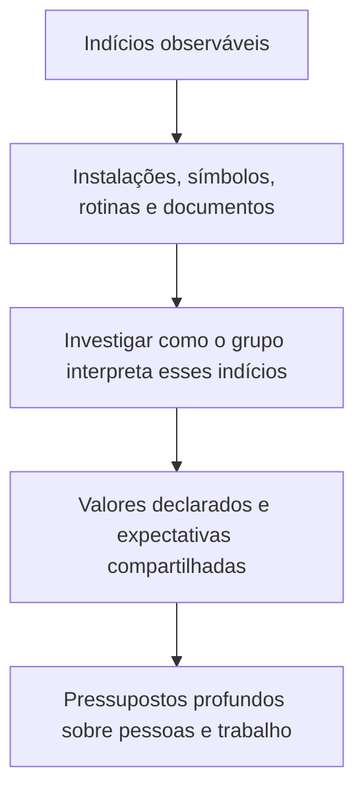

Cultura organizacional é uma chave para entender comportamentos que não estão inteiramente descritos em regulamentos. Ela se forma no convívio e nas soluções que um grupo considera eficazes, e ajuda a explicar como uma equipe interpreta prioridades, autoridade e cooperação. Neste capítulo, você estudará o conceito, suas dimensões e características, o papel dos fundadores e as funções culturais. A distinção entre cultura e clima é especialmente útil em questões que trocam uma orientação duradoura por uma percepção momentânea.

> [!objetivos]
> - Definir cultura organizacional e distingui-la do clima.
> - Identificar as dimensões material, psicossocial e ideológica.
> - Explicar como fundadores e experiências coletivas participam da formação cultural.
> - Reconhecer as sete características e as principais funções da cultura.
> - Classificar aspectos visíveis e invisíveis no modelo do iceberg.

## Conceito e diferença entre cultura e clima

A cultura organizacional é o conjunto de significados, valores, crenças, normas, hábitos e pressupostos que um grupo compartilha e transmite. Esses elementos não precisam estar escritos. Uma equipe pode, por exemplo, valorizar a comunicação imediata de falhas mesmo que não exista uma frase com essa regra no manual. A repetição dessa prática, sua aceitação e o modo como os recém-chegados a aprendem revelam um padrão cultural.

A cultura cumpre uma função interpretativa: oferece referências para que as pessoas compreendam o que ocorre e decidam como agir. Ela não determina mecanicamente toda conduta individual, pois as pessoas também têm trajetórias e julgamentos próprios. Ainda assim, influencia o que parece apropriado, admirável ou censurável em um grupo. A cultura também diferencia organizações, inclusive quando ambas têm estruturas formais parecidas.

Cultura e clima estão relacionados, mas não são sinônimos. Cultura tende a referir-se a padrões compartilhados mais profundos e consolidados. Clima organizacional é a percepção coletiva, em dado período, sobre aspectos do ambiente de trabalho, como apoio da chefia, reconhecimento e condições de execução. Uma alteração de escala pode afetar rapidamente a percepção de justiça e o clima; mudar pressupostos consolidados sobre hierarquia ou comunicação costuma exigir um processo mais longo.

| Aspecto | Cultura organizacional | Clima organizacional |
| --- | --- | --- |
| Foco | Valores, significados e pressupostos compartilhados | Percepções sobre o ambiente de trabalho |
| Horizonte | Formação gradual e relativa continuidade | Pode variar com acontecimentos e práticas recentes |
| Indícios | Histórias, hábitos, símbolos e critérios informais | Opiniões sobre apoio, justiça, reconhecimento e condições |
| Exemplo | A equipe considera indispensável relatar erros sem ocultá-los | Servidores avaliam que, neste mês, a chefia tem ouvido sugestões |

> [!pegadinha] Troca de conceitos
> Uma pesquisa de satisfação retrata percepções e ajuda a diagnosticar o clima. Ela, por si só, não descreve integralmente os pressupostos e a história que compõem a cultura. Da mesma forma, uma norma escrita não prova que o comportamento previsto foi incorporado culturalmente.

## Dimensões e iceberg cultural

Uma forma de organizar a análise é separar dimensões materiais, psicossociais e ideológicas. A dimensão material abrange os recursos e as condições concretas: instalações, equipamentos, tecnologia e arranjo físico. A psicossocial compreende as relações, a comunicação, as formas de cooperação e as redes de influência. A ideológica reúne missão, valores, crenças e concepções que dão sentido ao trabalho. As dimensões se influenciam: uma sala sem espaços de reunião pode dificultar a interação, enquanto uma crença de que só a chefia pode decidir restringe a participação mesmo quando há ferramentas colaborativas.

A metáfora do iceberg ajuda a lembrar que apenas parte da cultura é diretamente observável. Entre os aspectos visíveis estão uniformes, linguagem, organogramas, instalações, procedimentos e cerimônias. Sob eles existem expectativas, sentimentos, relações informais e pressupostos sobre autoridade, risco e confiança. O elemento visível pode ser descrito com facilidade; seu significado exige investigação. O mesmo uniforme pode representar orgulho de pertencer, obrigação funcional ou os dois sentidos ao mesmo tempo.

> [!exemplo] Um protocolo e uma crença
> Em uma unidade de atendimento, o procedimento exige que a equipe registre cada ocorrência. Esse registro é um elemento formal visível. Se, na prática, os profissionais também comunicam falhas sem receio de humilhação, pode haver uma expectativa compartilhada de aprendizagem e transparência. O protocolo isolado não permite concluir que essa expectativa existe; é necessário observar como o grupo reage a um erro real.

## Formação, dimensões de análise e características

A formação cultural é um processo coletivo. Fundadores ou lideranças iniciais podem influenciá-la ao selecionar pessoas, estabelecer prioridades e agir como modelos. Contudo, a cultura não se reduz às intenções de quem criou a organização. Os membros testam práticas, enfrentam problemas de adaptação ao ambiente e de coordenação interna e preservam aquilo que percebem como funcional. Uma orientação só se consolida como compartilhada quando é aceita e reproduzida pelo grupo, e não apenas anunciada pela chefia.

Em organizações já estabelecidas, a seleção de novos integrantes, a socialização, as promoções e as respostas a crises continuam reforçando ou modificando padrões. Se uma corporação diz valorizar iniciativa, mas pune qualquer decisão tomada sem autorização, os atos cotidianos ensinam uma regra prática diferente do discurso. Por isso, para compreender cultura, compare declarações formais e decisões concretas.

A literatura de comportamento organizacional descreve sete características que, combinadas em graus diversos, ajudam a caracterizar uma cultura: inovação e disposição para correr riscos; atenção a detalhes; orientação para resultados; orientação para pessoas; orientação para equipes; agressividade ou competitividade; e estabilidade. São dimensões de análise, não rótulos mutuamente exclusivos. Uma instituição pode ser exigente com detalhes e, ao mesmo tempo, cooperativa e orientada a resultados.

| Característica | Pergunta diagnóstica | Exemplo em serviço público |
| --- | --- | --- |
| Inovação e risco | Há espaço para testar melhorias com responsabilidade? | Equipe experimenta um novo fluxo em operação-piloto |
| Atenção aos detalhes | Precisão e análise são valorizadas? | Conferência cuidadosa de dados antes de despacho |
| Resultados | O foco recai sobre entregas e metas? | Redução do tempo de resposta com qualidade mantida |
| Pessoas | Decisões consideram seus efeitos sobre servidores? | Escala avaliada também pelo impacto sobre a equipe |
| Equipes | O trabalho é organizado em cooperação? | Planejamento integrado entre setores |
| Competitividade | Há ênfase em comparação e superação? | Unidades acompanham indicadores comparáveis |
| Estabilidade | Preservar previsibilidade é prioritário? | Rotinas padronizadas em atividade de alto risco |

> [!bizu] Leia como dimensões
> Quando a questão apresenta uma situação, identifique o comportamento valorizado. Incentivar testes aponta para inovação; exigir precisão aponta para atenção aos detalhes; considerar o impacto humano aponta para orientação às pessoas. Não infira uma cultura inteira a partir de um único sinal.

## Funções culturais

A cultura pode diferenciar uma organização de outras e proporcionar identidade aos integrantes. Ela também contribui para o comprometimento com propósitos coletivos, favorece alguma estabilidade social e fornece referências de comportamento. Em termos práticos, integrantes conhecem expectativas que não precisam ser repetidas em cada tarefa. Isso pode reduzir incerteza e facilitar coordenação.

A cultura funciona ainda como mecanismo informal de controle e produção de sentido: ajuda o grupo a interpretar prioridades e os limites da conduta aceitável. Isso não substitui leis, regulamentos, controles formais ou prestação de contas. Uma cultura de integridade reforça o cumprimento de deveres; jamais autoriza descumpri-los em nome da tradição.

Essas funções têm efeitos ambivalentes. Coesão e identidade ajudam a coordenar esforços, mas valores muito rígidos podem dificultar a adaptação ou a inclusão de perspectivas novas. A cultura não é automaticamente benéfica: sua contribuição depende do conteúdo dos valores e da compatibilidade com as tarefas, com os direitos das pessoas e com o ambiente.

> [!atencao] Cultura não substitui regra formal
> Valores informais podem orientar escolhas cotidianas, mas não revogam normas jurídicas ou administrativas. Em órgão público, uma prática tradicional incompatível com a legalidade deve ser corrigida, mesmo que tenha sido repetida por muito tempo.

## Cultura, comportamento e análise do ambiente

A cultura mantém relação com os sistemas de gestão, a estrutura, as prioridades e a tecnologia. Não é apenas efeito das escolhas administrativas: ao mesmo tempo, influencia as escolhas futuras. Um sistema de avaliação que recompensa apenas rapidez pode estimular atalhos; se a equipe valoriza segurança e sabe que pode reportar riscos, a mesma tecnologia será usada com mais cautela. Esses fenômenos humanos individuais e grupais ajudam a compreender por que uma organização sente, faz e interpreta as coisas de uma maneira própria.

O iceberg também permite separar o que é facilmente visualizado daquilo que demanda escuta e observação. Entre elementos emersos podem estar instalações, organogramas, títulos e descrição de cargos, objetivos, prioridades, políticas de gestão de pessoas, métodos e procedimentos. Aspectos submersos incluem padrões de poder, percepções, atitudes, relações informais e expectativas. Essa divisão não transforma um item em exclusivamente formal: a política é documento visível, mas pode produzir efeitos invisíveis nas relações e na confiança.

> [!esquema] Três planos para observar
> **Material:** instalações, recursos, tecnologia e condições do trabalho. **Psicossocial:** interação, comunicação e relações formais e informais. **Ideológico:** missão, visão, valores e crenças. Na prática, os planos se influenciam mutuamente.

Uma análise útil começa por perguntas concretas. Que comportamento recebe reconhecimento? Quem pode falar em reuniões? Como a equipe reage quando as metas entram em conflito com a segurança? Quais procedimentos são seguidos de fato? As respostas ajudam a distinguir a descrição oficial da cultura vivida. O administrador não deve atribuir uma intenção única a todos os membros; unidades e indivíduos podem interpretar a mesma regra de formas diferentes.

A dimensão psicossocial não é sinônimo de clima. Relações e comunicação podem ser parte de padrões culturais duradouros, enquanto clima descreve percepções do ambiente num intervalo definido. Uma equipe pode ter uma cultura de ajuda mútua que persiste durante várias chefias e, mesmo assim, atravessar um período de clima desfavorável por causa de sobrecarga. Separar as perguntas — “que padrão o grupo aprendeu?” e “como as pessoas percebem o trabalho agora?” — evita misturar os conceitos.

## Como as funções aparecem em uma equipe

A função de integração ajuda a explicar a cooperação entre membros que não se conheciam antes. Quando pessoas novas entram em uma corporação, referências culturais permitem interpretar a cadeia de comando, os modos de pedir apoio e os limites de atuação. A função de identidade responde, em parte, à pergunta “que tipo de organização somos?”. A diferenciação externa aparece em símbolos, formas de atendimento e padrões reconhecidos por usuários e parceiros.

A função de comprometimento conecta a atividade cotidiana a objetivos mais amplos. Um agente pode executar uma tarefa porque está formalmente designada, mas uma cultura de serviço público também pode ajudá-lo a compreender como essa tarefa protege a população. A estabilidade social deriva de expectativas mais previsíveis: colegas sabem como comunicar uma ocorrência, quem precisa ser informado e como será tratado um relato de falha. Tais expectativas são guias informais, não autorização para substituir competência legal ou procedimento obrigatório.

Em prova, palavras como “cimento”, “identidade” e “regras do jogo” aparecem como metáforas de coesão, pertencimento e orientação. Isso não quer dizer que a cultura elimine conflito. Ela oferece critérios comuns, mas grupos podem discordar sobre sua interpretação. A liderança precisa identificar quando a divergência é produtiva e quando a falta de clareza começa a comprometer segurança, legalidade ou serviço.

## Pistas para interpretar questões

Em Robbins, inovação e assunção de riscos indicam o estímulo à criatividade e à experimentação responsável. O iceberg distingue elementos acima e abaixo do nível da água: a superfície não revela integralmente os aspectos psicológicos e sociológicos que sustentam atitudes. A cultura afeta a maneira como os integrantes percebem situações, escolhem condutas e avaliam as decorrências de uma decisão.

Ao resolver um item, sublinhe mentalmente o indício da situação e associe-o a uma dimensão ou função. “Precisão” aponta para atenção a detalhes; “meta final” para resultados; “efeito sobre os servidores” para orientação às pessoas; “manutenção do estado atual” para estabilidade. Se o enunciado pergunta pela identidade coletiva ou pela distinção entre organizações, considere as funções de diferenciação e pertencimento. A resposta deve corresponder ao aspecto enfatizado, mesmo quando outras características também estejam presentes no caso.

## Mapa do capítulo

| Conceito | Ideia central | Sinal de prova |
| --- | --- | --- |
| Cultura | Significados, valores e pressupostos aprendidos pelo grupo | Padrão compartilhado relativamente profundo |
| Clima | Percepções sobre o ambiente em certo período | Pode responder mais depressa a práticas recentes |
| Dimensões | Material, psicossocial e ideológica | Recursos; relações; valores e missão |
| Iceberg | Visível e invisível coexistem | Artefato visível não revela sozinho seu significado |
| Características | Sete dimensões descritivas | Inovação, detalhes, resultados, pessoas, equipes, competitividade, estabilidade |
| Funções | Identidade, diferenciação, compromisso, coesão e orientação | Controle cultural é informal e não substitui a lei |

### Para fixar
- Cultura reúne significados, valores e pressupostos compartilhados e aprendidos.
- Clima expressa percepções sobre o ambiente de trabalho em dado período.
- Dimensões material, psicossocial e ideológica abrangem recursos, relações e valores.
- O iceberg tem manifestações observáveis e pressupostos menos acessíveis.
- A cultura se forma coletivamente; a intenção do fundador não garante sua consolidação.
- As sete características são dimensões analíticas, não tipos exclusivos de organização.
- A cultura diferencia organizações, apoia identidade e coordena expectativas.
- Valores informais não substituem leis, regulamentos ou controles formais.
