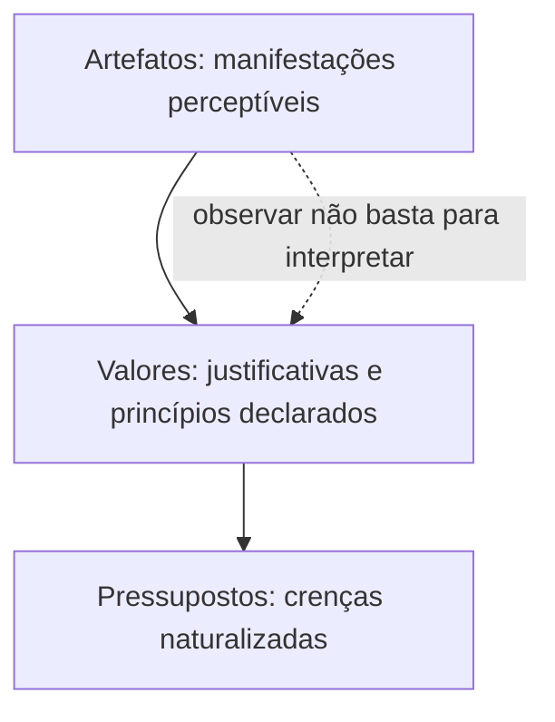

O primeiro capítulo apresentou a cultura como um fenômeno com sinais visíveis e conteúdos menos acessíveis. Este capítulo aprofunda essa ideia por meio de modelos que organizam os níveis e os componentes culturais. Comparar os autores evita confundir classificações: Schein distingue profundidade e possibilidade de observação; Hofstede organiza manifestações como camadas; outros autores destacam símbolos, narrativas e normas informais. Em questões, o nome do modelo costuma ser decisivo.

> [!objetivos]
> - Explicar os três níveis culturais de Edgar Schein.
> - Ordenar as camadas do modelo de Hofstede e distinguir práticas de valores.
> - Identificar símbolos, heróis, rituais, histórias e tabus.
> - Distinguir valores declarados dos efetivamente praticados.

## Os três níveis de Schein

Edgar Schein apresenta a cultura em três níveis, que diferem pela visibilidade e profundidade. No primeiro estão os artefatos: elementos que podem ser vistos, ouvidos ou percebidos, como a arquitetura, o vestuário, a linguagem, os documentos, as rotinas e as cerimônias. Em geral, é relativamente fácil notar que uma unidade começa o expediente com uma reunião breve. É mais difícil saber, só olhando, se a reunião simboliza participação, controle ou cumprimento de uma formalidade.

O segundo nível compreende valores declarados ou adotados: princípios, metas e justificativas que os membros conseguem enunciar. Uma organização pode afirmar que prioriza segurança, transparência ou atendimento humanizado. Esses valores ajudam a explicar escolhas e fornecem critérios conscientes, embora nem sempre correspondam às práticas.

No nível mais profundo ficam os pressupostos básicos, crenças tomadas como naturais e raramente questionadas. Podem envolver ideias sobre a confiabilidade das pessoas, o lugar da autoridade, a relação com o tempo e o modo adequado de lidar com incerteza. Um pressuposto de que “erro deve ser escondido” pode permanecer influente mesmo após a publicação de um valor oficial de aprendizagem. Por isso, mudanças em artefatos são mais simples de iniciar do que mudanças em pressupostos arraigados.

| Nível de Schein | Acessibilidade | Exemplos | Pergunta de análise |
| --- | --- | --- | --- |
| Artefatos | Visíveis ou audíveis | Uniforme, linguagem, espaço, cerimônia | O que se observa? |
| Valores declarados | Reconhecíveis e verbalizáveis | Segurança, missão, metas, código de conduta | O que o grupo diz que orienta suas escolhas? |
| Pressupostos básicos | Profundos e muitas vezes inconscientes | Crenças sobre autoridade, erro e confiança | Que ideia parece tão óbvia que raramente é discutida? |

> [!exemplo] A sala de reunião
> Uma sala organizada em fileiras é um artefato. Pode decorrer de espaço limitado, preferência por exposição frontal ou valorização da hierarquia. Para identificar o sentido cultural, observe quem fala, como as decisões são tomadas e o que os próprios integrantes dizem. A forma física é dado inicial, não diagnóstico completo.

> [!pegadinha] Visível não significa superficial no sentido de irrelevante
> Artefatos são manifestações visíveis, mas podem carregar significados importantes. O erro de prova é dizer que o observador sempre compreende seu significado imediatamente. A observação é direta; a interpretação exige contexto.

## Camadas de Hofstede e as práticas

O modelo de Geert Hofstede representa a cultura como camadas concêntricas. Na parte externa estão símbolos: palavras, gestos, insígnias, imagens e objetos cujo significado é reconhecido por quem conhece o grupo. Mais internamente vêm heróis, isto é, personagens reais ou imaginários que personificam qualidades valorizadas. Os rituais são atividades coletivas socialmente significativas, ainda que não sejam indispensáveis à produção imediata. No núcleo ficam os valores, preferências gerais sobre o que é desejável ou indesejável.

Símbolos, heróis e rituais são manifestações observáveis agrupadas como práticas. Os valores são mais profundos e não são necessariamente dedutíveis de uma prática isolada. Uma cerimônia de reconhecimento, por exemplo, pode valorizar cooperação ou desempenho individual, conforme os critérios e a forma como ocorre. As práticas podem mudar com mais rapidez que os valores, embora mudanças nas práticas também possam expressar transformação mais ampla.

| Camada | O que representa | Exemplo hipotético em corporação pública |
| --- | --- | --- |
| Símbolos | Sinais com significado reconhecido pelo grupo | Insígnia ou vocabulário de uma unidade |
| Heróis | Modelos de conduta admirados | Servidor lembrado por agir com integridade em crise |
| Rituais | Práticas coletivas com sentido social | Cerimônia de passagem de comando |
| Valores | Preferências e critérios fundamentais | Valorização de serviço ao público e cooperação |

> [!bizu] Hofstede: práticas ao redor, valores no núcleo
> Na cebola cultural, símbolos, heróis e rituais são práticas; valores ocupam o centro. Não troque valores e rituais nem trate as quatro camadas como se tivessem a mesma visibilidade.

## Outros componentes: narrativas, tabus e símbolos

Organizações transmitem cultura também por histórias sobre acontecimentos marcantes, decisões difíceis e pessoas que representam comportamentos valorizados. Uma história repetida pode ensinar como a instituição entende coragem, prudência ou lealdade. Mitos são narrativas que integram a memória do grupo; não precisam ser relatos literais em todos os pormenores para exercer função simbólica. O analista deve perguntar que valor a narrativa reforça e que comportamento apresenta como exemplar.

Tabus são proibições ou limites socialmente fortes, expressos ou tácitos. Eles demarcam condutas consideradas inaceitáveis e podem reforçar integridade e respeito. Também podem bloquear questionamentos necessários se o grupo tratar uma prática ultrapassada como intocável. Símbolos materiais, como prédios, distintivos e objetos cerimoniais, comunicam pertencimento e hierarquia, mas seu significado depende da história e do uso dentro da organização.

| Componente | Como transmite significado | Questão para o gestor |
| --- | --- | --- |
| Símbolo | Condensa uma identidade em objeto, gesto ou expressão | Quem reconhece o sinal e o que ele representa? |
| História ou mito | Conecta decisões atuais à memória coletiva | Que conduta a narrativa recompensa? |
| Herói | Torna um valor visível em uma trajetória pessoal | Qual qualidade se espera que outros imitem? |
| Ritual | Reafirma pertencimento e relações | Quem participa e que status é reconhecido? |
| Tabu | Indica fronteiras da aceitação social | A proibição protege valores legítimos ou impede revisão? |

## Valores professados e valores praticados

Valores professados são os princípios que a organização declara em planos, discursos, cartazes e códigos. Valores praticados são os critérios que de fato orientam decisões e recompensas. Os dois podem coincidir, mas a divergência é reveladora. Se a liderança divulga cooperação e depois premia apenas resultados individuais, os integrantes percebem qual mensagem tem consequência concreta.

A comparação precisa considerar situações reais, não apenas um episódio isolado. Pode-se observar quem recebe recursos, como a chefia reage a um problema, que condutas são promovidas e quais consequências acompanham violações. Uma organização não deve ser classificada como incoerente a partir de qualquer divergência pontual; a análise procura padrões. Quando há conflito consistente entre discurso e ação, as práticas tendem a orientar o comportamento cotidiano com mais força que slogans.

> [!atencao] Diagnóstico cultural
> Para avaliar a cultura, cruze artefatos, discursos, histórias e decisões. Não conclua que um valor foi incorporado apenas porque está escrito, nem atribua significado único a um símbolo sem investigar como os membros o interpretam.

## Como comparar modelos sem misturar autores

Autores diferentes organizam o fenômeno com propósitos distintos. Schein é particularmente útil quando a questão pergunta por profundidade, observabilidade ou pressupostos. A imagem das camadas mostra como uma prática visível pode refletir princípios declarados e, mais abaixo, crenças naturalizadas. Hofstede, por sua vez, destaca manifestações culturais e o núcleo de valores. Comparar modelos não significa que eles sejam incompatíveis; cada um ilumina aspectos diferentes.

A metáfora do iceberg, frequentemente associada à discussão de cultura em Chiavenato, enfatiza a diferença entre componentes mais fáceis e mais difíceis de perceber. Organogramas, cargos, políticas, procedimentos e tecnologia podem aparecer à superfície. Relações de poder, sentimentos, atitudes e formas de interação são menos imediatamente visíveis. O modelo não afirma que todo componente de superfície é consciente ou que tudo o que está submerso seja impossível de conhecer; entrevistas, observação e análise de decisões permitem formular hipóteses.

Também convém separar “nível” de “dimensão”. Os níveis de Schein indicam profundidade. As dimensões materiais, psicossociais e ideológicas classificam aspectos da organização observada. Um prédio integra a dimensão material e pode ser um artefato de Schein; a regra não escrita sobre quem pode usar uma sala pode revelar pressupostos sobre status. A mesma situação pode ser analisada por mais de uma lente, desde que se explique o critério utilizado.

| Pergunta do enunciado | Modelo ou categoria que ajuda | Resposta a procurar |
| --- | --- | --- |
| O que se vê ou ouve no ambiente? | Artefatos de Schein; símbolos e práticas de Hofstede | Manifestação observável |
| Qual princípio é oficialmente declarado? | Valores declarados | Justificativa consciente |
| Que crença o grupo toma como natural? | Pressupostos de Schein | Convicção profunda e pouco questionada |
| Que dimensão envolve espaço e recursos? | Dimensão material | Condição concreta de trabalho |
| Que aspecto envolve interação e comunicação? | Dimensão psicossocial | Relações entre membros |
| Onde se encontram missão e sistema de valores? | Dimensão ideológica | Orientação e sentido institucional |

## Significados partilhados no cotidiano

O grupo constrói significados por interações repetidas. Uma palavra técnica pode ser apenas uma abreviação funcional em determinada equipe e, em outra, também funcionar como marca de pertencimento. Uma anedota sobre uma operação passada pode ensinar prudência, improvisação responsável ou confiança em equipes. Esses sentidos não são automaticamente idênticos: integrantes antigos podem conhecer referências que os novos ainda não entendem.

Maximiano e Chiavenato são referências comuns em Administração para tratar dos componentes culturais e de sua transmissão. Em uma leitura prática, é possível mapear o que é dito, o que é feito e o que é proibido. Histórias e mitos mostram quais acontecimentos permanecem na memória; símbolos concentram significados; rituais transformam valores em atividade coletiva; tabus sinalizam limites. Um diagnóstico deve perguntar como esses meios são usados, por quem e com que consequências.

Os valores declarados e praticados também se relacionam com as camadas. Uma organização pode exibir um código de ética e cartazes sobre respeito. Esses artefatos e mensagens exprimem princípios professados. Se a chefia aceita humilhação cotidiana ou distribui oportunidades de modo incompatível com a regra, as experiências dos membros indicam outros valores praticados. Isso não significa que toda falha individual defina o sistema; padrões recorrentes, respostas institucionais e incentivos ajudam a inferir a cultura.

> [!exemplo] O símbolo e o uso
> Um distintivo pode representar tradição para uma unidade e responsabilidade pública para outra. Para interpretar a cultura, observe as histórias associadas ao objeto, os ritos em que aparece e se a conduta dos membros corresponde ao valor que ele pretende representar. O símbolo não fala por si só.

Uma investigação séria combina métodos simples: observação de reuniões, leitura dos documentos, conversa com integrantes em níveis diferentes e comparação entre decisões em situações ordinárias e críticas. Uma única entrevista pode refletir uma experiência pessoal; um manual pode descrever o desejado, não o vivido. A convergência de evidências aumenta a confiança na interpretação, ainda que não torne a cultura inteiramente mensurável.

Na prova, expressões como “camada superficial”, “nível intermediário” e “núcleo profundo” normalmente sinalizam um modelo de profundidade. Já “símbolos, heróis e rituais” apontam para práticas em torno de valores. Se o item mencionar percepções, atitudes e poder invisível sob a estrutura formal, a metáfora do iceberg ajuda. O mais seguro é identificar o autor ou o vocabulário citado antes de escolher uma correspondência.

## Aplicação dos modelos em uma mudança

Suponha que um órgão implante uma plataforma digital para substituir formulários em papel. O nível de artefatos permite observar computadores, telas, guias e novas rotinas. Os valores declarados podem enfatizar agilidade, segurança da informação e atendimento acessível. Os pressupostos básicos podem incluir crenças sobre tecnologia, confiança no servidor, controle e risco de erro. Se a direção pressupõe que os trabalhadores tentarão burlar o sistema, pode multiplicar autorizações; se confia em capacitação e auditoria adequada, pode oferecer autonomia com controles claros.

A lente de Hofstede pergunta quais símbolos, personagens e ritos emergem em torno da mudança. A organização pode destacar equipes que ajudaram a construir a solução, criar uma cerimônia de lançamento ou adotar novos termos para o atendimento digital. Esses elementos formam práticas e podem tornar visíveis valores como cooperação e inovação. Ainda assim, a aceitação do sistema depende da experiência concreta: se ele aumenta retrabalho, o ritual de lançamento não garante adesão.

O iceberg ajuda a verificar se as ações visíveis tratam as causas submersas. Um manual novo não resolve automaticamente a preocupação com responsabilização por falhas nem a crença de que pedir ajuda demonstra incompetência. Conversas, acompanhamento e resposta justa a problemas podem ser necessários. O objetivo não é “controlar” tudo o que as pessoas pensam, mas criar condições para que compreendam a finalidade da mudança e possam executá-la com competência.

### Roteiro breve de observação

1. Descreva os elementos observáveis sem atribuir significado prematuro.
2. Registre o que a organização declara valorizar e compara com decisões concretas.
3. Identifique práticas recorrentes: quem interage, quais histórias circulam e como se reconhece mérito.
4. Formule hipóteses sobre pressupostos e procure evidências que também possam refutá-las.
5. Ouça diferentes grupos, inclusive pessoas recém-chegadas e equipes operacionais.

O roteiro torna a análise mais cuidadosa, mas não constitui uma fórmula estatística. Uma cultura não é totalmente resumida por um questionário ou organograma. A triangulação de documentos, observação e entrevistas reduz o risco de confundir uma situação isolada com um padrão. Em particular, não se deve tomar uma atitude individual como prova de que todos compartilham a mesma crença.

A terminologia dos autores pode variar em traduções e edições. Em questões, dê prioridade ao rótulo expresso no enunciado e à relação conceitual descrita. Um artefato é manifestação; um pressuposto, crença profunda; uma dimensão material, classificação do tipo de aspecto analisado. Uma mesma instalação pode ser artefato perceptível, objeto da dimensão material e símbolo de status, conforme a pergunta.

> [!bizu] Use a pergunta para escolher a lente
> Profundidade leva a Schein; camadas com símbolos, heróis, ritos e valores levam a Hofstede; recursos, relações e missão indicam dimensões material, psicossocial e ideológica. Defina a unidade de análise antes de classificar.

## Limites de inferência e cultura aplicada

Os modelos são instrumentos conceituais, e não instrumentos de diagnóstico automático. Um uniforme idêntico em duas organizações não significa que elas compartilhem as mesmas crenças. A forma pode ser imposta por uma exigência operacional, enquanto a relação dos membros com o uniforme varia. Do mesmo modo, uma cerimônia pode manter tradições, iniciar uma mudança ou simplesmente cumprir um calendário; sua interpretação depende das práticas e dos sentidos compartilhados.

O ambiente físico e a interação podem ser lidos em conjunto. Um espaço aberto pode facilitar conversas, mas, sem tempo disponível ou autorização para cooperar, a estrutura não produz participação por si só. Um organograma formal pode representar uma cadeia clara de responsabilidade, enquanto a influência informal corre por redes de experiência e confiança. A leitura cultural observa os dois planos sem confundir hierarquia formal com poder efetivamente exercido em todas as situações.

O administrador também deve observar as maneiras pelas quais a cultura é transmitida aos membros novos: orientação inicial, acompanhamento por colegas experientes, relatos de casos, celebrações e correção de condutas. O aprendizado nem sempre ocorre em uma aula formal. Pode resultar de observar o que a equipe faz quando há pressão de tempo, informação incompleta ou desacordo entre setores. Essas situações mostram quais critérios são acionados quando os documentos não fornecem uma resposta detalhada.

Quando as práticas são alteradas, a organização pode precisar explicar por que o novo padrão é desejável e como será apoiado. Mudar a aparência de uma sala ou distribuir um manual atualizado representa uma etapa visível. Para que o grupo compreenda a mudança, é preciso que os responsáveis respondam a dúvidas, forneçam recursos e apliquem critérios consistentes. Assim, os modelos de cultura ajudam tanto a descrever a situação quanto a desenhar intervenções sem supor que um único símbolo transforme todo o sistema.

## Mapa do capítulo

| Modelo ou componente | Organização | Elemento mais profundo |
| --- | --- | --- |
| Schein | Artefatos → valores → pressupostos | Pressupostos básicos |
| Hofstede | Símbolos → heróis → rituais → valores | Valores |
| Componentes culturais | Símbolos, narrativas, heróis, ritos e tabus | Sentidos compartilhados e limites sociais |
| Diagnóstico | Comparar declarações com escolhas concretas | Valores efetivamente praticados |

### Para fixar
- Schein distingue artefatos, valores declarados e pressupostos básicos.
- Artefatos são observáveis, mas seu significado precisa ser interpretado no contexto.
- Pressupostos básicos são crenças profundas tratadas como naturais pelo grupo.
- Em Hofstede, símbolos, heróis e rituais são práticas que envolvem os valores.
- Histórias podem ensinar padrões de conduta e preservar memória coletiva.
- Tabus demarcam comportamentos considerados inaceitáveis.
- Valores professados aparecem no discurso; valores praticados aparecem nas decisões.
- O diagnóstico cultural combina sinais e observa padrões, não apenas declarações isoladas.
