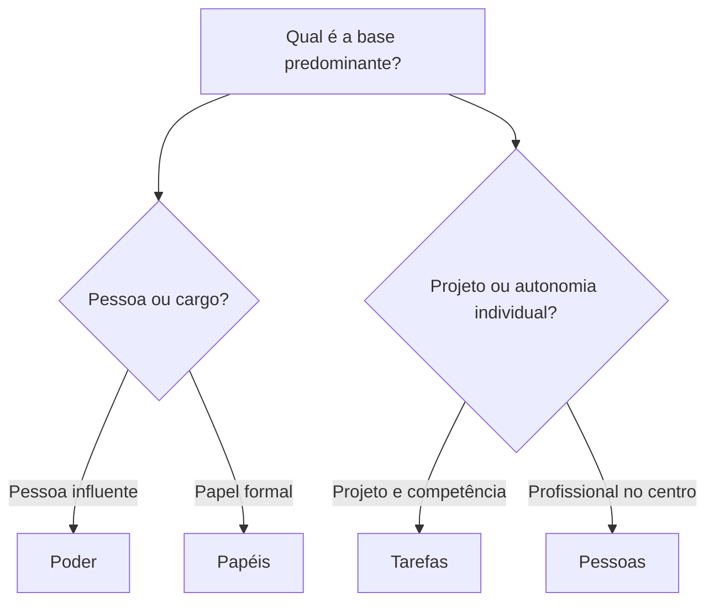

Os modelos anteriores ajudam a reconhecer que a cultura se manifesta em objetos, palavras e práticas coletivas. Agora, o foco passa para essas manifestações em ação: tipos de artefatos, ritos que marcam a vida institucional, meios pelos quais os recém-chegados aprendem os padrões e a tipologia de Charles Handy. A banca pode descrever uma cerimônia ou estrutura sem nomear a categoria; a tarefa é inferir sua finalidade e a lógica de autoridade correspondente.

> [!objetivos]
> - Classificar artefatos físicos, verbais e comportamentais.
> - Reconhecer categorias de ritos organizacionais e suas funções.
> - Distinguir mecanismos primários e secundários de incorporação cultural.
> - Comparar as quatro culturas propostas por Charles Handy.

## Artefatos e sua interpretação

Artefatos físicos incluem arquitetura, disposição de salas, equipamentos, uniformes, distintivos e outros objetos. Eles podem comunicar hierarquia, proximidade, especialização ou a história da instituição. Artefatos verbais abrangem jargões, expressões, histórias, piadas internas e metáforas. O vocabulário técnico pode facilitar a coordenação entre profissionais, mas também marcar fronteiras entre quem domina ou não aquela linguagem. Artefatos comportamentais compreendem rotinas, formas de saudação, cerimônias e modos habituais de interação.

Essas categorias são úteis para observação, mas não determinam sozinhas o sentido. Uma sala com portas abertas pode sugerir acessibilidade, porém é necessário verificar se os servidores realmente conseguem procurar a chefia. Uma história sobre uma operação pode reforçar a cooperação ou, se enfatizar apenas atos individuais, valorizar heroísmo solitário. O significado emerge da interpretação compartilhada e dos efeitos que os artefatos têm nas relações.

| Categoria | Exemplos | Cuidados na leitura |
| --- | --- | --- |
| Física | Instalações, mobiliário, viaturas, uniformes | Distinguir função prática e mensagem simbólica |
| Verbal | Jargões, histórias, metáforas, expressões | Verificar quem entende e em quais situações se usa |
| Comportamental | Ritos, cerimônias, padrões de interação | Observar participantes, sequência e consequências |

> [!exemplo] Mudança do espaço
> Um quartel remodela a área administrativa para criar um ponto de reunião entre planejamento e logística. O arranjo físico é um artefato. Se a chefia também distribui informação e autoriza decisões conjuntas, a mudança pode expressar uma orientação cooperativa. Se nada muda nas interações, o novo espaço sozinho não comprova que a cultura se transformou.

## Ritos organizacionais

Ritos são práticas coletivas com significado simbólico. A classificação associada a Trice e Beyer costuma incluir seis tipos. Ritos de passagem acompanham transições de posição ou papel, como posse e conclusão de formação. Ritos de degradação retiram ou reduzem publicamente uma condição, autoridade ou reputação, reafirmando limites. Ritos de reforço reconhecem êxito e tornam visíveis comportamentos valorizados, como uma premiação formal.

Ritos de renovação concentram atenção em desenvolvimento e capacidade futura, por exemplo cursos institucionais e programas de aperfeiçoamento. Ritos de redução de conflitos oferecem meios simbólicos ou formais para administrar tensões, como reuniões de conciliação. Ritos de integração reforçam vínculos e a sensação de fazer parte do grupo, como celebrações coletivas. A mesma ocasião pode cumprir mais de uma função, mas a questão normalmente pede identificar a finalidade predominante.

| Rito | Função predominante | Exemplo original |
| --- | --- | --- |
| Passagem | Marcar mudança de papel ou status | Cerimônia de posse de uma nova chefia |
| Degradação | Retirar ou censurar status e poder | Anúncio formal de afastamento após apuração concluída |
| Reforço | Celebrar desempenho reconhecido | Concessão de distinção por trabalho técnico consistente |
| Renovação | Reafirmar capacidade e aperfeiçoar práticas | Ciclo de treinamento para atualizar procedimentos |
| Redução de conflitos | Conter ou negociar tensões | Mesa de diálogo entre setores com atribuições sobrepostas |
| Integração | Fortalecer vínculos e identidade coletiva | Encontro institucional que reúne equipes diferentes |

> [!pegadinha] Confundir reconhecimento e integração
> O prêmio dirigido a uma pessoa ou equipe por desempenho é típico de reforço. Uma atividade que reúne o grupo e fortalece pertencimento aproxima-se do rito de integração. O evento pode combinar os dois, mas avalie o objetivo destacado no enunciado.

## Aprendizagem e mecanismos de incorporação

A cultura é aprendida por participação, observação e interpretação das respostas da organização. Schein distingue mecanismos primários, pelos quais lideranças comunicam prioridades diretamente, e mecanismos secundários, que sustentam ou tornam visíveis essas prioridades por sistemas formais. Entre os primários estão aquilo que líderes acompanham e medem, sua reação a crises, a distribuição de recursos, a conduta que modelam e os critérios de seleção, promoção e recompensa.

Entre os secundários podem estar o desenho da estrutura, os procedimentos, os sistemas de trabalho, os ritos e a arquitetura. Eles ganham força quando são consistentes com os sinais primários. Se a organização declara segurança como prioridade, mas os dirigentes só elogiam velocidade e ignoram desvios de segurança, os membros aprenderão pela reação concreta. Uma estrutura formal pode reforçar uma mensagem; dificilmente corrige por si só uma mensagem contraditória transmitida pela liderança.

| Mecanismo | Exemplos | O que o integrante aprende |
| --- | --- | --- |
| Primário | Reação da chefia a crise e erro; critérios de promoção | O que recebe atenção e consequência |
| Primário | Alocação de recursos e exemplo cotidiano | Quais prioridades são reais |
| Secundário | Organograma, sistemas, normas e procedimentos | Como o trabalho foi formalmente organizado |
| Secundário | Ritos, espaço físico e símbolos | Que identidades e relações são representadas |

> [!atencao] Coerência das mensagens
> A aprendizagem cultural é mais clara quando liderança, recompensas, sistemas e símbolos apontam na mesma direção. Em caso de conflito, observe qual sinal tem consequências concretas para as pessoas.

## As quatro culturas de Charles Handy

Charles Handy associa quatro configurações a imagens mitológicas e geométricas. A cultura do poder (Zeus) concentra influência em uma figura ou núcleo central. Decisões podem ser rápidas e dependem de relações de confiança e proximidade. É flexível, mas pode ficar excessivamente dependente da pessoa central e produzir desigualdade de acesso.

A cultura de papéis (Apolo) organiza a instituição por funções, regras e posições bem definidas. A autoridade decorre do cargo e dos procedimentos; a previsibilidade é valorizada. Pode ser adequada a tarefas estáveis e reguladas, embora a rigidez dificulte respostas fora do padrão. A cultura de tarefas (Atena) direciona grupos especializados à resolução de problemas ou projetos. A autoridade tende a acompanhar conhecimento e contribuição; equipes podem reorganizar-se conforme a tarefa. A cultura de pessoas (Dionísio) põe os profissionais no centro: a organização serve de estrutura de apoio à autonomia de especialistas. É encontrada como referência em grupos de profissionais que preservam independência técnica.

| Cultura | Imagem | Base de coordenação | Força e limite típicos |
| --- | --- | --- | --- |
| Poder | Teia com centro dominante | Influência central e relações pessoais | Agilidade; dependência do centro |
| Papéis | Templo de funções | Regras, cargos e procedimentos | Previsibilidade; menor flexibilidade |
| Tarefas | Rede de especialistas | Conhecimento e solução de problemas | Criatividade; pode haver disputa de recursos |
| Pessoas | Indivíduos como núcleo | Autonomia dos profissionais | Independência; coordenação institucional pode ser difícil |

Uma mesma organização pode apresentar mais de uma configuração. Uma corporação militar pode depender de regras e posições claras na rotina, aproximando-se de papéis; em uma operação intersetorial, pode formar uma equipe orientada à tarefa. Essas categorias são lentes de análise, não diagnósticos permanentes nem julgamentos morais.

> [!bizu] Associe a lógica
> Centralização pessoal remete a poder; regras e funções, a papéis; equipe montada para resolver problema, a tarefas; autonomia do especialista como finalidade, a pessoas.

A tipologia foi criada como ferramenta para pensar a organização do trabalho, e não como uma lista de personalidades. O termo “poder” descreve a distribuição de influência, “papéis” descreve a coordenação por cargos e normas, “tarefas” aponta para equipes temporárias ou especializadas e “pessoas” dá centralidade à autonomia profissional. Cada forma pode produzir bons resultados quando é compatível com a atividade e acompanhada de mecanismos adequados de coordenação.

A figura mitológica serve como atalho de memorização, mas a classificação depende das relações entre autoridade e tarefa descritas no caso. Não classifique pela presença de um líder ou de uma equipe isoladamente: procure qual princípio organiza o conjunto.

## Os seis ritos e a aprendizagem institucional

A tipologia dos ritos é mais completa quando suas finalidades são comparadas. Além de passagem, degradação, reforço e integração, aparecem renovação e redução de conflitos. A renovação investe em capacidade e atualiza conhecimentos; a redução de conflitos cria canais para negociação, reconhecimento de tensões e recomposição das relações. Cursos de aperfeiçoamento não são apenas transmissão de conteúdo: podem reafirmar o que a organização considera competência. Uma mesa de diálogo, por sua vez, pode tornar visível a expectativa de que divergências sejam tratadas institucionalmente.

Ritos têm efeitos sociais porque tornam públicos certos acontecimentos. A posse formaliza a entrada em um cargo e sinaliza que o membro assume novas responsabilidades. Uma cerimônia de reconhecimento consolida a memória de um desempenho valorizado. Uma medida de degradação, quando legítima e proporcional, comunica que determinado padrão foi violado. Atos públicos de censura sem devido processo ou exposição humilhante, porém, não devem ser tratados como prática recomendável; a classificação descreve uma função simbólica, não aprova automaticamente a conduta.

> [!esquema] Ritos por efeito principal
> **Transição:** passagem. **Retirada de status:** degradação. **Reconhecimento:** reforço. **Desenvolvimento:** renovação. **Administração de tensões:** redução de conflitos. **Vínculo coletivo:** integração.

A formação de cultura também é afetada por aquilo que líderes prestam atenção, medem e controlam, pela resposta a incidentes críticos e por decisões de alocação de recursos. Esses sinais primários podem comunicar prioridades mais intensamente que uma circular. Se uma organização afirma que qualidade importa, mas mede somente volume, integrantes podem concluir que a quantidade tem precedência. A atenção é cultural porque revela o que recebe acompanhamento, debate e consequência.

Outros mecanismos atuam como sustentação: organogramas, sistemas e procedimentos, desenho físico, ritos e histórias formais. São chamados secundários por servirem de expressão e reforço. Um procedimento de passagem de serviço pode estabilizar comunicação; um organograma pode mostrar linhas de autoridade. Se a estrutura formal conflita com o comportamento dos dirigentes, no entanto, o integrante tende a observar os dois e interpretar qual regra tem força real.

## Handy: imagens para reconhecer padrões

A tipologia de Handy não se confunde com as quatro culturas de Daft apresentadas no próximo capítulo. Em Handy, Zeus simboliza poder centralizado; Apolo, regras e papéis; Atena, tarefas e solução de problemas; Dionísio, autonomia das pessoas. A metáfora geométrica ajuda a memorizar o eixo de coordenação: centro de poder, pilares funcionais, rede de projeto ou profissionais no centro.

Essas formas podem coexistir. Uma organização mantém regras formais para garantir continuidade e legalidade, mas reúne especialistas de diferentes setores quando um problema exige resposta integrada. O primeiro arranjo aproxima-se da cultura de papéis; o segundo, da cultura de tarefas. A mudança de contexto não prova inconsistência: pode expressar a necessidade de equilibrar padronização, competência técnica e autonomia.

Esse olhar é útil para compreender como autoridade se distribui e como o trabalho é coordenado. Se decisões dependem do acesso a uma pessoa central, isso aponta para poder; se dependem da posição definida em uma regra, para papéis. Quando especialistas se agrupam por um desafio concreto, predomina a tarefa. Quando a organização existe sobretudo para apoiar a prática autônoma de seus integrantes, a cultura de pessoas é a referência.

O exemplo também mostra por que o modelo não funciona como escala de maturidade. Uma organização não precisa “evoluir” de poder para papéis e depois para tarefas ou pessoas. Pode preservar uma cadeia de comando em situações de risco e conceder autonomia técnica dentro de limites definidos. Ao identificar a cultura predominante, descreva as relações e as decisões observadas; não use a classificação para elogiar ou depreciar automaticamente a instituição.

## Ritos, reprodução e transmissão de padrões

Algumas referências usam “reprodução” ao explicar práticas que mantêm e renovam padrões sociais. Esse sentido se aproxima do rito de renovação: o grupo atualiza competências e reafirma modos de agir por meio de ensino, treino e outras atividades repetidas. A repetição pode conservar uma prática útil, mas também abre oportunidade para revisar rotinas que já não atendem ao propósito. O que se transmite não é apenas um procedimento; podem ser transmitidos credos profissionais, histórias de serviço e critérios para reconhecer um trabalho bem feito.

Atividades recorrentes em escritórios, quartéis ou unidades de atendimento podem funcionar como veículos culturais quando carregam significado coletivo. Uma reunião periódica pode ser só instrumento de coordenação, mas também comunicar quem participa de decisões. Uma celebração pode integrar equipes; uma cerimônia pode marcar passagem ou confirmação de status. A classificação depende da função social predominante, não do nome dado ao evento.

> [!exemplo] Uma atividade com funções combinadas
> Uma cerimônia de conclusão de curso reconhece uma etapa formativa e recebe novos profissionais na unidade. Há reforço de aprendizagem, rito de passagem e integração. Se a pergunta destaca a transição de papel, a categoria mais precisa é passagem; se enfatiza pertencimento coletivo, a análise recai sobre integração.

Ritos de confirmação ou engrandecimento reconhecem êxitos e confirmam expectativas sobre o que merece respeito. O termo não significa exagerar méritos nem criar culto à personalidade; é a função simbólica da confirmação do valor atribuído a uma realização. Ritos de degradação ou demissão em sentido organizacional podem diminuir status e reforçar a fronteira do comportamento aceito, mas devem ser distinguidos de procedimentos disciplinares juridicamente válidos. A classificação administrativa não substitui garantias de processo e dignidade.

Narrativas e histórias completam esse circuito de aprendizagem. Elas podem ser repetitivas porque episódios conhecidos são contados a novos integrantes em momentos diferentes. Uma história de cooperação entre setores, contada em um curso e numa reunião de planejamento, ajuda a manter a memória do grupo. O gestor pode verificar que mensagem ela transmite: se o desfecho premia colaboração, improvisação responsável ou obediência cega. A história também pode ser atualizada para incluir múltiplos protagonistas, sem apagar a contribuição de uma equipe.

A conexão entre rituais, histórias e modelos de Handy também é possível. Uma unidade que reconhece sobretudo a obediência a funções e cargos transmite sinais próximos à cultura de papéis. Um grupo que celebra a conclusão de projetos complexos reforça a orientação a tarefas. Essas associações não são rígidas: toda organização utiliza ritos e narrativas, independentemente da cultura predominante.

As quatro imagens ajudam a reconhecer maneiras distintas de coordenar o trabalho, mas não devem ser usadas para rotular cada servidor. Um integrante de equipe em cultura de papéis pode propor melhorias; profissionais de cultura de pessoas também precisam cumprir compromissos coletivos. O modelo descreve a lógica predominante da organização, não todas as atitudes individuais. Em órgãos públicos, qualquer autonomia permanece sujeita às atribuições legais e à prestação de contas.

## Mapa do capítulo

| Tema | Categorias essenciais | Chave para classificar |
| --- | --- | --- |
| Artefatos | Físicos, verbais, comportamentais | Qual manifestação é descrita? |
| Ritos | Passagem, degradação, reforço, renovação, redução de conflitos, integração | Que efeito social se pretende produzir? |
| Incorporação | Mecanismos primários e secundários | A mensagem vem da liderança ou de estruturas de apoio? |
| Handy | Poder, papéis, tarefas e pessoas | Qual é o centro de autoridade e coordenação? |

### Para fixar
- Artefatos físicos, verbais e comportamentais são manifestações culturais observáveis.
- Rito de passagem acompanha transição de papel ou status.
- Reforço reconhece êxito; integração fortalece vínculos do grupo.
- Renovação desenvolve capacidades; redução de conflitos administra tensões.
- Liderança comunica cultura por atenção, recursos, exemplo e consequências.
- Sistemas formais e ritos podem reforçar mensagens transmitidas pelas lideranças.
- Handy associa poder a influência central e papéis a regras e posições.
- Cultura de tarefas gira em torno de problemas; cultura de pessoas prioriza profissionais.
