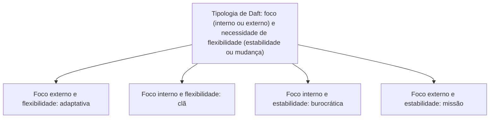

Cultura não significa uniformidade absoluta. Em organizações grandes podem coexistir uma identidade ampla e práticas próprias de unidades, enquanto a força dos valores compartilhados traz vantagens e riscos. Este capítulo reúne classificações importantes e examina como a cultura favorece coordenação, mas também pode dificultar adaptação e diversidade. Ao final, a socialização e a mudança cultural são tratadas como processos que exigem diagnóstico, coerência e tempo.

> [!objetivos]
> - Diferenciar cultura dominante, subculturas e contraculturas, além de culturas fortes e fracas.
> - Relacionar as quatro culturas de Daft às dimensões de foco e flexibilidade.
> - Reconhecer orientações culturais internacionais sem transformá-las em estereótipos.
> - Explicar vantagens, barreiras, socialização e gestão de mudança cultural.

## Cultura dominante, subculturas e força cultural

A cultura dominante expressa valores e referências amplamente compartilhados e fornece uma identidade geral à organização. Ela não elimina diferenças internas. Subculturas se desenvolvem em áreas, profissões, unidades geográficas ou equipes que enfrentam tarefas próprias. Podem criar vocabulário e rotinas particulares sem romper com os valores centrais. Em uma corporação de resposta a emergências, logística e atendimento pré-hospitalar podem cultivar práticas técnicas diferentes, mantendo compromisso comum com serviço e segurança.

Contracultura designa um conjunto de valores que se opõe de modo significativo a aspectos centrais da cultura predominante. Pode surgir de conflitos, insatisfação ou crítica a práticas percebidas como inadequadas. Não se deve confundir toda divergência com contracultura: opiniões diferentes e subculturas compatíveis são parte normal de instituições complexas. A análise pergunta se o grupo desafia pressupostos centrais ou apenas adapta a rotina local.

A força cultural descreve o grau em que valores centrais são amplamente compartilhados e exercem influência sobre a conduta. Em culturas fortes, os integrantes tendem a conhecer expectativas comuns e a agir com coordenação informal. Culturas fracas têm menor consenso e influência menos uniforme. Força não equivale a qualidade: uma cultura forte pode sustentar integridade e cooperação, mas também pode reforçar hábitos prejudiciais se não houver abertura a revisão.

| Conceito | Relação com o conjunto | Exemplo hipotético |
| --- | --- | --- |
| Dominante | Referências gerais da organização | Compromisso institucional com atendimento seguro |
| Subcultura | Particularidade de um grupo compatível com o todo | Setor técnico adota rotina especializada de conferência |
| Contracultura | Oposição a valores centrais vigentes | Grupo rejeita abertamente a regra informal de ocultar falhas |
| Forte | Valores amplamente aceitos e influentes | Membros cooperam mesmo sem supervisão constante |
| Fraca | Valores pouco compartilhados | Unidades interpretam prioridades de modo muito diverso |

> [!pegadinha] Forte não quer dizer boa
> Uma cultura forte pode facilitar coordenação e identidade, mas também produzir conformismo, resistência à mudança ou exclusão. Avalie o conteúdo dos valores, além de sua intensidade e disseminação.

## Tipologia de Daft e orientações entre matriz e filiais

Richard Daft combina duas perguntas: o foco é predominantemente interno ou externo? A organização privilegia flexibilidade ou estabilidade? A cultura adaptativa ou de iniciativa olha para o ambiente externo e valoriza flexibilidade, inovação e resposta a mudanças. A cultura de missão também considera o ambiente externo, mas opera com mais estabilidade, objetivos claros e metas. A cultura de clã enfatiza integração e participação internas, mantendo capacidade de adaptação. A cultura burocrática volta-se para a integração interna por regras, previsibilidade e estabilidade.

| Cultura de Daft | Foco predominante | Flexibilidade | Ênfase típica |
| --- | --- | --- | --- |
| Adaptativa ou iniciativa | Externo | Alta | Inovação e resposta ao ambiente |
| Missão | Externo | Menor, relativa estabilidade | Objetivos e resultados definidos |
| Clã | Interno | Alta | Participação, cooperação e desenvolvimento dos membros |
| Burocrática | Interno | Menor, estabilidade | Regras, consistência e previsibilidade |

Quando uma organização atua em outros países, pode adotar orientações etnocêntrica, policêntrica ou geocêntrica. A orientação etnocêntrica privilegia as práticas da matriz e tende a aplicá-las às filiais. A policêntrica dá maior autonomia às unidades locais e considera as condições de cada sociedade. A geocêntrica procura integrar práticas e conhecimentos de diferentes partes da organização em uma abordagem mais ampla. Não são necessariamente etapas de uma evolução; representam escolhas gerenciais com vantagens e limitações próprias.

| Orientação | Centro de referência | Risco a observar |
| --- | --- | --- |
| Etnocêntrica | Matriz | Ignorar condições locais |
| Policêntrica | Filial e contexto local | Fragmentação entre unidades |
| Geocêntrica | Organização integrada e múltiplas fontes | Complexidade de coordenação |

## Diferenças culturais e comparação responsável

A literatura intercultural também compara tendências individualistas e coletivistas. Em termos gerais, a primeira dimensão dá maior ênfase à autonomia e responsabilidade individual, enquanto a segunda destaca pertencimento, interdependência e deveres perante grupos. Essas categorias descrevem tendências estudadas em contextos sociais; não permitem prever automaticamente a conduta de uma pessoa nem dividir sociedades em blocos homogêneos.

Outra dimensão comparativa tradicional distingue orientações associadas a assertividade, competição e realização de outras que valorizam cuidado, cooperação e qualidade de vida. Em textos clássicos, encontram-se os termos “masculinidade” e “feminilidade” para essas dimensões culturais. Eles não descrevem a personalidade ou as capacidades naturais de homens e mulheres. Em gestão contemporânea, é prudente explicar o sentido operacional dos termos e evitar inferências estereotipadas sobre indivíduos. A prova pode cobrar o rótulo doutrinário; a resposta deve relacioná-lo à dimensão descrita, sem converter tendência cultural em regra universal.

> [!atencao] Nível de análise
> Uma dimensão comparativa de culturas coletivas não é diagnóstico de cada integrante. Evite frases como “todo servidor desta sociedade age assim”. Analise tendências agregadas e reconheça diferenças individuais, regionais e organizacionais.

## Vantagens e barreiras

Uma cultura coerente pode oferecer identidade, comprometimento, estabilidade e referências para decisões. Ao orientar condutas esperadas, pode reduzir a necessidade de instruções repetidas e facilitar coordenação. Também pode reforçar continuidade e confiança entre equipes. Essas vantagens dependem de valores compatíveis com a missão, a legalidade e o respeito às pessoas.

A rigidez cultural gera barreiras. A barreira à mudança surge quando hábitos que funcionaram em um contexto passam a impedir adaptação a novas demandas. A barreira à diversidade aparece quando a pressão por “encaixe” leva a organização a rejeitar perspectivas, origens ou estilos diferentes, desperdiçando contribuições. A barreira a fusões e aquisições decorre de incompatibilidades culturais que dificultam a integração, ainda que estruturas ou recursos pareçam compatíveis. No setor público, esses fenômenos também ocorrem em reorganizações, incorporações de unidades e cooperação entre órgãos.

| Efeito | Pode ser vantagem quando… | Pode virar barreira quando… |
| --- | --- | --- |
| Coesão | Facilita coordenação e confiança | Exige conformidade excessiva |
| Estabilidade | Mantém padrões necessários à segurança | Impede resposta a novos riscos |
| Identidade | Reforça compromisso com serviço público | Afasta quem traz experiências diferentes |
| Rotinas comuns | Reduz dúvidas e retrabalho | Torna difícil integrar unidades com práticas diversas |

> [!exemplo] Procedimento antigo
> Uma equipe mantém uma rotina de conferência que reduz erros. Com a introdução de um sistema digital, insiste em duplicar todos os registros em papel, embora isso gere atrasos e não reduza riscos. A cultura de cuidado é valiosa; a prática específica deve ser reavaliada diante da nova tecnologia.

## Socialização e mudança cultural

Socialização organizacional é o processo pelo qual novos integrantes aprendem valores, normas, relações e comportamentos esperados para desempenhar seus papéis. Um modelo recorrente divide o processo em pré-chegada, encontro e metamorfose. Na pré-chegada, a pessoa chega com expectativas e experiências anteriores. No encontro, compara essas expectativas com a realidade do trabalho. Na metamorfose, ajusta-se e aprende como atuar no novo contexto. O processo é influenciado por treinamento, orientação, apoio da equipe e pela própria disposição da organização de ouvir o recém-chegado.

A socialização não deve ser confundida com apagar diferenças individuais. Uma integração bem conduzida esclarece missão, responsabilidades, limites legais e canais de apoio, ao mesmo tempo que permite ao novo membro contribuir com experiências próprias. Uma organização que exige adesão acrítica pode obter conformidade aparente e perder capacidade de aprendizagem.

Mudar a cultura é difícil porque envolve padrões compartilhados, especialmente pressupostos profundos. O processo começa pelo diagnóstico da cultura existente e pela definição clara do padrão desejado. É mais viável atuar primeiro em aspectos observáveis, como sistemas, rotinas, estrutura e recompensas, enquanto lideranças modelam as novas prioridades. Treinamento, comunicação, avaliação de desempenho e seleção podem reforçar a direção pretendida. Mudanças sustentáveis dependem de coerência entre o discurso, a distribuição de recursos e as consequências das decisões; uma ordem isolada não altera automaticamente crenças arraigadas.

> [!bizu] Socialização em três momentos
> Pré-chegada: expectativas prévias. Encontro: confronto com a realidade. Metamorfose: aprendizado e adaptação ao papel. A sequência descreve o ingresso; não garante que a cultura seja imutável.

> [!pegadinha] Mudança não é instantânea
> Trocar um organograma, um slogan ou um uniforme altera manifestações visíveis. Para mudar cultura, é preciso que decisões, sistemas de recompensa e condutas cotidianas sustentem os valores desejados ao longo do tempo.

## Outras classificações e diagnóstico cuidadoso

Cultura dominante, subculturas e contraculturas descrevem a relação entre grupos e referências institucionais. A existência de subculturas não é falha por si. Especialistas precisam de linguagem, procedimentos e critérios ligados ao seu trabalho. A pergunta gerencial é se as particularidades ajudam a executar a missão ou criam barreiras injustificadas. Uma contracultura pode expor problemas que o grupo principal deixou de perceber; ao mesmo tempo, a oposição persistente a valores legítimos pode comprometer coordenação. A administração deve compreender as causas antes de tentar impor uniformidade.

A força cultural também deve ser avaliada junto com o conteúdo. Valores amplamente compartilhados podem reduzir ambiguidade e favorecer senso de pertencimento. Porém, quanto maior a pressão por conformidade, maior pode ser o risco de silenciar opiniões divergentes ou tratar inovação como deslealdade. Culturas fortes podem reduzir a necessidade de fiscalização rotineira em certos contextos, mas não eliminam controles, responsabilização nem a necessidade de rever procedimentos.

A matriz de Daft pode ser lida por quadrantes. A adaptativa combina foco externo e flexibilidade: aprende com mudanças ambientais e incentiva resposta inovadora. A missão mantém foco externo, mas privilegia objetivos, metas e acompanhamento estável. O clã enfatiza coesão interna e participação, embora precise responder ao ambiente. A burocrática dá importância a consistência, regras e integração interna, especialmente útil onde previsibilidade e conformidade são necessárias. Nenhum perfil é universalmente superior: sua adequação depende da tarefa, do ambiente e dos riscos.

> [!exemplo] Combinação de culturas
> Uma secretaria pode ter rotinas burocráticas para executar pagamentos e, simultaneamente, grupos temporários de projeto para melhorar o atendimento digital. A primeira estrutura protege consistência; a segunda concentra competência em uma tarefa. A combinação pode ser funcional se responsabilidades e limites estiverem claros.

## Orientações globais sem receitas prontas

Uma filial pode receber procedimentos da matriz, adaptar-se ao contexto local ou participar de um arranjo integrado com outras unidades. A orientação etnocêntrica facilita consistência e transferência de práticas, mas pode ignorar necessidades locais. A policêntrica favorece adaptação e conhecimento da região, mas pode criar padrões fragmentados. A geocêntrica busca uma visão global e compartilhamento de práticas úteis, exigindo coordenação e comunicação mais complexas.

Essas escolhas também se aplicam por analogia a redes públicas distribuídas, sem pressupor que uma agência internacional e um órgão governamental sejam idênticos. Uma direção central pode definir critérios comuns de segurança e permitir que unidades regionais escolham como organizar o atendimento, respeitando as particularidades locais. Uma integração equilibrada identifica quais valores são inegociáveis e onde há espaço legítimo para adaptação.

As dimensões de individualismo e coletivismo ajudam a discutir o equilíbrio entre autonomia e obrigações perante grupos. A aplicação em administração requer cautela. Setores de uma mesma instituição podem valorizar decisões individuais ou coordenação coletiva independentemente da tendência atribuída a um país. Em vez de presumir a resposta pela nacionalidade, o gestor pode examinar a tarefa: uma decisão clínica individual exige responsabilidade técnica, enquanto uma operação de busca depende de informação compartilhada e coordenação.

## Efeitos sobre integração e desempenho

A cultura pode apoiar desempenho ao alinhar prioridades, reduzir conflitos sobre expectativas e tornar a cooperação mais previsível. Uma equipe que confia nos canais de comunicação tende a compartilhar alertas relevantes antes que se tornem problemas maiores. Uma cultura de atenção ao público pode estimular resposta respeitosa sem exigir que cada situação seja roteirizada. Contudo, cultura não compensa falta de recursos, desenho ruim de processos, treinamento insuficiente ou metas contraditórias. Diagnóstico cultural deve ser parte da análise, não explicação universal para qualquer resultado.

Quando há baixa satisfação ou rotatividade elevada, por exemplo, não se deve concluir imediatamente que a causa é uma cultura fraca. Podem contribuir remuneração, carga de trabalho, condições físicas, qualidade da chefia ou incompatibilidade entre valores professados e recompensas. Indicadores, entrevistas e observação devem ser combinados. A cultura é uma hipótese explicativa que precisa ser sustentada por sinais consistentes.

A mudança cultural também pode incluir ações sobre elementos profundos. Uma crise pode interromper a confiança em práticas antigas, mas crise sozinha não define uma direção saudável. Liderança renovada pode dar exemplo, porém a substituição de pessoas não garante mudança. Alterar recompensas sem explicar a razão pode gerar obediência curta. A mudança gradual de produtos, sistemas e estrutura costuma ser mais palpável, enquanto o aprendizado repetido e coerente pode modificar pressupostos com o tempo.

> [!atencao] Não confundir evento com transformação
> Um treinamento pontual ou campanha de comunicação pode iniciar uma mudança, mas a incorporação cultural depende da repetição de práticas coerentes e da experiência de que os novos valores são levados a sério nas decisões.

Na gestão da mudança, a participação tem valor prático: revela impactos que a liderança central talvez não conheça e permite que os membros compreendam por que a transformação é necessária. O plano deve identificar aspectos preservados, práticas a abandonar e comportamentos novos a aprender. Avaliar resultados, admitir ajustes e reconhecer desvios evita que a iniciativa se torne apenas simbólica.

## Barreiras em contextos de integração

A compatibilidade cultural merece atenção quando unidades são fundidas ou passam a compartilhar serviços. Uma equipe pode decidir com autonomia técnica, enquanto outra exige validação central em cada etapa. A divergência não é apenas preferência pessoal: pode refletir pressupostos sobre responsabilidade, controle e confiança. Antes de padronizar, identifique obrigações legais, riscos operacionais e práticas que funcionam em cada unidade. Depois, defina quais procedimentos precisam ser comuns e quais admitem adaptação.

A diversidade inclui diferenças de experiência, formação, origem, idade, modo de comunicação e perspectivas. Uma cultura forte pode facilitar uma linguagem compartilhada, mas também pressionar membros a esconder aspectos que não se ajustam ao perfil dominante. O desafio é preservar valores institucionais legítimos sem exigir que todos tenham o mesmo estilo pessoal. Na administração pública, respeito à diversidade convive com imparcialidade, competência e observância dos deveres do cargo.

## De padrões atuais a uma cultura desejada

A transformação começa com uma descrição realista: que práticas devem ser preservadas, quais geram dificuldades e quais condições do ambiente mudaram? Uma análise de contexto permite evitar receitas prontas importadas de outra organização. Práticas originárias de uma matriz ou de uma unidade não se tornam adequadas automaticamente quando adotadas em outro país, estado ou setor. A instituição pode adaptar elementos úteis ao local onde está instalando uma filial ou incorporando uma equipe, ao mesmo tempo que mantém valores essenciais.

Uma liderança que pretende ampliar cooperação pode ajustar critérios de promoção para reconhecer resultados coletivos, treinar chefias para conduzir reuniões participativas e criar canais de coordenação. O planejamento organizacional, os sistemas de avaliação e recompensa, a seleção de novos membros e os processos de educação precisam sustentar a mesma mudança. Se a promoção continuar premiando competição individual, discursos sobre colaboração terão pouco efeito.

> [!esquema] Alinhamento para mudança
> **Diagnóstico:** identificar cultura vivida e condições atuais. **Direção:** definir valores e comportamentos desejados. **Ações:** alinhar estrutura, treinamento, avaliação e recompensa. **Aprendizagem:** observar resultados, conversar com os grupos e ajustar o percurso.

A mudança não exige apagar a história da organização. Memórias de crises, tradições e símbolos podem ser reinterpretados para apoiar novos padrões. O processo tende a ser gradual porque os membros precisam experimentar que os comportamentos novos são viáveis e reconhecidos. Uma crise pode abrir espaço para revisão, mas também elevar ansiedade e resistência. A substituição da liderança pode alterar prioridades, mas sem sistemas coerentes os padrões antigos podem retornar.

Quando a cultura atual é conservadora em relação a riscos, a gestão pode distinguir prudência necessária de resistência automática. Em atividade de emergência, controles rigorosos podem proteger vidas; em inovação administrativa, proibir toda experimentação pode impedir melhoria. O objetivo é alinhar flexibilidade ao contexto, não transformar mudança em valor absoluto. A instituição deve explicitar quais decisões podem ser testadas, quais exigem autorização e como os resultados serão avaliados.

## Mapa do capítulo

| Tema | Distinção central | Consequência para a gestão |
| --- | --- | --- |
| Dominante, sub e contracultura | Ampla referência, particularidade compatível, oposição central | Diagnosticar coesão e conflito sem confundir divergência |
| Forte e fraca | Intensidade e amplitude do compartilhamento | Força pode coordenar ou enrijecer |
| Daft | Foco interno/externo e flexibilidade/estabilidade | Classificar quatro perfis culturais |
| Internacionalização | Matriz, contexto local ou integração global | Ajustar coordenação sem presumir superioridade cultural |
| Barreiras | Mudança, diversidade, fusões e integração | Reconhecer custos do conformismo e incompatibilidade |
| Socialização e mudança | Aprender papel; alinhar práticas à cultura desejada | Liderança e sistemas precisam sustentar a transformação |

### Para fixar
- A cultura dominante não elimina subculturas próprias de áreas e profissões.
- Contracultura desafia elementos centrais; diferença pontual não basta para classificá-la.
- Cultura forte indica ampla aceitação, não superioridade moral ou eficácia automática.
- Daft combina foco interno/externo com flexibilidade/estabilidade.
- Etnocêntrica privilegia a matriz; policêntrica, a filial; geocêntrica, a integração.
- Dimensões interculturais descrevem tendências agregadas, não todos os indivíduos.
- Cultura pode apoiar coesão e também criar barreiras à mudança e à diversidade.
- Socialização passa por pré-chegada, encontro e metamorfose.
- Mudança cultural exige coerência duradoura entre liderança, sistemas e práticas.
