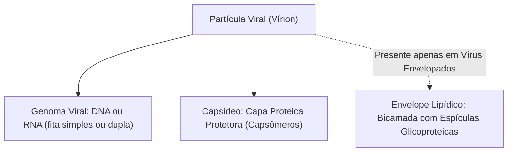
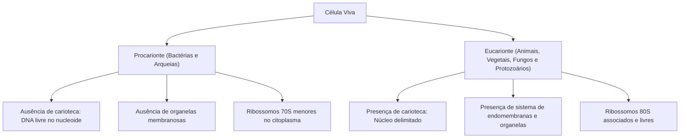
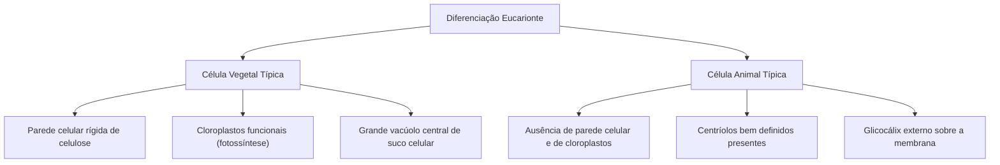
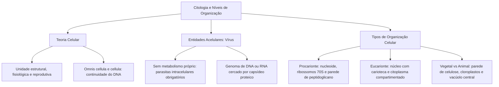

A Citologia representa o alicerce fundamental para a compreensão dos fenômenos vitais que regem os seres vivos. Desde a manutenção da homeostase fisiológica até as respostas inflamatórias agudas observadas em situações de emergência e trauma, todos os processos biológicos derivam do funcionamento coordenado das células. Compreender a morfologia, a organização estrutural e os limites evolutivos da unidade celular permite decifrar o funcionamento dos tecidos, dos órgãos e dos organismos complexos.

> [!objetivos]
> - Compreender a formulação histórica e os postulados basilares da Teoria Celular moderna.
> - Caracterizar a biologia dos vírus, sua condição de seres acelulares e suas patologias de relevância.
> - Diferenciar a arquitetura procarionte da organização compartimentada das células eucariontes.
> - Identificar as estruturas ultraestruturais bacterianas, como parede de peptidoglicano e plasmídeos.
> - Contrastar as peculiaridades morfológicas e funcionais entre células vegetais e animais.

## Conceito de célula e os postulados da Teoria Celular

A célula constitui a menor porção de matéria viva dotada de capacidade autônoma de metabolismo, autoduplicação e manutenção do equilíbrio interno. O termo célula deriva do latim *cella*, que significa cavidade ou pequeno aposento.

O vocábulo foi cunhado pelo cientista inglês Robert Hooke em 1665. Ao examinar fatias delgadas de cortiça por meio de um microscópio óptico rudimentar, Hooke visualizou minúsculos compartimentos poliédricos vazios. Na verdade, Hooke observou apenas as paredes celulares de tecido vegetal morto do sobreiro (*Quercus suber*).

No século XIX, o avanço das lentes de microscopia permitiu aos naturalistas alemães Matthias Schleiden (em 1838) e Theodor Schwann (em 1839) formularem a **Teoria Celular**. Posteriormente ampliada por Rudolf Virchow em 1855, a teoria fundamenta-se em três princípios dogmáticos:

1. **Unidade morfológica e estrutural**: todos os organismos vivos, desde as bactérias mais primitivas até os mamíferos superiores, são constituídos por uma (seres unicelulares) ou por múltiplas células (seres pluricelulares).
2. **Unidade fisiológica e funcional**: as reações bioquímicas vitais, como a respiração celular, a síntese de proteínas e a produção de energia, ocorrem no interior dos limites celulares.
3. **Unidade reprodutiva e genética**: toda célula origina-se exclusivamente da divisão de uma célula preexistente (*omnis cellula e cellula*). A continuidade da vida é garantida pela transmissão do ácido desoxirribonucleico (DNA), que codifica as informações biológicas para as gerações filhas.

> [!bizu]
> **A exceção da Teoria Celular:** as bancas de concurso costumam questionar qual grupo de entidades biológicas representa uma exceção clássica aos postulados da Teoria Celular. A resposta imediata recai sobre os **vírus**, pois são entidades acelulares que dependem integralmente do aparato de uma célula hospedeira para manifestar reprodução e síntese de macromoléculas.

## Vírus: organização acelular e parasitismo intracelular obrigatório

Os vírus ocupam uma posição singular na Biologia e geram frequentes debates científicos sobre sua caracterização como seres vivos. Eles não possuem organização celular, não contêm membrana plasmática, não apresentam citoplasma e são totalmente desprovidos de ribossomos e de metabolismo energético próprio.

Fora do ambiente celular, o vírus apresenta-se como uma partícula inerte denominada **vírion**. O vírion é incapaz de sintetizar proteínas ou quebrar moléculas de glicose para produzir trifosfato de adenosina (ATP). Por essa limitação bioquímica absoluta, os vírus são classificados como **parasitas intracelulares obrigatórios**.

A arquitetura dos vírus é constituída pelos seguintes componentes estruturais:

- **Genoma viral**: ao contrário das células vivas (que possuem simultaneamente DNA como material genético e RNA como mensageiro e transportador), os vírus apresentam ordinariamente **ou DNA ou RNA** como seu genoma principal.
- **Capsídeo**: envoltório de natureza estritamente proteica, composto por subunidades idênticas chamadas capsômeros. Protege o ácido nucleico viral e reconhece quimicamente a superfície da célula hospedeira. O conjunto formado pelo capsídeo e pelo genoma denomina-se nucleocapsídeo.
- **Envelope membranoso**: presente em certos vírus (como o vírus da gripe e os coronavírus), consiste em uma bicamada lipídica originada da membrana celular da célula parasitada durante o processo de brotamento. O envelope é pontilhado por espículas proteicas virais que facilitam a adsorção celular.

### Viroses de relevância nos certames públicos

As viroses aparecem com grande recorrência em provas de concurso. A tabela a seguir consolida as patologias mais cobradas, seus agentes, vetores e formas de profilaxia:

| Doença Viral | Agente Etiológico e Genoma | Vetor ou Forma de Contágio | Sintomatologia Típica | Medidas de Profilaxia |
|---|---|---|---|---|
| **COVID-19** | SARS-CoV-2 (Vírus envelopado de RNA) | Gotículas respiratórias, aerossóis e contato físico. | Febre, tosse seca, dispneia, mialgia, perda de paladar e olfato. | Vacinação em massa, uso de máscaras e higienização das mãos. |
| **Gripe Comum e H1N1** | *Influenzavirus* A (Vírus envelopado de RNA) | Secreções aéreas e contato com fômites contaminados. | Febre alta, coriza, cefaleia intensa, prostração e dor muscular. | Vacinação anual, etiqueta respiratória e ventilação de ambientes. |
| **Dengue** | DENV 1 a 4 (Vírus envelopado de RNA) | Picada da fêmea do mosquito *Aedes aegypti*. | Febre aguda, cefaleia retro-orbital, manchas avermelhadas e mialgia. | Controle e eliminação de criadouros do vetor e vacinação. |
| **Febre Amarela** | *Flavivirus* febre amarela (Vírus de RNA) | Mosquitos vetores (*Haemagogus* silvestre e *Aedes* urbano). | Febre súbita, icterícia decorrente de lesão hepática e hemorragias. | Vacinação preventiva com vírus atenuado e combate aos mosquitos. |
| **Raiva Humana** | *Lyssavirus* (Vírus envelopado de RNA) | Mordedura, arranhadura ou lambedura de mamíferos infectados. | Hidrofobia, espasmos musculares severos, delírios e paralisia. | Vacinação antirrábica profilática e soroterapia imediata pós-exposição. |
| **Poliomielite** | Poliovírus (Vírus não envelopado de RNA) | Via fecal-oral por água e alimentos contaminados. | Paralisia flácida assimétrica permanente dos membros inferiores. | Vacinação infantil sistemática (vacinas Sabin e Salk). |
| **AIDS (SIDA)** | HIV (Retrovírus de RNA com transcriptase reversa) | Relação sexual desprotegida, transfusão sanguínea e via vertical. | Destruição progressiva de linfócitos T CD4+ e infecções oportunistas. | Uso de preservativos, triagem de hemoderivados e terapia antirretroviral. |

> [!atencao]
> **Formas de não transmissão do HIV:** é clássica a tentativa das bancas de confundir o estudante sobre as vias de transmissão do vírus da imunodeficiência humana. O HIV **não é transmitido** por contato social rotineiro, aperto de mão, abraço, uso compartilhado de copos, talheres, sanitários públicos, piscina, lágrimas ou saliva. A concentração viral em secreções salivares é biologicamente insuficiente para estabelecer infecção primária.

## Células procariontes versus células eucariontes

A classificação biológica dos seres vivos organiza as formas celulares em dois grandes grupos morfológicos e evolutivos: procariontes e eucariontes. A distinção fundamental reside na presença ou ausência de uma membrana nuclear que compartimentalize o material genético.

### Arquitetura da célula procarionte

Os procariontes englobam os organismos pertencentes aos domínios **Bacteria** (eubactérias e cianobactérias) e **Archaea** (arqueobactérias adaptadas a ambientes extremos). Trata-se invariavelmente de seres unicelulares que apresentam grande versatilidade metabólica:

- **Parede celular bacteriana**: revestimento externo rígido localizado sobre a membrana plasmática. Confere formato geométrico à bactéria e resiste à pressão osmótica interna, impedindo a lise da célula em meio hipotônico. Nas bactérias, a parede é composta exclusivamente por **peptidoglicano** (mureína), polímero formado por cadeias de açúcares unidas por pontes peptídicas curtas.
- **Nucleoide**: região do citosol desprovida de membrana envolvente na qual se concentra o **cromossomo bacteriano único**. O DNA bacteriano é uma molécula circular de fita dupla, desprovida de histonas estruturantes típicas dos eucariontes.
- **Plasmídeos**: pequenas moléculas circulares acessórias de DNA dupla-fita extracromossômico. Os plasmídeos replicam-se de maneira autônoma e contêm genes que conferem vantagens adaptativas específicas, como resistência múltipla a antibióticos ou produção de toxinas bacterianas. Podem ser transferidos entre bactérias por conjugação ou transformação.
- **Ribossomos 70S**: únicas organelas citoplasmáticas presentes nos procariontes. São estruturas não membranosas compostas por RNA ribossômico e proteínas, com coeficiente de sedimentação de 70S (formados pelas subunidades 50S maior e 30S menor), responsáveis pela síntese proteica.
- **Apêndices locomotores e de adesão**: incluem os flagelos bacterianos (formados por filamentos helicoidais da proteína **flagelina**, estruturalmente distintos dos flagelos eucariontes) e as fímbrias ou *pili*, envolvidas na adesão aos tecidos do hospedeiro e na transferência de plasmídeos por conjugação.

> [!pegadinha]
> **Organelas em bactérias:** as bancas examinadoras costumam elaborar questões indagando qual estrutura celular está presente simultaneamente em bactérias, células vegetais e células animais. Lembre-se: bactérias não possuem mitocôndrias, complexo golgiense, retículo endoplasmático ou lisossomos! A única estrutura presente em procariontes e eucariontes é o **ribossomo**, organela não membranosa responsável pela síntese de proteínas.

### Arquitetura da célula eucarionte

Os eucariontes reúnem os reinos Protoctista, Fungi, Plantae e Animalia. Caracterizam-se pela marcante compartimentalização interna proporcionada por sistemas de membranas fosfolipídicas:

- **Envoltório nuclear (carioteca)**: dupla membrana porosa que isola fisicamente o material genético do citoplasma, proporcionando controle rigoroso sobre a transcrição e o processamento de RNA mensageiro.
- **Organelas citoplasmáticas membranosas**: estruturas especializadas que desempenham funções isoladas, como retículo endoplasmático liso e rugoso, complexo golgiense, lisossomos, peroxissomos, mitocôndrias e cloroplastos.
- **Ribossomos 80S**: maiores e mais densos que os bacterianos, com coeficiente de sedimentação 80S (subunidades 60S e 40S), atuando dispersos no citosol ou aderidos às membranas do retículo endoplasmático rugoso.
- **Citoesqueleto protéico complexo**: rede tridimensional intrincada de microtúbulos, microfilamentos de actina e filamentos intermediários, responsável pela manutenção da forma, sustentação mecânica, ancoragem de organelas e movimentação celular.

## Célula vegetal versus célula animal

No domínio dos eucariontes pluricelulares, a divergência entre a linhagem vegetal e a linhagem animal estabeleceu adaptações anatômicas e metabólicas específicas. As células vegetais possuem três estruturas exclusivas que não aparecem nas células dos animais:

A comparação analítica dos componentes revela os traços distintivos cobrados em certames:

| Elemento Estrutural | Célula Vegetal | Célula Animal | Significado Biológico |
|---|---|---|---|
| **Parede Celular** | **Presente** (feita de celulose). | **Ausente**. | Confere rigidez, sustentação estática e proteção mecânica e osmótica. |
| **Cloroplastos e Plastos** | **Presente**. | **Ausente**. | Realizam a fotossíntese e o armazenamento de pigmentos ou amido. |
| **Vacúolo Central** | **Presente e volumoso** (ocupa até 90% do volume). | **Ausente** (ou minúsculo e temporário). | Realiza osmorregulação, manutenção do turgor e acúmulo de substâncias. |
| **Centríolos** | Ausentes na maioria das plantas com sementes. | **Presentes** (um par no centrossomo). | Atuam na polimerização do fuso mitótico e origem de cílios e flagelos. |
| **Reserva Energética** | **Amido** (polímero vegetal de glicose). | **Glicogênio** (polímero ramificado de glicose). | Molécula insolúvel de estocagem de carboidratos para o metabolismo. |

> [!esquema]
> **Síntese dos Domínios Celulares:** memorize as diferenças cruciais para a resolução rápida de itens de prova:
> - **Procariontes**: sem carioteca, sem organelas membranosas, cromossomo circular no nucleoide, ribossomos 70S e parede de peptidoglicano.
> - **Eucariontes animais**: possuem carioteca, organelas diversas, ribossomos 80S, centríolos e armazenam glicogênio, sem parede de celulose.
> - **Eucariontes vegetais**: possuem carioteca, organelas diversas, ribossomos 80S, parede de celulose, cloroplastos, vacúolo central e armazenam amido.

## Mapa do capítulo

### Para fixar

1. **Teoria Celular**: consolidada por Schleiden, Schwann e Virchow, estabelece que a célula é a unidade morfológica, funcional e hereditária de todos os seres vivos, derivando sempre de outra célula preexistente.
2. **Exceção viral**: os vírus são entidades biológicas acelulares destituídas de metabolismo próprio e de ribossomos, sobrevivendo exclusivamente como parasitas intracelulares obrigatórios.
3. **Morfologia dos vírus**: constituídos por um cerne contendo DNA ou RNA envolvido por uma capa de proteínas denominada capsídeo. Vírus envelopados possuem um folheto lipídico externo com espículas glicoproteicas.
4. **Células procariontes**: não possuem envoltório nuclear delimitando o material genético. O DNA circular único fica condensado no nucleoide. Apresentam ribossomos 70S e parede celular de peptidoglicano, carecendo de organelas membranosas.
5. **Plasmídeos bacterianos**: moléculas circulares acessórias de DNA que conferem propriedades adaptativas vantajosas, a exemplo da resistência a antibióticos, sendo transmitidas por conjugação ou transformação.
6. **Células eucariontes**: caracterizam-se pelo núcleo verdadeiro delimitado por carioteca e por uma ampla compartimentalização citoplasmática com organelas membranosas e ribossomos 80S.
7. **Peculiaridades da célula vegetal**: distingue-se da célula animal pela presença de parede celular celulósica, plastos clorofilados para a fotossíntese e um volumoso vacúolo central de suco celular.
8. **Reserva energética celular**: os animais e fungos estocam glicose na forma de glicogênio, ao passo que as células vegetais acumulam energia na forma de amido.