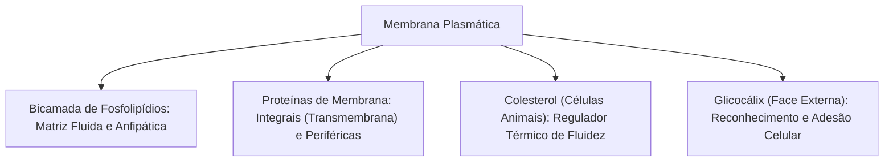
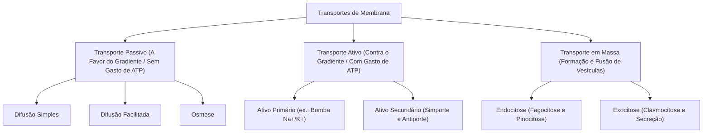
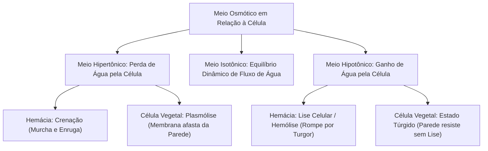
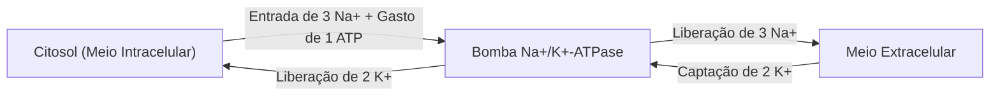
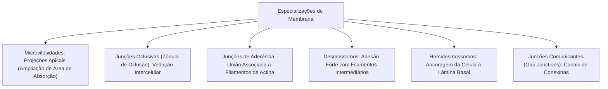
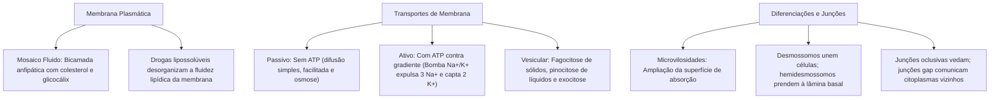

A membrana plasmática constitui o envoltório dinâmico indispensável que separa o meio intracelular altamente organizado do ambiente extracelular flutuante. Longe de atuar como uma barreira física estática, a membrana funciona como uma fronteira seletiva ativa, controlando a entrada de nutrientes, a expulsão de escórias metabólicas, a recepção de sinais químicos e a transmissão de impulsos bioelétricos.

> [!objetivos]
> - Compreender a organização molecular do modelo do mosaico fluido e as funções do glicocálix.
> - Avaliar o impacto de compostos químicos e drogas de abuso lipossolúveis sobre a fluidez membranar.
> - Diferenciar os mecanismos de transporte passivo por difusão simples, difusão facilitada e osmose.
> - Analisar o funcionamento eletrogênico da bomba de sódio e potássio e os transportes em massa.
> - Caracterizar as especializações de membrana e as junções intercelulares em tecidos epiteliais.

## Estrutura molecular e o Modelo do Mosaico Fluido

A concepção moderna da membrana plasmática foi proposta em 1972 pelos pesquisadores norte-americanos S. Jonathan Singer e Garth L. Nicolson, sob a denominação de **Modelo do Mosaico Fluido**. De acordo com essa formulação, a membrana é uma estrutura tridimensional fluida, formada por uma matriz lipídica contínua na qual se inserem ou se associam proteínas globulares dotadas de mobilidade lateral.

Os componentes químicos fundamentais da membrana desempenham papéis biológicos essenciais:

- **Fosfolipídios em bicamada**: são moléculas com nítido caráter **anfipático** (ou anfifílico). Cada fosfolipídio apresenta uma "cabeça" polar e hidrofílica (formada por glicerol ligado a um grupo fosfato carregado eletricamente) e duas "caudas" apolares e hidrofóbicas (compostas por longas cadeias de ácidos graxos). Em meio aquoso, essas moléculas organizam-se espontaneamente em uma bicamada: as cabeças polares voltam-se para as superfícies aquosas interna e externa, enquanto as caudas hidrofóbicas se ocultam no interior da membrana, protegidas da água.
- **Proteínas integrais e periféricas**: as proteínas integrais (ou intrínsecas) atravessam a bicamada de lado a lado (proteínas transmembrana) ou inserem-se profundamente nela. Funcionam como canais iônicos, bombas de transporte e receptores hormonais. As proteínas periféricas (ou extrínsecas) ligam-se frouxamente às superfícies externa ou interna da bicamada por interações eletrostáticas, atuando como enzimas e pontos de ancoragem do citoesqueleto.
- **Colesterol**: esteroide lipídico presente com exclusividade nas células animais (as células vegetais contêm fitoesteróis). O colesterol intercala-se entre as caudas dos fosfolipídios, desempenhando o papel de tampão de fluidez: em temperaturas elevadas, restringe a movimentação excessiva dos lipídios; em temperaturas baixas, impede o empacotamento cerrado das caudas, evitando o congelamento da membrana.
- **Glicocálix**: revestimento superficial presente exclusivamente na face externa da membrana de células animais e de alguns protozoários. É formado pelas porções glicídicas de glicoproteínas e glicolipídios. Exerce proteção mecânica e química, atua na retenção de água e nutrientes e opera no reconhecimento intercelular (como a tipagem sanguínea do sistema ABO e o reconhecimento imunológico entre linfócitos e células corporais).

> [!bizu]
> **Assimetria da Membrana Plasmática:** a membrana não é idêntica em suas duas faces. A face citoplasmática e a face extracelular possuem composições moleculares distintas. O glicocálix, por exemplo, localiza-se **estritamente na face externa**. Da mesma forma, as proteínas receptoras expõem seus sítios de ligação voltados exclusivamente para o ambiente extracelular.

### Aspectos toxicológicos: impacto de drogas e solventes na membrana

A permeabilidade da bicamada fosfolipídica é diretamente influenciada pela natureza físico-química dos solutos. Moléculas pequenas e apolares (lipossolúveis) dissolvem-se com facilidade na região hidrofóbica das caudas de ácidos graxos, atravessando a membrana sem necessidade de transportadores proteicos.

Esse mecanismo bioquímico explica a ação biológica e a alta toxicidade de diversas substâncias químicas, solventes industriais e drogas de abuso:
- **Etanol e anestésicos gerais**: o álcool etílico e substâncias anestésicas voláteis (como éter e clorofórmio) possuem considerável lipossolubilidade. Eles se dissolvem na porção lipídica das membranas dos neurônios, desestabilizando o ordenamento dos fosfolipídios e aumentando a fluidez da membrana. Esse fenômeno altera a conformação espacial dos canais iônicos voltagem-dependentes e dos receptores sinápticos (como os receptores GABAérgicos), inibindo a excitabilidade do sistema nervoso central.
- **Solventes orgânicos e inalantes (cola de sapateiro e tolueno)**: a inalação de hidrocarbonetos aromáticos e solventes industriais provoca a dissolução e desestruturação de componentes lipídicos das membranas neuronais e da bainha de mielina, acarretando morte celular precoce, lesões cerebrais irreversíveis e arritmias cardíacas graves.

## Mecanismos de transporte através da membrana plasmática

A membrana plasmática ostenta a propriedade da **permeabilidade seletiva**. O tráfego de íons e moléculas entre o citoplasma e o líquido intersticial classifica-se conforme a exigência energética e o sentido do gradiente de concentração.

### Transportes passivos

O transporte passivo caracteriza-se pela movimentação espontânea de substâncias a favor do seu gradiente de concentração (do meio mais concentrado para o meio menos concentrado), **sem qualquer consumo direto de energia metabólica (ATP)**.

1. **Difusão simples**: o soluto atravessa diretamente a bicamada lipídica. É a rota utilizada por gases respiratórios (oxigênio e gás carbônico), ácidos graxos, hormônios esteroides e moléculas apolares pequenas. A velocidade de transporte é diretamente proporcional à concentração do soluto e à sua solubilidade em lipídios.
2. **Difusão facilitada**: o soluto move-se a favor do gradiente, mas necessita do auxílio de proteínas transportadoras transmembrana (permeases ou carreadores) ou de canais iônicos hidrofílicos. É o mecanismo utilizado para o transporte de glicose, aminoácidos e íons (como cálcio, sódio e potássio). A velocidade de difusão facilitada atinge um ponto de saturação máxima (cinética de Michaelis-Menten) quando todos os sítios de ligação dos carreadores estão ocupados.
3. **Osmose**: constitui a difusão do solvente (água) através de uma membrana semipermeável. A água desloca-se espontaneamente da região de **menor concentração de solutos (meio hipotônico)** para a região de **maior concentração de solutos (meio hipertônico)**, no intuito de equilibrar as pressões osmóticas. O transporte de água é acelerado pela presença de canais proteicos especializados chamados **aquaporinas**.

> [!atencao]
> **Osmose e parede celular:** as células animais desprovidas de parede celular (como os glóbulos vermelhos) sofrem rompimento da membrana plasmática (hemólise) quando imersas em meio excessivamente hipotônico (como água destilada pura). Em contraste, as células vegetais não sofrem lise: a presença da resistente parede celular de celulose impede a expansão excessiva, gerando uma pressão mecânica contrária (pressão de turgor) que estanca a entrada de água.

### Transportes ativos

O transporte ativo envolve o deslocamento de íons ou moléculas **contra o gradiente de concentração** (do meio menos concentrado para o meio mais concentrado), exigindo o fornecimento indispensável de energia celular gerada pela hidrólise do ATP.

- **Transporte ativo primário — Bomba de Sódio e Potássio (Na⁺/K⁺-ATPase)**: enzima transmembrana presente em todas as células do corpo humano. A cada ciclo catalítico, a bomba quebra uma molécula de ATP e transporta ativamente **3 íons sódio (Na⁺) para fora da célula** e **2 íons potássio (K⁺) para dentro da célula**. Esse transporte assimétrico mantém o meio intracelular rico em potássio e o meio extracelular rico em sódio, gerando o gradiente eletroquímico responsável pelo potencial de repouso das membranas e pelo controle do volume hídrico celular.

> [!pegadinha]
> **Estequiometria da Bomba Na⁺/K⁺:** as questões de concurso formulam pegadinhas invertendo a contagem e a direção dos íons transportados pela bomba. Guarde a regra mnemônica clássica: a bomba **"joga 3 Na⁺ para a RUA (fora)"** e **"põe 2 K⁺ para DENTRO"**! Ambos os íons movem-se contra seus gradientes de concentração químicos e elétricos, razão pela qual o transporte é estritamente ativo e dependente de energia da hidrólise do ATP.

- **Transporte ativo secundário**: utiliza a energia eletroquímica armazenada no gradiente de íons sódio (criado previamente pelo transporte primário) para impulsionar a entrada de outro composto contra o seu gradiente. Pode ocorrer na modalidade de **simporte** (quando as duas substâncias entram na mesma direção, como o co-transporte de sódio e glicose no epitélio intestinal) ou **antiporte** (quando os solutos movem-se em sentidos opostos, como a troca de sódio por cálcio).

### Transportes em massa ou vesiculares

Grandes massas de partículas, macromoléculas ou microrganismos inteiros não conseguem atravessar a bicamada nem se acoplar a carreadores proteicos. O transporte dessas porções realiza-se por deformações ativas da membrana e formação de vesículas:

1. **Endocitose**: processo de internalização de material externo. Divide-se em:
   - **Fagocitose**: emissão de projeções citoplasmáticas ativas (pseudópodes) guiadas pelo citoesqueleto de actina para englobar partículas sólidas volumosas (bactérias e restos celulares). Forma uma vesícula grande denominada fagossomo, essencial para a defesa imunológica realizada por macrófagos e neutrófilos.
   - **Pinocitose**: invaginação da membrana plasmática para a ingestão contínua de fluidos extracelulares com solutos dissolvidos, originando vesículas delgadas chamadas pinossomos.
   - **Endocitose mediada por receptores**: processo de grande especificidade molecular em que macromoléculas externas (como o colesterol ligado à lipoproteína LDL) ligam-se a receptores específicos na membrana, promovendo a formação de vesículas revestidas pela proteína **clatrina**.
2. **Exocitose**: fusão de vesículas intracelulares com a membrana plasmática para o descarte de resíduos da digestão celular (clasmocitose ou defecação celular) ou para a secreção regulada de produtos celulares sintetizados (como a liberação de insulina pelo pâncreas e a expulsão de neurotransmissores nas sinapses).

## Diferenciações de membrana e junções intercelulares

Nos tecidos animais (com ênfase no tecido epitelial de revestimento), as membranas celulares apresentam especializações adaptadas a funções de absorção, ancoragem e vedação de cavidades.

As especializações morfológicas dividem-se em dois grupos funcionais:

- **Microvilosidades**: dobras e projeções digitiformes microscópicas localizadas na superfície apical de células epiteliais. São sustentadas internamente por feixes longitudinais de microfilamentos de actina. Sua função primária é **ampliar extraordinariamente a área superficial de contato**, otimizando a absorção de nutrientes no epitélio intestinal e a reabsorção de água e sais nos túbulos renais.
- **Complexo juncional epitelial**:
  - **Junções oclusivas (ou zônula de oclusão)**: localizam-se na porção mais apical da lateral das células. As membranas vizinhas fundem-se por meio de proteínas integrais (ocludinas e claudinas), vedando completamente o espaço intercelular e impedindo a passagem indiscriminada de substâncias entre os compartimentos teciduais.
  - **Desmossomos (ou mácula de adesão)**: estruturas em forma de placas discóides situadas na face interna da membrana de duas células contíguas. Delas partem filamentos intermediários de queratina (tonofilamentos). Conferem altíssima resistência mecânica à tração e ao atrito, sendo abundantes na epiderme e no músculo cardíaco.
  - **Hemidesmossomos**: possuem estrutura morfológica semelhante à metade de um desmossomo. Contudo, não unem células entre si, mas **ancoram a membrana basal da célula epitelial à lâmina basal e à matriz extracelular** por meio de proteínas integrinas.
  - **Junções comunicantes (gap junctions ou nexos)**: formadas por conjuntos cilíndricos de proteínas transmembrana denominadas **conexinas**, que se alinham formando canais hidrofílicos contínuos entre células adjacentes. Permitem a passagem direta de íons e pequenas moléculas de sinalização (como cálcio e AMP cíclico), promovendo o acoplamento elétrico e metabólico no músculo cardíaco e em certas sinapses.

A tabela a seguir sistematiza as principais modalidades de junção e suas funções:

> [!esquema]
> **Diferenciação Crítica: Desmossomo vs Hemidesmossomo:**
> - **Desmossomo**: une **célula com célula** vizinha, conferindo grande resistência à tração mecânica por meio de filamentos intermediários de queratina.
> - **Hemidesmossomo**: une a **célula à lâmina basal e à matriz extracelular**, ancorando o tecido epitelial sobre o tecido conjuntivo subjacente.
> A confusão entre essas duas estruturas de ancoragem é um dos erros mais frequentes em provas de ciências biológicas.

| Estrutura Juncional | Proteínas Envolvidas | Associação ao Citoesqueleto | Função Fisiológica Primordial |
|---|---|---|---|
| **Junção Oclusiva** | Ocludinas e claudinas. | Filamentos de actina apicais. | Vedação do espaço intercelular e barreira física. |
| **Desmossomo** | Caderinas (desmogleína). | Filamentos intermediários de queratina. | Adesão mecânica firme contra forças de cisalhamento. |
| **Hemidesmossomo** | Integrinas e colágeno. | Filamentos intermediários de queratina. | Fixação da camada epitelial à lâmina basal subjacente. |
| **Junção Gap (Nexo)** | Conexinas (hexâmeros). | Não ancorado a filamentos estruturais. | Comunicação citoplasmática direta e propagação iônica. |

## Mapa do capítulo

### Para fixar

1. **Modelo do Mosaico Fluido**: a membrana plasmática é formada por uma bicamada contínua de fosfolipídios anfipáticos na qual estão incrustadas proteínas com mobilidade lateral contínua.
2. **Glicocálix**: camada de glicídios associada a proteínas e lipídios na face externa da membrana celular, responsável pela proteção mecânica, hidratação e reconhecimento intercelular.
3. **Compostos lipossolúveis e drogas**: substâncias apolares como álcool, solventes e anestésicos atravessam espontaneamente a bicamada lipídica, desestruturando a fluidez membranar e deprimindo a atividade elétrica dos neurônios.
4. **Transporte passivo**: ocorre espontaneamente a favor do gradiente de concentração sem consumo de ATP. Divide-se em difusão simples, difusão facilitada por carreadores e osmose.
5. **Comportamento osmótico**: em meio hipertônico a célula perde água (crenação em hemácias e plasmólise em vegetais). Em meio hipotônico, hemácias sofrem lise, ao passo que células vegetais tornam-se túrgidas sem romper, contidas pela parede celular.
6. **Bomba de Sódio e Potássio (Na⁺/K⁺-ATPase)**: transporte ativo primário que quebra ATP para expelir 3 íons Na⁺ e internalizar 2 íons K⁺, mantendo os gradientes eletroquímicos vitais da célula.
7. **Endocitose e exocitose**: a fagocitose engloba partículas sólidas mediante pseudópodes; a pinocitose invagina fluidos aquosos; e a exocitose realiza a secreção de substâncias e o descarte de resíduos metabólicos.
8. **Especializações juncionais**: as microvilosidades aumentam a absorção; os desmossomos conferem adesão mecânica entre células; os hemidesmossomos ancoram a célula à lâmina basal; as junções oclusivas impedem o fluxo intercelular; e as junções gap permitem a troca direta de íons entre citoplasmas vizinhos.