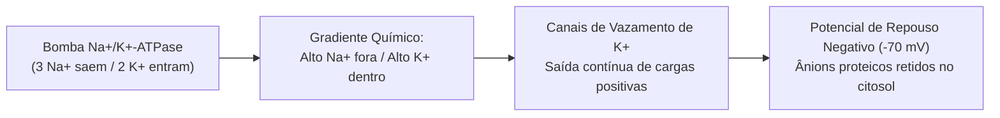
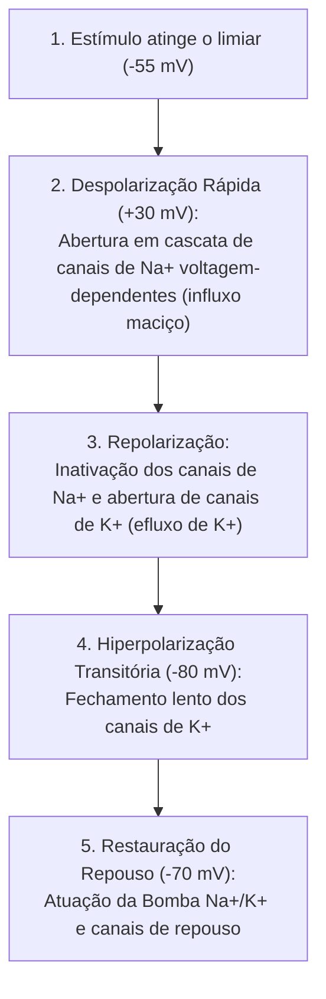
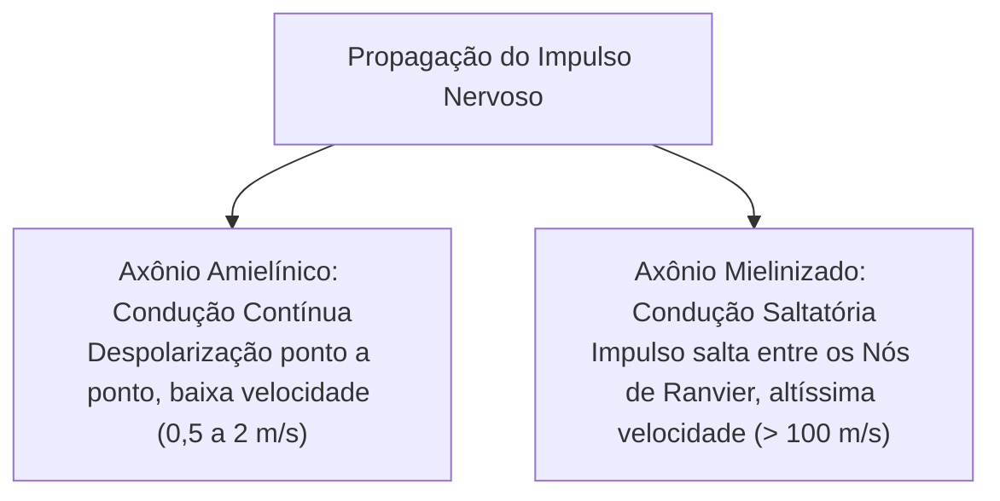
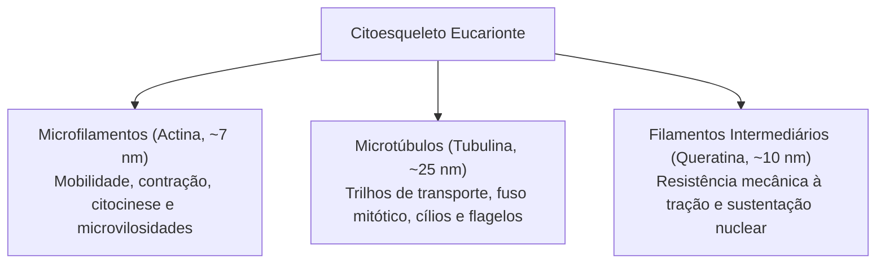
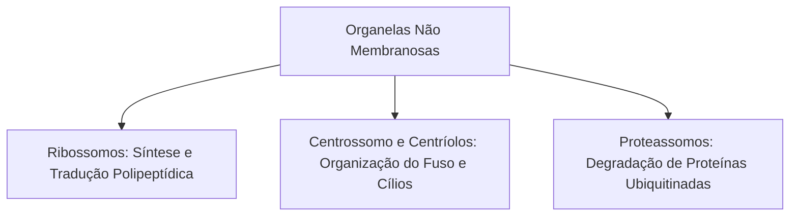

A compreensão da biologia celular transcende a análise morfológica estática. A membrana plasmática atua como um capacitor biológico. Ela gera e conduz gradientes elétricos indispensáveis à contração muscular e à transmissão de impulsos nervosos. No espaço intracelular, o citoplasma abriga um arranjo dinâmico de filamentos protéicos. Essa rede confere sustentação mecânica, permite o tráfego de cargas e viabiliza a locomoção de células de defesa em resposta a estímulos químicos.

> [!objetivos]
> - Compreender a gênese do potencial de repouso e as fases iônicas do potencial de ação.
> - Diferenciar a condução contínua da propagação saltatória e contrastar sinapses elétricas e químicas.
> - Caracterizar os três componentes do citoesqueleto: microfilamentos, microtúbulos e filamentos intermediários.
> - Identificar as proteínas motoras celulares (miosinas, cinesinas e dineínas) e seus sentidos de deslocamento.
> - Descrever a estrutura e a função biológica de ribossomos, centríolos e proteassomos.

## Eletrofisiologia da membrana: potenciais de repouso e de ação

A distribuição assimétrica de íons entre o citoplasma e o meio intersticial confere à membrana uma diferença de voltagem. Essa voltagem estável em repouso denomina-se **potencial de repouso da membrana**.

Nas células excitáveis (neurônios e fibras musculares), o interior celular mantém-se eletricamente negativo em repouso. A voltagem situa-se tipicamente entre **-70 mV e -90 mV**.



Dois fatores biofísicos explicam essa negatividade interna:
1. **Atividade da bomba Na⁺/K⁺-ATPase**: a bomba expele três íons de sódio para cada dois íons de potássio internalizados. Isso gera uma perda líquida contínua de cargas positivas no citosol.
2. **Permeabilidade passiva ao potássio**: a membrana em repouso possui muitos canais de vazamento abertos para o potássio. O K⁺ sai espontaneamente a favor de seu gradiente de concentração. No interior celular restam proteínas e fosfatos com cargas negativas que não conseguem atravessar a bicamada.

### O potencial de ação e a despolarização celular

Quando um estímulo atinge o **limiar de excitabilidade** (cerca de -55 mV), ocorre uma inversão rápida e transitória da polaridade elétrica. Esse fenômeno denomina-se **potencial de ação**.

O potencial de ação subordina-se à **lei do tudo ou nada**. Se o estímulo for sublimiar, nada acontece. Se o limiar for alcançado, dispara-se um potencial de ação completo com amplitude constante.



O potencial de ação desenvolve-se em fases coordenadas:

- **Despolarização**: canais de sódio voltagem-dependentes abrem-se com rapidez. O sódio entra maciçamente na célula a favor do gradiente. O meio intracelular atinge valores positivos de **+30 mV a +40 mV**.
- **Repolarização**: ao atingir o pico positivo, os canais de sódio inativam-se. Simultaneamente, abrem-se os canais de potássio voltagem-dependentes. O K⁺ sai rapidamente da célula, restaurando a negatividade citoplasmática.
- **Hiperpolarização e período refratário**: a lentidão no fechamento dos canais de potássio leva a membrana a valores mais negativos que o repouso original (cerca de -80 mV). Durante o período refratário absoluto, novos estímulos não conseguem disparar potenciais. Isso garante a condução unidirecional do impulso.

> [!atencao]
> **Princípio do Tudo ou Nada:** o potencial de ação não varia de intensidade ou amplitude com a força do estímulo. Desde que o estímulo atinja o limiar de excitação (-55 mV), o pico gerado será invariavelmente de mesma voltagem (+30 mV). O que o sistema nervoso codifica para diferenciar um estímulo fraco de um estímulo doloroso intenso não é a voltagem de cada potencial de ação, mas a **frequência de disparos por segundo** e o número de neurônios recrutados.

### Propagação do impulso: condução contínua e condução saltatória

O impulso nervoso propaga-se ao longo do axônio por dois modos distintos:

- **Condução contínua (axônios amielínicos)**: a despolarização avança ponto a ponto pela membrana axonal. É um processo mais lento (velocidades entre 0,5 e 2 metros por segundo), com maior gasto de ATP.
- **Condução saltatória (axônios mielinizados)**: a bainha de mielina atua como isolante elétrico lipídico. As trocas iônicas ocorrem exclusivamente nos **nós de Ranvier**. O impulso salta de um nódulo para o seguinte. Atinge velocidades superiores a **100 metros por segundo**, consumindo menos energia.



### Sinapses celulares: químicas versus elétricas

A transmissão do sinal entre células realiza-se nas sinapses:

- **Sinapses químicas**: constituem a maioria das conexões nervosas no corpo humano. Há uma fenda física separando as membranas. A despolarização abre canais de cálcio (Ca²⁺) no axônio. O cálcio induz a exocitose de **neurotransmissores** (como acetilcolina ou noradrenalina). O mediador químico difunde-se pela fenda e acopla-se a receptores pós-sinápticos. O processo é **unidirecional**.
- **Sinapses elétricas**: as membranas estão unidas por **junções comunicantes (gap junctions)**. Os íons fluem diretamente entre os citoplasmas através de conexinas. Não há atraso sináptico químico. A transmissão é ultrarrápida e pode ser **bidirecional**. São encontradas no miocárdio cardíaco e em reflexos vitais rápidos.

## Organização do citoplasma e a matriz do citosol

O citoplasma dos eucariontes ocupa todo o espaço entre a membrana plasmática e o núcleo. Ele reúne o citosol fluido, o citoesqueleto estrutural e as organelas funcionais.

O **citosol (ou hialoplasma)** é um colóide aquoso dinâmico que representa mais de metade do volume da célula. Ele contém água, íons inorgânicos, aminoácidos e centenas de enzimas metabólicas ativas. No citosol ocorre a glicólise anaeróbica inicial e a síntese de nucleotídeos e ácidos graxos. 

O citosol alterna entre dois estados físicos fundamentais: o estado **sol** (mais fluido e com grande dispersão molecular) e o estado **gel** (mais viscoso e rico em pontes protéicas). Essa alternância permite a **ciclose**, que é a corrente citoplasmática circular contínua observada com facilidade em células vegetais. A ciclose distribui nutrientes e organelas pelo interior celular sem consumo de estruturas de transporte especializadas.

## O citoesqueleto: microfilamentos, microtúbulos e filamentos intermediários

O citoesqueleto fornece suporte mecânico, controla a morfologia celular e organiza o tráfego intracelular. Diferencia-se em três tipos de filamentos:



### Microfilamentos de actina

São formados por subunidades da proteína globular actina (actina G). Elas polimerizam-se em filamentos helicoidais de fita dupla (actina F) com cerca de 7 nanômetros de espessura.
- **Polaridade dinâmica**: exibem uma extremidade positiva de montagem rápida e uma extremidade negativa de desmontagem lenta, consumindo ATP.
- **Funções celulares**: concentram-se no córtex sob a membrana plasmática. Sustentam o eixo interno das microvilosidades intestinais. Projetam pseudópodes na locomoção ameboide. Formam também o **anel contrátil** que promove a divisão citoplasmática ao término da mitose.

### Microtúbulos de tubulina

São tubos ocos rígidos com diâmetro de 25 nanômetros. Resultam da polimerização de heterodímeros de alfa e beta-tubulina com gasto de GTP.
- **Centro organizador**: são nucleados a partir do centrossomo celular pela gama-tubulina. Suas extremidades positivas crescem em direção à periferia.
- **Funções celulares**: formam trilhos para o transporte de organelas e vesículas. Estruturam o **fuso mitótico** que separa os cromossomos durante a divisão celular. Compõem o axonema com arranjo de microtúbulos 9+2 em **cílios e flagelos** eucariontes.

### Filamentos intermediários

Apresentam espessura média de 10 nanômetros. São fibras resistentes em forma de corda entrelaçada. Não possuem polaridade química nem consomem nucleotídeos energéticos na montagem.
- **Variedades biológicas**: englobam as **queratinas** nas células epiteliais, a **desmina** no tecido muscular, a **vimentina** no tecido conjuntivo, os **neurofilamentos** nos neurônios e as **lâminas nucleares** sob a carioteca.
- **Função primordial**: proporcionam grande resistência contra estiramentos mecânicos e atritos. Fixam-se aos desmossomos e hemidesmossomos para manter os tecidos coesos.

| Tipo de Filamento | Proteína Constituinte | Diâmetro Médio | Consumo Energético | Função Biológica Principal |
|---|---|---|---|---|
| **Microfilamento** | Actina | ~7 nm | ATP | Motilidade ameboide, contração e anel da citocinese. |
| **Microtúbulo** | Alfa e Beta-Tubulina | ~25 nm | GTP | Trilho vesicular, fuso mitótico, cílios e flagelos. |
| **Filamento Intermediário** | Queratinas, Lâminas, Desmina | ~10 nm | Nenhum | Resistência mecânica à tração e suporte nuclear. |

> [!bizu]
> **Diferença de flagelos:** não confunda o flagelo bacteriano com o flagelo dos eucariontes (como o do espermatozoide humano). O flagelo das bactérias é formado por filamentos helicoidais rígidos da proteína **flagelina**, funcionando como uma hélice rotatória impulsionada por gradiente de prótons. O flagelo eucarionte é formado por **microtúbulos de tubulina no arranjo 9+2**, realizando batimento ondulatório impulsionado pelo deslizamento da proteína motora dineína com gasto direto de ATP.

## Proteínas motoras celulares e motilidade ameboide

As proteínas motoras usam a energia da hidrólise do ATP para gerar movimento linear sobre o citoesqueleto:

```mermaid Direção de Deslocamento das Proteínas Motoras
flowchart LR
    CINES["Cinesina (Kinesina)"] -->|Desloca-se para a Extremidade POSITIVA (+)| PERIF["Periferia Celular / Membrana (Transporte Anterógrado)"]
    DINE["Dineína"] -->|Desloca-se para a Extremidade NEGATIVA (-)| CENTR["Centro Celular / Centrossomo (Transporte Retrógrado)"]
    MIOS["Miosina II"] -->|Traciona Filamentos de Actina com ATP| CONT["Contração Muscular e Citocinese"]
```

> [!esquema]
> **Sentido dos Motores Celulares:**
> - **Cinesina**: caminha para o **polo positivo (+)**, levando vesículas do centro em direção à periferia axonal (transporte anterógrado).
> - **Dineína**: caminha para o **polo negativo (-)**, trazendo materiais da periferia para o centro celular (transporte retrógrado).
> - **Miosina**: atua sobre filamentos de **actina**, tracionando-os durante a contração muscular e citocinese.

As principais famílias motoras apresentam atribuições marcantes:

- **Cinesinas**: motores associados aos microtúbulos que caminham em direção à **extremidade positiva (+)**. Movem vesículas do centrossomo para a periferia da célula (transporte anterógrado).
- **Dineínas**: motores associados aos microtúbulos que se deslocam para a **extremidade negativa (-)**, no sentido do centro celular (transporte retrógrado). A dineína ciliar também comanda o batimento de cílios e flagelos.
- **Miosinas**: motores associados aos filamentos de actina. A **miosina II** realiza o deslizamento de filamentos na contração muscular e no estrangulamento do anel da citocinese.

### Locomoção ameboide e quimiotaxia

Macrófagos e neutrófilos deslocam-se pelos tecidos por meio de **movimentos ameboides**. Esse processo envolve três passos:
1. **Protrusão**: a polimerização frontal de actina projeta a membrana para a frente, gerando lamelipódios ou pseudópodes.
2. **Adesão**: as projeções fixam-se temporariamente à matriz extracelular por integrinas.
3. **Tração e retração**: a miosina II contrai a região posterior da célula, tracionando o corpo celular para a frente. O deslocamento orientado por gradientes de substâncias químicas de bactérias e ferimentos denomina-se **quimiotaxia**.

## Organelas não membranosas

As organelas não membranosas não possuem bicamada fosfolipídica externa. Estão em contato físico direto com o citosol:



### Ribossomos: a maquinaria de síntese protéica

São complexos formados por RNA ribossômico associado a proteínas.
- **Subunidades**: cada ribossomo possui uma subunidade menor e uma subunidade maior. Elas se unem no citoplasma sobre o RNA mensageiro para conduzir a síntese protéica.
- **Tipos celulares**: os eucariontes possuem ribossomos **80S** (subunidades 60S e 40S). Os procariontes, mitocôndrias e cloroplastos possuem ribossomos **70S** (subunidades 50S e 30S). Podem atuar livres no citosol ou aderidos ao retículo endoplasmático rugoso.

### Centrossomo e centríolos

O centrossomo é o centro organizador de microtúbulos nas células animais. Ele contém um par de **centríolos** perpendiculares entre si.
- **Estrutura**: cada centríolo é formado por **nove trincas de microtúbulos periféricos** (arranjo 9+0), sem túbulos centrais.
- **Funções**: orientam o fuso mitótico na divisão celular e originam os corpúsculos basais de cílios e flagelos.

> [!pegadinha]
> **Centríolos em vegetais superiores:** as bancas examinadoras gostam de afirmar que todas as células vegetais possuem centríolos bem desenvolvidos. Cuidado: as plantas angiospermas e a grande maioria das gimnospermas **não possuem centríolos** nem áster em suas divisões celulares! A mitose nesses vegetais é classificada como **anastral e acêntrica**, embora possuam centrossomos amorfos que polimerizam o fuso regularmente.

### Proteassomos: a usina de reciclagem protéica

Os proteassomos são cilindros enzimáticos no citosol e no núcleo. Sua função é degradar seletivamente proteínas anômalas ou envelhecidas.
- **Ubiquitinação**: as proteínas destinadas à degradação recebem a ligação de moléculas de **ubiquitina**.
- **Digestão**: o proteassomo reconhece a marcação de ubiquitina. Ele desdobra a proteína com gasto de ATP e fragmenta a cadeia em pequenos peptídeos reaproveitáveis.

## Mapa do capítulo

```mermaid Síntese Geral: Eletrofisiologia e Citoesqueleto
flowchart TD
    M1["Eletrofisiologia da Membrana"] --> M1A["Repouso em -70 mV mantido por bomba Na+/K+ e efluxo passivo de K+"]
    M1 --> M1B["Potencial de ação: Despolarização por Na+ e repolarização por K+"]
    M1 --> M1C["Condução saltatória nos nós de Ranvier é mais rápida e econômica"]
    M1 --> M1D["Sinapses: Químicas com neurotransmissores e elétricas por gap junctions"]

    M2["Citoesqueleto"] --> M2A["Actina (7 nm): Locomoção ameboide, citocinese e microvilosidades"]
    M2 --> M2B["Microtúbulos (25 nm): Fuso mitótico, trilhos e axonema de cílios (9+2)"]
    M2 --> M2C["Filamentos intermediários (10 nm): Queratinas e suporte mecânico"]

    M3["Motores e Organelas Não Membranosas"] --> M3A["Cinesina para a periferia (+); Dineína para o centro (-)"]
    M3 --> M3B["Ribossomos 80S para síntese de proteínas; Proteassomos para reciclagem"]
    M3 --> M3C["Centríolos (arranjo 9+0): Fuso mitótico e origem de cílios e flagelos"]
```



### Para fixar

1. **Potencial de repouso**: apresenta voltagem de aproximadamente -70 mV nas células excitáveis, mantido ativamente pela bomba Na⁺/K⁺-ATPase e pela elevada permeabilidade da membrana à saída passiva de íons potássio.
2. **Fases do potencial de ação**: a despolarização decorre da entrada rápida de sódio por canais voltagem-dependentes até cerca de +30 mV. A repolarização ocorre pela inativação dos canais de sódio e abertura de canais de potássio, que efluem da célula.
3. **Condução saltatória**: nos axônios mielinizados, a despolarização salta de um nó de Ranvier para outro, acelerando a velocidade do impulso para mais de 100 m/s e reduzindo o consumo de energia celular.
4. **Sinapses químicas versus elétricas**: a sinapse química é unidirecional e utiliza neurotransmissores liberados na fenda sináptica após influxo de cálcio. A sinapse elétrica conecta citoplasmas diretamente por junções gap, com propagação imediata e bidirecional.
5. **Microfilamentos de actina**: formados por polímeros de actina de 7 nm, são responsáveis pela emissão de pseudópodes na motilidade ameboide, sustentação de microvilosidades e formação do anel contrátil na citocinese.
6. **Microtúbulos de tubulina**: cilindros ocos de 25 nm nucleados a partir do centrossomo, atuam como trilhos para transporte de vesículas, formam o fuso mitótico e compõem o axonema 9+2 de cílios e flagelos.
7. **Filamentos intermediários**: estruturas resistentes de 10 nm formadas por queratinas, desmina e lâminas nucleares, conferindo ancoragem celular e resistência mecânica contra estiramentos.
8. **Proteínas motoras**: cinesinas transportam cargas em direção à extremidade positiva dos microtúbulos (periferia); dineínas deslocam-se para a extremidade negativa (centro celular); e miosinas tracionam filamentos de actina na contração e citocinese.
9. **Organelas não membranosas**: ribossomos executam a tradução do RNA mensageiro em cadeias polipeptídicas; centríolos (9+0) orientam a divisão celular; e proteassomos degradam seletivamente proteínas marcadas por ubiquitina.