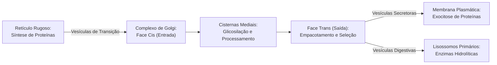
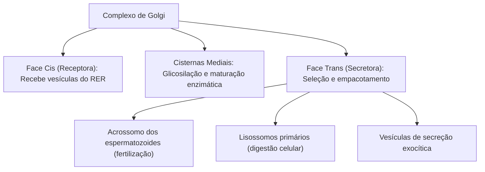
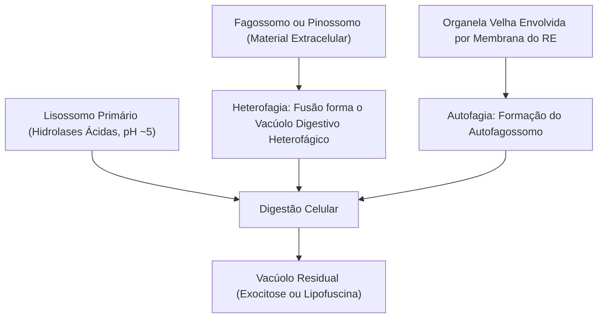
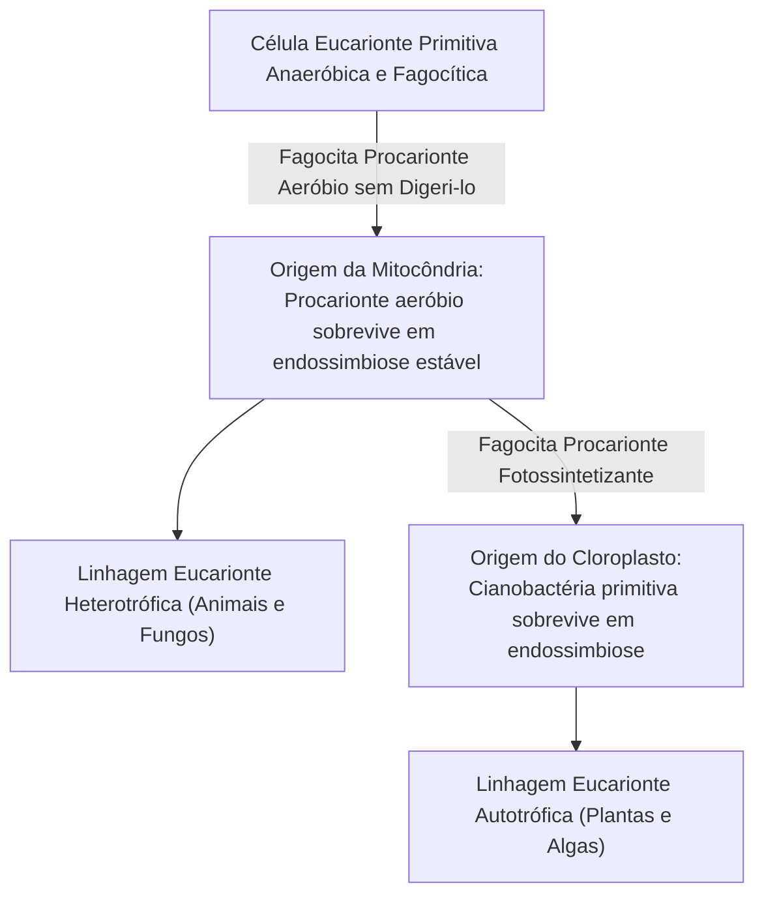
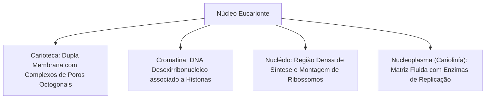
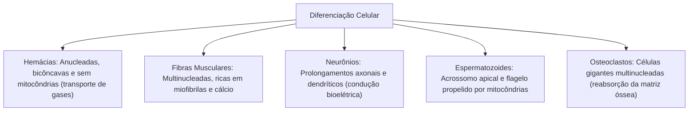
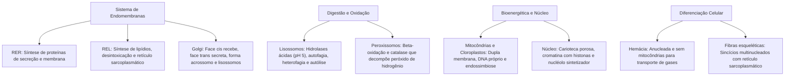

A compartimentalização intracelular representa a mais importante conquista evolutiva dos organismos eucariontes. Ao delimitar reações bioquímicas antagônicas em microambientes fechados por membranas, a célula otimizou o rendimento enzimático, protegeu seu material genético contra danos físicos e viabilizou a especialização morfológica observada nos diferentes tecidos corporais. Essa sofisticação citoplasmática assegura a manutenção da homeostase e o suprimento energético necessário para o metabolismo.

> [!objetivos]
> - Diferenciar a morfologia e as atribuições do retículo rugoso, retículo liso e complexo de Golgi.
> - Compreender a digestão intracelular pelos lisossomos e a neutralização de peróxidos pelos peroxissomos.
> - Analisar a ultraestrutura de mitocôndrias e cloroplastos e as evidências da teoria da endossimbiose.
> - Descrever a arquitetura nuclear: carioteca, poros, cromatina e síntese ribossômica no nucléolo.
> - Identificar as adaptações citológicas em células especializadas, como hemácias e fibras musculares.

## O sistema de endomembranas: retículo endoplasmático e complexo golgiense

O sistema de endomembranas integra compartimentos contínuos ou conectados por tráfego vesicular constante, coordenando a fabricação, o processamento e a secreção de biomoléculas.

### Retículo endoplasmático rugoso

O retículo endoplasmático rugoso (RER), também chamado de ergastoplasma ou retículo granular, é formado por sacos achatados (cisternas) paralelos e contínuos com o envoltório nuclear. Sua superfície externa citoplasmática é recoberta por ribossomos aderidos.
- **Importação co-traducional**: as proteínas destinadas à secreção possuem uma sequência-sinal de aminoácidos em sua extremidade inicial. Essa sequência é reconhecida pela partícula de reconhecimento de sinal (SRP), que ancora o ribossomo a um translocador protéico na membrana do RER. A cadeia polipeptídica penetra no lúmen do retículo enquanto ainda está sendo sintetizada.
- **Funções vitais**: atua na síntese de proteínas de secreção externa (como enzimas pancreáticas e anticorpos pelos plasmócitos), proteínas integrais da membrana plasmática e enzimas hidrolíticas lisossômicas. No lúmen do RER, as proteínas sofrem enovelamento com auxílio de chaperonas e glicosilação inicial (adição de oligossacarídeos).

### Retículo endoplasmático liso

O retículo endoplasmático liso (REL), ou retículo agranular, apresenta morfologia tubular ramificada e é totalmente desprovido de ribossomos aderidos.
- **Síntese de lipídios**: fabrica a maioria dos fosfolipídios de membrana, triglicerídeos, colesterol e hormônios esteroides (como testosterona, estrogênio e cortisol). É exuberante em células dos testículos, ovários e córtex das glândulas suprarrenais.
- **Desintoxicação celular (detoxificação)**: abriga o complexo enzimático citocromo P450, que inativa medicamentos, toxinas e compostos químicos insolúveis, convertendo-os em substâncias hidrossolúveis excretáveis pelos rins e bile. É abundante nos hepatócitos do fígado.
- **Armazenamento de cálcio (retículo sarcoplasmático)**: nas células musculares estriadas esqueléticas e cardíacas, o REL recebe a denominação especializada de retículo sarcoplasmático. Ele sequestra e armazena grandes quantidades de íons cálcio (Ca²⁺), liberando-os no citosol sob comando elétrico para disparar a contração das miofibrilas.

> [!esquema]
> **Comparação Didática dos Retículos:**
> - **RER (Rugoso)**: possui ribossomos aderidos, realiza síntese co-traducional de proteínas de secreção, proteínas de membrana e hidrolases lisossômicas.
> - **REL (Liso)**: desprovido de ribossomos, realiza síntese de lipídios e esteroides, desintoxicação de xenobióticos no fígado e estocagem de cálcio no músculo.

### Complexo de Golgi

O complexo golgiense é composto por uma pilha de quatro a oito cisternas membranosas circulares e ligeiramente encurvadas, denominadas dictiossomos, posicionadas próximo ao núcleo celular.
- **Polaridade funcional**: possui uma **face cis** (voltada para o RER), que recebe as vesículas de transporte contendo proteínas recém-sintetizadas, e uma **face trans** (voltada para a membrana plasmática), de onde brotam as vesículas de secreção acabadas.
- **Modificação pós-traducional**: conclui a glicosilação e realiza fosforilações e sulfatações de macromoléculas.
- **Destinação e secreção**: classifica as proteínas e as direciona aos seus destinos finais (membrana celular, secreção constitutiva ou grânulos de armazenamento regulados).
- **Formação do acrossomo**: no desenvolvimento dos espermatozoides (espermiogênese), as cisternas e vesículas do Golgi fundem-se no ápice da cabeça do gameta para estruturar o acrossomo, vesícula gigante repleta de enzimas digestivas (como hialuronidase e acrossina) necessárias para perfurar a zona pelúcida do óvulo durante a fertilização.
- **Origem dos lisossomos**: o Golgi empacota as enzimas hidrolíticas marcadas com manose-6-fosfato e as secreta sob a forma de lisossomos primários.

## Organelas digestivas e metabólicas: lisossomos, peroxissomos e vacúolos

A manutenção da viabilidade celular depende da digestão seletiva de nutrientes captados, da reciclagem de estruturas desgastadas e da eliminação de agentes tóxicos.

### Lisossomos e as vias digestivas

Os lisossomos são vesículas esféricas delimitadas por membrana única originadas do complexo golgiense. Contêm em seu interior mais de 40 tipos de enzimas digestivas pertencentes ao grupo das **hidrolases ácidas** (como proteases, nucleases, lipases e fosfatases).
- **Manutenção do pH ácido**: as hidrolases ácidas operam com atividade ótima em **pH em torno de 5,0**. Para manter esse microambiente ácido contra o citosol neutro (pH 7,2), a membrana lisossômica possui bombas ativas de prótons (H⁺-ATPase) que bombeiam continuamente H⁺ para o interior da organela com consumo de ATP.
- **Heterofagia**: digestão de materiais captados do exterior celular por fagocitose ou pinocitose. O lisossomo primário funde-se ao fagossomo, formando o vacúolo digestivo (lisossomo secundário). Os nutrientes simples atravessam a membrana para o citosol, enquanto os restos indigeríveis formam o corpo residual, eliminado por clasmocitose.
- **Autofagia**: mecanismo de controle de qualidade pelo qual a célula digere suas próprias organelas senescentes ou macromoléculas danificadas para reaproveitar seus constituintes em momentos de escassez energética.
- **Autólise**: rompimento maciço e simultâneo das membranas lisossômicas, liberando as hidrolases ácidas no citosol e provocando a autodestruição da própria célula. É um processo fisiológico natural (como a regressão da cauda dos girinos durante a metamorfose) ou patológico (como a silicose pulmonar, na qual partículas de sílica inaladas perfuram as membranas dos lisossomos de macrófagos alveolares).

> [!bizu]
> **Segurança contra rompimentos acidentais:** se um único lisossomo se romper acidentalmente dentro da célula, suas enzimas não digerem o citoplasma. As hidrolases ácidas são completamente inativadas no pH neutro (7,2) do citosol. A destruição celular por autólise só ocorre quando inúmeros lisossomos se rompem simultaneamente, acidificando todo o citosol.

### Peroxissomos e o metabolismo da catalase

Os peroxissomos são organelas esféricas com membrana simples presentes em quase todas as células eucariontes, com destaque nos rins e no fígado.
- **Origem enzimática**: suas enzimas oxidativas são sintetizadas por ribossomos livres no citosol e importadas de forma pós-traducional.
- **Oxidação de ácidos graxos e geração de peróxido**: realizam a quebra oxidativa (beta-oxidação) de ácidos graxos de cadeia muito longa, preparando-os para o aproveitamento mitocondrial. Durante essas reações de oxidação que consomem oxigênio molecular (O₂), é gerado o **peróxido de hidrogênio (H₂O₂)**, composto altamente tóxico e reativo.
- **Ação da catalase**: para neutralizar esse veneno celular, os peroxissomos contêm a enzima **catalase**, que degrada rapidamente o H₂O₂ em água e gás oxigênio (2 H₂O₂ → 2 H₂O + O₂). Os peroxissomos também participam da síntese de lipídios da bainha de mielina (plasmalogênios) e da conversão de ácido úrico.

### Vacúolos celulares

- **Vacúolo central vegetal**: bolsa membranosa volumosa exclusiva das células vegetais, delimitada por uma membrana seletiva denominada **tonoplasto**. Ocupa com frequência mais de 80% a 90% do volume celular, atuando no armazenamento de água, íons, carboidratos solúveis, pigmentos antocianinas e compostos secundários de defesa, além de exercer o controle osmótico e a manutenção da pressão de turgor.
- **Vacúolo pulsátil (ou contrátil)**: estrutura presente em protozoários de água doce (como o paramécio e a ameba). Como esses organismos unicelulares são hipertônicos em relação à água doce hipotônica do ambiente, a água entra continuamente na célula por osmose. O vacúolo pulsátil coleta periodicamente esse excesso hídrico e contrai-se ativamente com gasto de ATP, bombeando a água para fora e impedindo a lise celular.

## Organelas bioenergéticas semiautônomas e a Teoria da Endossimbiose

Mitocôndrias e cloroplastos são as centrais bioenergéticas responsáveis pela conversão de energia química e luminosa em ATP. Ambas são classificadas como **organelas semiautônomas** porque possuem seu próprio genoma, sua própria maquinaria de síntese protéica e capacidade de autoduplicação independente do ciclo celular.

### Mitocôndrias

As mitocôndrias realizam a respiração celular aeróbica, extraindo a energia contida nas ligações químicas dos alimentos para produzir grandes quantidades de ATP.
- **Membrana externa**: lisa e permeável à passagem de pequenos metabólitos devido à presença de proteínas transmembrana formadoras de poros chamadas porinas.
- **Espaço intermembranar**: compartimento intermediário onde se acumulam prótons (H⁺) bombeados pelos complexos da cadeia respiratória.
- **Membrana interna e cristas mitocondriais**: altíssima seletividade e impermeabilidade conferida pelo fosfolipídio cardiolipina. Apresenta invaginações profundas denominadas **cristas mitocondriais**, que aumentam exponencialmente a área de superfície disponível para os complexos proteicos da cadeia transportadora de elétrons e as unidades da ATP sintase.
- **Matriz mitocondrial**: fluido viscoso interno onde ocorrem o ciclo de Krebs (ciclo do ácido cítrico) e a beta-oxidação de ácidos graxos. Contém o DNA mitocondrial circular (mtDNA), ribossomos 70S, RNA transportador e enzimas ativas.

> [!atencao]
> **Herança mitocondrial estritamente materna:** durante a fecundação humana, apenas o núcleo do espermatozoide penetra no ovócito secundário. As mitocôndrias do espermatozoide, localizadas na peça intermediária, não entram no óvulo ou são ativamente marcadas por ubiquitina e degradadas no citoplasma do zigoto. Em consequência, **todo o DNA mitocondrial de uma pessoa é herdado exclusivamente de sua mãe biológica**, sendo um marcador genético valioso em estudos de ancestralidade e genética forense.

### Cloroplastos

Presentes em plantas e algas, convertem energia luminosa solar em energia química estável armazenada em glicose mediante o processo de fotossíntese.
- **Membranas e tilacoides**: delimitados por uma membrana dupla envolvente. No interior, apresentam um sistema de sacos membranosos achatados denominados **tilacoides**, cujas membranas contêm os pigmentos fotossintéticos de **clorofila** e os fotossistemas. Pilhas de tilacoides sobrepostos recebem o nome de **grana** (no singular, granum).
- **Estroma**: matriz líquida que preenche o espaço ao redor dos tilacoides, análoga à matriz mitocondrial. No estroma localizam-se as enzimas responsáveis pela fixação do dióxido de carbono no ciclo de Calvin-Benson, além de DNA circular e ribossomos 70S.

### Evidências da Teoria da Endossimbiose (Margulis)

Proposta por Lynn Margulis, a teoria da endossimbiose postula que as mitocôndrias derivaram de bactérias aeróbias ancestrais e os cloroplastos de cianobactérias fotossintetizantes ancestrais fagocitadas por células eucariontes primitivas. As evidências científicas que sustentam essa teoria compreendem:
1. **Presença de dupla membrana**: a membrana interna reflete a membrana do procarionte ancestral, enquanto a externa deriva da membrana da vesícula fagocítica da célula hospedeira.
2. **DNA circular e desprovido de histonas**: idêntico em conformação estrutural ao cromossomo das bactérias atuais.
3. **Ribossomos 70S próprios**: do mesmo tamanho e sensibilidade a antibióticos que os ribossomos bacterianos.
4. **Autoduplicação independente**: dividem-se por fissão binária simples no citoplasma, de modo independente da mitose celular.

| Parâmetro Comparativo | Mitocôndria | Cloroplasto |
|---|---|---|
| **Função Metabólica Primária** | Respiração celular aeróbica (ATP). | Fotossíntese (geração de glicose). |
| **Distribuição Biológica** | Animais, fungos, protozoários e plantas. | Exclusivo de plantas e algas fotossintetizantes. |
| **Estruturas Internas Típicas** | Cristas mitocondriais e matriz. | Tilacoides, grana e estroma. |
| **Pigmentos Envolvidos** | Ausentes. | Clorofilas, carotenos e xantofilas. |

> [!pegadinha]
> **Coexistência em células vegetais:** uma questão clássica das bancas questiona se as células vegetais possuem mitocôndrias. Não caia no erro de pensar que "vegetal tem cloroplasto e animal tem mitocôndria"! As células vegetais possuem **cloroplastos E mitocôndrias**. O cloroplasto produz glicose durante o dia; as mitocôndrias quebram essa glicose 24 horas por dia para fornecer ATP contínuo às demandas celulares da planta.

## O núcleo celular eucarionte

O núcleo atua como centro de controle metabólico e genético da célula eucarionte, abrigando o genoma responsável por coordenar a síntese de todas as proteínas e a transmissão dos caracteres hereditários.

Os elementos estruturais do núcleo desempenham funções coordenadas:

- **Carioteca (envoltório nuclear)**: constituída por duas membranas concêntricas separadas pelo espaço perinuclear. A membrana nuclear externa é contínua com a membrana do retículo endoplasmático rugoso e apresenta ribossomos aderidos à sua face citoplasmática. A face interna é revestida e sustentada pela lâmina nuclear (filamentos intermediários).
- **Poros nucleares**: o envoltório nuclear é perfurado por milhares de complexos de poros octogonais formados por nucleoporinas. Esses poros atuam como cancelas ativas seletivas, controlando o trânsito macromolecular bidirecional: permitem a saída de moléculas de RNA mensageiro, RNA transportador e subunidades ribossômicas para o citoplasma, e a entrada seletiva de proteínas nucleares (como histonas, DNA polimerases e fatores de transcrição).
- **Cromatina**: complexo formado pela associação do DNA nuclear com proteínas básicas chamadas histonas. Na interfase, a cromatina apresenta-se descondensada em grande parte de sua extensão:
  - **Eucromatina**: região frouxa e desenrolada do filamento, metabolicamente ativa na transcrição de genes em RNA.
  - **Heterocromatina**: região altamente condensada e espiralada, que se cora intensamente ao microscópio óptico, sendo transcricionalmente inativa.
- **Cromossomo**: estado de condensação estrutural máxima atingido pela cromatina durante a divisão celular (mitose ou meiose), que facilita a segregação equitativa dos alelos sem emaranhamentos.
- **Nucléolo**: corpúsculo denso e arredondado, desprovido de membrana circundante, visível no núcleo interfásico. Corresponde à região organizadora do nucléolo, onde trechos específicos de DNA transcrevem o RNA ribossômico (rRNA), que se agrega a proteínas importadas do citoplasma para formar as subunidades 60S e 40S dos ribossomos.

## Tipos celulares e diferenciação morfofisiológica

A diferenciação celular corresponde ao processo biológico pelo qual células indiferenciadas (células-tronco) sofrem ativação e repressão gênica seletiva, adquirindo estruturas e funções altamente especializadas. Todos os tipos celulares de um organismo compartilham o mesmo genoma genético idêntico, divergindo unicamente nos perfis de expressão de seus genes.

As adaptações celulares mais cobradas incluem:

- **Hemácias humanas (eritrócitos)**: discos bicôncavos com cerca de 7,5 micrômetros de diâmetro. Durante a maturação eritropoética na medula óssea, a hemácia expulsa seu núcleo, suas mitocôndrias e seu retículo endoplasmático. Essa anucleação maximiza o espaço interno para acomodar aproximadamente 280 milhões de moléculas de **hemoglobina**, proteína responsável pelo transporte de oxigênio. Sem mitocôndrias, as hemácias geram energia exclusivamente por **glicólise anaeróbica láctica**, impedindo que consumam o próprio oxigênio que transportam aos tecidos periféricos.
- **Fibras musculares estriadas esqueléticas**: células cilíndricas gigantescas resultantes da fusão sincicial embrionária de múltiplos mioblastos mononucleados. Possuem centenas de núcleos alongados localizados na periferia citoplasmática, milhares de mitocôndrias produtoras de ATP e sarcoplasma preenchido por sarcômeros alinhados de actina e miosina.
- **Osteoclastos**: células multinucleadas gigantes originadas da fusão de monócitos do sistema imunológico. Secretam ácido clorídrico e enzimas proteolíticas para desmineralizar e reabsorver a matriz óssea envelhecida durante a remodelação esquelética contínua.
- **Espermatozoides**: gametas masculinos monofuncionais adaptados à motilidade e fecundação. Sua cabeça aloja o núcleo haploide altamente condensado e o acrossomo; sua peça intermediária contém mitocôndrias espiraladas que fornecem ATP para o batimento flagelar motor da cauda.

> [!exemplo]
> **Metabolismo Exclusivo das Hemácias:** a anucleação e a perda completa de mitocôndrias pelas hemácias humanas maduras constituem um exemplo de adaptação fisiológica extrema. Sem mitocôndrias, a hemácia não pode realizar o ciclo de Krebs nem a fosforilação oxidativa. Ela depende unicamente da glicólise anaeróbia láctica no citosol para produzir ATP, garantindo que 100% do oxigênio ligado à hemoglobina seja entregue aos tecidos corporais sem consumo pela própria célula transportadora.

## Mapa do capítulo

### Para fixar

1. **Retículo Rugoso**: caracterizado pela presença de ribossomos aderidos à sua face externa, realiza a síntese co-traducional de proteínas de secreção, proteínas de membrana e hidrolases lisossômicas.
2. **Retículo Liso**: desprovido de ribossomos, é especializado na síntese de fosfolipídios e hormônios esteroides, desintoxicação de substâncias lipossolúveis no fígado e armazenamento de cálcio nas fibras musculares (retículo sarcoplasmático).
3. **Complexo Golgiense**: atua na maturação, glicosilação e empacotamento de proteínas recebidas na face cis e liberadas na face trans. Origina o acrossomo nos espermatozoides e os lisossomos primários.
4. **Lisossomos**: vesículas digestivas com hidrolases ácidas em pH 5,0 mantido por bombas de prótons. Realizam heterofagia de partículas ingeridas, autofagia de organelas desgastadas e autólise celular.
5. **Peroxissomos**: oxidam ácidos graxos gerando peróxido de hidrogênio (H₂O₂), o qual é convertido em água e oxigênio pela enzima catalase.
6. **Teoria da Endossimbiose**: postula que mitocôndrias e cloroplastos evoluíram de bactérias aeróbias e cianobactérias fagocitadas por eucariontes primitivos, evidenciado por sua dupla membrana, DNA circular, ribossomos 70S e autoduplicação binária.
7. **DNA mitocondrial**: transmitido por herança estritamente materna, pois as mitocôndrias do espermatozoide não participam da formação do zigoto.
8. **Célula vegetal bioenergética**: contém tanto cloroplastos para a produção fotossintética de glicose quanto mitocôndrias para a produção aeróbica de ATP.
9. **Núcleo e nucléolo**: o núcleo guarda a cromatina (DNA associado a histonas) delimitada pela carioteca com poros seletivos. O nucléolo fabrica as subunidades ribossômicas a partir de rRNA.
10. **Especializações celulares**: as hemácias maduras são anucleadas e desprovidas de mitocôndrias, gerando energia por glicólise anaeróbia. Fibras musculares esqueléticas e osteoclastos são sincícios multinucleados adaptados à contração e reabsorção óssea.