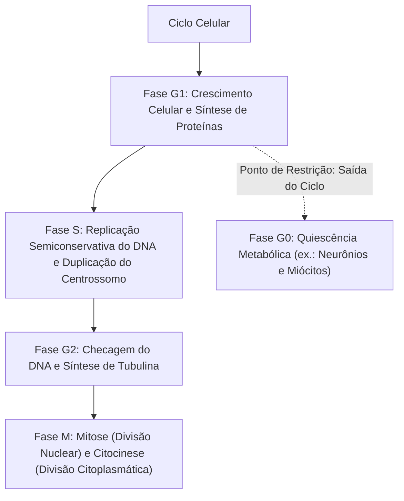
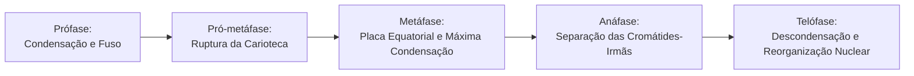
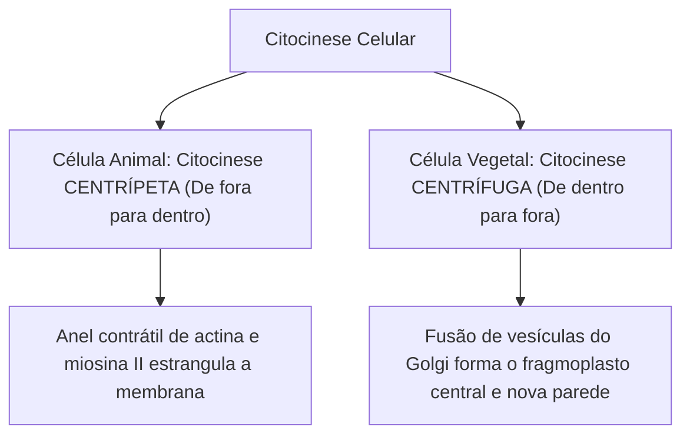
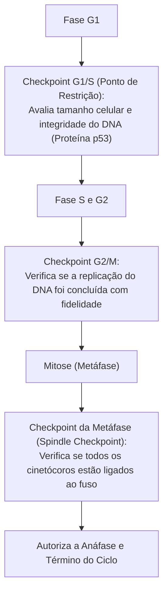
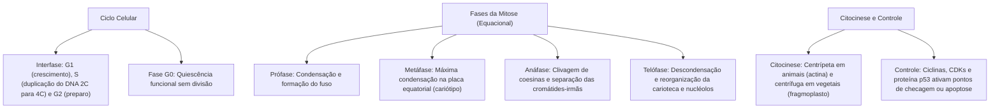

A divisão celular representa o mecanismo biológico pelo qual a vida se perpetua e os tecidos corporais se renovam. Nos organismos pluricelulares, a mitose assegura que uma célula-tronco diploide origine duas células-filhas geneticamente idênticas à célula genitora, garantindo o crescimento do indivíduo, a cicatrização de queimaduras e ferimentos, e a reposição diária de milhões de leucócitos e eritrócitos consumidos na circulação sanguínea.

> [!objetivos]
> - Identificar as etapas da interfase (G1, S e G2) e as alterações na quantidade de DNA celular.
> - Compreender a sequência cronológica e os eventos citológicos das fases da mitose.
> - Contrastar a citocinese centrípeta animal com a citocinese centrífuga vegetal.
> - Analisar os pontos de checagem do ciclo celular e os complexos ciclina-CDK.
> - Relacionar as falhas no controle da apoptose e no gene p53 com a proliferação tumoral.

## O ciclo celular e a interfase

O ciclo celular compreende a sequência integrada de eventos que transcorre desde o nascimento de uma célula até a sua própria divisão em duas células-filhas. O ciclo subdivide-se em dois períodos fundamentais: a **interfase** (fase de intenso metabolismo e preparação, que ocupa cerca de 90% a 95% do tempo total) e a **fase M** (mitose e citocinese).

A interfase é dividida em três fases coordenadas:

- **Fase G1 (Gap 1 ou primeiro intervalo)**: período que se segue imediatamente à divisão celular anterior. A célula recém-formada absorve nutrientes, cresce em volume citoplasmático, duplica organelas membranosas e realiza intensa transcrição de RNA e síntese protéica. Determinadas células altamente diferenciadas (como os neurônios adultos e as fibras musculares esqueléticas) saem do ciclo e entram em **G0**, estado de quiescência permanente no qual desempenham suas funções sem se dividir.
- **Fase S (Síntese)**: momento crucial no qual ocorre a **replicação semiconservativa do DNA**. A quantidade de material genético dobra (passando de 2C para 4C na notação de conteúdo de DNA), embora o número de cromossomos permaneça constante (46 cromossomos na espécie humana). Cada cromossomo passa a ser constituído por duas cópias idênticas denominadas **cromátides-irmãs**, mantidas unidas no centrômero por anéis de proteínas coesinas. Concomitantemente, ocorre a duplicação do centrossomo celular.
- **Fase G2 (Gap 2 ou segundo intervalo)**: intervalo final da interfase. A célula sintetiza proteínas estruturais necessárias para a movimentação cromossômica (com destaque para a tubulina do fuso mitótico), armazena energia em ATP e confere a integridade do DNA recém-duplicado antes de autorizar o ingresso na divisão nuclear.

## Fases da mitose: a divisão equacional

A mitose é classificada como uma **divisão equacional**. Ela preserva com rigor o número de cromossomos da célula genitora nas duas células-filhas formadas (2n → 2n). 

Didaticamente, a mitose divide-se em quatro fases principais: prófase, metáfase, anáfase e telófase. A pró-metáfase atua como etapa de transição intermediária. Os nomes dessas fases derivam de prefixos gregos que indicam o momento da divisão: *pro* significa antes, *meta* indica meio ou mudança, *ana* representa separação ou para trás, e *telo* expressa fim ou limite. Em aulas práticas e pesquisas laboratoriais, o estudo clássico da mitose é conduzido em células meristemáticas da ponta de raiz de cebola ou alho, ou por meio de microscopia confocal de fluorescência, que permite registrar figuras nítidas da dissociação e segregação das fibras do fuso.

### Prófase

É a fase inaugural da mitose, caracterizada por profundas transformações nucleares e citoplasmáticas:
- Os filamentos de cromatina espiralam-se gradativamente com o auxílio de histonas e condensinas, tornando os cromossomos visíveis como corpos individualizados.
- O nucléolo desintegra-se gradualmente, cessando a síntese de RNA ribossômico.
- Os dois centrossomos duplicados afastam-se em direção aos polos opostos da célula, polimerizando microtúbulos que estruturam o **áster** e o **fuso mitótico**.

### Pró-metáfase

Ocorre a fosforilação enzimática das lâminas nucleares, provocando a **desintegração do envoltório nuclear (carioteca)** em pequenas vesículas que se dispersam pelo citosol. Os microtúbulos do fuso penetram na região nuclear e conectam-se aos **cinetócoros**, complexos proteicos em forma de disco localizados sobre os centrômeros de cada cromátide-irmã.

### Metáfase

Fase de equilíbrio dinâmico e simetria celular:
- Os cromossomos atingem seu **grau máximo de condensação e espiralização**, exibindo o clássico formato em "X" com as cromátides-irmãs bem delineadas.
- Puxados pelas forças de tração dos microtúbulos cinetocóricos de ambos os polos, os cromossomos alinham-se no plano médio da célula, formando a **placa equatorial (ou placa metafásica)**.
- É a fase ideal para a realização do **exame de cariótipo**, fotomicrografia clínica que permite contar e ordenar os cromossomos para detectar anomalias numéricas (como a síndrome de Down) ou estruturais.

> [!bizu]
> **Identificação Rápida da Metáfase:** nos itens de prova, a menção a "cromossomos alinhados no equador da célula", "máximo encurtamento cromossômico" ou "preparo de lâmina para análise de cariótipo" aponta invariavelmente para a **metáfase**.

### Anáfase

Fase de separação e movimento:
- Ocorre a ativação do complexo promotor da anáfase (APC/C), que induz a destruição proteolítica das **coesinas** que mantinham as cromátides unidas.
- As **cromátides-irmãs separam-se**, convertendo-se em **cromossomos-filhos independentes**.
- Os microtúbulos cinetocóricos encurtam-se por despolimerização nas extremidades, tracionando os cromossomos-filhos para os polos opostos da célula. Ao mesmo tempo, microtúbulos polares sobrepostos deslizam entre si com auxílio de cinesinas, empurrando os polos celulares e alongando a célula.

### Telófase

Fase de encerramento da cariocinese (divisão do núcleo), que reproduz de modo inverso os eventos da prófase:
- Os cromossomos-filhos atingem os polos e começam a descondensar-se, reassumindo o aspecto frouxo de cromatina.
- As vesículas da carioteca agrupam-se ao redor dos dois lotes cromossômicos polares, reconstituindo os dois novos envoltórios nucleares.
- Os nucléolos reorganizam-se a partir das regiões organizadoras do nucléolo.
- As fibras do fuso mitótico desintegram-se completamente no citosol.

| Fase da Mitose | Evento Citológico Primordial | Estado do DNA e Cromossomos |
|---|---|---|
| **Prófase** | Formação do fuso mitótico e condensação inicial. | Cromossomos duplicados com cromátides-irmãs. |
| **Pró-metáfase** | Desintegração da carioteca e ligação aos cinetócoros. | Cromossomos capturados pelos microtúbulos. |
| **Metáfase** | Alinhamento equatorial e grau máximo de condensação. | Cromossomos duplicados na placa equatorial. |
| **Anáfase** | Clivagem de coesinas e migração aos polos opostos. | Separação das cromátides em cromossomos-filhos. |
| **Telófase** | Reconstituição da carioteca e dos nucléolos. | Descondensação cromossômica nos novos núcleos. |

## Citocinese: divisão citoplasmática em animais e vegetais

A telófase é acompanhada pela **citocinese**, processo físico de clivagem do citoplasma que individualiza as duas novas células-filhas. O mecanismo difere radicalmente entre células animais e células vegetais superiores:

- **Citocinese animal (centrípeta)**: ocorre de fora para dentro. Durante a anáfase tardia, organiza-se sob a membrana plasmática equatorial um **anel contrátil de microfilamentos de actina e miosina II**. À medida que a miosina traciona a actina, o anel estrangula a célula para o centro até que a membrana se funda, separando completamente as duas metades celulares. Como as células animais contêm centríolos que emitem fibras do áster, sua mitose é dita **cêntrica e astral**.
- **Citocinese vegetal (centrífuga)**: ocorre de dentro para fora. Como a resistente parede celular celulósica impede qualquer estrangulamento mecânico periférico, a célula vegetal utiliza vesículas originadas do complexo golgiense repletas de pectina. Essas vesículas alinham-se no centro equatorial sobre restos de microtúbulos, estruturando o **fragmoplasto**. As vesículas fundem-se do centro para as bordas, originando a lamela média, sobre a qual é depositada a nova parede de celulose. Como as plantas com sementes não possuem centríolos nem áster, sua mitose é **acêntrica e anastral**.

> [!pegadinha]
> **Divisão em bactérias:** as bactérias não realizam mitose! A reprodução das bactérias ocorre por **fissão binária simples (ou bipartição)**. O cromossomo circular único duplica-se, fixa-se à membrana plasmática e a bactéria alonga-se, dividindo-se por invaginação da parede celular de peptidoglicano, sem fuso mitótico nem fases nucleares.

## Pontos de checagem do ciclo celular e a regulação por ciclinas e CDKs

A progressão harmônica ao longo do ciclo celular é rigorosamente monitorada por um sistema de controle bioquímico interno composto por **pontos de checagem (checkpoints)**. Esse maquinário assegura que uma fase só tenha início quando a etapa precedente estiver integralmente concluída e com alta fidelidade de replicação.

O motor bioquímico desse sistema consiste na ligação entre duas classes de moléculas:
- **Ciclinas**: proteínas sintetizadas e degradadas ciclicamente em momentos específicos de cada fase do ciclo.
- **Quinases dependentes de ciclinas (CDKs)**: enzimas presentes em concentrações constantes na célula, mas inativas por si sós. Quando uma ciclina atinge seu pico de concentração e acopla-se à CDK correspondente, o complexo ciclina-CDK é ativado, fosforilando proteínas-alvo que autorizam a passagem para a etapa seguinte.

Existem três pontos de checagem cruciais:

1. **Checkpoint G1/S (ponto de restrição)**: localiza-se no final da fase G1. Avalia se a célula atingiu tamanho adequado, se há nutrientes suficientes e se o DNA está íntegro. Se for detectada lesão no DNA, entra em ação a proteína **p53 (o guardião do genoma)**. A p53 estimula a síntese da proteína p21, que inibe o complexo ciclina-CDK, paralisando o ciclo em G1 para que as enzimas de reparo corrijam o erro. Caso a lesão seja irreparável, a p53 aciona genes que disparam a **apoptose (morte celular programada)**.
2. **Checkpoint G2/M**: localizado na transição entre o G2 e a mitose. Impede a entrada na divisão se o DNA não tiver sido completamente replicado ou se persistirem quebras nas fitas de DNA.
3. **Checkpoint do fuso mitótico (na metáfase)**: monitora a ancoragem mecânica de todos os cinetócoros aos microtúbulos do fuso. Se houver um único cromossomo desalinhado fora da placa equatorial, a ativação da enzima separase é bloqueada, impedindo a anáfase e evitando a distribuição desigual de cromossomos (aneuploidias).

> [!atencao]
> **Falhas no controle e carcinogênese:** mutações genéticas com perda de função no gene supressor de tumor *TP53* (que codifica a proteína p53) ou hiperativação de proto-oncogenes permitem que células portadoras de graves alterações no DNA ultrapassem os pontos de checagem sem sofrer apoptose. Essa proliferação celular desordenada, autônoma e clonal origina as **neoplasias (tumores)**, que podem ser benignas ou malignas (câncer com capacidade de invasão tecidual e metástase).

## Mapa do capítulo

### Para fixar

1. **Interfase**: período de intensa preparação celular. Divide-se em G1 (crescimento e síntese), S (duplicação semiconservativa do DNA e dos centrossomos) e G2 (checagem e síntese de tubulina).
2. **Mitose equacional**: gera duas células-filhas geneticamente idênticas à célula-mãe. Preserva o número original de cromossomos (2n → 2n) para promover o crescimento do corpo e a reparação de tecidos lesados.
3. **Prófase e pró-metáfase**: marcam o início da condensação cromossômica, desaparecimento do nucléolo, formação do fuso mitótico a partir dos centrossomos e desintegração da carioteca.
4. **Metáfase**: os cromossomos atingem sua espiralização máxima e alinham-se na placa equatorial ligados aos microtúbulos do fuso, sendo a melhor etapa para análise clínica do cariótipo.
5. **Anáfase**: caracterizada pela clivagem das coesinas e separação longitudinal das cromátides-irmãs, que migram para os polos opostos como cromossomos-filhos pelo encurtamento do fuso.
6. **Telófase**: encerra a divisão nuclear com a descondensação dos cromossomos, reconstrução da carioteca e reconstituição dos nucléolos.
7. **Citocinese animal versus vegetal**: a citocinese animal é centrípeta (de fora para dentro), operada por anel contrátil de actina e miosina. A vegetal é centrífuga (de dentro para fora), operada pela deposição de vesículas que formam o fragmoplasto.
8. **Ausência de mitose em bactérias**: procariontes reproduzem-se por fissão binária simples (bipartição), sem fuso nem fases nucleares.
9. **Pontos de checagem e p53**: os checkpoints G1/S, G2/M e de metáfase são regulados por ciclinas e CDKs. A proteína p53 paralisa o ciclo para reparo do DNA ou induz a apoptose em caso de dano irreparável, prevenindo neoplasias.