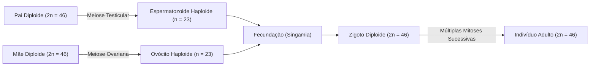
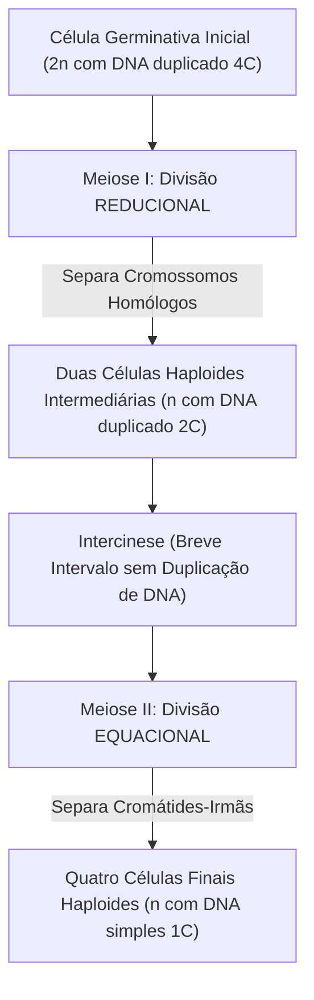
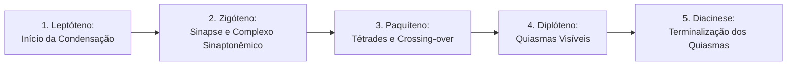
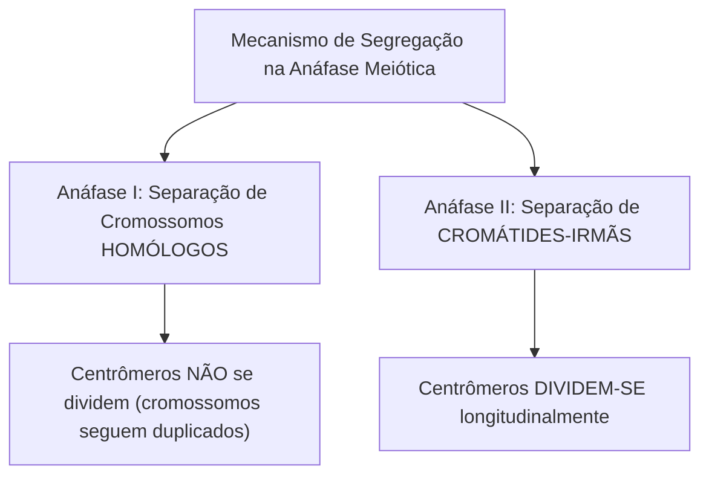
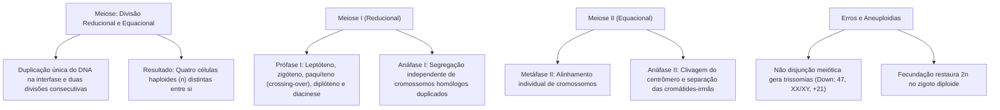

A reprodução sexuada constitui o motor evolutivo primordial para a geração de diversidade genética nas populações biológicas. Enquanto a mitose replica com fidelidade o genoma para o crescimento tecidual, a meiose atua na formação dos gametas. Ela reduz à metade o número de cromossomos da espécie e recombina blocos gênicos entre linhagens parentais distintas, garantindo que cada novo indivíduo seja geneticamente singular.

> [!objetivos]
> - Compreender a redução da ploidia e a restauração do número diploide na fecundação.
> - Dominar a sequência dos cinco estágios da prófase I e o mecanismo do crossing-over.
> - Diferenciar os eventos da anáfase I (separação de homólogos) da anáfase II (separação de cromátides).
> - Analisar as consequências das falhas de não disjunção meiótica e a origem de aneuploidias.
> - Contrastar de forma comparativa e sistemática as divisões celulares por mitose e meiose.

## Ploidia cromossômica e o papel biológico da meiose

O conceito de **ploidia** refere-se ao número de lotes cromossômicos completos presentes no núcleo de uma célula, simbolizado pela letra **n**. 

Na espécie humana e na esmagadora maioria dos animais superiores, as células do corpo (células somáticas) são **diploides (2n = 46)**. Elas abrigam 23 pares de **cromossomos homólogos**. Os cromossomos homólogos apresentam o mesmo tamanho, idêntica posição do centrômero e contêm genes que controlam os mesmos caracteres biológicos nos mesmos locos gênicos (um cromossomo herdado do genitor paterno e o outro da genitora materna).

Por sua vez, as células da linhagem germinativa especializadas na reprodução (os gametas: espermatozoide e ovócito) são **haploides (n = 23)**. Quando ocorre a fecundação, a fusão dos dois núcleos gaméticos reconstitui o patrimônio genético original da espécie humana no zigoto (n + n = 2n = 46).



Se a meiose não reduzisse o número cromossômico pela metade, a cada geração subsequente a quantidade de cromossomos duplicaria progressivamente (46 para 92, 184, 368), inviabilizando a estabilidade do genoma biológico da espécie.

- **Cromossomos autossomos**: são os cromossomos comuns a ambos os sexos, que não determinam diretamente o sexo genético. Na espécie humana, existem **22 pares de autossomos** (44 cromossomos autossômicos).
- **Cromossomos sexuais (alossomos)**: compõem o 23º par. Determinam o sexo cromossômico: a presença do par **XX** determina o sexo feminino biológico, ao passo que o par heteromórfico **XY** determina o sexo masculino.
- **Poliploidia**: condição em que a célula possui três ou mais lotes cromossômicos completos (3n, 4n). É comum em plantas cultivadas (trigo, café e banana), mas letal em mamíferos.

## Visão geral da meiose: duas divisões e uma única replicação

A meiose compreende duas divisões celulares sucessivas (Meiose I e Meiose II) precedidas por uma **única replicação semiconservativa do DNA** ocorrida durante a fase S da interfase.



Em virtude desse desenho biológico singular, o comportamento das etapas meióticas apresenta objetivos distintos:
1. **Meiose I (divisão reducional)**: promove a separação física dos cromossomos homólogos pareados, reduzindo a ploidia da célula de diploide (2n) para haploide (n).
2. **Meiose II (divisão equacional)**: assemelha-se a uma mitose comum. Ocorre a clivagem dos centrômeros e a separação das cromátides-irmãs, mantendo a ploidia haploide (n) e gerando **quatro células-filhas geneticamente distintas**.
3. **Intercinese**: período transitório que separa o término da telófase I do início da prófase II. A intercinese não realiza nova replicação do material genético.

## Meiose I: a divisão reducional

A primeira divisão meiótica é o evento em que ocorrem os fenômenos de maior complexidade genética e morfológica da biologia celular.

### Prófase I e seus cinco estágios

A prófase I é extraordinariamente longa, ocupando até 90% de todo o tempo da meiose. Ela subdivide-se didaticamente em cinco subfases consecutivas:



1. **Leptóteno**: os cromossomos duplicados iniciam sua condensação, surgindo como filamentos delgados com nós mais densos denominados cromômeros.
2. **Zigóteno**: inicia-se o pareamento íntimo e altamente específico entre os cromossomos homólogos. Esse pareamento gene a gene denomina-se **sinapse cromossômica**. A sinapse é estabilizada por uma estrutura protéica em forma de escada que se monta entre os filamentos, denominada **complexo sinaptonêmico**.
3. **Paquíteno**: a condensação acentua-se e a sinapse dos homólogos atinge sua plenitude. Cada par associado é denominado **bivalente** ou **tétrade** (por conter quatro cromátides: duas de cada homólogo). É no paquíteno que ocorre o **crossing-over (permutação ou recombinação gênica)**: quebras transversais enzimáticas e trocas recíprocas de fragmentos de DNA entre **cromátides não irmãs** dos homólogos pareados. O crossing-over embaralha os alelos maternos e paternos, criando novas combinações gênicas nos futuros gametas.
4. **Diplóteno**: o complexo sinaptonêmico desfaz-se parcialmente e os cromossomos homólogos começam a se repelir e se afastar. Permanecem unidos exclusivamente nos pontos em que houve a permuta de segmentos, configurando figuras de cruzamento em "X" denominadas **quiasmas**. Os quiasmas são a prova citológica visível de que o crossing-over ocorreu. Em ovócitos humanos femininos, a meiose é paralisada no diplóteno (estágio de dictióteno) durante o desenvolvimento intrauterino fetal, permanecendo bloqueada até o início da puberdade.
5. **Diacinese**: etapa final da prófase I. A condensação atinge seu ápice e os quiasmas deslizam para as extremidades dos braços cromossômicos, fenômeno denominado **terminalização dos quiasmas**. O nucléolo e a carioteca desintegram-se completamente, liberando as tétrades para interagir com os microtúbulos do fuso.

> [!bizu]
> **Mnemônico dos Estágios da Prófase I:** memorize a sequência das cinco subfases usando a clássica frase mnemônica: **"LEmbre-se ZIlia do PAr do DI-DI"**:
> - **LE**ptóteno
> - **ZI**góteno (sinapse)
> - **PA**quíteno (permuta / crossing-over)
> - **DI**plóteno (quiasmas visíveis)
> - **DI**acinese (terminalização)

> [!esquema]
> **Crossing-over e Variabilidade Genética:**
> - O crossing-over ocorre exclusivamente entre **cromátides NÃO irmãs** de cromossomos homólogos pareados.
> - Se a permuta ocorresse entre cromátides-irmãs, não haveria recombinação nova, pois cromátides-irmãs são cópias xerográficas idênticas produzidas na replicação.
> - O crossing-over aumenta exponencialmente a diversidade biológica da descendência sem alterar o número total de genes do indivíduo.

### Metáfase I

Os pares de cromossomos homólogos pareados (tétrades) alinham-se na região equatorial da célula. A disposição dos cromossomos na placa metafásica da meiose I apresenta uma diferença essencial em relação à mitose:
- Na mitose, os cromossomos alinham-se individualmente, um abaixo do outro.
- Na metáfase I da meiose, os **homólogos alinham-se aos pares (lado a lado)**.
- Os microtúbulos que partem de um polo da célula conectam-se a apenas um dos dois cinetócoros do par bivalente, enquanto os microtúbulos do polo oposto ligam-se ao cinetócoro do outro homólogo.

### Anáfase I

A anáfase I realiza a segregação independente dos cromossomos homólogos:
- Os microtúbulos do fuso encurtam-se, tracionando um cromossomo inteiro duplicado para um polo e o outro homólogo duplicado para o polo oposto.
- **Não há divisão dos centrômeros**: as cromátides-irmãs permanecem firmemente unidas no centrômero.
- A migração aleatória dos cromossomos paternos e maternos para os polos opostos consagra a **segregação independente dos caracteres** (segunda lei de Mendel), gerando milhões de arranjos genômicos distintos (2²³ ≈ 8,4 milhões de tipos de gametas possíveis no ser humano, sem contabilizar a permutação).

### Telófase I e Citocinese I

Os cromossomos duplicados atingem os polos celulares. Em muitos organismos, a carioteca reorganiza-se temporariamente e os nucléolos ressurgem. Segue-se a citocinese I, individualizando duas células-filhas haploides (n), contendo cada uma 23 cromossomos duplicados constituídos por duas cromátides recombinadas.

## Meiose II: a divisão equacional

Após a intercinese, as duas células haploides iniciam a Meiose II de forma sincrônica. Esta divisão processa-se de modo idêntico a uma mitose regular:

- **Prófase II**: a carioteca desintegra-se novamente, os cromossomos voltam a se condensar e forma-se o fuso da meiose II perpendicularmente ao eixo da primeira divisão.
- **Metáfase II**: os 23 cromossomos alinham-se individualmente no plano equatorial da célula (placa metafásica II). Aqui, as fibras do fuso ligam-se aos **dois lados opostos de cada cinetócoro**.
- **Anáfase II**: as coesinas centroméricas são degradadas e os **centrômeros dividem-se longitudinalmente**. As **cromátides-irmãs separam-se**, migrando para polos opostos como cromossomos-filhos independentes.
- **Telófase II e Citocinese II**: os cromossomos desespiralam-se nos polos, a carioteca e os nucléolos reconstituem-se e a citocinese divide o citoplasma.

O saldo final da meiose a partir de uma célula genitora diploide (2n) consiste na formação de **quatro células haploides (n) geneticamente distintas entre si e diferentes da célula-mãe**.



## Não disjunção meiótica e as alterações cromossômicas

A distribuição dos cromossomos durante a anáfase I ou anáfase II depende do perfeito funcionamento dos microtúbulos do fuso. Quando um par de cromossomos homólogos ou um par de cromátides-irmãs deixa de se separar na anáfase, ocorre a **não disjunção meiótica**.

A não disjunção produz gametas com um cromossomo a mais (n + 1) ou com um cromossomo a menos (n - 1). Quando esse gameta defeituoso participa da fecundação com um gameta normal (n), origina-se um zigoto portador de **aneuploidia** (alteração no número de um cromossomo específico):

```mermaid Gênese da Aneuploidia por Não Disjunção Meiótica
flowchart TD
    PAR["Célula Germinativa em Meiose"] --> FALHA["Falha na Anáfase: Não Disjunção de Homólogos ou Cromátides"]
    FALHA --> GAM_PLUS["Gameta com Cromossomo a Mais (n + 1)"]
    FALHA --> GAM_MINUS["Gameta com Cromossomo a Menos (n - 1)"]

    GAM_PLUS -->|Fecundação com Gameta Normal (n)| TRIS["Trissomia (2n + 1: ex.: Síndrome de Down)"]
    GAM_MINUS -->|Fecundação com Gameta Normal (n)| MONOS["Monossomia (2n - 1: ex.: Síndrome de Turner)"]
```

As aneuploidias mais abordadas em provas compreendem:
- **Síndrome de Down (Trissomia do cromossomo 21)**: presença de três cópias do autossomo 21 (47, XX, +21 ou 47, XY, +21). É a aneuploidia viável mais frequente na espécie humana, associada à hipotonia muscular, prega palmar única, cardiopatias congênitas e déficit cognitivo variável. Sua incidência aumenta significativamente com a idade materna avançada, em decorrência do longo período de bloqueio no diplóteno dos ovócitos primários.
- **Síndrome de Turner (Monossomia do X)**: mulher portadora de cariótipo 45, X0. Apresenta baixa estatura, pescoço alado, tórax largo e esterilidade por gônadas em fita.
- **Síndrome de Klinefelter**: indivíduo do sexo masculino com cariótipo 47, XXY. Caracteriza-se por ginecomastia, atrofia testicular, esterilidade e membros longos.

> [!pegadinha]
> **Momento da Não Disjunção:** preste muita atenção na análise de heredogramas e marcadores genéticos em questões de prova:
> - A não disjunção na **Meiose I** gera 100% de gametas anômalos (dois gametas n+1 e dois gametas n-1).
> - A não disjunção na **Meiose II** gera 50% de gametas normais (n) e 50% de gametas alterados (um gameta n+1 e um gameta n-1).

> [!atencao]
> **Autossomos versus Cromossomos Sexuais:** lembre-se de que a Síndrome de Down é uma alteração que afeta um cromossomo **autossômico** (o cromossomo 21), atingindo indistintamente indivíduos do sexo masculino ou feminino. Em contraste, as síndromes de Turner (45, X0) e de Klinefelter (47, XXY) são aneuploidias que afetam exclusivamente os **cromossomos sexuais (alossomos)**.

## Quadro comparativo definitivo: mitose versus meiose

A tabela a seguir consolida os elementos de distinção entre as duas divisões celulares cobrados com alta recorrência nas provas:

| Critério de Comparação | Mitose | Meiose |
|---|---|---|
| **Local de Ocorrência** | Células somáticas do corpo. | Células germinativas gonadais. |
| **Finalidade Primária** | Crescimento, regeneração e cicatrização. | Produção de gametas para reprodução sexuada. |
| **Número de Divisões** | Uma única divisão nuclear e citoplasmática. | Duas divisões nucleares consecutivas (I e II). |
| **Ploidia Resultante** | Equacional: preserva a ploidia (2n → 2n). | Reducional e equacional: reduz à metade (2n → n). |
| **Células-Filhas Geradas** | Duas células-filhas idênticas à célula-mãe. | Quatro células-filhas geneticamente distintas. |
| **Pareamento de Homólogos** | Inexistente (cromossomos alinham-se sozinhos). | Presente na Prófase I (sinapse e tétrades). |
| **Crossing-over (Permutação)** | Ausente em condições fisiológicas normais. | Presente no Paquíteno da Prófase I. |
| **Alinhamento na Metáfase** | Cromossomos individuais na placa equatorial. | Pares de homólogos na Metáfase I; individuais na II. |
| **Comportamento na Anáfase** | Separação imediata de cromátides-irmãs. | Anáfase I separa homólogos; Anáfase II separa cromátides. |

## Mapa do capítulo



### Para fixar

1. **Ploidia celular**: humanos possuem células somáticas diploides (2n = 46 cromossomos) organizadas em 22 pares de autossomos e 1 par sexual (XX ou XY), e gametas haploides (n = 23). A fecundação reconstitui a diploidia no zigoto.
2. **Dinâmica meiótica**: compreende uma única duplicação de DNA seguida por duas divisões celulares sucessivas, gerando quatro células haploides geneticamente diversas.
3. **Prófase I**: estágio mais extenso da meiose, subdividido em leptóteno (condensação inicial), zigóteno (sinapse homóloga com complexo sinaptonêmico), paquíteno (crossing-over), diplóteno (quiasmas visíveis) e diacinese (terminalização).
4. **Crossing-over (permutação)**: troca recíproca de fragmentos de DNA entre cromátides não irmãs de cromossomos homólogos no paquíteno, originando novas combinações de alelos.
5. **Anáfase I versus Anáfase II**: a anáfase I separa cromossomos homólogos duplicados sem clivar centrômeros, reduzindo a ploidia para haploide. A anáfase II quebra os centrômeros e separa as cromátides-irmãs.
6. **Segregação independente**: a distribuição aleatória dos homólogos paternos e maternos na anáfase I gera mais de 8 milhões de combinações cromossômicas distintas em gametas humanos.
7. **Não disjunção meiótica**: erro na migração cromossômica durante a anáfase que origina gametas anormais com excesso (n + 1) ou falta (n - 1) de cromossomos, provocando aneuploidias como a Síndrome de Down (trissomia 21).
8. **Mitose versus Meiose**: a mitose é equacional, realiza uma divisão e origina duas células-filhas idênticas sem pareamento de homólogos. A meiose é reducional e equacional, realiza duas divisões e gera quatro células haploides geneticamente recombinadas.