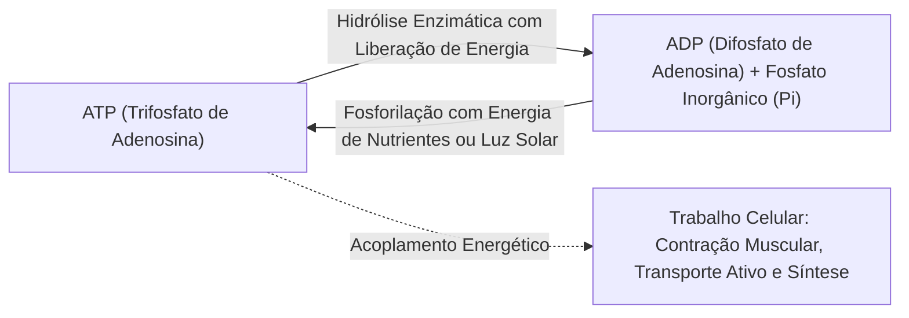
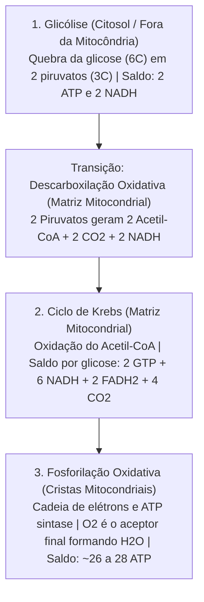
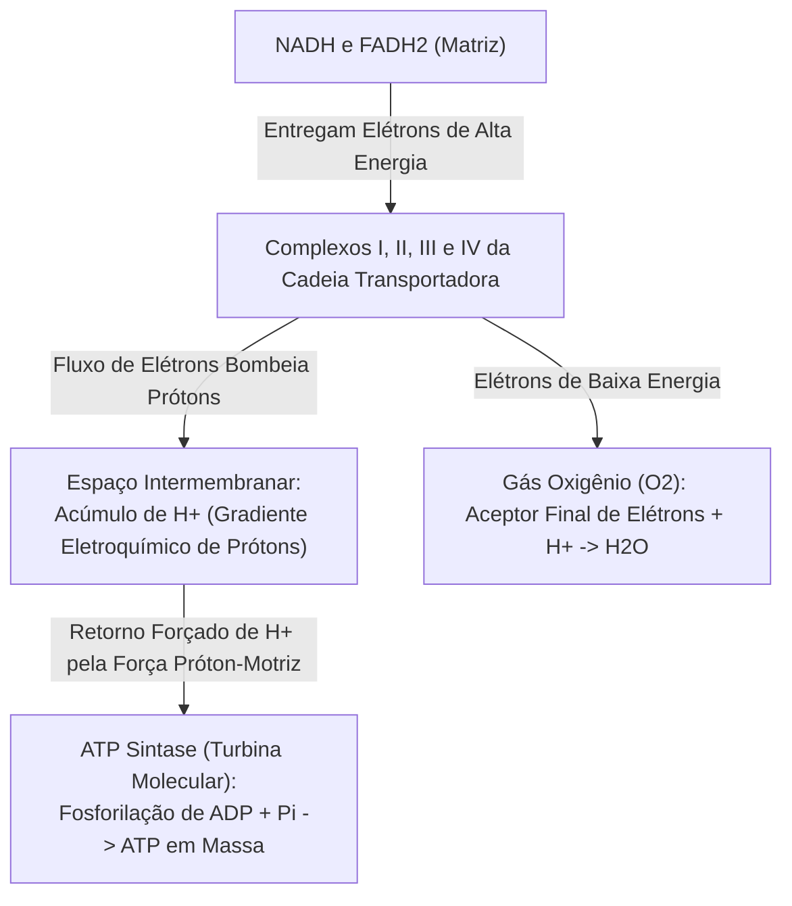
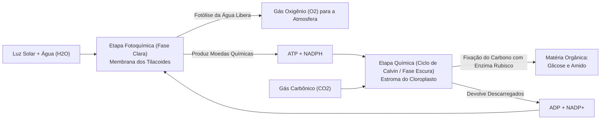
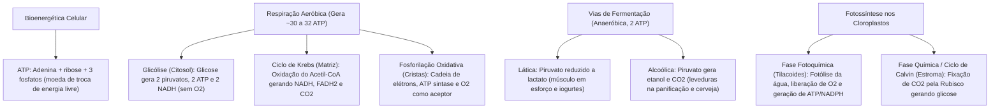

A manutenção das estruturas biológicas e a execução das funções vitais dependem de um fluxo ininterrupto de energia livre. A bioenergética celular estuda as vias metabólicas pelas quais as células extraem energia das ligações químicas dos nutrientes orgânicos ou da luz solar. Essa energia é armazenada na molécula de trifosfato de adenosina (ATP). O metabolismo energético governa a sobrevivência celular durante exercícios intensos e na síntese de novos tecidos corporais.

> [!objetivos]
> - Compreender a estrutura molecular do ATP e sua função como moeda energética celular.
> - Dominar as três etapas da respiração celular aeróbica: glicólise, ciclo de Krebs e fosforilação oxidativa.
> - Analisar o papel do gás oxigênio como aceptor final de elétrons e a síntese quimiosmótica de ATP.
> - Diferenciar a fermentação lática da fermentação alcoólica e suas aplicações biotecnológicas.
> - Caracterizar as etapas fotoquímica e química da fotossíntese nos tilacoides e estroma dos cloroplastos.

## O ATP e a moeda de troca energética celular

O trifosfato de adenosina (ATP) constitui a principal molécula intermediária de armazenamento e transferência de energia livre em todos os seres vivos. 

Sua estrutura molecular é formada por:
1. Uma base nitrogenada púrica: a **adenina**.
2. Um açúcar de cinco carbonos: a pentose **ribose**.
3. Uma cadeia linear de **três grupos fosfato** unidos entre si por ligações fosfoanidro.



As ligações químicas que unem o segundo e o terceiro grupos fosfato do ATP armazenam expressiva quantidade de energia livre eletrostática. Quando a célula necessita de energia para realizar trabalho mecânico ou químico, enzimas ATPases quebram a ligação terminal por hidrólise:

ATP + H₂O → ADP + Pi + Energia Livre

A molécula de ADP resultante é imediatamente reciclada de volta a ATP por meio da adição de um fosfato inorgânico (Pi). Esse processo consome a energia proveniente da oxidação dos alimentos na respiração ou da captação de luz solar na fotossíntese.

> [!bizu]
> **Ventilação Pulmonar versus Respiração Celular:** nos certames públicos, não confunda os dois conceitos. A **ventilação pulmonar** é o processo mecânico de renovação do ar nos alvéolos pulmonares por expansão torácica. A **respiração celular** é o processo bioquímico intracelular no qual moléculas orgânicas são oxidadas para sintetizar ATP no citoplasma e nas mitocôndrias.

## Respiração celular aeróbica

A respiração aeróbica constitui a via catabólica mais eficiente de extração de energia química a partir de carboidratos, lipídios e proteínas. A equação química global resume a oxidação completa de uma molécula de glicose:

C₆H₁₂O₆ + 6 O₂ → 6 CO₂ + 6 H₂O + Energia (ATP)

Esse processo desenvolve-se em três etapas bioquímicas coordenadas no interior da célula:



### Glicólise: a quebra anaeróbica no citosol

A glicólise é a etapa inaugural e ancestral da respiração celular. Ela ocorre livremente no **citosol (hialoplasma)** da célula e **independe da presença de gás oxigênio (O₂)**:
- Consiste em uma sequência de dez reações enzimáticas. Essas reações dividem uma molécula de glicose (com 6 carbonos) em **duas moléculas de piruvato** (com 3 carbonos cada).
- **Fase de investimento energético**: a célula consome inicialmente **duas moléculas de ATP**. Esse consumo fosforila a glicose e a ativa quimicamente para a quebra.
- **Fase de rendimento**: ocorrem reações de oxidação. Elétrons de alta energia e íons de hidrogênio são capturados pela coenzima transportadora **NAD⁺**, reduzindo-a a **2 NADH**. Simultaneamente, são produzidas quatro moléculas de ATP por fosforilação ao nível do substrato.
- **Saldo líquido da glicólise**: **duas moléculas de piruvato**, **duas moléculas de ATP líquidos** e **duas moléculas de NADH**. Na presença de oxigênio, os piruvatos são transportados para a matriz mitocondrial.

### A descarboxilação oxidativa do piruvato e o Ciclo de Krebs

Ao penetrar na matriz mitocondrial, cada piruvato passa por uma etapa preparatória de descarboxilação oxidativa:
- O piruvato (3C) perde um átomo de carbono sob a forma de **dióxido de carbono (CO₂)**. Elétrons liberados reduzem mais um NAD⁺ a NADH.
- O fragmento restante de dois carbonos combina-se com a **coenzima A (CoA)**, formando a molécula de **Acetil-CoA**. Como a glicose originou dois piruvatos, essa etapa produz 2 Acetil-CoA, 2 CO₂ e 2 NADH.

O **Ciclo de Krebs** (também denominado ciclo do ácido cítrico) processa-se inteiramente na **matriz mitocondrial**:
1. O grupo acetila (2C) do Acetil-CoA transfere-se para o oxaloacetato (com 4 carbonos), sintetizando o **citrato (com 6 carbonos)**. A coenzima A é liberada para novo ciclo.
2. Em uma sequência de oito reações catalisadas por enzimas solúveis, o citrato é oxidado e descarboxilado. Dois átomos de carbono são expelidos sob a forma de duas moléculas de CO₂.
3. A energia liberada transfere elétrons para coenzimas transportadoras. Para cada Acetil-CoA que entra no ciclo, formam-se **3 NADH** e **1 FADH₂**.
4. Ocorre ainda a síntese direta de **uma molécula de GTP** (bioequivalente ao ATP) por fosforilação ao nível do substrato.
5. Ao término da via, o oxaloacetato é regenerado, permitindo reiniciar o ciclo com outra unidade de Acetil-CoA.

> [!esquema]
> **Saldo do Ciclo de Krebs por Glicose:** como uma molécula de glicose fornece duas moléculas de Acetil-CoA, o ciclo de Krebs executa duas voltas completas por glicose degradada, produzindo:
> - **4 moléculas de CO₂** (que se somam às 2 moléculas de CO₂ da descarboxilação do piruvato, totalizando os 6 CO₂ da equação respiratória global).
> - **6 moléculas de NADH**.
> - **2 moléculas de FADH₂**.
> - **2 moléculas de GTP/ATP**.

### Fosforilação oxidativa e a cadeia transportadora de elétrons

A fosforilação oxidativa constitui a terceira etapa da respiração celular. Ela realiza-se na **membrana interna da mitocôndria**, onde se situam as cristas mitocondriais.



A fosforilação oxidativa opera por meio de mecanismos integrados:

1. **A cadeia transportadora de elétrons**: os carreadores NADH e FADH₂ produzidos nas fases anteriores descarregam seus elétrons de alta energia nos complexos proteicos da membrana interna (Complexos I, II, III e IV). Os elétrons fluem ao longo de transportadores dispostos em ordem crescente de afinidade eletrônica.
2. **A teoria quimiosmótica de Mitchell**: a energia liberada pela passagem dos elétrons na cadeia é utilizada para bombear prótons (H⁺) da matriz para o espaço intermembranar. Cria-se um acentuado **gradiente eletroquímico de prótons** entre os dois lados da membrana interna.
3. **O papel da ATP sintase**: como a membrana interna é impermeável a íons livres, os prótons acumulados retornam para a matriz exclusivamente pelo canal central da enzima **ATP sintase**. Esse fluxo de prótons aciona a rotação da enzima, promovendo a síntese de ATP em massa a partir de ADP e fosfato inorgânico.
4. **O oxigênio como aceptor final**: no término da cadeia (Complexo IV), os elétrons desprovidos de energia são captados pelo **gás oxigênio (O₂)**. O oxigênio combina-se com prótons livres da matriz mitocondrial para formar **água (H₂O)**.

> [!pegadinha]
> **O aceptor final de elétrons:** se faltar oxigênio molecular na célula, a cadeia de transporte de elétrons paralisa imediatamente por acúmulo de elétrons no último complexo. Sem a movimentação eletrônica, cessa o bombeamento de prótons, o gradiente desaparece e a ATP sintase para de fabricar ATP. O oxigênio atua estritamente como **aceptor final de elétrons e prótons**, formando água metabólica.

## Respiração anaeróbica e vias fermentativas

Determinados microrganismos ou células musculares humanas privadas temporariamente de oxigênio não conseguem operar a cadeia transportadora de elétrons. Sem oxigênio, a cadeia respiratória paralisa e as coenzimas NADH acumulam-se no citosol sem ter onde descarregar seus elétrons.

Para não interromper a glicólise (que fornece os 2 ATP de emergência), a célula precisa oxidar o NADH de volta a NAD⁺. Esse processo citoplasmático que reoxida o NADH transferindo seus elétrons para uma molécula orgânica endógena denomina-se **fermentação**.

```mermaid Comparativo das Vias Fermentativas
flowchart TD
    GLIC["Glicose (6C)"] -->|Glicólise Anaeróbia no Citosol (Gera 2 ATP e 2 NADH)| PIR["2 Piruvatos (3C)"]

    PIR -->|Redução Direta pelo NADH sem Perda de Carbono| FERM_LAT["Fermentação Lática:<br/>Produz 2 Lactatos (3C) | Sem emissão de CO2"]
    PIR -->|Descarboxilação + Redução pelo NADH| FERM_ALC["Fermentação Alcoólica:<br/>Produz 2 Etanois (2C) + 2 CO2"]
```

### Fermentação lática

Na fermentação lática, as duas moléculas de piruvato recebem diretamente os elétrons e hidrogênios do NADH, convertendo-se em **duas moléculas de lactato (ácido lático)** com três carbonos cada.
- Não há liberação de gás carbônico (CO₂).
- **Importância fisiológica no músculo humano**: durante exercícios extenuantes ou salvamentos intensos, o suprimento de oxigênio torna-se insuficiente nos músculos esqueléticos. Os miócitos realizam fermentação lática temporária para gerar ATP rápido. O acúmulo de lactato dissocia-se em íons H⁺, acidificando o meio intracelular e provocando a **fadiga muscular aguda**. No repouso posterior, o lactato vai para o fígado pelo sangue e é reconvertido em glicose no **Ciclo de Cori**.
- **Aplicações na biotecnologia de alimentos**: bactérias láticas (como *Lactobacillus*) fermentam a lactose do leite, produzindo ácido lático que coagula as proteínas lácteas, permitindo a fabricação de iogurtes e queijos.

### Fermentação alcoólica

Na fermentação alcoólica, o piruvato (3C) sofre uma descarboxilação irreversível, liberando **gás carbônico (CO₂)** e gerando o composto intermediário acetaldeído (2C). O acetaldeído é reduzido pelos elétrons do NADH, originando o **etanol (álcool etílico)**.
- **Microorganismos responsáveis**: executada principalmente por fungos unicelulares da classe das leveduras, com destaque para a espécie *Saccharomyces cerevisiae*.
- **Aplicações na indústria e biotecnologia**:
  - **Panificação**: as leveduras do fermento biológico consomem açúcares da massa. O gás carbônico liberado fica retido no glúten, formando bolhas que fazem o pão crescer e ficar fofo. O álcool evapora com o calor do forno.
  - **Bebidas alcoólicas e biocombustíveis**: fermentação anaeróbica de uva para vinho, malte para cerveja e caldo de cana para bioetanol combustível.

| Critério Comparativo | Respiração Aeróbica | Fermentação Lática | Fermentação Alcoólica |
|---|---|---|---|
| **Necessidade de Oxigênio** | Indispensável (Aeróbica). | Ausente (Anaeróbica). | Ausente (Anaeróbica). |
| **Local Intracelular** | Citosol e Mitocôndria. | Estritamente no Citosol. | Estritamente no Citosol. |
| **Aceptor Final de Elétrons** | Gás Oxigênio (O₂). | Piruvato (converte em lactato). | Acetaldeído (converte em etanol). |
| **Emissão de Dióxido de Carbono** | Sim (6 CO₂ por glicose). | Não emite CO₂. | Sim (2 CO₂ por glicose). |
| **Rendimento Energético Líquido** | Alto (~30 a 32 ATP). | Baixo (2 ATP da glicólise). | Baixo (2 ATP da glicólise). |

## Fotossíntese: a conversão de luz em matéria orgânica

A fotossíntese constitui o processo biológico autotrófico responsável pela produção primária de biomassa e pela liberação de oxigênio na biosfera. É executada por plantas, algas eucarióticas e cianobactérias fotossintetizantes.

A equação global da fotossíntese resume a estequiometria do processo:

12 H₂O + 6 CO₂ + Luz Solar → C₆H₁₂O₆ + 6 O₂ + 6 H₂O

A fotossíntese divide-se em duas etapas interdependentes realizadas no interior dos cloroplastos:



### Etapa fotoquímica (fase clara)

Ocorre na **membrana dos tilacoides** dos cloroplastos e depende da incidência da radiação solar:
- **Absorção de luz pelos fotossistemas**: os pigmentos de **clorofila a**, clorofila b e carotenoides absorvem fótons de luz. Os elétrons da clorofila são excitados e fluem por uma cadeia transportadora na membrana do tilacoide.
- **Fotólise da água (Reação de Hill)**: uma enzima associada ao Fotossistema II promove a quebra da água com auxílio de luz:
  2 H₂O → 4 H⁺ + 4 e⁻ + O₂
  **O gás oxigênio liberado na fotossíntese provém da molécula de água**, e não do gás carbônico.
- **Fotofosforilação e geração de NADPH**: a passagem de elétrons pela cadeia do tilacoide bombeia prótons para o lúmen. O retorno de prótons pela ATP sintase produz **ATP (fotofosforilação)**. No término da cadeia, elétrons reduzem a coenzima **NADP⁺** a **NADPH**. Ao final da fase clara, a energia luminosa foi convertida em energia química de **ATP e NADPH**.

### Etapa química (fase escura ou Ciclo de Calvin-Benson)

Ocorre no **estroma** do cloroplasto e independe da incidência direta de luz. Ela utiliza o ATP e o NADPH sintetizados na fase fotoquímica:
- **Fixação do dióxido de carbono**: o CO₂ atmosférico entra pelas folhas e é fixado à ribulose 1,5-bisfosfato (RuBP). Essa reação é catalisada pela enzima **Rubisco**, a proteína mais abundante do planeta Terra.
- **Redução e síntese de carboidratos**: a molécula resultante é reduzida com consumo do ATP e NADPH da fase clara, formando trioses fosfatadas. A cada seis voltas do ciclo de Calvin com a fixação de seis moléculas de CO₂, produz-se o equivalente a **uma molécula de glicose (C₆H₁₂O₆)**. A glicose é utilizada na respiração da própria planta ou armazenada como amido nos amiloplastos.

> [!atencao]
> **Autotrofia e Respiração em Vegetais:** é erro frequente em concursos julgar que os vegetais realizam apenas fotossíntese e os animais respiração. Os vegetais são seres aeróbicos completos: suas células realizam **fotossíntese** na presença de luz para fabricar compostos orgânicos, e realizam **respiração celular aeróbica ininterruptamente (dia e noite)** em suas mitocôndrias para manter a vida de suas células e tecidos.

## Mapa do capítulo



### Para fixar

1. **ATP como moeda biológica**: o trifosfato de adenosina armazena energia química em suas ligações fosfoanidro terminais, liberando energia livre e fosfato inorgânico (Pi) ao ser hidrolisado em ADP.
2. **Glicólise**: primeira fase da respiração celular, realizada anaerobicamente no citosol, onde uma glicose é quebrada em dois piruvatos, rendendo 2 ATP líquidos e 2 NADH.
3. **Ciclo de Krebs**: ocorre na matriz mitocondrial a partir do Acetil-CoA, promovendo descarboxilações que liberam CO₂ e reduzem coenzimas transportadoras em NADH e FADH₂.
4. **Cadeia transportadora de elétrons e fosforilação oxidativa**: situada nas cristas mitocondriais, bombeia prótons para o espaço intermembranar; o retorno dos prótons pela ATP sintase produz a maior parte do ATP aeróbico.
5. **Gás oxigênio como aceptor final**: o O₂ recebe os elétrons exauridos ao final da cadeia respiratória e prótons da matriz para formar água metabólica, evitando o colapso da respiração celular.
6. **Fermentação lática**: via anaeróbica no citosol que converte piruvato em lactato para reoxidar o NADH, operando no músculo humano sob esforço extenuante e na indústria de laticínios.
7. **Fermentação alcoólica**: realizada por leveduras (*Saccharomyces cerevisiae*), converte piruvato em etanol e CO₂, sendo a base da panificação (crescimento da massa pelo CO₂) e da produção de bebidas e bioetanol.
8. **Etapa fotoquímica da fotossíntese**: realizada nos tilacoides dos cloroplastos, absorve luz pela clorofila, quebra a água na fotólise liberando O₂ para o ar e produz ATP e NADPH.
9. **Ciclo de Calvin (fase escura)**: ocorre no estroma do cloroplasto, onde a enzima Rubisco fixa o CO₂ atmosférico utilizando o ATP e NADPH da fase clara para sintetizar glicose.
10. **Metabolismo vegetal completo**: plantas respiram aerobicamente o tempo todo em suas mitocôndrias e realizam fotossíntese em seus cloroplastos quando iluminadas.