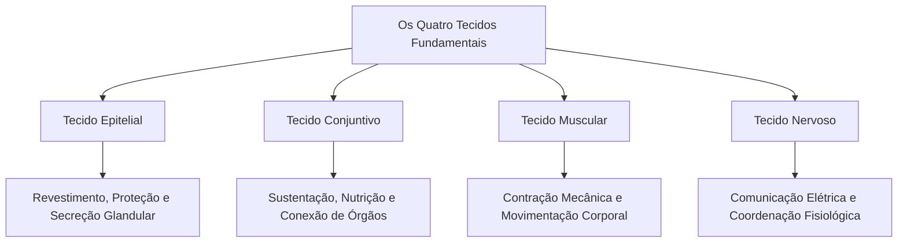
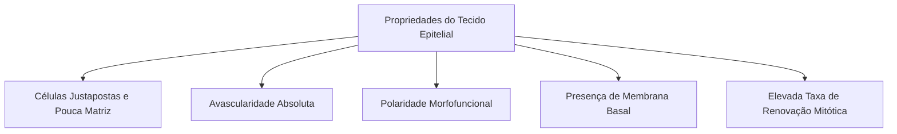
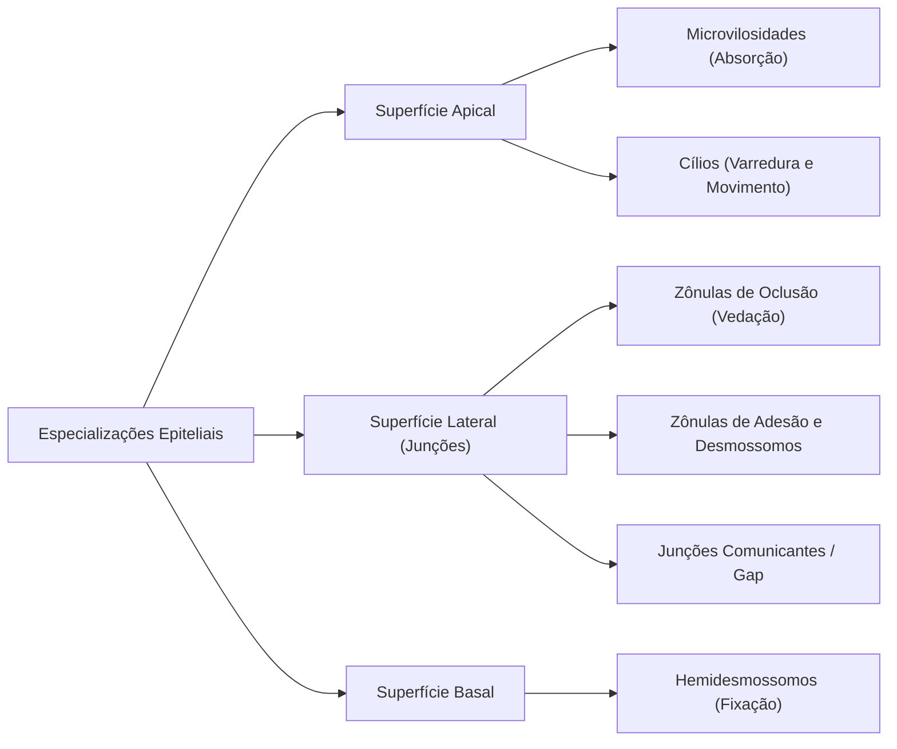
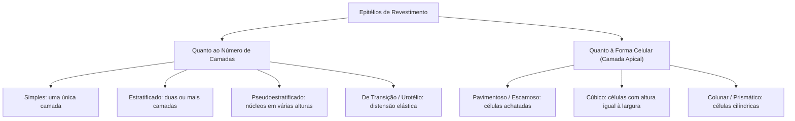
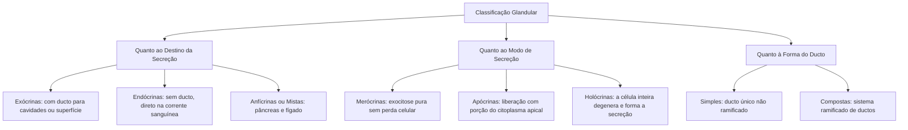

Os organismos multicelulares apresentam uma admirável divisão de trabalho biológico. No corpo humano adulto, cerca de duzentos tipos celulares distintos associam-se intimamente com substâncias extracelulares para desempenhar funções coordenadas. Essas associações estruturadas formam os **tecidos**, agrupamentos celulares especializados que constituem as unidades de construção dos órgãos e sistemas fisiológicos.

A **histologia** é a ciência biológica dedicada à investigação da estrutura microscópica dos tecidos e à sua correlação funcional. Compreender a organização tecidual exige o conhecimento dos métodos de microscopia e das propriedades do **tecido epitelial**, o primeiro dos quatro tecidos fundamentais dos animais.

> [!objetivos]
> - Compreender a organização dos tecidos animais e as etapas da técnica histológica padrão.
> - Dominar a coloração por hematoxilina e eosina, diferenciando estruturas basófilas e acidófilas.
> - Identificar as propriedades do tecido epitelial: justaposição, avascularidade, polaridade e lâmina basal.
> - Classificar os epitélios de revestimento, destacando o urotélio e o epitélio respiratório.
> - Diferenciar glândulas exócrinas e endócrinas, analisando os modos merócrino, apócrino e holócrino.

## Organização tecidual e os quatro tecidos fundamentais

A anatomia microscópica agrupa a imensa variedade celular animal em apenas **quatro tecidos básicos**:
1. **Tecido epitelial:** caracterizado por células poliédricas justapostas com escassa matriz extracelular, atuando no revestimento de superfícies, absorção e secreção;
2. **Tecido conjuntivo:** caracterizado por grande abundância de matriz extracelular produzida por células esparsas, desempenhando sustentação mecânica, conexão, defesa e preenchimento;
3. **Tecido muscular:** constituído por células alongadas ricas em filamentos de actina e miosina com capacidade contrátil, responsável pela movimentação do corpo e de fluidos internos;
4. **Tecido nervoso:** formado por neurônios altamente ramificados e células da glia, especializado na recepção, processamento e transmissão de impulsos eletroquímicos.

Com exceção do sistema nervoso central, que é quase inteiramente composto por tecido nervoso, a maioria dos órgãos resulta da integração física e fisiológica desses tecidos. A parede do estômago, por exemplo, conta com epitélio interno de secreção e proteção, conjuntivo de sustentação vascular e feixes musculares lisos para a trituração mecânica do bolo alimentar.

## Fundamentos das técnicas histológicas

As células e tecidos animais são estruturas transparentes e frágeis. Para que possam ser observados em detalhes ao microscópio óptico de luz, os fragmentos biológicos precisam passar por uma sequência rigorosa de etapas laboratoriais:

### Fixação tecidual

A **fixação** preserva a arquitetura biológica e impede a autólise por enzimas lisossômicas, além de evitar a decomposição bacteriana:
- **Métodos químicos:** consistem na imersão em **formaldeído (formol a 10%)** tamponado ou glutaraldeído. O fixador forma pontes cruzadas entre proteínas teciduais, insolubilizando-as e endurecendo o fragmento;
- **Métodos físicos:** baseiam-se no congelamento rápido por nitrogênio líquido, indicado para preservar lipídios solúveis e enzimas lábeis.

### Inclusão e microtomia

Para a passagem do feixe luminoso, o fragmento é fatiado em secções de **5 a 10 micrômetros (µm)**. O tecido é desidratado em etanol, clarificado em xilol e impregnado em **parafina líquida aquecida**, formando um bloco sólido ao esfriar.

O corte fino é feito em um **micrótomo**, aparelho dotado de navalha de aço de alta precisão. As fatias delgadas obtidas são transferidas para uma lâmina de vidro para a coloração.

### Coloração por hematoxilina e eosina (HE)

Como os cortes delgados de parafina são incolores, a visualização exige coloração histológica. O método padrão utilizado mundialmente é a combinação de **hematoxilina e eosina (HE)**, dois corantes de propriedades ácido-base complementares:

| Corante Histológico | Natureza Química | Alvo Celular | Afinidade / Comportamento | Cor Resultante |
|---|---|---|---|---|
| **Hematoxilina** | Corante **básico** (catiônico, carga positiva) | Ácidos nucleicos (DNA do núcleo e RNA dos ribossomos) | Liga-se a estruturas ácidas; essas estruturas são denominadas **basófilas** | **Azul escuro ou roxo** |
| **Eosina** | Corante **ácido** (aniônico, carga negativa) | Proteínas do citoplasma, citoesqueleto e fibras colágenas | Liga-se a estruturas básicas; essas estruturas são denominadas **acidófilas ou eosinófilas** | **Rosa ou avermelhado** |

> [!esquema]
> **Regra mnemônica de bancada:**
> - Corante **Básico** cora estruturas ricas em ácidos (DNA/RNA) -> Núcleo é **Basófilo** (Azul/Roxo).
> - Corante **Ácido** cora estruturas ricas em proteínas -> Citoplasma é **Acidófilo** (Rosa).

Outros métodos especiais incluem o **PAS (Ácido Periódico de Schiff)**, que evidencia glicoproteínas e a membrana basal em tom vermelho-magenta, e corantes como o azul de toluidina, que apresenta metacromasia em grânulos de mastócitos.

## Características gerais do tecido epitelial

O tecido epitelial reveste a superfície externa do corpo, recobre cavidades internas e tubos viscerais, e dá origem às unidades glandulares. Suas propriedades fundamentais são:

### Células justapostas e escassa substância intercelular

Diferente do conjuntivo, o epitélio exibe células intimamente unidas por complexos proteicos juncionais. O espaço intercelular é reduzido a fendas mínimas, com quantidade quase nula de substância intercelular amorfa. Essa disposição coesa forma barreiras mecânicas protetoras contra agentes patogênicos e impede o vazamento de fluidos.

### Avascularidade e nutrição por difusão

O tecido epitelial é **completamente desprovido de capilares sanguíneos e vasos linfáticos**. Sua nutrição, oxigenação e drenagem de resíduos metabólicos ocorrem por **difusão** a partir dos vasos do tecido conjuntivo subjacente.

Nos tratos digestório, respiratório e geniturinário, a camada de tecido conjuntivo que sustenta diretamente o epitélio recebe o nome de **lâmina própria**. O conjunto formado pelo epitélio e sua lâmina própria compõe uma **mucosa**.

### Polaridade celular: domínio apical, lateral e basal

As células epiteliais exibem uma nítida **polaridade funcional**. A superfície celular não é uniforme, dividindo-se em três domínios com composições bioquímicas distintas:
1. **Domínio apical:** voltado para a luz (lúmen) do órgão ou para o meio externo, frequentemente provido de diferenciações como cílios e microvilosidades;
2. **Domínio lateral:** voltado para as células adjacentes, concentrando junções celulares de adesão, vedação e comunicação;
3. **Domínio basal:** repousa sobre a matriz extracelular especializada da lâmina basal, ancorando a célula ao tecido conjuntivo por hemidesmossomos.

### A membrana basal

Todo epitélio repousa sobre a **membrana basal**. Ao microscópio eletrônico, nota-se que ela se compõe da **lâmina basal** (produzida pelas células epiteliais, rica em colágeno IV, laminina e proteoglicanas) e da **lâmina reticular** (produzida pelo tecido conjuntivo, rica em fibras reticulares de colágeno III).

A membrana basal desempenha funções cruciais:
- Suporte mecânico e adesão do epitélio ao conjuntivo;
- Filtro que seleciona macromoléculas no trânsito celular;
- Guia físico para migração celular na cicatrização;
- Barreira mecânica contra a invasão de células neoplásicas.

### Alta capacidade de regeneração

Em áreas expostas a atrito ou agressões químicas contínuas (pele, boca e estômago), as células superficiais descamam habitualmente. Essa perda é compensada por **células-tronco** da camada basal, que sofrem mitoses sucessivas para regenerar o tecido.

## Especializações de membrana e complexos juncionais

Para manter a coesão tecidual e viabilizar a comunicação intercelular, os domínios das células epiteliais apresentam especializações ultraestruturais:

### Especializações da superfície apical

- **Microvilosidades:** projeções digitiformes microscópicas sustentadas internamente por feixes longitudinais de filamentos de **actina**. Presentes em abundância no epitélio intestinal e nos túbulos renais (borda em escova), ampliam em até trinta vezes a área superficial útil para a absorção de nutrientes e água;
- **Cílios:** estruturas móveis e alongadas sustentadas por um arranjo interno organizado de **microtúbulos (axonema 9+2)** associados a proteínas motoras de dineína. Realizam batimentos coordenados unidirecionais para transportar muco e partículas retidas nas vias respiratórias e impulsionar o ovócito na tuba uterina.

### Complexos juncionais da superfície lateral e basal

A estabilidade do epitélio depende de sistemas especializados de junção:

1. **Zônula de oclusão (junção oclusiva):** anel contínuo localizado no ápice lateral que promove a fusão focal das membranas celulares vizinhas mediante proteínas transmembrana (ocludinas e claudinas). Atua como barreira impermeável primária, impedindo a passagem paracelular indiscriminada de substâncias entre a luz do órgão e os tecidos profundos;
2. **Zônula de adesão:** faixa subjacente à zônula de oclusão que ancora filamentos de actina do citoesqueleto por meio de proteínas de adesão dependentes de cálcio chamadas **caderinas**;
3. **Desmossomos (máculas de adesão):** placas proteicas densas e pontuais que ancoram filamentos intermediários de **queratina** do citoesqueleto entre células vizinhas. Conferem extraordinária resistência mecânica contra forças de tração e cisalhamento, sendo abundantes na epiderme;
4. **Junções comunicantes (junções gap ou nexos):** canais cilíndricos hidrofílicos formados por anéis de proteínas chamadas **conexinas**. Permitem a passagem direta de íons e pequenas moléculas sinalizadoras (como cálcio e AMP cíclico) entre os citoplasmas, promovendo o acoplamento elétrico e metabólico entre as células;
5. **Hemidesmossomos:** estruturas localizadas na face basal que ancoram os filamentos intermediários de queratina da célula epitelial às proteínas da lâmina basal por meio de **integrinas**, fixando o epitélio ao substrato.

## Classificação dos epitélios de revestimento

Os epitélios de revestimento recobrem as superfícies corpóreas externas e internas. Sua classificação tradicional fundamenta-se em dois critérios morfológicos universais: o **número de camadas celulares** e o **formato das células** da camada mais externa.

### Epitélios simples

Possuem uma única camada de células repousando sobre a membrana basal:
- **Pavimentoso simples:** células achatadas com núcleos delgados em disco. Forma superfícies propícias à difusão rápida de gases e líquidos. Exemplos: alvéolos pulmonares, endotélio (revestimento interno de vasos sanguíneos e câmaras cardíacas) e mesotélio (revestimento das cavidades serosas pleural, pericárdica e peritoneal);
- **Cúbico simples:** células hexagonais com núcleos esféricos e centrais. Participa de processos de absorção e secreção ativa. Exemplos: túbulos contorcidos renais e revestimento superficial do ovário;
- **Colunar simples (prismático simples):** células cilíndricas altas com núcleos elípticos alongados próximos à base. Pode ser secretor (estômago) ou dotado de microvilosidades para absorção ativa (intestino delgado e grosso).

### Epitélios estratificados

Compostos por duas ou mais camadas sobrepostas de células. O nome do epitélio reflete a forma geométrica das células situadas na **camada mais superficial**:
- **Pavimentoso estratificado queratinizado:** as camadas superficiais perdem os núcleos e enchem-se de queratina insolúvel, formando uma barreira impermeável e seca contra desidratação e abrasão. Exemplo exclusivo: **epiderme da pele**;
- **Pavimentoso estratificado não queratinizado:** conserva células vivas e núcleos até a superfície, mantendo-se lubrificado por secreções glandulares. Exemplos: mucosa bucal, faringe, esôfago, vagina e canal anal;
- **Cúbico e colunar estratificados:** raros no organismo humano, encontrados apenas em ductos excretores de maior calibre de glândulas sudoríparas e salivares.

### Epitélios especiais: pseudoestratificado e de transição

- **Epitélio pseudoestratificado colunar ciliado:** morfologia intrigante que gera falsa impressão de estratificação. Todas as suas células apoiam-se diretamente na membrana basal, mas suas alturas desiguais posicionam os núcleos celulares em diferentes níveis ópticos. Apenas as células mais altas alcançam a superfície livre, onde exibem cílios móveis intercalados com células caliciformes secretoras de muco. Exemplo clássico: **revestimento da mucosa respiratória (fossas nasais, traqueia e brônquios)**;
- **Epitélio de transição (urotélio):** epitélio estratificado altamente especializado que reveste órgãos sujeitos a grandes variações de volume, como a **bexiga urinária**, ureteres e cálices renais. Em repouso (bexiga vazia), as células superficiais apresentam-se volumosas e arredondadas em formato de cúpula. Quando o órgão enche-se de urina e a parede distende-se mecanicamente, as células achatam-se temporariamente para acompanhar a tensão elástica sem permitir o extravasamento de urina para os tecidos adjacentes.

> [!bizu]
> **O urotélio nas provas:** a plasticidade do epitélio de transição confere proteção contra a acidez da urina e adaptação mecânica. Se a bexiga estiver cheia, as células parecem pavimentosas; se vazia, parecem cúbicas arredondadas. Por isso o nome *transição*.

| Tipo de Epitélio | Morfologia Celular | Localizações Típicas no Organismo | Função Primária |
|---|---|---|---|
| **Pavimentoso Simples** | Camada única de células delgadas e achatadas | Alvéolos pulmonares, endotélio vascular e mesotélio seroso | Difusão gasosa e filtração de fluidos |
| **Cúbico Simples** | Camada única de células isodiamétricas com núcleo central | Túbulos renais e ductos de glândulas exócrinas | Absorção seletiva e secreção tubular |
| **Colunar Simples** | Camada única de células altas com microvilosidades | Revestimento gástrico e intestinal | Absorção de nutrientes e secreção de muco |
| **Pseudoestratificado Ciliado** | Camada única com núcleos em diferentes alturas e cílios | Traqueia, brônquios e cavidade nasal | Condução e limpeza do fluxo aéreo |
| **Pavimentoso Estratificado** | Múltiplas camadas; topo achatado (com ou sem queratina) | Epiderme (queratinizado) e esôfago (não queratinizado) | Proteção contra abrasão e patógenos |
| **De Transição (Urotélio)** | Múltiplas camadas de formato plástico variável | Bexiga urinária e ureteres | Acomodação de volume e barreira osmótica |

## O epitélio glandular: secreção e classificação

As **glândulas** originam-se durante a embriogênese a partir da proliferação e invaginação de células de um epitélio de revestimento em direção ao tecido conjuntivo subjacente. Elas especializam-se na síntese e expulsão de produtos úteis para a fisiologia corporal (muco, enzimas, hormônios e fluidos aquosos).

### Classificação quanto ao destino do produto de secreção

1. **Glândulas exócrinas:** mantêm conexão direta com o epitélio originário por meio de **ductos excretores**. Conduzem seus produtos para uma superfície corporal externa (glândulas sudoríparas e sebáceas) ou para o interior de cavidades viscerais ocas (glândulas salivares, gástricas e mamárias). Estruturalmente, dividem-se em **parênquima** (porção epitelial funcional produtora da secreção) e **estroma** (tecido conjuntivo de sustentação que conduz vasos e nervos);
2. **Glândulas endócrinas:** perdem completamente a ligação com o epitélio de origem e não possuem ductos. Seus produtos, denominados **hormônios**, são lançados diretamente no espaço intersticial e absorvidos pela rede capilar sanguínea, alcançando órgãos-alvo distantes. Subdividem-se morfologicamente em:
   - **Cordonais:** as células organizam-se em cordões anastomosados circundados por capilares sanguíneos sinusoides (adeno-hipófise, paratireoides, suprarrenais e ilhotas pancreáticas);
   - **Foliculares ou vesiculares:** as células formam esferas ocas (folículos) preenchidas por coloide gelatinoso que armazena precursores hormonais antes da liberação sanguínea (glândula tireoide);
3. **Glândulas anfícrinas (mistas):** desempenham funções exócrinas e endócrinas simultaneamente. O exemplo mais emblemático é o **pâncreas**: sua porção exócrina (ácinos pancreáticos) secreta o suco digestivo pancreático conduzido pelo ducto principal ao duodeno, enquanto sua porção endócrina (ilhotas de Langerhans) sintetiza e lança insulina e glucagon diretamente na circulação sanguínea.

### Classificação quanto ao modo de liberação da secreção

A integridade da célula glandular durante o processo secretor define três mecanismos fisiológicos distintos:

- **Secreção merócrina (ou écrina):** o produto acumulado em vesículas intracelulares é descarregado no lúmen por meio de **exocitose simples**, sem nenhuma perda de material citoplasmático ou lesão à membrana plasmática da célula. É o modo mais comum e econômico de secreção do corpo humano. Exemplos: glândulas salivares, pâncreas exócrino e a grande maioria das glândulas sudoríparas termorreguladoras;
- **Secreção apócrina:** o produto acumula-se no ápice celular e é liberado juntamente com uma porção do **citoplasma apical** e da membrana envoltória. A célula preserva seu núcleo e maquinaria basal, regenerando a porção perdida antes do próximo ciclo secretor. Exemplos: glândulas mamárias (porção lipídica do leite materno) e glândulas sudoríparas axilares modificadas;
- **Secreção holócrina:** o produto sintetizado acumula-se continuamente no citoplasma até provocar a morte e a desintegração total da célula secretora. A **célula inteira desprende-se e converte-se na própria secreção**. A reposição depende da divisão mitótica contínua de células-tronco basais na periferia do ácino glandular. Exemplo clássico e exclusivo de provas: **glândulas sebáceas da pele**.

> [!pegadinha]
> **Atenção aos modos de secreção em provas:**
> - **Merócrina:** célula permanece 100% intacta (saliva, pâncreas, suor térmico);
> - **Apócrina:** perde o ápice celular com citoplasma (leite, glândulas axilares);
> - **Holócrina:** a célula morre e vira a própria secreção (*holo* = todo; sebáceas).

> [!resolvido]
> **Questão prática de análise histológica:**
> Um pesquisador colheu fragmentos da mucosa respiratória de um mamífero e submeteu a lâmina à técnica padrão de hematoxilina e eosina. Ao exame em microscopia óptica, identificou um tecido cujas células exibem núcleos em alturas diversas, dando a falsa impressão de múltiplas camadas, além de projeções apicais móveis e células caliciformes produtoras de muco.
>
> **Diagnóstico tecidual fundamentado:**
> 1. Trata-se do **epitélio pseudoestratificado colunar ciliado**;
> 2. Embora os núcleos se posicionem em diferentes planos, todas as células repousam sobre a mesma lâmina basal;
> 3. Os cílios apicais com axonema de microtúbulos realizam o batimento mecânico para propelir o muco retentor de impurezas em direção à faringe, cumprindo papel essencial de barreira imunológica mecânica contra partículas inaladas.

## Mapa do capítulo

A síntese visual abaixo consolida as principais características do tecido epitelial e das técnicas histológicas:

| Tópico Estudado | Propriedade Central e Regra Biológica | Exemplo ou Aplicação Típica |
|---|---|---|
| **Coloração HE** | Hematoxilina básica cora núcleos (DNA/RNA) de roxo; Eosina ácida cora citoplasma de rosa. | Lâminas padrão de microscopia óptica |
| **Vascularização** | Avascularidade absoluta; nutrição exclusiva por difusão do tecido conjuntivo. | Epitélio repousa sobre lâmina própria |
| **Microvilosidades** | Projeções de membrana com citoesqueleto de actina que ampliam a superfície de absorção. | Borda em escova dos enterócitos intestinais |
| **Cílios** | Estruturas móveis com axonema 9+2 de microtúbulos para varredura unidirecional. | Vias aéreas superiores e tubas uterinas |
| **Desmossomos** | Junções de ancoragem mecânica conectadas a filamentos intermediários de queratina. | Epiderme resistente à tração |
| **Urotélio** | Epitélio de transição com capacidade de distensão elástica sem romper a vedação. | Bexiga urinária e ureteres |
| **Secreção Merócrina** | Liberação puramente exocítica do produto sem perda de citoplasma celular. | Pâncreas exócrino e glândulas salivares |
| **Secreção Holócrina** | A célula inteira morre, rompe-se e passa a integrar a matéria secretada. | Glândulas sebáceas da derme |

### Para fixar

- O corpo animal organiza-se em quatro tecidos fundamentais: epitelial, conjuntivo, muscular e nervoso.
- Na coloração HE, a hematoxilina básica liga-se a ácidos nucleicos (basofilia), e a eosina ácida cora proteínas citoplasmáticas (acidofilia).
- O tecido epitelial caracteriza-se por células justapostas, matriz extracelular quase nula, avascularidade e presença de membrana basal.
- As microvilosidades apicais aumentam a absorção intestinal com actina; os cílios batem com microtúbulos para mover fluidos.
- As zônulas de oclusão vedam o espaço intercelular, enquanto os desmossomos conferem ancoragem e as junções gap permitem comunicação iônica.
- O epitélio respiratório é pseudoestratificado colunar ciliado, e o epitélio da bexiga urinária é urotélio de transição elástica.
- Glândulas exócrinas drenam produtos por ductos; glândulas endócrinas lançam hormônios no sangue; o pâncreas é glândula mista (anfícrina).
- Na secreção merócrina não há perda celular; na apócrina perde-se o ápice; na holócrina a célula inteira desintegra-se no produto.
