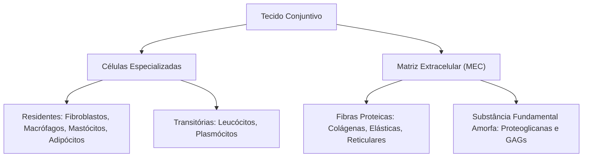
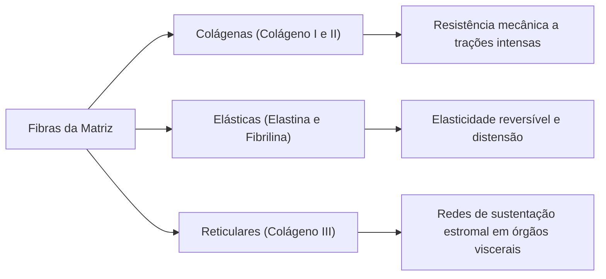
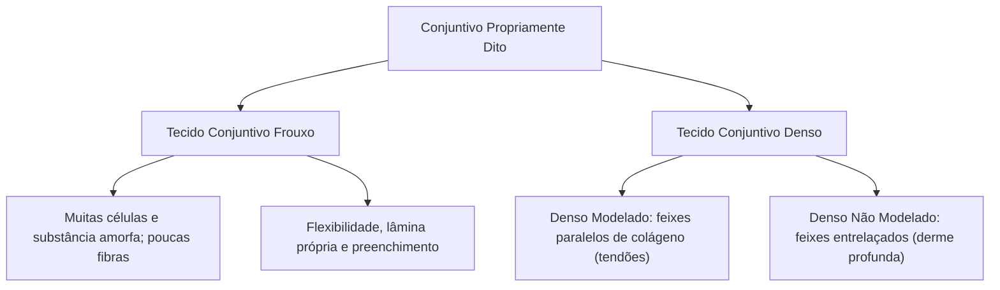
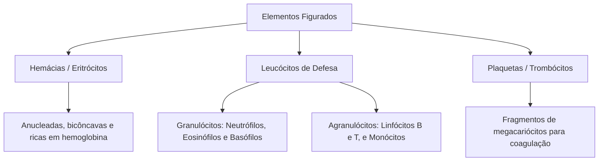
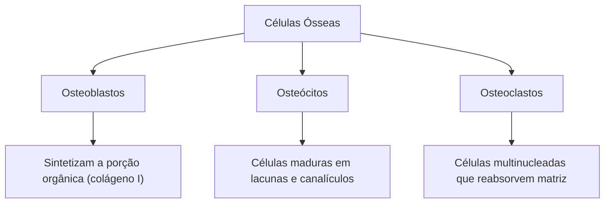
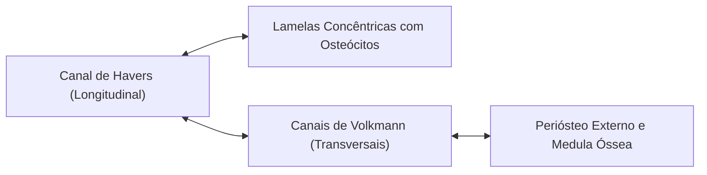

Se os epitélios especializam-se no revestimento e na secreção, os tecidos conjuntivos assumem o papel de alicerce e conexão do organismo. Eles preenchem os espaços vazios entre os demais tecidos. Também ancoram os epitélios, conduzem vasos e nervos, suportam trações mecânicas intensas e constituem reservas energéticas e barreiras imunológicas.

Originados embrionariamente a partir do **mesoderma** e do mesênquima primitivo, os tecidos conjuntivos distinguem-se pela grande quantidade de **matriz extracelular**, formada por substâncias amorfas e fibras proteicas resistentes.

> [!objetivos]
> - Compreender a composição tripartida do conjuntivo: células, fibras proteicas e substância fundamental.
> - Diferenciar as células residentes das células transitórias de defesa imunológica.
> - Comparar o tecido conjuntivo frouxo e o tecido conjuntivo denso modelado e não modelado.
> - Dominar a biologia da cartilagem, suas três variedades (hialina, elástica e fibrosa) e o papel do pericôndrio.
> - Identificar a arquitetura histológica do osso, as funções celulares (osteoblastos, osteoclastos, osteócitos) e o sistema de Havers.

## Componentes fundamentais do tecido conjuntivo

Ao contrário do epitélio, o tecido conjuntivo apresenta células amplamente dispersas. O espaço entre elas é preenchido pela **matriz extracelular (MEC)**:

### A matriz extracelular: fibras proteicas e substância fundamental

A matriz extracelular confere aos subtipos conjuntivos suas propriedades mecânicas exclusivas:

1. **Substância fundamental amorfa:** gel translúcido hidratado que preenche o espaço intercelular. É composta por **glicosaminoglicanas (GAGs)**, como o ácido hialurônico e o condroitinsulfato, associadas a proteínas para formar **proteoglicanas**. Por possuírem cargas elétricas negativas, essas moléculas retêm água de solvatação. Elas resistem à compressão e facilitam a difusão de nutrientes e gases entre os capilares e as células;
2. **Fibras proteicas extracelulares:** filamentos sintetizados sobretudo pelos fibroblastos:
   - **Fibras colágenas:** as mais abundantes do corpo humano. São formadas pelo polímero proteico **colágeno**. Apresentam grande resistência à tração longitudinal. O colágeno tipo I predomina em tendões, ligamentos, derme e matriz óssea; o colágeno tipo II é característico da cartilagem;
   - **Fibras elásticas:** compostas pela proteína **elastina** circundada por microfibrilas de **fibrilina**. Podem distender-se amplamente e recuperar o comprimento de repouso. São encontradas nos pulmões, nas artérias elásticas (como a aorta) e nos ligamentos vertebrais;
   - **Fibras reticulares:** formadas por **colágeno tipo III**. Constituem redes delgadas que sustentam o parênquima de órgãos linfoides e hematopoéticos, como o baço, linfonodos e medula óssea.

### População celular do tecido conjuntivo

As células conjuntivas dividem-se em duas categorias funcionais:

- **Fibroblastos:** são as células mais frequentes. Possuem citoplasma abundante e sintetizam os componentes da matriz extracelular (colágeno, elastina e proteoglicanas). Em repouso metabólico, tornam-se fusiformes e recebem o nome de **fibrócitos**;
- **Macrófagos:** células fagocíticas móveis originadas de **monócitos** sanguíneos. Contêm muitos lisossomos para digerir invasores e restos celulares, atuando ainda na apresentação de antígenos aos linfócitos;
- **Mastócitos:** células repletas de grânulos com mediadores químicos pré-formados: **histamina** (vasodilatador inflamatório) e **heparina** (anticoagulante natural);
- **Plasmócitos:** derivados da ativação dos **linfócitos B**. Exibem núcleo em "roda de carroça" e retículo rugoso denso para sintetizar **anticorpos (imunoglobulinas)** solúveis;
- **Adipócitos:** células que armazenam triglicérides em seu citoplasma;
- **Leucócitos transitórios:** células de defesa que migram do sangue para o conjuntivo diante de sinais inflamatórios (neutrófilos, eosinófilos e linfócitos).

## Tecido conjuntivo propriamente dito: frouxo e denso

O conjuntivo propriamente dito subdivide-se pela quantidade de fibras colágenas:

### Tecido conjuntivo frouxo

Apresenta distribuição equilibrada de substância fundamental amorfa, células e fibras delgadas sem orientação fixa. É flexível, bem vascularizado e pouco resistente a forças intensas. Suas funções abrangem:
- Preenchimento de espaços entre órgãos e sustentação de nervos e vasos sanguíneos;
- Formação da **lâmina própria** que ancora epitélios no trato digestório e respiratório;
- Meio difusor de trocas metabólicas e primeiro sítio de combate a patógenos invasores.

### Tecido conjuntivo denso

Possui predomínio esmagador de fibras colágenas espessas sobre a substância fundamental. Confere alta resistência mecânica à tração:
- **Denso modelado (regular):** fibras colágenas orientadas em feixes paralelos compactos. Suporta tensões unidirecionais intensas. Constitui os **tendões** (que fixam músculos a ossos) e os **ligamentos** (que unem ossos nas articulações móveis);
- **Denso não modelado (irregular):** feixes colágenos entrelaçados em várias direções espaciais. Resiste a forças mecânicas multidirecionais. Forma a **camada reticular da derme**, o periósteo, o pericôndrio e as cápsulas fibrosas de órgãos como rins e baço.

## Tecidos conjuntivos com propriedades especiais

Certos subtipos exibem composições peculiares de matriz ou células:

### Tecido adiposo: unilocular versus multilocular

O tecido adiposo especializou-se em armazenar gordura neutra e exercer atividade endócrina:

| Característica | Adiposo Branco (Unilocular) | Adiposo Marrom (Multilocular) |
|---|---|---|
| **Morfologia** | Uma única gotícula lipídica gigante central que comprime o núcleo na periferia | Múltiplas pequenas gotículas lipídicas e núcleo central |
| **Mitocôndrias** | Quantidade moderada de mitocôndrias comuns | Densidade altíssima de mitocôndrias com citocromos |
| **Vascularização** | Vascularização padrão | Extremamente vascularizado por capilares |
| **Ocorrência** | Predomina no **adulto** (hipoderme e gordura visceral) | Abundante no **recém-nascido** (pescoço e dorso) |
| **Função** | Reserva de energia, isolamento térmico e amortecimento | **Termogênese ativa**: gera calor por queima direta de lipídios |

> [!bizu]
> **A proteína termogenina:** o tecido adiposo multilocular gera calor graças à **termogenina (UCP-1)**. Essa proteína desacopla o gradiente de prótons mitocondrial da síntese de ATP. Assim, a energia química dissipa-se na forma de calor para manter o corpo do recém-nascido aquecido.

### Tecidos reticular, elástico e mucoso

- **Tecido reticular:** constituído por fibras de colágeno III. Forma a rede de sustentação interna do baço, linfonodos e medula óssea;
- **Tecido elástico:** feixes paralelos de fibras elásticas, presente em ligamentos vertebrais e grandes artérias;
- **Tecido mucoso:** consistência gelatinosa rica em ácido hialurônico, constituindo a geleia de Wharton do cordão umbilical.

## O tecido conjuntivo fluido: sangue e linfa

O sangue é uma variedade especializada de tecido conjuntivo de matriz líquida que percorre todo o sistema cardiovascular. Impulsionado pela bomba cardíaca, ele realiza o transporte contínuo de oxigênio e dióxido de carbono, nutrientes absorvidos pelo tubo digestório, hormônios endócrinos, eletrólitos, calor metabólico e células encarregadas da imunidade orgânica.

Sua constituição reparte-se em duas frações fundamentais:
1. **Plasma sanguíneo:** representa cerca de cinquenta e cinco por cento do volume do sangue total. É uma solução coloidal aquosa composta por noventa por cento de água e solutos vitais, com destaque para as proteínas plasmáticas. A **albumina** mantém a pressão osmótica coloidal que evita o edema tecidual; as **globulinas** incluem os anticorpos da fração gama e proteínas transportadoras; e o **fibrinogênio** atua como substrato solúvel para a formação da malha de fibrina na hemostasia;
2. **Elementos figurados:** compreendem as células e fragmentos citoplasmáticos que flutuam no plasma, estudados clinicamente por meio de **esfregaços sanguíneos** corados por misturas tipo Romanovsky (como Giemsa ou Wright):
   - **Hemácias (eritrócitos):** discos bicôncavos anucleados de sete micrômetros de diâmetro. Desprovidos de núcleo e mitocôndrias no estado maduro, obtêm energia exclusivamente por **fermentação láctica**, evitando consumir o oxigênio transportado. Acomodam em seu interior cerca de duzentos e oitenta milhões de moléculas da proteína quaternária **hemoglobina**, que ancora o oxigênio nos pulmões para distribuí-lo aos tecidos periféricos;
   - **Leucócitos (glóbulos brancos):** células nucleadas encarregadas da defesa imunológica e vigilância contra patógenos. Dividem-se em dois grandes grupos:
     * **Granulócitos:** possuem núcleos polimórficos lobados e grânulos específicos citoplasmáticos. Abrangem os **neutrófilos** (fagócitos ativos de primeira linha que migram por diapedese na infecção bacteriana aguda), os **eosinófilos** (atuantes na resposta contra helmintos parasitas e regulação de processos alérgicos) e os **basófilos** (que liberam grânulos de histamina e heparina);
     * **Agranulócitos:** exibem citoplasma sem granulações específicas e núcleos não segmentados. Compreendem os **linfócitos B e T** (orquestradores da imunidade adaptativa específica e precursores dos plasmócitos) e os **monócitos** (grandes células fagocíticas circulantes que migram para o conjuntivo para se diferenciarem em macrófagos teciduais);
   - **Plaquetas (trombócitos):** fragmentos citoplasmáticos discoides anucleados liberados pela fragmentação periférica dos **megacariócitos** na medula óssea. Contêm grânulos com fatores de agregação e enzimas que desencadeiam a formação do tampão hemostático primário em lesões vasculares.

Em íntima relação com o leito vascular, a **linfa** é o líquido intersticial reabsorvido pelos capilares linfáticos de fundo cego. Ela circula pelo sistema linfático em direção aos linfonodos, recolhendo lipídios absorvidos no intestino delgado e conduzindo linfócitos para a filtragem imunológica antes de retornar à circulação venosa central.

## Tecido cartilaginoso

O tecido cartilaginoso é uma modalidade resistente e maleável de sustentação. Apresenta matriz sólida hidratada que amortece impactos mecânicos e atua como molde para ossos em desenvolvimento.

### Matriz cartilaginosa e condrogênese

A matriz é sintetizada inicialmente por células jovens chamadas **condroblastos**. Ao serem aprisionados em cavidades da matriz chamadas **lacunas**, transformam-se em **condrócitos** maduros. Divisões mitóticas no interior de uma mesma lacuna originam os **grupos isógenos**.

> [!pegadinha]
> **Avascularidade da cartilagem:** a cartilagem é um dos raros tecidos conjuntivos **totalmente avasculares**. Não possui vasos sanguíneos, vasos linfáticos ou nervos. Sua nutrição depende da difusão a partir do **pericôndrio** (tecido conjuntivo denso que a reveste).
> Porém, muita atenção: o pericôndrio está **ausente nas cartilagens articulares** móveis e nas **fibrocartilagens**. Nessas regiões, a nutrição provém exclusivamente do líquido sinovial articular.

O crescimento cartilaginoso ocorre por duas vias:
- **Crescimento intersticial:** multiplicação dos condrócitos na profundidade da matriz;
- **Crescimento aposicional:** diferenciação de condroblastos a partir da camada interna do pericôndrio.

### Variedades de cartilagem

| Cartilagem | Matriz e Fibras | Pericôndrio | Localizações Principais |
|---|---|---|---|
| **Hialina** (a mais comum) | Fibrilas de **colágeno II** e proteoglicanas basófilas | Presente (exceto nas superfícies articulares móveis) | Traqueia, brônquios, septo nasal, laringe e extremidades das costelas |
| **Elástica** | Colágeno II e rica rede de **fibras elásticas** | Presente | Pavilhão auditivo, conduto auditivo e **epiglote** |
| **Fibrosa (Fibrocartilagem)** | Feixes densos de **colágeno I** sem substância amorfa | **Ausente** | **Discos intervertebrais**, sínfise púbica e meniscos |

## Tecido ósseo

O tecido ósseo é o componente estrutural do esqueleto dos vertebrados. Sustenta o corpo, alavanca músculos, protege órgãos vitais e armazena cálcio e fosfato.

### Matriz óssea: orgânica e inorgânica

O osso associa dois componentes fundamentais:
1. **Fração inorgânica:** representa metade da massa seca. É formada por fosfato de cálcio cristalizado em **hidroxiapatita** [Ca10(PO4)6(OH)2]. Garante rigidez e dureza;
2. **Fração orgânica (osteoide):** constituída quase toda por fibras de **colágeno tipo I** e glicoproteínas. Confere tenacidade e flexibilidade contra choques mecânicos.

### Células do tecido ósseo

O osso passa por remodelação contínua com a cooperação de três células:

- **Osteoblastos:** células cuboides situadas na periferia óssea. Sintetizam o colágeno da matriz osteoide e promovem sua calcificação mineral;
- **Osteócitos:** células maduras aprisionadas em lacunas na matriz calcificada. Comunicam-se por longos prolongamentos em canalículos mediante junções gap, mantendo a homeostase mineral;
- **Osteoclastos:** células gigantes e multinucleadas derivadas de precursores monocíticos. Secretam ácidos e enzimas que escavam a matriz na lacuna de Howship. Realizam a **reabsorção óssea** para liberar cálcio na corrente sanguínea.

> [!esquema]
> **Ação hormonal sobre o cálcio:**
> - **Paratormônio (PTH):** ativa os osteoclastos para reabsorver matriz óssea e aumentar o cálcio sanguíneo;
> - **Calcitonina:** inibe os osteoclastos e favorece a fixação do cálcio nos ossos.

### O sistema de Havers (ósteon)

No osso compacto maduro, a matriz mineralizada organiza-se em lamelas concêntricas formando os **sistemas de Havers (ósteons)**:
- **Canal de Havers:** canal longitudinal central contendo capilares sanguíneos e feixes nervosos;
- **Canais de Volkmann:** túneis transversais que comunicam os canais de Havers entre si, com a cavidade medular e com o periósteo externo;
- **Canalículos:** ramificações microscópicas que unem os osteócitos lacunares ao canal vascular central.

O osso é forrado externamente pelo **periósteo** e internamente pelo **endósteo**.

### O disco epifisário de crescimento

O alongamento dos ossos longos depende da placa de cartilagem hialina situada entre epífise e diáfise: o **disco epifisário**. Apresenta cinco zonas: repouso, proliferação em moedas, hipertrofia celular, calcificação da matriz e ossificação invasiva por vasos e osteoblastos.

> [!resolvido]
> **Caso prático de prova:**
> Uma amostra de tecido de sustentação esquelética revelou ausência de vascularização, condrócitos em lacunas, grupos isógenos e matriz extracelular basófila rica em colágeno tipo II. A biópsia foi retirada da laringe de um paciente adulto.
>
> **Diagnóstico histológico:**
> 1. Trata-se da **cartilagem hialina**, a variedade cartilaginosa mais frequente no trato respiratório;
> 2. Sua avascularidade explica o metabolismo reduzido e a dependência do pericôndrio para difusão de solutos;
> 3. O colágeno tipo II e as proteoglicanas ácidas garantem amortecimento elástico contra compressões mecânicas.

## Mapa do capítulo

A tabela consolida as características dos tecidos conjuntivos, cartilaginosos e ósseos:

| Tecido | Matriz e Fibras | Principais Células | Vascularização | Exemplo Típico |
|---|---|---|---|---|
| **Frouxo** | Equilíbrio de substância amorfa e fibras | Fibroblastos e macrófagos | Muito vascularizado | Lâmina própria sob epitélios |
| **Denso Modelado** | Feixes paralelos compactos de colágeno I | Fibrócitos comprimidos | Pouco vascularizado | **Tendões** e ligamentos |
| **Denso Não Modelado** | Feixes entrelaçados de colágeno I | Fibrócitos esparsos | Moderadamente vascularizado | Derme profunda reticular |
| **Adiposo Marrom** | Gotículas múltiplas e mitocôndrias UCP-1 | Adipócitos multiloculares | Muito vascularizado | Recém-nascidos (termogênese) |
| **Cartilagem Hialina** | Colágeno II e proteoglicanas basófilas | Condrócitos em lacunas | **Avascular** (pericôndrio) | Traqueia e anéis respiratórios |
| **Fibrocartilagem** | Feixes espessos de colágeno I | Condrócitos alinhados | **Avascular** (sem pericôndrio) | Discos intervertebrais |
| **Tecido Ósseo** | Cristais de hidroxiapatita e colágeno I | Osteoblastos, osteócitos e osteoclastos | Muito vascularizado (ósteons) | Esqueleto dos vertebrados |

### Para fixar

- O tecido conjuntivo deriva do mesênquima e é formado por células, fibras colágenas, elásticas e substância amorfa.
- O fibroblasto sintetiza matriz; o macrófago fagocita antígenos; o mastócito libera histamina e heparina na inflamação.
- O conjuntivo frouxo preenche órgãos; o denso modelado forma tendões resistentes à tração unidirecional.
- O tecido adiposo branco estoca lipídios; o marrom gera calor direto por meio da termogenina (UCP-1) em bebês.
- Hemácias são anucleadas e fermentativas; plaquetas são fragmentos de megacariócitos que atuam na hemostasia.
- A cartilagem é totalmente avascular e nutre-se pelo pericôndrio, ausente nas articulações móveis e fibrocartilagens.
- A matriz óssea mineralizada associa cristais de hidroxiapatita inorgânica a fibras de colágeno tipo I.
- Osteoblastos formam osso; osteócitos ocupam lacunas e canalículos comunicantes; osteoclastos reabsorvem a matriz.
- O sistema de Havers apresenta canais centrais longitudinais de Havers e transversais de Volkmann com lamelas concêntricas.
