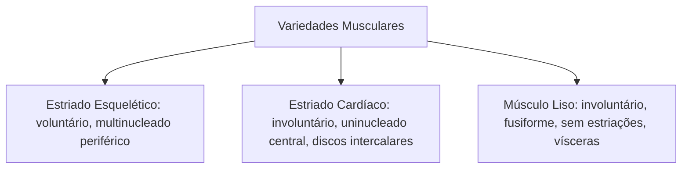
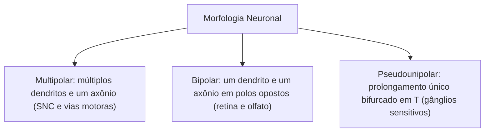
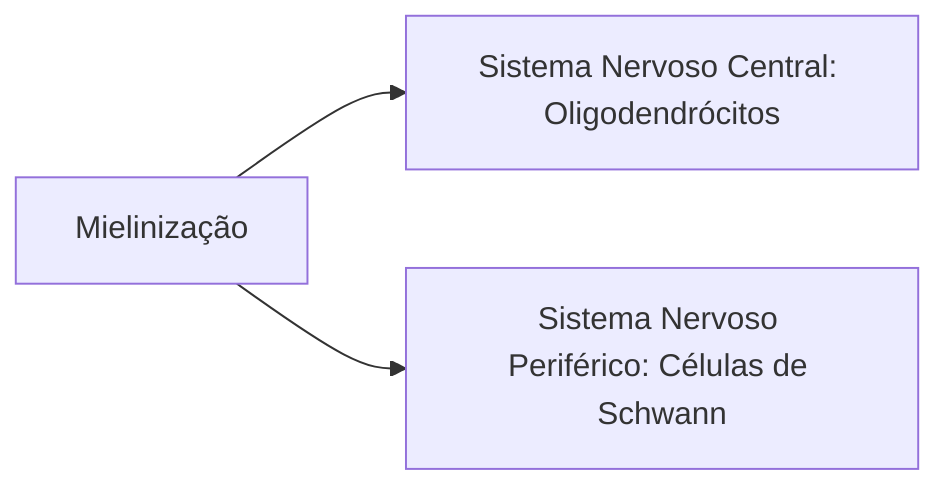

Dentre os **principais tecidos animais**, os tecidos muscular e nervoso destacam-se pela **excitabilidade elétrica**, propriedade biológica que viabiliza a geração e a propagação de potenciais de ação através de suas membranas plasmáticas. Enquanto o tecido muscular converte energia química em força mecânica para movimentação corporal e visceral, o tecido nervoso atua como a rede integradora de captação sensorial, processamento neural e emissão de ordens motoras.

Compreender as particularidades morfológicas e funcionais desses dois tecidos é basilar para a resolução de questões de histologia sobre os principais tecidos animais nas provas de concurso.

> [!objetivos]
> - Comparar os três tipos de tecido muscular: estriado esquelético, estriado cardíaco e liso.
> - Compreender a organização do sarcômero e o papel dos envoltórios conjuntivos musculares.
> - Dominar a morfologia do neurônio e sua classificação conforme o número de prolongamentos.
> - Diferenciar as células da neuroglia no sistema nervoso central e periférico.
> - Identificar o mecanismo da condução saltatória nos nós de Ranvier e os envoltórios nervosos.

## Tecido muscular estriado esquelético

O músculo estriado esquelético compõe a musculatura somática fixada aos ossos e cartilagens. Atua sob **controle motor voluntário**, sendo ativado por fibras nervosas do sistema nervoso somático.

Suas unidades morfofuncionais são as **fibras musculares esqueléticas**, células cilíndricas extraordinariamente longas (podendo atingir vários centímetros de extensão) e **multinucleadas**. Seus dezenas de núcleos celulares localizam-se na periferia da fibra, dispostos imediatamente abaixo da membrana plasmática, denominada **sarcolema**.

O sarcoplasma é repleto de feixes de miofibrilas que exibem estriações transversais alternadas de faixas claras (bandas I) e escuras (bandas A). Essa periodicidade resulta da repetição linear dos **sarcômeros**, as unidades contráteis delimitadas entre duas **linhas Z** sucessivas, onde filamentos finos de **actina** deslizam sobre filamentos grossos de **miosina** mediante hidrólise de ATP e liberação de cálcio pelo retículo sarcoplasmático.

### Envoltórios conjuntivos do músculo esquelético

A transmissão da força mecânica gerada pelos sarcômeros para os tendões depende de três camadas ordenadas de tecido conjuntivo:
1. **Endomísio:** fina bainha de conjuntivo frouxo e fibras reticulares que envolve individualmente cada fibra muscular;
2. **Perimísio:** camada de tecido conjuntivo denso que agrupa feixes paralelos de fibras em **fascículos** musculares;
3. **Epimísio:** espessa bainha externa de conjuntivo denso que reveste o ventre muscular por inteiro, prolongando-se nas extremidades para formar tendões de ancoragem óssea.

As fibras musculares adultas não sofrem mitose. Em caso de lesões parciais, a regeneração depende das **células satélites**, células-tronco unipotentes situadas entre o sarcolema e a lâmina basal que proliferam e se fundem para reparar o tecido danificado.

## Tecidos musculares estriado cardíaco e liso

Os outros dois tipos musculares operam sob controle estritamente involuntário:

### Músculo estriado cardíaco

Forma a túnica média contrátil do coração, o **miocárdio**. Suas células são curtas, cilíndricas, frequentemente ramificadas ou bifurcadas, possuindo **um ou dois núcleos centralizados**.

Sua marca registrada em microscopia são os **discos intercalares**, complexos juncionais transversais que conectam as extremidades dos cardiomiócitos. Os discos contêm desmossomos (que impedem a separação mecânica durante as sístoles vigorosas) e **junções comunicantes (gap)**, que estabelecem canais iônicos diretos entre as células, permitindo a despolarização elétrica sincronizada em onda por todo o miocárdio.

Sua contração é **involuntária, vigorosa e rítmica**, com automatismo deflagrado pelo nó sinoatrial. Os cardiomiócitos não realizam divisão celular; áreas infartadas são substituídas por cicatrizes de tecido conjuntivo fibroso sem capacidade contrátil.

### Músculo liso (não estriado)

Constituído por células fusiformes afiladas com **núcleo único central**. Não apresenta estrias transversais nem sarcômeros; seus filamentos de actina e miosina conectam-se a **corpos densos** no citoplasma e na face interna da membrana.

Produz contrações **lentas, involuntárias e sustentadas** com baixo gasto de ATP, sob regulação do sistema nervoso autônomo. Localiza-se na parede de vísceras ocas (estômago, intestinos, bexiga, útero) e na túnica média de vasos sanguíneos. Apresenta alta capacidade de divisão mitótica e pronta regeneração tecidual.

> [!pegadinha]
> **Pegadinha frequente de prova:**
> - O músculo **cardíaco** possui estriações transversais e sarcômeros (assim como o esquelético), mas seu controle é **involuntário** (assim como o liso);
> - Apenas o músculo estriado esquelético está sob comando **voluntário** somático;
> - O músculo liso **não tem sarcômeros** nem estrias, ancorando seus filamentos em corpos densos.

| Característica | Estriado Esquelético | Estriado Cardíaco | Músculo Liso |
|---|---|---|---|
| **Forma Celular** | Cilíndrica muito longa | Cilíndrica ramificada | Fusiforme afilada |
| **Núcleos** | Múltiplos periféricos | 1 ou 2 centrais | Único central |
| **Estriações** | Presentes (sarcômeros) | Presentes (sarcômeros) | Ausentes (sem sarcômeros) |
| **Discos Intercalares**| Ausentes | **Presentes** (junções gap) | Ausentes |
| **Controle Motor** | Voluntário somático | Involuntário autônomo | Involuntário autônomo |
| **Localização** | Fixado ao esqueleto | Exclusivo do coração | Parede de órgãos e vasos |

## Tecido nervoso: neurônios e neuroglia

O tecido nervoso é especializado na geração, condução e transmissão do impulso nervoso (potencial de ação). Ele divide-se em dois componentes celulares integrados: os neurônios e as células da neuroglia.

### Morfologia e classificação do neurônio

O neurônio é a unidade funcional condutora do sinal elétrico, estruturado em três domínios:
1. **Corpo celular (pericário ou soma):** centro trófico onde se situa o núcleo esférico com nucléolo evidente e acúmulos basófilos de retículo rugoso denominados **substância de Nissl**;
2. **Dendritos:** projeções curtas e amplamente ramificadas especializadas na recepção de sinais sinápticos;
3. **Axônio:** prolongamento cilíndrico único que conduz os potenciais de ação do cone de implantação até as terminações pré-sinápticas.

### Células da neuroglia (glia)

Ultrapassam os neurônios em número e exercem suporte metabólico, proteção e mielinização:
- **Astrócitos:** células estreladas do sistema nervoso central. Emitem expansões denominadas **pés vasculares** que cobrem capilares cerebrais, integrando a **barreira hematoencefálica** e controlando o microambiente iônico extracelular;
- **Oligodendrócitos:** produzem e mantêm a **bainha de mielina** ao redor de múltiplos axônios no Sistema Nervoso Central (SNC);
- **Células de Schwann:** sintetizam a bainha de mielina em torno de um único segmento axonal no Sistema Nervoso Periférico (SNP);
- **Micróglia:** pequenas células fagocíticas móveis derivadas de monócitos mesodérmicos, responsáveis pela defesa imune e fagocitose no encéfalo e medula.

> [!esquema]
> **Condução saltatória nos nós de Ranvier:** a bainha de mielina atua como isolante elétrico lipídico, interrompida em intervalos regulares chamados **nós de Ranvier**. A despolarização salta de um nó para o seguinte, acelerando dramaticamente a velocidade de propagação do impulso nervoso com menor gasto de ATP celular.

## Organização do sistema nervoso e envoltórios periféricos

Em cortes anatômicos do SNC, distinguem-se duas zonas:
- **Substância cinzenta:** abriga corpos celulares de neurônios, dendritos, porções iniciais de axônios e células gliais;
- **Substância branca:** formada predominantemente por feixes paralelos de axônios mielinizados, devendo sua cor esbranquiçada aos lipídios da mielina.

No sistema nervoso periférico, os axônios agregam-se em nervos protegidos por três envoltórios conjuntivos:
1. **Endoneuro:** conjuntivo frouxo que envolve cada fibra nervosa individual;
2. **Perineuro:** bainha celular e colágena densa que circunda feixes de fibras (fascículos), formando barreira de proteção hematonervosa;
3. **Epineuro:** camada conjuntiva densa que recobre externamente o tronco do nervo periférico.

> [!resolvido]
> **Questão prática de prova:**
> Uma lâmina histológica do sistema cardiovascular revela fibras ramificadas, estriações transversais com sarcômeros, núcleos únicos centrais e faixas densas unindo as células contíguas. O examinador indaga o nome dessas faixas e sua função fisiológica.
>
> **Resolução técnica:**
> Trata-se dos **discos intercalares** do músculo estriado cardíaco. Eles unem os cardiomiócitos por desmossomos mecânicos e contêm junções comunicantes (gap) que transmitem íons diretamente entre os citoplasmas, viabilizando a sístole cardíaca sincronizada.

## Mapa do capítulo

A tabela a seguir resume as características centrais dos tecidos muscular e nervoso:

| Estrutura Histológica | Composição e Características | Localização / Função |
|---|---|---|
| **Músculo Esquelético** | Fibras longas multinucleadas periféricas com estrias | Voluntário; fixado aos ossos do esqueleto |
| **Músculo Cardíaco** | Fibras ramificadas uninucleadas com **discos intercalares** | Involuntário rítmico; miocárdio do coração |
| **Músculo Liso** | Células fusiformes mononucleadas sem sarcômeros | Involuntário; vísceras ocas e vasos sanguíneos |
| **Sarcômero** | Unidade contrátil delimitada entre duas linhas Z | Deslizamento molecular de actina e miosina |
| **Células Satélites** | Células-tronco quiescentes do sarcolema | Regeneração de fibras musculares esqueléticas |
| **Bainha de Mielina** | Isolante lipídico sintetizado por células gliais | Oligodendrócitos (SNC) e Células de Schwann (SNP) |
| **Nós de Ranvier** | Interrupções periódicas da mielina axonal | Permitem a rápida condução saltatória do impulso |
| **Astrócitos** | Células gliais com pés vasculares | Sustentação e barreira hematoencefálica no SNC |

### Para fixar

- O músculo esquelético é voluntário, multinucleado periférico e estriado; envoltórios: endomísio, perimísio e epimísio.
- O sarcômero é a unidade de contração muscular, delimitado entre duas linhas Z com deslizamento de actina e miosina.
- O músculo cardíaco apresenta discos intercalares com desmossomos e junções gap, viabilizando o sincronismo contrátil.
- O músculo liso é involuntário, fusiforme e desprovido de estrias transversais, com alta capacidade regenerativa.
- Neurônios possuem corpo celular com substância de Nissl, dendritos receptores aferentes e axônio eferente.
- Neurônios multipolares predominam no SNC; pseudounipolares concentram-se nos gânglios sensitivos dorsais.
- A mielina é produzida por oligodendrócitos no SNC e por células de Schwann nos nervos periféricos.
- Os nós de Ranvier viabilizam a condução saltatória, acelerando o tráfego de sinais elétricos com economia energética.
- Nervos periféricos são envolvidos por endoneuro (ao redor do axônio), perineuro (no fascículo) e epineuro (no nervo).
