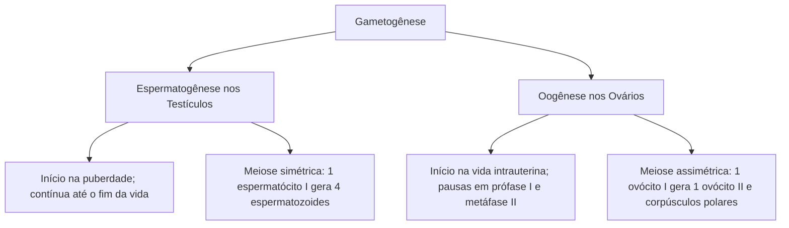
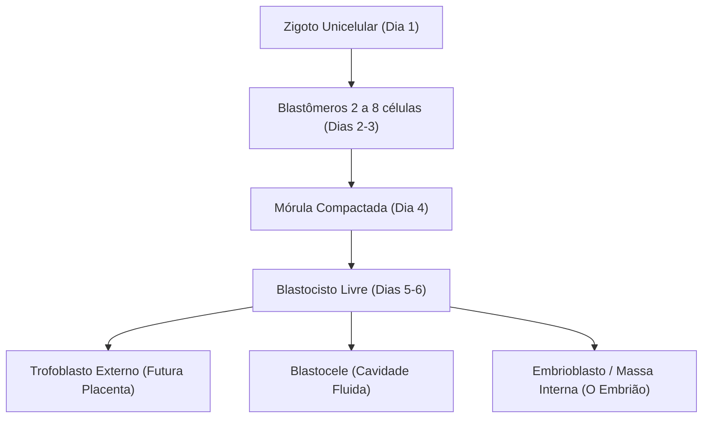
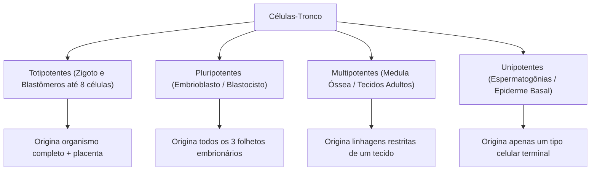

A embriologia investiga a sequência biológica pela qual uma única célula diploide, o zigoto, sofre divisões coordenadas e especialização funcional para originar um indivíduo multicelular. Como introdução indispensável ao estudo do desenvolvimento ontogenético, essa trajetória inicia-se com a formação e maturação dos gametas haploides nos órgãos reprodutores dos genitores.

Nas primeiras semanas da introdução ao desenvolvimento embrionário, eventos morfogenéticos precisos transformam o ovo fertilizado em um embrião bilaminar implantado no útero materno. O domínio dessa cronologia é frequentemente exigido nas provas de concurso.

> [!objetivos]
> - Comparar a espermatogênese e a oogênese quanto a etapas e produtos celulares.
> - Compreender a determinação cromossômica do sexo pelo gene SRY e a diferenciação gonadal.
> - Analisar os passos da fecundação, a capacitação e os bloqueios à polispermia.
> - Dominar a clivagem, a mórula, o blastocisto e a classificação das células-tronco.
> - Descrever a eclosão, a nidação e a formação do disco didérmico (epiblasto e hipoblasto).

## Gametogênese: espermatogênese e oogênese

A reprodução sexuada assenta-se na alternância entre fases nucleares haploides e diploides. A **meiose** reduz à metade o número de cromossomos característico da espécie (de 46 para 23 cromossomos por gameta), promovendo a variabilidade genética por meio do *crossing-over* (recombinação na prófase I) e da segregação independente dos cromossomos homólogos.

### Determinação genética do sexo e o gene SRY

Durante as primeiras semanas gestacionais, as gônadas primitivas do embrião são bipotenciais. A diferenciação do aparelho reprodutor depende da presença do **cromossomo Y**.

No braço curto do cromossomo Y localiza-se o gene **SRY**, que codifica uma proteína ativadora do fator Sox9. Na presença do gene SRY, a gônada indiferenciada desenvolve-se em **testículo**:
- As **células de Sertoli** diferenciam-se nos cordões testiculares, secretando o hormônio antimülleriano (AMH) que causa a regressão dos ductos paramesonéfricos femininos;
- As **células de Leydig** do interstício passam a produzir testosterona, induzindo o desenvolvimento da genitália interna masculina.

Na ausência do cromossomo Y e do gene SRY, a via feminina opera naturalmente: a gônada torna-se **ovário**, e os ductos paramesonéfricos formam o útero, as tubas uterinas e o canal vaginal superior.

### A espermatogênese e a espermiogênese

A espermatogênese ocorre nos túbulos seminíferos sob controle do LH e do FSH:
1. **Multiplicação:** espermatogônias diploides (2n) proliferam por mitose a partir da puberdade;
2. **Crescimento:** espermatogônias diferenciam-se em **espermatócitos primários (espermatócitos I)**;
3. **Maturação meiótica:**
   - A meiose I divide cada espermatócito I em dois **espermatócitos secundários (espermatócitos II)** haploides (n = 23);
   - A meiose II divide os espermatócitos II em quatro **espermátides** haploides;
4. **Espermiogênese:** transformação das espermátides em espermatozoides funcionais:
   - Formação do **acrossomo** a partir do complexo de Golgi com enzimas líticas;
   - Condensação do DNA, com substituição de histonas por **protaminas**;
   - Formação do **flagelo** propulsor a partir dos centríolos;
   - Concentração de mitocôndrias na **peça intermediária** para suprimento de ATP;
   - Eliminação de citoplasma residual fagocitado pelas células de Sertoli.

Os espermatozoides completam a maturação e adquirem motilidade no **epidídimo**.

### A oogênese e suas pausas meióticas

A **oogênese** (ou ovogênese) apresenta divisões citoplasmáticas desiguais e dormência celular:
1. **Período fetal:** oogônias proliferam por mitose no ovário fetal no primeiro trimestre. Por volta do quinto mês intrauterino, tornam-se **ovócitos primários (ovócitos I)** e entram em meiose, parando no estágio de **diplóteno da prófase I**. Nessa fase, permanecem congelados em folículos primordiais até a puberdade;
2. **Reativação na puberdade:** sob estímulo cíclico do FSH, o ovócito I completa a meiose I antes da ovulação. Distribui quase todo o citoplasma para uma única célula volumosa, o **ovócito secundário (ovócito II)**, descartando o **primeiro corpúsculo polar**;
3. **Pausa em metáfase II e ovulação:** o ovócito II inicia a meiose II, mas sofre nova parada em **metáfase II**. É nesse estágio que ocorre a ovulação, com o gameta envolvido pela **zona pelúcida** (glicoproteínas ZP1, ZP2 e ZP3) e pela *corona radiata*;
4. **Conclusão meiótica:** a meiose II só termina se houver penetração de um espermatozoide, gerando o **óvulo maduro** e o **segundo corpúsculo polar**. Sem fecundação, ele degenera em 24 horas. O folículo rompido torna-se o **corpo lúteo**, secretor de progesterona.

## Fecundação e ativação do zigoto

A fertilização ocorre na ampola da tuba uterina:

### Capacitação espermática e reação acrossômica

No trato feminino, os espermatozoides passam pela **capacitação**: glicoproteínas seminais são removidas, desestabilizando o sarcolema e aumentando a entrada de cálcio.

Ao tocar a zona pelúcida, a proteína ZP3 dispara a **reação acrossômica**:
- O acrossomo libera enzimas líticas (**hialuronidase** e **acrosina**) que abrem passagem na zona pelúcida;
- As membranas se fundem, e o núcleo masculino penetra no citoplasma do ovócito II.

> [!atencao]
> **A reação cortical contra a polispermia:** a entrada de mais de um espermatozoide é bloqueada em dois tempos. O bloqueio rápido consiste na despolarização elétrica da membrana do ovócito. O bloqueio lento (reação cortical) ocorre pela liberação de cálcio que estimula os **grânulos corticais** a exocitarem enzimas, alterando a zona pelúcida e tornando-a impenetrável.

Com a penetração, o ovócito conclui a meiose II. Ocorre a fusão dos pronúcleos masculino e feminino (**cariogamia**), reconstituindo o genoma diploide (2n = 46 cromossomos) do **zigoto**.

## Segmentação e início da gastrulação

Após a fertilização, o zigoto inicia o período de **segmentação (ou clivagem)**, caracterizado por sucessivas divisões mitóticas sem intervalo de crescimento celular.

Os padrões zoológicos de segmentação correlacionam-se diretamente com a quantidade e a distribuição do vitelo no ovo:
- **Ovos oligolécitos (isolécitos):** contêm pouco vitelo distribuído homogeneamente (equinodermos e mamíferos placentários). Sofrem **clivagem holoblástica** (total);
- **Ovos heterolécitos (telolécitos incompletos):** vitelo moderado concentrado no polo vegetativo (anfíbios). Sofrem clivagem holoblástica desigual;
- **Ovos telolécitos completos (megalécitos):** imensa massa de vitelo ocupando quase todo o citoplasma (aves, répteis e peixes). Sofrem **clivagem meroblástica discoidal**, restrita a uma pequena calota citoplasmática superficial;
- **Ovos centrolécitos:** vitelo concentrado na região central do ovo (artrópodes/insetos). Sofrem clivagem meroblástica superficial.

Na espécie humana e nos demais mamíferos placentários, a clivagem é do tipo **holoblástica rotacional**:
- Ocorre divisão completa dos blastômeros em virtude da ausência de vitelo denso;
- Na segunda rodada de divisão, um blastômero divide-se no plano meridional e o outro no plano equatorial;
- Como não há tempo para crescimento celular entre as mitoses, o volume total do embrião não se altera, e os **blastômeros** tornam-se progressivamente menores a cada ciclo.

### Mórula, compactação e blastocisto

Por volta do quarto dia pós-fertilização, o embrião atinge o estágio de **mórula**, uma esfera maciça contendo entre 12 e 16 células.

Nessa fase, ocorre o evento crítico da **compactação**: as células externas da mórula aderem firmemente umas às outras por meio de caderinas e junções de oclusão. Essa vedação isola o meio interno embrionário do líquido tubário circundante.

No quinto dia, bombas iônicas de sódio transportam fluidos para o interior da mórula, formando uma cavidade preenchida por líquido chamada **blastocele**. O embrião passa a denominar-se **blastocisto**:
1. **Trofoblasto:** camada externa de células epiteliais que delimita a blastocele, encarregada da fixação uterina e da formação da placenta;
2. **Embrioblasto (massa celular interna):** agrupamento celular localizado em um dos polos da blastocele, que originará todos os tecidos do feto e os folhetos germinativos durante a gastrulação.

## Diferenciação celular e noções sobre células-tronco

Todas as células somáticas de um organismo possuem o mesmo genoma herdado do zigoto. A transformação de células precursoras indiferenciadas em tecidos especializados recebe o nome de **diferenciação celular**.

Esse fenômeno é governado pela **expressão gênica diferencial**:
- Fatores de transcrição específicos ativam determinados grupos de genes próprios de cada linhagem tecidual;
- Mecanismos epigenéticos estáveis (como a metilação de resíduos de citosina no DNA e a desacetilação de histonas) silenciam permanentemente os genes desnecessários, sem alterar a sequência de nucleotídeos da molécula de DNA;
- Células em estágio inicial de desenvolvimento mantêm genes de pluripotência ativados (como Oct4, Sox2 e Nanog), que são desativados conforme as células se especializam.

Na medicina regenerativa e na biologia celular, as **células-tronco** são caracterizadas pela capacidade de autorrenovação (divisão simétrica ou assimétrica) e potencial de diferenciação. Elas organizam-se em uma hierarquia de potência decrescente:

1. **Células totipotentes:** possuem capacidade irrestrita de gerar **todos os tecidos somáticos e reprodutivos do corpo, além de todos os anexos extraembrionários e a placenta**. São capazes de se desenvolver em um organismo completo e viável. Compreendem o zigoto e os blastômeros iniciais isolados até a fase de oito células. A separação espontânea desses blastômeros na tuba é a causa biológica dos gêmeos monozigóticos (idênticos);
2. **Células pluripotentes:** são as células-tronco embrionárias derivadas da massa celular interna (**embrioblasto**) do blastocisto. Conseguem diferenciar-se em qualquer tipo celular derivado dos três folhetos germinativos (ectoderme, mesoderme e endoderme), como neurônios, hepatócitos e cardiomiócitos. Contudo, são **incapazes de formar o trofoblasto e a placenta**, não podendo sozinhas gerar um novo organismo;
3. **Células multipotentes:** células-tronco adultas presentes em tecidos maduros, dotadas de plasticidade restrita a linhagens de uma mesma família funcional. O exemplo mais notável são as células-tronco hematopoéticas da medula óssea vermelha, que originam hemácias, todas as linhagens de leucócitos e plaquetas, além das células mesenquimais do estroma conjuntivo;
4. **Células unipotentes:** comprometidas de forma irreversível com a produção de um único tipo celular específico, mantendo a capacidade contínua de regeneração tecidual, a exemplo das espermatogônias nos testículos e das células-tronco da camada basal da epiderme.

> [!esquema]
> **Avanços biotecnológicos: células iPS:** em 2006, pesquisas demonstraram que células adultas diferenciadas (como fibroblastos da pele) podem ser reprogramadas geneticamente de volta ao estado pluripotente mediante a inserção de quatro fatores de transcrição (Oct4, Sox2, Klf4 e c-Myc). Essas células são denominadas **células-tronco pluripotentes induzidas (iPSCs)**, contornando dilemas éticos associados ao uso de embriões humanos.

## Implantação e formação do embrião didérmico

Ao sexto dia pós-fecundação, o blastocisto atinge o lúmen uterino para iniciar a **implantação (ou nidação)**:

### Eclosão embrionária (*hatching*)

Enquanto circula pelas tubas, o embrião encontra-se protegido pela zona pelúcida glicoproteica, o que impede uma gravidez ectópica prematura. Ao chegar ao útero, o trofoblasto secreta proteases que rompem a zona pelúcida, permitindo que o blastocisto emerja de seu envoltório protetor. Esse evento recebe o nome de **eclosão ou hatching**.

### Invasão endometrial pelo trofoblasto

Livre da zona pelúcida, o blastocisto entra em contato íntimo com o epitélio do endométrio. O trofoblasto divide-se rapidamente em duas porções estruturais:
- **Citotrofoblasto:** camada interna de células epiteliais mononucleadas distintas com limites bem nítidos;
- **Sinciciotrofoblasto:** massa celular externa invasiva e multinucleada, formada pela fusão contínua de células do citotrofoblasto sem membranas divisórias. Suas enzimas histolíticas digerem a matriz extracelular endometrial e erodem capilares maternos, implantando o embrião profundamente na parede do útero.

O sinciciotrofoblasto é a fonte primária do hormônio **gonadotrofina coriônica humana (hCG)**. O hCG sinaliza ao corpo lúteo ovariano para continuar produzindo progesterona, impedindo a menstruação e a perda do concepto nas semanas iniciais da gestação.

### O disco embrionário bilaminar

Durante a segunda semana do desenvolvimento, o embrioblasto organiza-se espacialmente em duas camadas epiteliais superpostas, formando o **disco embrionário didérmico (ou bilaminar)**:
1. **Epiblasto:** camada dorsal voltada para o polo de implantação, formada por células colunares altas. Uma fenda no interior dessa camada expande-se para constituir a **cavidade amniótica**, revestida pela membrana do âmnio;
2. **Hipoblasto:** camada ventral de células cuboides menores voltada para a antiga blastocele. Suas células proliferam para revestir internamente essa cavidade, que passa a denominar-se **cavidade exocelômica (ou saco vitelino primitivo)**.

No final da segunda semana, surge uma condensação linear de células na porção posterior do epiblasto: a **linha primitiva**. Sua formação marca o término da fase bilaminar e estabelece os eixos corporais primários (craniocaudal e dorsoventral), preparando o embrião para o início da gastrulação.

> [!pegadinha]
> **Atenção aos detalhes em provas:**
> - As células-tronco embrionárias do blastocisto são **pluripotentes**, e não totipotentes (não originam o trofoblasto nem a placenta);
> - Apenas o zigoto e os blastômeros até o estágio de 8 células são **totipotentes**;
> - A ovulação humana libera um **ovócito II** estacionado em metáfase II, e não um óvulo com meiose terminada.

> [!resolvido]
> **Caso prático simulado:**
> Em reprodução assistida, um embrião de cinco dias exibiu uma cavidade fluida interna (blastocele), uma camada celular periférica e uma massa celular em um dos polos. O embriologista isolou células da massa interna para cultivo celular.
>
> **Análise técnica:**
> 1. Trata-se do estágio de **blastocisto**;
> 2. A camada periférica é o trofoblasto, que formará a placenta e secretará hCG;
> 3. As células isoladas da massa interna constituem o embrioblasto, dotadas de potencial de células-tronco **pluripotentes**, capazes de diferenciar-se em qualquer tecido derivado de ectoderme, mesoderme ou endoderme.

## Mapa do capítulo

A tabela consolida a cronologia das etapas iniciais do desenvolvimento embrionário:

| Estrutura / Etapa | Evento Central | Consequência Morfofuncional |
|---|---|---|
| **Espermatogênese** | Meiose nos túbulos seminíferos | Quatro espermatozoides haploides flagelados |
| **Oogênese** | Pausas em prófase I e metáfase II | Um ovócito II com zona pelúcida e corpúsculo polar |
| **Fecundação** | Reação acrossômica e reação cortical | Bloqueio da polispermia e formação do zigoto diploide |
| **Segmentação** | Clivagens sem aumento volumétrico | Blastômeros cada vez menores dentro da zona pelúcida |
| **Mórula** | Compactação de 12 a 16 blastômeros | Isolamento do meio interno embrionário |
| **Blastocisto** | Blastocele, trofoblasto e embrioblasto | Embrioblasto com células-tronco pluripotentes |
| **Hatching** | Ruptura da zona pelúcida no 6º dia | Permite a nidação endometrial |
| **Sinciciotrofoblasto** | Invasão tecidual e produção de hCG | Ancoragem uterina e manutenção do corpo lúteo |
| **Disco Bilaminar** | Diferenciação em epiblasto e hipoblasto | Origem dos tecidos do embrião e cavidades anexas |

### Para fixar

- O gene SRY no cromossomo Y determina o sexo gonadal masculino induzindo células de Sertoli e Leydig.
- A oogênese pausa em prófase I no feto e em metáfase II na ovulação, concluindo a meiose só na fecundação.
- A capacitação e a reação acrossômica permitem a entrada do núcleo espermático; os grânulos corticais bloqueiam a polispermia.
- A segmentação gera blastômeros menores sem elevar o volume global do embrião dentro da zona pelúcida.
- A mórula compactada forma o blastocisto com blastocele, trofoblasto (placenta) e embrioblasto (feto).
- Células totipotentes originam o organismo completo e placenta; pluripotentes formam os tecidos dos três folhetos fetais.
- O hatching é a eclosão do blastocisto da zona pelúcida indispensável para a fixação no endométrio.
- O sinciciotrofoblasto multinucleado invade o endométrio e secreta hCG para manter a progesterona lútea.
- O embrião didérmico compõe-se de epiblasto (camada dorsal colunar) e hipoblasto (camada ventral cuboide).
