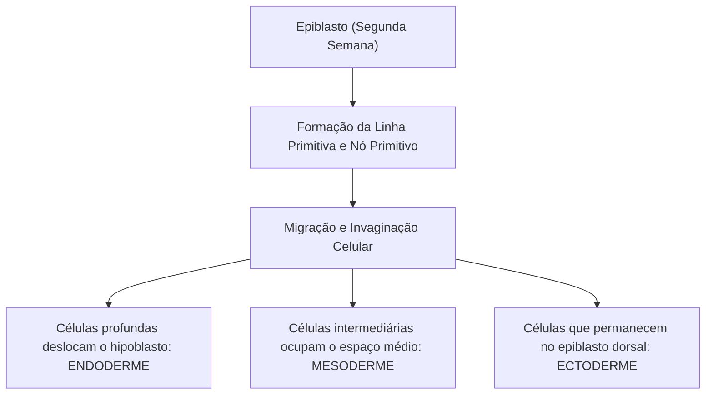
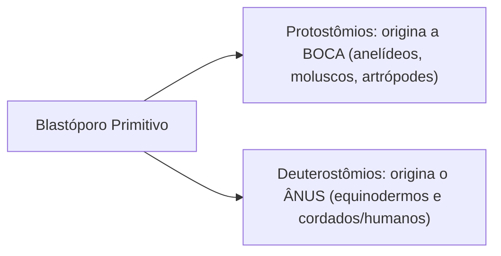
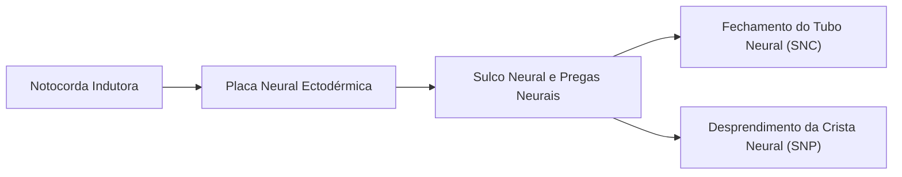
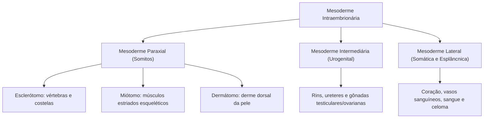
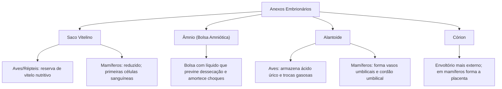
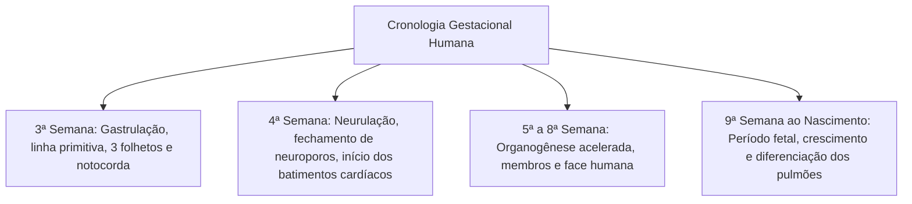

A terceira semana do desenvolvimento humano inaugura a fase mais dinâmica da embriogênese. Por meio de movimentos morfogenéticos coordenados de migração, invaginação e rearranjo celular, o disco bilaminar didérmico converte-se em um embrião trilaminar tridérmico. Esse processo crucial denomina-se **gastrulação**.

A gastrulação estabelece os três folhetos germinativos primordiais — **ectoderme, mesoderme e endoderme** —, define os eixos corporais fundamentais e prepara o terreno para a **organogênese**, período no qual os folhetos interagem para esculpir todos os órgãos e tecidos viscerais do futuro indivíduo. Em paralelo, quatro anexos extraembrionários asseguram a proteção mecânica, trocas metabólicas e sustentação fisiológica do embrião.

> [!objetivos]
> - Compreender a dinâmica celular da gastrulação, a formação da linha primitiva e o destino do blastóporo em deuterostômios.
> - Dominar a neurulação primária, o papel indutor da notocorda e os derivados do tubo neural e da crista neural.
> - Mapear os derivados da ectoderme, mesoderme (paraxial, intermediária e lateral) e endoderme.
> - Comparar a estrutura e as funções biológicas dos quatro anexos embrionários: âmnio, saco vitelino, alantoide e córion.
> - Analisar a formação e as funções da placenta humana nas trocas materno-fetais e na secreção hormonal.

## Gastrulação: a gênese dos três folhetos embrionários

A gastrulação tem início no décimo quinto dia pós-fecundação com o surgimento da **linha primitiva**, um espessamento linear na superfície dorsal do epiblasto orientado no eixo caudal-cranial. Na extremidade cefálica dessa linha, organiza-se uma depressão circular circundada por células elevadas denominada **nó primitivo (nó de Hensen)**.

### O mecanismo de invaginação e formação dos folhetos

As células epiteliais do epiblasto sofrem uma transição morfológica, perdem as junções de oclusão e migram internamente através do sulco primitivo:
1. **Endoderme embrionária:** as primeiras ondas de células que migram para o interior invadem a camada ventral do hipoblasto, substituindo gradualmente suas células originais para formar o folheto germinativo mais interno;
2. **Mesoderme intraembrionária:** as células que continuam a invaginar posicionam-se entre o epiblasto dorsal e a nova endoderme ventral, espalhando-se lateral e cranialmente para originar uma camada intermediária frouxa de tecido conjuntivo embrionário (mesênquima);
3. **Ectoderme embrionária:** as células que permanecem na superfície dorsal do epiblasto após o encerramento da migração passam a constituir o folheto externo definitivo do embrião.

### O blastóporo e o padrão deuterostômio

Na embriologia comparada dos animais triblásticos, a abertura que comunica o intestino primitivo (**arquêntero**) com o meio externo durante a gastrulação denomina-se **blastóporo**:
- **Protostômios:** o blastóporo dá origem à **boca** do animal. O ânus surge posteriormente em outra região corporal. Exemplos: artrópodes, anelídeos e moluscos;
- **Deuterostômios:** o blastóporo dá origem primariamente ao **ânus**. A abertura bucal surge secundariamente no polo oposto. Exemplos: equinodermos e cordados, incluindo a espécie humana.

> [!bizu]
> **Mnemônico de prova:**
> - **Proto**-stômio = **Primeiro** a boca (*stoma* = boca);
> - **Deutero**-stômio = **Segundo** a boca (o blastóporo vira o ânus). Todos os cordados e vertebrados são deuterostômios.

## Neurulação e os derivados da ectoderme

A **organogênese** inicia-se ao redor da quarta semana com a **neurulação**, conjunto de transformações que molda o primórdio do sistema nervoso a partir da ectoderme dorsal.

### A indução notocordal

Células mesodérmicas que invaginam através do nó primitivo migram cefalicamente até a placa pré-cordal, formando um cordão celular cilíndrico rígido no eixo axial do embrião: a **notocorda**.

A notocorda atua como o indutor primário da embriogênese:
- Define o eixo longitudinal primário e a simetria bilateral do corpo;
- Fornece sustentação mecânica esquelética inicial ao embrião;
- Secreta moléculas sinalizadoras (como a proteína *Sonic Hedgehog* - Shh) que instruem a ectoderme dorsal sobrejacente a se espessar, formando a **placa neural**;
- No adulto, a notocorda regride quase por completo, persistindo como remanescente funcional exclusivo no centro dos discos intervertebrais: o **núcleo pulposo**.

### Fechamento do tubo neural e a crista neural

Sob indução continuada, a placa neural aprofunda-se no centro. Forma-se o sulco neural delimitado por duas pregas neurais elevadas. As margens dessas pregas elevam-se e encontram-se na linha média dorsal. Elas se fundem, convertendo-se no **tubo neural** oco.

O fechamento do tubo neural inicia-se na região cervical. O processo progride em sentido cefálico e caudal. Mantêm-se aberturas temporárias chamadas **neuroporo cranial** (que se fecha no 25º dia) e **neuroporo caudal** (que se fecha no 27º dia). A falha no fechamento cranial origina anencefalia. A falha no fechamento caudal causa espinha bífida. Esses defeitos são prevenidos pela ingestão materna de **ácido fólico** no período periconcepcional.

Durante a fusão das pregas neurais, células da crista neural sofrem transição epitélio-mesênquima. Elas desprendem-se do tubo neural e migram por todo o embrião. Pela ampla capacidade de diferenciação, a crista neural é chamada de quarto folheto embrionário.

### Derivados definitivos da ectoderme

A ectoderme reparte-se em três contingentes derivados fundamentais:

| Divisão Ectodérmica | Principais Derivados Anatômicos |
|---|---|
| **Tubo Neural** | Encéfalo e medula espinal (**Sistema Nervoso Central**), neuro-hipófise, retina e nervo óptico |
| **Crista Neural** | Gânglios sensitivos e autonômicos do **Sistema Nervoso Periférico**, células de Schwann, **melanócitos** da pele, medula da glândula adrenal (células cromafins), cartilagens e ossos do viscerocrânio craniofacial |
| **Ectoderme de Superfície (Cutânea)** | **Epiderme da pele**, pelos, unhas, glândulas sudoríparas, sebáceas e mamárias, **esmalte dentário**, cristalino do olho, epitélio da cavidade nasal e bucal |

## Mesoderme e seus compartimentos

A mesoderme intraembrionária prolifera e organiza-se em três faixas longitudinais paralelas bilaterais de cada lado da notocorda:

### Mesoderme paraxial e a segmentação somítica

A faixa adjacente à notocorda divide-se em blocos celulares pareados denominados **somitos**, dispostos cranialmente até a região coccígea ao longo da quarta e quinta semanas. Cada somito subdivide-se funcionalmente em três regiões:
- **Esclerótomo:** células ventromediais que migram ao redor da notocorda e do tubo neural para formar as **vértebras e costelas** do esqueleto axial;
- **Miótomo:** células dorsomediais que originam toda a **musculatura estriada esquelética** do tronco e dos membros;
- **Dermátomo:** células externas que migram sob a ectoderme para originar a **derme da região dorsal** do corpo.

### Mesoderme intermediária

Cordão cilíndrico que conecta a mesoderme paraxial à mesoderme lateral. É responsável pela formação integral do **sistema urogenital**: néfrons renais, ductos coletores, ureteres, tecido estromal das gônadas (testículos e ovários) e ductos genitais excretores.

### Mesoderme lateral

Placa periférica delgada que se fende internamente para delimitar o **celoma intraembrionário** (futuras cavidades pericárdica, pleural e peritoneal). Divide-se em dois folhetos:
1. **Mesoderme somática (parietal):** associada à ectoderme (somatopleura), forma a derme ventrolateral, os ossos e tecidos conjuntivos dos membros;
2. **Mesoderme esplâncnica (visceral):** associada à endoderme (esplancnopleura), origina o **coração** primitivo, os vasos sanguíneos e células sanguíneas (vasculogênese e angiogênese), o baço, o córtex das glândulas suprarrenais e as camadas musculares lisas e conjuntivas do trato gastrointestinal e respiratório.

## Endoderme e seus derivados epiteliais

A endoderme é o folheto germinativo mais interno. Durante o dobramento craniocaudal e lateral do embrião na quarta semana, ela é incorporada para o interior do corpo para formar o tubo digestório primitivo (intestino anterior, médio e posterior).

A endoderme é responsável pelo **revestimento epitelial de órgãos viscerais ocos e pelo parênquima de glândulas anexas**:
- Revestimento mucoso interno de todo o tubo digestório (da faringe ao canal anal);
- Revestimento epitelial interno da laringe, traqueia, brônquios e dos alvéolos pulmonares;
- Parênquima secretor glandular do **fígado** (hepatócitos) e do **pâncreas** (ácinos e ilhotas);
- Revestimento epitelial da bexiga urinária, uretra e parte da cavidade timpânica;
- Parênquima funcional da glândula **tireoide**, glândulas **paratireoides** e do **timo**.

> [!pegadinha]
> **Atenção nas provas de folhetos embrionários:**
> - O **fígado** e o **pâncreas** possuem parênquima secretor de origem **endodérmica**, mas seu estroma de sustentação conjuntiva e seus vasos sanguíneos derivam da **mesoderme**;
> - A **derme** deriva da **mesoderme**, mas a **epiderme** deriva da **ectoderme**;
> - A glândula **adrenal (suprarrenal)** tem origem dupla: o córtex deriva da **mesoderme** e a medula deriva da **ectoderme (crista neural)**.

## Anexos embrionários comparados

Os anexos embrionários são estruturas membranosas temporárias desenvolvidas a partir dos folhetos embrionários que não fazem parte do corpo anatômico definitivo do feto, atuando em sua nutrição, respiração, excreção e hidratação.

Sua evolução filogenética representou a conquista definitiva do ambiente terrestre pelos tetrápodes **amniotas** (répteis, aves e mamíferos), libertando a reprodução da dependência obrigatória do meio aquático:

### Saco vitelino (vesícula vitelínica)

Bolsa membranosa originada da endoderme e mesoderme esplâncnica:
- Em **peixes, répteis e aves:** extremamente desenvolvida, armazena o vitelo lipoproteico abundante indispensável para nutrir o embrião durante toda a incubação;
- Em **mamíferos placentários:** apresenta-se rudimentar e praticamente desprovida de vitelo. Desempenha, contudo, duas funções primordiais transitórias no primeiro trimestre:
  1. É o sítio pioneiro da **hematopoiese embrionária** (formação das primeiras ilhotas sanguíneas e capilares na terceira semana);
  2. Abriga e abriga as **células germinativas primordiais**, que migram de sua parede em direção às gônadas em formação para originar os gametas.

### Âmnio (bolsa amniótica)

Membrana interna formada por ectoderme e mesoderme somática. Delimita a **cavidade amniótica**, preenchida pelo **líquido amniótico**. Suas funções vitais englobam:
- Hidratação contínua do concepto, prevenindo a dessecação em terra firme;
- Amortecimento mecânico hidrostático contra traumas físicos maternos;
- Manutenção da temperatura corporal fetal estável;
- Permissão de movimentos livres essenciais ao desenvolvimento dos ossos e músculos;
- Barreira que impede a adesão da pele do feto aos tecidos circundantes.

### Alantoide

Evaginação tubular da parede posterior do intestino primitivo (endoderme e mesoderme):
- Em **répteis e aves:** atua como reservatório de **ácido úrico** e participa da respiração;
- Em **mamíferos placentários:** apresenta-se reduzido em tamanho. Contribui para formar os **vasos sanguíneos umbilicais** do cordão umbilical. Sua porção interna involui no feto e forma o **úraco**, ligamento fibroso da bexiga urinária no adulto.

### Córion

É o anexo mais externo que envolve todos os demais anexos e o embrião:
- Em **aves e répteis:** une-se à casca do ovo para realizar as trocas gasosas;
- Em **mamíferos placentários:** projeta prolongamentos chamados **vilosidades coriônicas**, que penetram no endométrio uterino para formar a porção fetal da **placenta**.

## Desenvolvimento embrionário humano e a placenta

A **placenta** é um órgão temporário discoide hemo-corial exclusivo dos mamíferos eutérios, formado pela íntima associação entre dois tecidos:
1. **Porção fetal:** representada pelo **córion viloso** e suas árvores de vilosidades coriônicas ricas em capilares fetais;
2. **Porção materna:** representada pela **decídua basal** do endométrio gravídico, rica em glândulas secretoras e lacunas vasculares maternas.

> [!atencao]
> **A barreira placentária:** o sangue materno e o sangue fetal **nunca se misturam diretamente** em condições normais de gestação. O oxigênio e a glicose materna difundem-se através da fina barreira tecidual das vilosidades coriônicas para o sangue do feto, enquanto o dióxido de carbono e a ureia fetal migram no sentido inverso.
> A placenta realiza trocas respiratórias, nutrição ativa, excreção e confere imunidade passiva natural ao transferir anticorpos maternos da classe **IgG** para o feto.

Além das trocas de solutos, a placenta funciona como uma poderosa glândula endócrina, sintetizando hCG no início da gravidez e grandes quantidades de **progesterona, estrógenos e somatotrofina coriônica (hPL)** a partir do segundo trimestre, dispensando o corpo lúteo ovariano.

> [!resolvido]
> **Questão prática de prova:**
> Um livro didático de biologia celular apresenta três tecidos humanos adultos para que o candidato aponte os folhetos embrionários originários: o tecido nervoso do encéfalo, a musculatura estriada do bíceps braquial e o epitélio de revestimento interno do estômago.
>
> **Classificação embriológica correta:**
> 1. O encéfalo e todo o sistema nervoso central derivam da **ectoderme** (especificamente do tubo neural sob indução da notocorda);
> 2. O bíceps braquial (músculo estriado esquelético somático) origina-se da **mesoderme** (a partir do miótomo dos somitos paraxiais);
> 3. O epitélio de revestimento interno gástrico deriva da **endoderme** (tubo digestório primitivo).

## Mapa do capítulo

A tabela a seguir consolida as origens dos tecidos e a anatomia dos anexos embrionários:

| Estrutura Biológica | Folheto de Origem | Principais Derivados / Funções Fisiológicas |
|---|---|---|
| **Ectoderme** | Folheto externo do epiblasto | Sistema Nervoso (SNC e SNP), epiderme, pelos, unhas e esmalte dentário |
| **Mesoderme** | Folheto intermediário invaginado | Músculos (esquelético, cardíaco e liso), ossos, sangue, coração e rins |
| **Endoderme** | Folheto interno ventral | Revestimento do tubo digestório e respiratório, fígado e pâncreas |
| **Notocorda** | Mesoderme axial do nó primitivo | Indutor do tubo neural; forma o núcleo pulposo no adulto |
| **Âmnio** | Ectoderme e mesoderme somática | Bolsa com líquido amniótico que amortece choques e hidrata |
| **Córion** | Trofoblasto e mesoderme | Vilosidades coriônicas fetais que formam a placenta em mamíferos |
| **Saco Vitelino** | Endoderme e mesoderme | Hematopoiese inicial e abrigo de células germinativas em humanos |
| **Alantoide** | Endoderme e mesoderme | Forma os vasos do cordão umbilical e o ligamento úraco |
| **Placenta** | Córion fetal e decídua materna | Trocas de nutrientes e gases sem mistura de sangues; síntese hormonal |

### Para fixar

- A gastrulação transforma o embrião bilaminar em trilaminar (ectoderme, mesoderme e endoderme).
- O blastóporo dá origem ao ânus na espécie humana, definindo o padrão de desenvolvimento deuterostômio.
- A notocorda induz a formação da placa neural; o tubo neural gera o SNC e a crista neural origina o SNP.
- A mesoderme paraxial segmenta-se em somitos: esclerótomo (ossos axiais), miótomo (músculos) e dermátomo (derme dorsal).
- A mesoderme intermediária forma o sistema urogenital; a lateral forma coração, vasos, sangue e celoma.
- A endoderme origina o revestimento epitelial dos tratos digestório e respiratório e o parênquima do fígado e pâncreas.
- O âmnio protege contra choques mecânicos e dessecação; o saco vitelino realiza a primeira hematopoiese em humanos.
- O alantoide dá origem aos vasos do cordão umbilical; o córion forma as vilosidades da placenta.
- A placenta permite trocas gasosas e nutricionais sem mistura de sangues, além de secretar hCG e progesterona.
