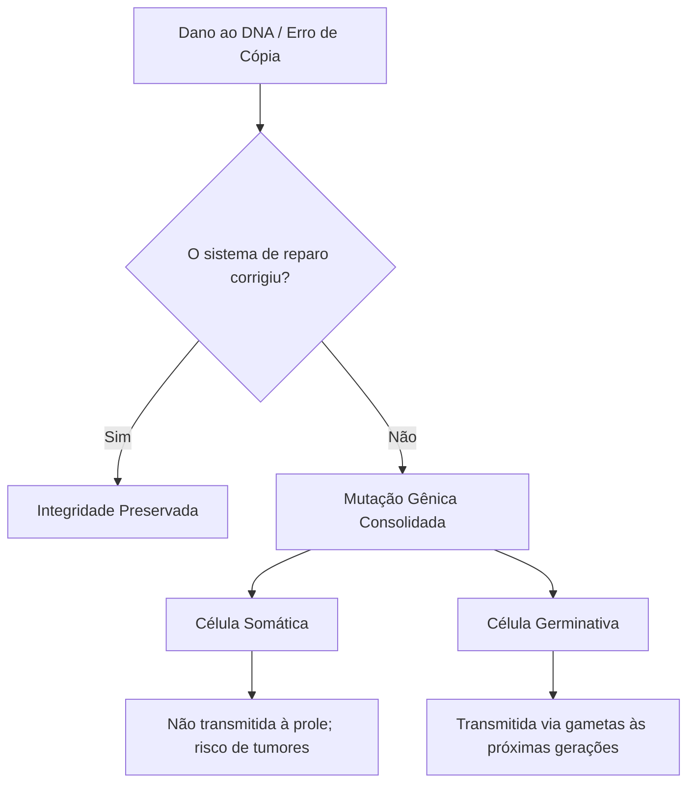
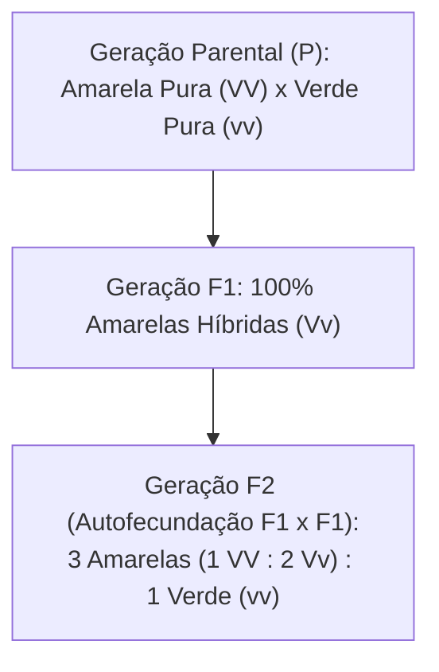
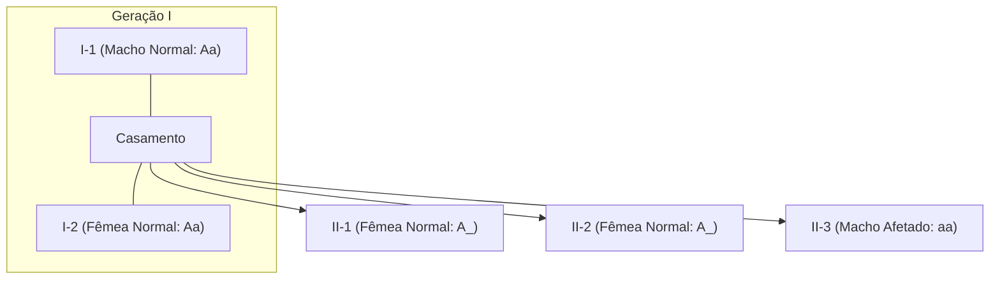
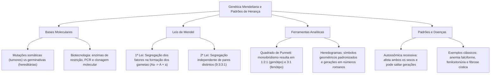

A Genética dedica-se a desvendar as leis que regem a transmissão das características biológicas ao longo das gerações. Desde os experimentos clássicos conduzidos por Gregor Mendel até o advento da biologia molecular contemporânea, a compreensão dos genes como unidades funcionais da hereditariedade revolucionou a medicina, a biotecnologia e a perícia forense. Dominar os fundamentos mendelianos e a leitura de heredogramas é basilar para compreender como as variações moleculares afetam os indivíduos.

> [!objetivos]
> - Compreender a natureza das mutações gênicas, seus agentes causadores e a distinção entre linhagens somáticas e germinativas.
> - Conhecer as ferramentas elementares da biologia molecular aplicadas à manipulação e amplificação de ácidos nucleicos.
> - Dominar a Primeira e a Segunda Leis de Mendel, relacionando os fatores hereditários ao comportamento meiótico dos cromossomos.
> - Interpretar cruzamentos genéticos utilizando o quadrado de Punnett e calcular proporções genotípicas e fenotípicas.
> - Analisar heredogramas familiares identificando o padrão de herança autossômica recessiva em enfermidades humanas.

## Mutações Gênicas e Reparo do Material Genético

A integridade do material genético constitui requisito primordial para a sobrevivência celular e a estabilidade das espécies. Durante o processo de replicação do ácido desoxirribonucleico (DNA), a enzima DNA polimerase atua com fidelidade molecular, realizando leitura de prova para remover nucleotídeos pareados incorretamente. Paralelamente, sistemas enzimáticos especializados monitoram a molécula de DNA, corrigindo lesões e quebras estruturais.

Quando esses mecanismos de reparo falham ou são sobrecarregados, ocorrem alterações permanentes na sequência de bases nitrogenadas, denominadas **mutações gênicas**. As mutações podem decorrer de erros espontâneos da replicação ou de danos provocados por **agentes mutagênicos**:
1. **Agentes físicos:** Radiações ionizantes (raios X e gama), que provocam quebras na dupla-hélice, e radiação não ionizante (raios ultravioleta), que induz a formação de dímeros de timina.
2. **Agentes químicos:** Substâncias eletrofílicas, agentes alquilantes e compostos aromáticos (como benzeno e derivados do alcatrão), que reagem covalentemente com as bases nitrogenadas.

No plano molecular, as mutações pontuais classificam-se em substituições de pares de bases, inserções e deleções. Em virtude da redundância do código genético, uma substituição de base pode ser **silenciosa**, mantendo inalterado o aminoácido original. Caso altere o aminoácido codificado, configura mutação de **sentido trocado** (*missense*), cujo exemplo clássico reside na **anemia falciforme**, na qual a substituição de uma adenina por timina provoca a troca de um ácido glutâmico por valina na hemoglobina. Por fim, se a alteração introduzir precocemente um códon de parada (*stop codon*), caracteriza-se mutação **sem sentido** (*nonsense*), gerando uma proteína truncada e não funcional.

> [!pegadinha]
> Cuidado com afirmações que tratam toda mutação como transmissível aos filhos. Apenas as alterações ocorridas nas células da linhagem germinativa (produtoras de gametas) passam hereditariamente para a prole. Mutações restritas a células somáticas (como no câncer de pele causado por exposição solar) afetam somente o tecido do indivíduo e não são transmitidas aos seus descendentes.

Importa destacar a diferença biológica quanto ao tipo celular atingido. As mutações ocorridas em **células somáticas** não são transmitidas aos descendentes, embora possam desencadear proliferação celular desordenada e neoplasias no indivíduo afetado. Por outro lado, apenas as mutações presentes em **células da linhagem germinativa** (espermatogônias, ovogônias e seus gametas maduros) são transmitidas hereditariamente à prole, fornecendo a matéria-prima essencial para a evolução e a variabilidade genética.

| Categoria da Mutação | Mecanismo Molecular | Impacto Fenotípico Típico |
| :--- | :--- | :--- |
| **Silenciosa** | Troca de nucleotídeo sem alterar o aminoácido | Inalterado devido à degeneração do código genético |
| **Sentido Trocado** | Troca de nucleotídeo que substitui um aminoácido | Pode afetar a função proteica (ex.: anemia falciforme) |
| **Sem Sentido** | Substituição que cria códon de terminação prematuro | Proteína incompleta e via de regra inativa |
| **Inserção ou Deleção** | Adição ou perda de bases (deslocamento da leitura) | Modificação completa da cadeia de aminoácidos a jusante |

## Noções Introdutórias de Biologia Molecular

O avanço das ciências biológicas permitiu dissecar os ácidos nucleicos in vitro por meio de ferramentas biotecnológicas que manipulam o genoma com alta especificidade. Essas técnicas sustentam a produção de biofármacos, a terapia gênica e a identificação molecular.

Dentre as ferramentas nucleares, sobressaem as **enzimas de restrição** (endonucleases de restrição). Produzidas naturalmente por bactérias como defesa contra vírus bacteriófagos, essas proteínas reconhecem e clivam sequências palindrômicas específicas de nucleotídeos na fita dupla de DNA. Muitas dessas enzimas geram cortes escalonados que deixam pontas de fita simples com bases expostas, conhecidas como **extremidades coesivas**. Essa propriedade viabiliza ligar fragmentos de DNA de fontes inteiramente distintas mediante a enzima DNA ligase.

Outro pilar metodológico consiste na **Reação em Cadeia da Polimerase (PCR)**. A técnica simula em escala acelerada a replicação celular, permitindo amplificar milhões de cópias de um segmento de DNA a partir de quantidades mínimas de material biológico. O procedimento baseia-se em ciclos térmicos repetitivos (desnaturação térmica, anelamento de oligonucleotídeos iniciadores ou *primers* e extensão enzimática) conduzidos por uma DNA polimerase termoestável, isolada de microrganismos extremófilos como a bactéria *Thermus aquaticus* (*Taq* polimerase).

Na **clonagem molecular**, fragmentos de DNA contendo genes de interesse são inseridos em moléculas transportadoras denominadas vetores de clonagem, predominantemente plasmídeos bacterianos. O plasmídeo recombinante é então introduzido em bactérias hospedeiras pelo processo de transformação genética. Uma vez no interior da célula bacteriana, o gene forasteiro é replicado a cada divisão celular e pode ser expresso para a síntese de proteínas terapêuticas em larga escala industrial, revolucionando a terapêutica médica, a exemplo da produção comercial da insulina humana recombinante.

| Ferramenta Molecular | Natureza Biológica | Aplicação Prática Fundamental |
| :--- | :--- | :--- |
| **Enzima de Restrição** | Endonuclease bacteriana | Corte específico de DNA em sítios palindrômicos |
| **DNA Ligase** | Enzima de união fosfodiéster | Junção covalente de fragmentos de DNA recombinante |
| **PCR (*Taq* Polimerase)** | Síntese de DNA in vitro termorresistente | Amplificação exponencial de segmentos gênicos ou STRs |
| **Plasmídeo Recombinante** | Molécula circular extracromossômica | Vetor de expressão e propagação gênica em bactérias |

## Os Experimentos e as Leis Fundamentais de Mendel

A genética clássica nasceu dos trabalhos experimentais desenvolvidos pelo monge austríaco Gregor Mendel na década de 1860. Mendel selecionou a ervilha-de-cheiro (*Pisum sativum*) como modelo biológico em razão de seus atributos vantajosos: facilidade de cultivo em canteiros, ciclo de vida curto, produção abundante de descendentes, flores adaptadas à autofecundação e existência de linhagens puras apresentando pares de caracteres qualitativos bem contrastantes (como sementes amarelas versus verdes, ou lisas versus rugosas).

Mendel garantiu inicialmente a pureza de suas linhagens parentais (geração P), observando que plantas autofecundadas por sucessivas gerações geravam descendentes invariavelmente idênticos aos pais. Ao cruzar indivíduos puros que exibiam características contrastantes (por exemplo, sementes amarelas com verdes), Mendel obteve uma primeira geração filial (F1) na qual todos os descendentes (híbridos) apresentavam uniformemente apenas uma das características: a cor amarela. Essa característica manifestada foi denominada **dominante**, enquanto a característica mascarada foi classificada como **recessiva**.

Ao permitir que as plantas híbridas da geração F1 realizassem autofecundação, Mendel observou na segunda geração filial (F2) o ressurgimento da característica recessiva verde na proporção quantitativa constante de **três indivíduos dominantes para cada indivíduo recessivo (3:1)**.

A partir dessas constatações empíricas, Mendel postulou a **Primeira Lei de Mendel** (também conhecida como Lei da Segregação dos Fatores ou Princípio da Pureza dos Gametas): cada característica hereditária de um organismo é determinada por um par de fatores que se separam durante a formação dos gametas, de maneira que cada gameta recebe apenas um fator de cada par.

Mais adiante, ao analisar a herança simultânea de duas características distintas (por exemplo, cor da semente: amarela/verde, e textura da semente: lisa/rugosa), Mendel cruzou linhagens puras duplo-homozigotas. Na geração F2, obteve quatro classes fenotípicas distintas na proporção clássica de **9:3:3:1** (9 amarelas lisas : 3 amarelas rugosas : 3 verdes lisas : 1 verde rugosa). Esse resultado fundamentou a **Segunda Lei de Mendel** (Lei da Segregação Independente): os fatores para duas ou mais características segregam-se de forma independente durante a formação dos gametas, combinando-se ao acaso.

> [!atencao]
> A Segunda Lei de Mendel (proporção 9:3:3:1) pressupõe que os genes estejam localizados em cromossomos homólogos distintos. Se dois ou mais genes estiverem situados no mesmo cromossomo, dizemos que estão em ligação gênica (*linkage*), segregando juntos para os mesmos gametas a menos que ocorra permutação (*crossing-over*).

No início do século XX, Walter Sutton e Theodor Boveri estabeleceram a **Teoria Cromossômica da Herança**. Eles demonstraram a correspondência física entre as deduções de Mendel e os eventos citológicos da meiose: os fatores mendelianos são os **genes**, localizados em posições físicas específicas chamadas locos gênicos ao longo dos cromossomos homólogos, e a segregação dos fatores nada mais é do que a separação dos cromossomos homólogos na anáfase I da divisão meiótica.

| Postulado Mendeliano | Base Citológica (Meiose) | Proporção Fenotípica em F2 |
| :--- | :--- | :--- |
| **Primeira Lei (Segregação)** | Separação dos homólogos na Anáfase I | 3 dominantes : 1 recessivo (monoibridismo) |
| **Segunda Lei (Independência)** | Disposição independente dos pares na Metáfase I | 9:3:3:1 (diibridismo clássico) |
| **Homozigose Parental** | Gametas contendo o mesmo tipo de alelo | Prole F1 uniforme (100% heterozigota) |

## Conceitos Chave em Genética e o Quadrado de Punnett

Para a resolução assertiva de problemas genéticos em provas de concursos públicos, é indispensável dominar a nomenclatura técnica adotada na disciplina:
- **Gene:** Segmento funcional de DNA que contém as instruções codificadas para a síntese de uma molécula biológica ativa (RNA ou polipeptídeo).
- **Alelos:** Formas variantes de um mesmo gene que ocupam a mesma posição relativa (loco gênico) em cromossomos homólogos.
- **Genótipo:** A constituição genética específica de um indivíduo, representada convencionalmente por combinações de letras maiúsculas e minúsculas.
- **Fenótipo:** As manifestações físicas, morfológicas, fisiológicas ou comportamentais detectáveis no indivíduo, resultantes da expressão do genótipo sob a influência moduladora do ambiente.
- **Homozigoto:** Indivíduo que possui dois alelos idênticos para determinado loco gênico (ex.: AA ou aa).
- **Heterozigoto:** Indivíduo que possui dois alelos distintos para o mesmo loco (ex.: Aa), frequentemente designado como híbrido.
- **Alelo Dominante:** Aquele que expressa plenamente seu fenótipo tanto em homozigose quanto em heterozigose (representado por letra maiúscula).
- **Alelo Recessivo:** Aquele cujo fenótipo correspondente somente se manifesta quando em dose dupla, ou seja, em homozigose estrita (representado por letra minúscula).

> [!esquema] Relação Fundamental entre Genótipo e Fenótipo
> **Genótipo** (conjunto de alelos herdados: AA, Aa, aa) + **Influência Ambiental** (fatores nutricionais, clima, estilo de vida) = **Fenótipo** (características morfológicas e fisiológicas observáveis).

O **Quadrado de Punnett**, concebido pelo geneticista britânico Reginald Punnett, representa uma matriz visual indispensável para prever a probabilidade dos tipos genotípicos e fenotípicos resultantes de determinado cruzamento biológico. Os possíveis tipos de gametas gerados por um dos parentais são dispostos nas linhas superiores, enquanto os gametas do outro progenitor organizam-se nas colunas laterais.

Ao cruzar dois indivíduos heterozigotos para um gene com dominância completa (Aa x Aa), cada progenitor produz 50% de gametas portando o alelo A e 50% de gametas portando o alelo a. O preenchimento da grade revela as combinações zigóticas:

| Gametas | **A** (50%) | **a** (50%) |
| :---: | :---: | :---: |
| **A** (50%) | **AA** (25%) | **Aa** (25%) |
| **a** (50%) | **Aa** (25%) | **aa** (25%) |

A análise da matriz demonstra a **proporção genotípica de 1:2:1** (25% AA : 50% Aa : 25% aa). Como os genótipos AA e Aa produzem o mesmo fenótipo dominante, a **proporção fenotípica resultante é de 3:1** (75% dominantes : 25% recessivos).

> [!bizu]
> Quando o cruzamento envolver um heterozigoto com um homozigoto recessivo (Aa x aa), chamado de cruzamento-teste ou retrocruzamento, a proporção genotípica e fenotípica será sempre de **1:1 (50% Aa dominantes e 50% aa recessivos)**. Esse cruzamento é utilizado para descobrir se um indivíduo fenotipicamente dominante é homozigoto ou heterozigoto.

| Tipo de Cruzamento | Proporção Genotípica | Proporção Fenotípica |
| :--- | :--- | :--- |
| **Aa x Aa (Monohíbridos)** | 1 AA : 2 Aa : 1 aa (1:2:1) | 3 Dominantes : 1 Recessivo (3:1) |
| **Aa x aa (Cruzamento-Teste)** | 1 Aa : 1 aa (1:1) | 1 Dominante : 1 Recessivo (1:1) |
| **AA x aa (Linhagens Puras)** | 100% Aa | 100% Dominantes |
| **AaBb x AaBb (Dihíbridos)** | 9 genótipos distintos | 9:3:3:1 (duas características independentes) |

## Heredogramas e Padrões de Herança Autossômica Recessiva

O estudo da genética humana e clínica apoia-se fortemente na montagem e interpretação de árvores genealógicas padronizadas, denominadas **heredogramas**. Como em seres humanos não é eticamente admissível realizar cruzamentos experimentais programados, o heredograma registra a história retrospectiva das uniões biológicas e a distribuição de fenótipos através das gerações familiares.

A simbologia convencional de um heredograma segue regras universais:
- **Quadrados** representam indivíduos do sexo biológico masculino;
- **Círculos** representam indivíduos do sexo biológico feminino;
- **Losangos** indicam indivíduos cujo sexo não foi identificado ou declarado;
- Símbolos **preenchidos ou sombreados** assinalam os indivíduos afetados pela característica ou patologia genética sob investigação;
- Símbolos **em branco** representam indivíduos fenotipicamente normais ou não afetados;
- Uma **linha horizontal** unindo dois símbolos denota cruzamento ou união conjugal (se for linha dupla, indica união consanguínea);
- **Linhas verticais** projetam-se do casamento para os descendentes (filhos), ordenados cronologicamente da esquerda para a direita;
- As gerações sucessivas são identificadas por **números romanos** (I, II, III), enquanto os indivíduos de cada geração recebem algarismos arábicos (1, 2, 3).

> [!exemplo] Exemplo prático de identificação em heredogramas
> Considere um casal normal (I-1 e I-2) que gera três filhos: duas meninas normais (II-1 e II-2) e um menino afetado por uma anomalia metabólica (II-3). 
> Como os pais são fenotipicamente normais e geraram um filho afetado, a característica é necessariamente **recessiva**. Se fosse dominante, obrigatoriamente um dos pais teria que manifestar o traço. Dessa forma, conclui-se com certeza que ambos os progenitores são heterozigotos portadores (Aa x Aa), e a criança afetada possui genótipo homozigoto recessivo (aa).

O padrão de **herança autossômica recessiva** ocorre quando o gene mutado localiza-se em um dos 22 pares de cromossomos autossomos humanos, atingindo machos e fêmeas em frequências similares. Principais características desse padrão:
1. O traço patológico comumente **salta gerações**, reaparecendo a partir de pais portadores sadios;
2. Pais sadios heterozigotos têm 25% de probabilidade de gerar um filho afetado (homozigoto recessivo);
3. Filhos de casal em que ambos os pais são afetados serão 100% afetados;
4. O casamento consanguíneo eleva a probabilidade de encontro de alelos recessivos raros.

As principais patologias humanas autossômicas recessivas cobradas em certames públicos incluem:
- **Anemia Falciforme:** Mutação de ponto no gene da globina beta que gera a hemoglobina S (HbS). Sob baixa tensão de oxigênio, a HbS polimeriza, alterando a morfologia das hemácias para o formato de foice, provocando hemólise precoce, vaso-oclusão dolorosa e isquemia tecidual.
- **Fenilcetonúria (PKU):** Erro inato do metabolismo decorrente da ausência ou deficiência da enzima hepática fenilalanina hidroxilase, responsável pela conversão do aminoácido fenilalanina em tirosina. O acúmulo de fenilalanina e seus metabólitos neurotóxicos provoca danos neurológicos severos. O diagnóstico precoce é feito pelo teste de triagem neonatal (teste do pezinho), permitindo tratamento eficaz baseado em dieta restrita em fenilalanina.
- **Fibrose Cística (Mucoviscidose):** Afecção provocada por mutações no gene CFTR, que codifica um canal condutor de íons cloreto na membrana de células epiteliais exócrinas. A disfunção compromete o transporte de água e eletrólitos, tornando secreções mucosas excessivamente viscosas. Isso acarreta obstrução crônica de vias aéreas, infecções pulmonares recorrentes e insuficiência pancreática exócrina.

| Doença Genética | Gene ou Proteína Afetada | Quadro Clínico Típico | Diagnóstico e Manejo |
| :--- | :--- | :--- | :--- |
| **Anemia Falciforme** | Hemoglobina beta (cadeia HbS) | Hemácias em foice, vaso-oclusão e anemia crônica | Eletroforese de hemoglobina / Hidratação e transfusão |
| **Fenilcetonúria (PKU)** | Fenilalanina hidroxilase (PAH) | Acúmulo de metabólitos e déficit intelectual | Teste do pezinho / Dieta restritiva de fenilalanina |
| **Fibrose Cística** | Regulador de condutância CFTR | Secreções espessas pulmonares e má absorção digestiva | Teste do suor e triagem / Fisioterapia e enzimas |

## Mapa do capítulo

### Para fixar

- **Mutações gênicas:** Alterações definitivas na sequência do DNA. Apenas mutações em células germinativas são transmitidas à prole.
- **Biotecnologia essencial:** Enzimas de restrição clivam sítios específicos; PCR amplifica fragmentos pela *Taq* polimerase; plasmídeos atuam como vetores de clonagem.
- **Primeira Lei de Mendel:** Cada caractere é determinado por um par de fatores que se separam de maneira pura durante a meiose gamética.
- **Segunda Lei de Mendel:** Pares de alelos localizados em cromossomos homólogos distintos segregam-se independentemente, gerando a proporção fenotípica 9:3:3:1 em F2.
- **Cruzamento monohíbrido (Aa x Aa):** Produz proporção genotípica 1:2:1 (25% AA, 50% Aa, 25% aa) e proporção fenotípica 3:1 (75% dominantes, 25% recessivos).
- **Heredogramas:** Quadrados representam machos, círculos representam fêmeas e símbolos escurecidos assinalam indivíduos afetados pelo fenótipo investigado.
- **Herança autossômica recessiva:** Manifesta-se exclusivamente em indivíduos homozigotos recessivos (aa), sendo frequentemente transmitida por pais sadios heterozigotos portadores (Aa).
- **Patologias recessivas humanas:** Destacam-se a anemia falciforme (troca de ácido glutâmico por valina), a fenilcetonúria (acúmulo de fenilalanina) e a fibrose cística (defeito no canal CFTR).
