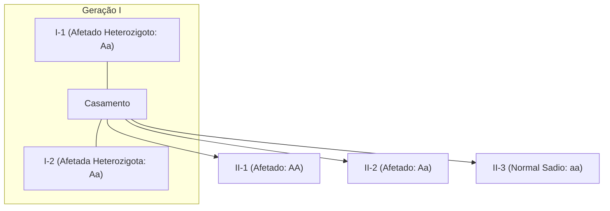
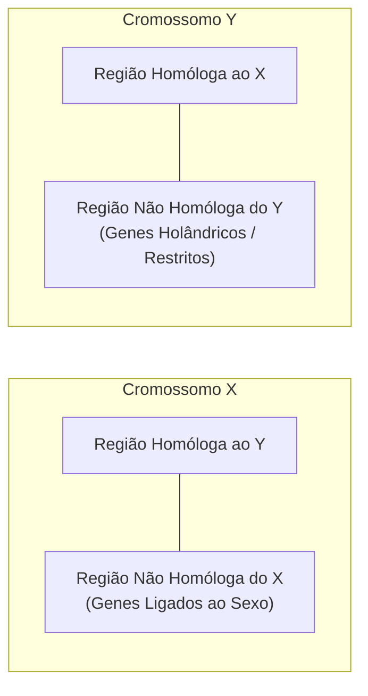
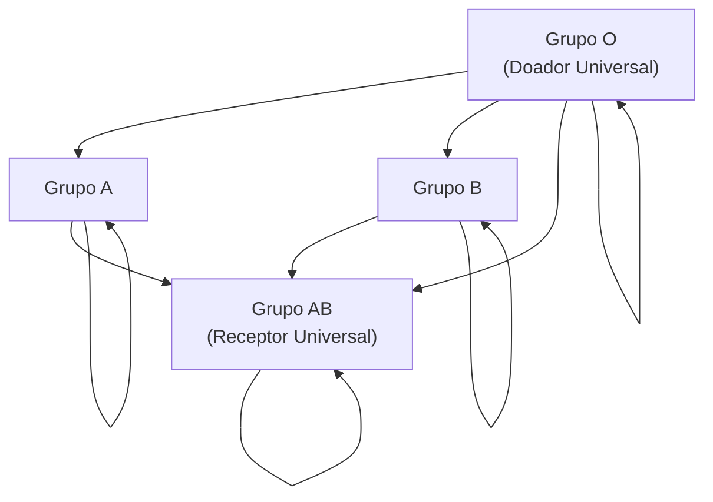
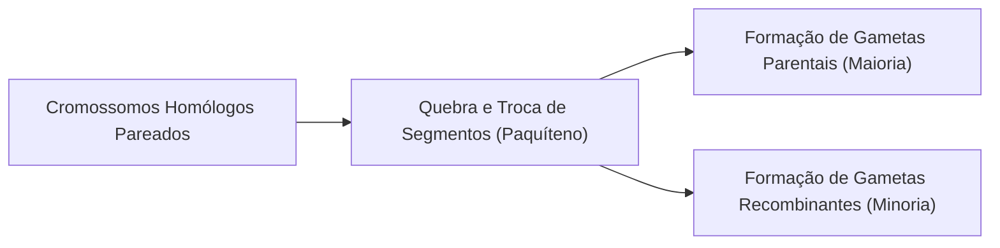
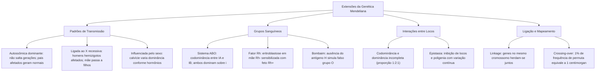

Embora as leis formuladas por Gregor Mendel tenham lançado as bases da hereditariedade biológica, o avanço da ciência revelou que muitos caracteres fenotípicos decorrem de mecanismos de transmissão mais complexos do que a simples dominância completa. Relações alélicas como codominância, dominância incompleta, polialelia, genes ligados aos cromossomos sexuais, interações entre múltiplos locos e ligação gênica ampliam o entendimento sobre como os genótipos se manifestam nos organismos vivos.

> [!objetivos]
> - Diferenciar a herança autossômica dominante da herança recessiva por meio da análise genealógica em heredogramas.
> - Compreender os mecanismos genéticos da herança ligada ao sexo no cromossomo X, da herança restrita ao Y e da herança influenciada pelo sexo.
> - Identificar as variações de dominância e calcular frequências genotípicas no sistema ABO e fator Rh.
> - Compreender a dinâmica da eritroblastose fetal e os procedimentos profiláticos de imunização materna.
> - Analisar a ligação gênica (linkage), o efeito do crossing-over e o cálculo de distâncias cromossômicas em centimorgans.

## Herança Autossômica Dominante: Características e Patologias

Na herança autossômica dominante, a presença de apenas uma cópia do alelo mutado (heterozigose: Aa) é suficiente para expressar plenamente a característica ou patologia fenotípica no indivíduo. O alelo situa-se em um dos vinte e dois pares de cromossomos autossômicos, razão pela qual homens e mulheres são afetados com idêntica probabilidade estatística.

A interpretação de heredogramas sob esse padrão apoia-se em critérios genealógicos distintivos:
1. **Ausência de saltos geracionais:** A característica manifesta-se em todas as gerações sucessivas de uma linhagem familiar, transmitida diretamente de um genitor afetado para seus descendentes.
2. **Filhos normais originados de pais afetados:** Esse é o clássico indício resolutivo em provas. Um casal em que ambos os indivíduos manifestam o fenótipo dominante pode gerar descendentes sadios. Isso ocorre quando ambos os progenitores são heterozigotos (Aa x Aa), gerando 25% de descendentes homozigotos recessivos (aa).
3. **Casal não afetado gera apenas descendência não afetada:** Indivíduos sadios possuem genótipo homozigoto recessivo (aa x aa), sendo incapazes de transmitir o alelo dominante mutado.

> [!bizu]
> Em questões de genética médica com heredogramas, procure sempre o padrão de pais iguais gerando filho diferente. Se dois pais afetados têm um filho sadio, o caráter sob estudo é indubitavelmente dominante, e ambos os pais são heterozigotos (Aa x Aa).

Dentre as enfermidades genéticas humanas autossômicas dominantes mais cobradas em concursos e vestibulares, destacam-se:
- **Polidactilia:** Presença de dedos supranumerários nas mãos ou nos pés. Trata-se de anomalia congênita anatômica corrigível cirurgicamente, que frequentemente exibe graus variáveis de penetrância incompleta.
- **Doença de Huntington:** Afecção neurodegenerativa severa decorrente da expansão anormal de trincas de nucleotídeos CAG no gene que codifica a proteína huntingtina no cromossomo 4. O quadro caracteriza-se pela perda progressiva da coordenação motora (movimentos coreicos involuntários), alterações psiquiátricas do humor e deterioração cognitiva. Os sintomas iniciam-se tipicamente na idade adulta madura (entre 35 e 50 anos), quando o indivíduo frequentemente já gerou descendência.
- **Neurofibromatose Tipo 1 (Doença de von Recklinghausen):** Causada por mutações no gene NF1 localizado no cromossomo 17, que codifica a neurofibromina (proteína supressora tumoral). Manifesta-se pelo surgimento de manchas cutâneas hipercrômicas (manchas café com leite), múltiplos neurofibromas cutâneos benignos e nódulos de Lisch na íris ocular.
- **Hipercolesterolemia Familiar:** Mutação no gene receptor de lipoproteína de baixa densidade (LDL). Indivíduos heterozigotos apresentam níveis plasmáticos de colesterol acentuadamente elevados e alto risco cardiovascular prematuro, enquanto homozigotos dominantes desenvolvem doença coronariana fulminante já na infância.

| Patologia Dominante | Mecanismo Fisiopatológico Central | Manifestações Clínicas Típicas |
| :--- | :--- | :--- |
| **Polidactilia** | Alteração no desenvolvimento esquelético distal | Dedos extras funcionais ou rudimentares |
| **Doença de Huntington** | Expansão de tripletos CAG (neurodegeneração) | Movimentos involuntários e demência progressiva |
| **Neurofibromatose Tipo 1** | Falha na supressão de tumores neurais | Manchas café com leite e neurofibromas |
| **Hipercolesterolemia** | Deficiência nos receptores hepáticos de LDL | Colesterol alto precoce e infarto agudo |

## Herança Relacionada ao Sexo: Ligada, Restrita e Influenciada

A determinação genética do sexo na espécie humana segue o sistema XY. As mulheres possuem dois cromossomos sexuais homólogos (XX), enquanto os homens são heterogaméticos, possuindo um cromossomo X e um cromossomo Y (XY). Os cromossomos sexuais apresentam uma região homóloga (que emparelha na meiose) e regiões não homólogas contendo genes exclusivos.

A **herança ligada ao sexo** corresponde aos genes situados na porção não homóloga do cromossomo X. No padrão **recessivo ligado ao X**, os homens são hemizigotos (X^a Y), expressando a característica com a presença de apenas um alelo recessivo. Já as mulheres demandam homozigose recessiva (X^a X^a) para expressar a afecção, atuando as heterozigotas (X^A X^a) como portadoras sadias. Disso decorrem três regras genealógicas cruciais:
1. A anomalia é muito mais frequente em homens do que em mulheres;
2. Mulheres afetadas transmitem obrigatoriamente o alelo mutado para 100% de seus filhos homens;
3. Homens afetados transmitem o cromossomo X mutado para todas as suas filhas (que serão portadoras), mas para nenhum de seus filhos homens (que herdam o cromossomo Y paterno).

Exemplos humanos paradigmáticos incluem o **daltonismo** (defeito na síntese de pigmentos visuais nos cones retinianos, prejudicando a distinção entre verde e vermelho) e as **hemofilias A e B** (distúrbios graves da hemostasia secundária decorrentes da deficiência dos fatores de coagulação VIII e IX, respectivamente).

> [!pegadinha]
> Cuidado com questões que afirmam que um pai hemofílico ou daltônico pode transmitir a doença ligada ao X diretamente para seu filho homem. O pai doa obrigatoriamente o cromossomo Y ao filho do sexo masculino. Portanto, filhos homens herdam a hemofilia ou o daltonismo exclusivamente de sua mãe!

Na linhagem feminina, para compensar a disparidade da dupla dose de genes do cromossomo X em relação aos homens, opera o mecanismo de **compensação de dose gênica** (hipótese de Mary Lyon). No início do desenvolvimento embrionário feminino, um dos cromossomos X condensa-se aleatoriamente em cada célula somática, tornando-se transcricionalmente inativo. Essa estrutura condensada é visualizada na microscopia óptica como o **corpúsculo de Barr** ou cromatina sexual.

No padrão **dominante ligado ao X**, o alelo manifesta-se em ambos os sexos, porém homens afetados transmitem a condição para todas as suas filhas mulheres e para nenhum de seus filhos do sexo masculino. Exemplo clássico é o raquitismo hipofosfatêmico, decorrente de defeito na reabsorção tubular renal de fosfato.

Por outro lado, a **herança restrita ao sexo (holândrica)** decorre de genes presentes exclusivamente na região não homóloga do cromossomo Y. Como o Y é transmitido unicamente pela linhagem paterna, os traços holândricos afetam apenas homens, sendo transmitidos linearmente de pai para todos os seus filhos homens (a exemplo do gene SRY, responsável pela diferenciação testicular).

Diferente das anteriores, a **herança influenciada pelo sexo** envolve genes situados em cromossomos autossômicos comuns, cuja dominância é alterada pela concentração de hormônios esteroides sexuais. O caso clássico é a **calvície hereditária**: o alelo C atua como dominante nos homens (onde genótipos CC e Cc expressam calvície sob estímulo da testosterona), comportando-se como recessivo nas mulheres (nas quais apenas a homozigose estrita CC provoca afinamento capilar acentuado).

| Padrão de Herança | Localização Genômica | Comportamento Genealógico Típico | Exemplo Clínico |
| :--- | :--- | :--- | :--- |
| **Ligada ao X Recessiva** | Porção não homóloga do X | Mais comum em homens; mãe passa ao filho | Daltonismo e Hemofilia |
| **Ligada ao X Dominante** | Porção não homóloga do X | Pai afetado transmite a todas as filhas | Raquitismo hipofosfatêmico |
| **Restrita ao Sexo (Holândrica)** | Porção não homóloga do Y | Exclusiva de homens; de pai para filho | Gene SRY (fator testicular) |
| **Influenciada pelo Sexo** | Cromossomos autossômicos | Dominância varia conforme o sexo biológico | Calvície hereditária |
| **Herança Mitocondrial** | Genoma da mitocôndria | Transmissão exclusivamente materna (óvulo) | Neuropatia óptica de Leber |

## Variações da Dominância: Codominância, Dominância Incompleta e Alelos Letais

A genética clássica mendeliana previa dominância completa em que o heterozigoto exibia fenótipo indistinguível do homozigoto dominante. Todavia, a interação entre alelos no mesmo loco pode assumir configurações bioquímicas distintas:

Na **dominância incompleta** (ou ausência de dominância), o alelo dominante não mascara por completo o alelo recessivo. Em decorrência dessa expressão parcial, o indivíduo heterozigoto exibe um **fenótipo intermediário**, perfeitamente distinguível de ambos os homozigotos parentais. Exemplo emblemático reside na flor da planta maravilha (*Mirabilis jalapa*): o cruzamento entre linhagens homozigotas vermelhas (VV) e brancas (BB) produz híbridos F1 uniformemente cor-de-rosa (VB). No cruzamento entre heterozigotos (VB x VB), as proporções genotípica e fenotípica coincidem rigorosamente em **1 vermelho (VV) : 2 rosa (VB) : 1 branco (BB)**.

Na **codominância**, os dois alelos funcionais expressam-se simultaneamente e com igual intensidade no indivíduo heterozigoto. Não há mistura ou fenótipo intermediário; ambos os produtos proteicos dos dois alelos são sintetizados integralmente. O exemplo típico na espécie humana reside no **sistema sanguíneo MN**. Indivíduos homozigotos L^M L^M possuem apenas o antígeno M na superfície de suas hemácias; homozigotos L^N L^N expressam unicamente o antígeno N; já os heterozigotos L^M L^N exibem simultaneamente ambos os antígenos M e N em sua membrana plasmática.

Os **alelos letais** representam mutações que inviabilizam a sobrevivência do indivíduo, acarretando morte pré-natal (aborto espontâneo) ou precoce. Em camundongos, o alelo amarelo (K) para a cor do pelo é dominante sobre o aguti (k). Todavia, embriões homozigotos dominantes (KK) morrem durante a gestação. Dessa forma, o cruzamento entre camundongos amarelos heterozigotos (Kk x Kk) produz descendentes vivos na **proporção fenotípica modificada de 2 amarelos : 1 aguti (2:1)**, ao invés da proporção mendeliana clássica de 3:1.

> [!esquema] Distinção Visual entre Dominância Incompleta e Codominância
> - **Dominância Incompleta:** Vermelho x Branco = Rosa (fenótipo intermediário por dosagem de pigmento).
> - **Codominância:** Tipo M x Tipo N = Tipo MN (expressão simultânea e independente de ambos os antígenos).

| Relação Alélica | Expressão no Heterozigoto | Proporção Fenotípica em F2 | Exemplo Biológico |
| :--- | :--- | :--- | :--- |
| **Dominância Completa** | Fenótipo idêntico ao homozigoto dominante | 3 Dominantes : 1 Recessivo | Ervilhas amarelas e verdes |
| **Dominância Incompleta** | Fenótipo intermediário entre os parentais | 1 : 2 : 1 | Flor da *Mirabilis jalapa* |
| **Codominância** | Expressão simultânea e plena de ambos | 1 : 2 : 1 | Sistema sanguíneo MN |
| **Alelos Letais** | Homozigotos sofrem letalidade | Proporção alterada (ex.: 2:1) | Pelagem amarela de camundongos |

## Alelos Múltiplos e Imunogenética dos Grupos Sanguíneos (ABO e Rh)

Diz-se que há **alelos múltiplos (ou polialelia)** quando um único loco gênico na população apresenta três ou mais formas alélicas alternativas geradas por mutações ao longo da história evolutiva. Muito embora uma população disponha de múltiplos alelos para aquele caractere, cada indivíduo diploide herda e abriga estritamente dois alelos (um de origem paterna e outro materna). Exemplo zoológico tradicional reside na cor da pelagem de coelhos, governada por quatro alelos organizados em hierarquia de dominância: selvagem ou aguti (C) > chinchila (c^ch) > himalaia (c^h) > albino (c).

Na espécie humana, o modelo mais importante de alelos múltiplos é o **Sistema Sanguíneo ABO**, descoberto por Karl Landsteiner. Esse sistema é controlado pelo gene *I* (isoaglutinação), localizado no cromossomo 9, que apresenta três alelos principais: I^A, I^B e i. A relação de dominância entre eles configura um caso simultâneo de dominância completa e codominância:
- I^A e I^B possuem **codominância** entre si;
- Tanto I^A quanto I^B apresentam **dominância completa sobre o alelo i**, que atua como recessivo nulo (não codifica enzima glicosiltransferase funcional).

Os alelos condicionam a produção de glicoproteínas de membrana eritrocitária denominadas **aglutinogênios** (antígenos), bem como a presença de anticorpos naturais dissolvidos no plasma sanguíneo, denominados **aglutininas**:
- **Grupo A:** Genótipos I^A I^A ou I^A i. Apresenta aglutinogênio A na membrana e aglutinina anti-B no plasma;
- **Grupo B:** Genótipos I^B I^B ou I^B i. Apresenta aglutinogênio B na membrana e aglutinina anti-A no plasma;
- **Grupo AB:** Genótipo I^A I^B. Apresenta ambos os aglutinogênios A e B na membrana e **nenhuma aglutinina** no plasma (receptor universal de hemácias);
- **Grupo O:** Genótipo ii. **Não apresenta aglutinogênios** A ou B na membrana e possui ambas as aglutininas anti-A e anti-B no plasma (doador universal de hemácias).

> [!atencao]
> Existe uma condição genética rara denominada **Fenótipo Bombaim (ou falso O)**. Ocorre devido à homozigose recessiva (hh) em um gene independente localizado no cromossomo 19. O alelo H funcional é necessário para sintetizar o antígeno H, precursor sobre o qual as enzimas codificadas por I^A e I^B ancoram os açúcares dos grupos A e B. Indivíduos hh não conseguem produzir o antígeno H, comportando-se nos testes laboratoriais de aglutinação como se fossem do grupo O, ainda que possuam alelos I^A ou I^B em seu genoma.

O **Fator Rh** constitui outro sistema independente de antígenos eritrocitários, determinado pelo gene R localizado no cromossomo 1. O alelo R (condicionador da presença do antígeno D na membrana) apresenta dominância completa sobre o alelo r:
- **Rh positivo (Rh+):** Genótipos RR ou Rr (possuem o antígeno D);
- **Rh negativo (Rh-):** Genótipo rr (ausência do antígeno D).

Diferente do sistema ABO, o plasma humano não contém anticorpos anti-Rh naturais pré-formados. O indivíduo Rh- apenas produz anticorpos anti-Rh se for exposto e sensibilizado por hemácias Rh+. Essa dinâmica fundamenta a etiologia da **Eritroblastose Fetal** (Doença Hemolítica do Recém-Nascido):
1. A condição ocorre quando uma **mãe Rh-** gera um **feto Rh+** (tendo o pai genótipo Rh+);
2. Durante o primeiro parto, o contato com o sangue fetal sensibiliza a mãe, induzindo a produção lenta de anticorpos anti-Rh do tipo IgG;
3. Em uma segunda gestação de feto Rh+, os anticorpos maternos anti-Rh (capazes de atravessar a barreira placentária) ingressam na circulação fetal, provocando destruição massiva de hemácias (hemólise), icterícia grave, anemia profunda e liberação compensatória de hemácias imaturas (eritroblastos);
4. **Prevenção clínica:** Administra-se injeção de imunoglobulina sintética anti-Rh (anti-D) na mãe Rh- não sensibilizada em até 72 horas após o primeiro parto. Esses anticorpos exógenos destroem rapidamente as hemácias fetais que entraram na circulação materna antes que o sistema imunológico da mulher inicie a resposta imune primária de sensibilização.

> [!exemplo] Exemplo Prático de Probabilidade no Sistema ABO e Rh
> Um casal formado por um homem do grupo A heterozigoto e Rh positivo heterozigoto (I^A i Rr) e uma mulher do grupo B heterozigota e Rh negativa (I^B i rr) planeja ter um filho. 
> A probabilidade de gerarem uma criança do grupo O e Rh positivo é calculada separadamente:
> - Probabilidade de ser grupo O (ii): cruzando I^A i com I^B i, obtém-se 1/4 (25%) de genótipo ii;
> - Probabilidade de ser Rh positivo (Rr): cruzando Rr com rr, obtém-se 1/2 (50%) de genótipo Rr;
> - Probabilidade combinada: 1/4 vezes 1/2 = 1/8 (12,5%).

| Grupo Sanguíneo | Aglutinogênio (Membrana) | Aglutinina (Plasma) | Doa Para | Recebe De |
| :--- | :--- | :--- | :--- | :--- |
| **A** | Antígeno A | Anti-B | A, AB | A, O |
| **B** | Antígeno B | Anti-A | B, AB | B, O |
| **AB** | Antígenos A e B | Nenhuma | AB | Todos (ABO) |
| **O** | Nenhum (apenas H) | Anti-A e Anti-B | Todos (ABO) | O |
| **Rh+** | Antígeno D presente | Nenhuma | Rh+ | Rh+, Rh- |
| **Rh-** | Ausente | Produzida se sensibilizado | Rh+, Rh- | Rh- |

## Interação Gênica, Ligação Gênica (Linkage) e Expressividade

A complexidade dos fenótipos biológicos revela fenômenos que ultrapassam a clássica correlação de um gene para um único caractere:

Na **interação gênica**, dois ou mais pares de alelos localizados em diferentes locos cromossômicos interagem coordenadamente para condicionar uma única característica fenotípica. O exemplo clássico reside na determinação do tipo de crista em galinhas, onde a interação entre dois pares de genes independentes (R e E) produz quatro formas morfológicas distintas: noz (R_E_), rosa (R_ee), ervilha (rrE_) e simples (rree), mantendo a proporção mendeliana diíbrida de 9:3:3:1 em F2.

Uma modalidade especial de interação gênica é a **epistasia**, na qual um gene (denominado epistático) inibe ou mascara a manifestação fenotípica de outro gene não alélico (denominado hipostático). Na pelagem de cães da raça labrador, o gene B define a cor preta (B_) e marrom (bb). Todavia, um gene epistático recessivo em outro loco (e) condiciona a deposição do pigmento no pelo: animais homozigotos recessivos ee são incapazes de fixar pigmento nas hastes capilares, exibindo pelagem dourada independentemente da presença dos alelos B ou b (proporção 9 pretos : 3 marrons : 4 dourados).

Na **herança quantitativa (poligenia)**, diversos pares de genes atuam com efeitos aditivos e cumulativos na formação do fenótipo, conferindo variação contínua na população que se distribui conforme uma curva de distribuição normal (curva de Gauss). É o caso da estatura corporal humana, do peso biológico e da pigmentação da pele.

Quando dois ou mais genes situam-se no mesmo cromossomo, eles não segregam de forma independente; diz-se que estão em **ligação gênica (*linkage*)**. O conjunto de genes no mesmo filamento cromossômico tende a ser herdado conjuntamente, compondo um grupo de ligação. A separação desses alelos ligados somente é viabilizada pelo fenômeno do **crossing-over (permutação meiótica)**, ocorrido durante o paquíteno da prófase I da meiose.

Thomas Hunt Morgan utilizou a mosca-das-frutas (*Drosophila melanogaster*) para demonstrar que a frequência de recombinação é diretamente proporcional à distância física entre os genes no cromossomo: quanto mais distantes dois genes se situam, maior é a probabilidade estatística de ocorrer permuta entre eles. A convenção genética estabelece que **1% de taxa de permutação corresponde a 1 unidade de recombinação (UR) ou 1 centimorgan (cM)**. Essa métrica permite construir mapas genéticos lineares determinando a ordem e a distância relativa dos locos ao longo do cromossomo.

Por fim, dois conceitos moduladores da expressão gênica merecem rigor:
- **Penetrância Gênica:** É a porcentagem estatística de indivíduos portadores de determinado genótipo que efetivamente manifestam o fenótipo associado. Quando 100% dos portadores exibem o traço, a penetrância é completa; se uma fração dos portadores não desenvolve o fenótipo, a penetrância é incompleta (a exemplo da polidactilia, cuja penetrância gira em torno de 65%).
- **Expressividade Variável:** Corresponde à intensidade ou gradação com que um mesmo genótipo se manifesta morfologicamente entre diferentes indivíduos afetados (por exemplo, um paciente com polidactilia pode exibir um dedo extra perfeitamente articulado, enquanto outro exibe apenas uma pequena verruga cartilaginosa).

| Fenômeno Genético | Mecanismo Operacional | Efeito Prático na Prole |
| :--- | :--- | :--- |
| **Epistasia** | Gene epistático inibe gene hipostático | Alteração das proporções 9:3:3:1 (ex.: 9:3:4) |
| **Herança Quantitativa** | Vários genes aditivos somam efeitos | Variação contínua em curva gaussiana |
| **Ligação Gênica (*Linkage*)** | Genes situados no mesmo cromossomo | Gametas parentais mais frequentes que recombinantes |
| **Mapeamento Genético** | Frequência de permuta proporcional à distância | 1% de recombinação = 1 centimorgan (cM) |
| **Penetrância Incompleta** | Genótipo nem sempre gera fenótipo | Portadores do alelo podem ser sadios |

## Mapa do capítulo

### Para fixar

- **Herança autossômica dominante:** O traço manifesta-se em heterozigose (Aa). Pais afetados podem ter filhos sadios se forem ambos heterozigotos. Destacam-se polidactilia, Huntington e neurofibromatose.
- **Herança ligada ao X recessiva:** Muito mais frequente em homens hemizigotos (X^a Y). Mulher afetada gera 100% de filhos homens afetados. Exemplos clássicos: daltonismo e hemofilia.
- **Compensação de dose:** Fêmeas inativam aleatoriamente um cromossomo X em células somáticas, visível como corpúsculo de Barr.
- **Herança influenciada pelo sexo:** Genes autossômicos cuja relação de dominância é condicionada por hormônios (a calvície atua como dominante em homens e recessiva em mulheres).
- **Sistema ABO:** Apresenta alelos múltiplos (I^A, I^B, i). Indivíduos do grupo O são doadores universais de hemácias; grupo AB são receptores universais de hemácias.
- **Eritroblastose fetal:** Ocorre quando mãe Rh- sensibilizada gera feto Rh+. A prevenção exige aplicação de imunoglobulina anti-D em até 72 horas pós-parto.
- **Ligação gênica (*Linkage*):** Genes no mesmo cromossomo não segregam de forma independente. A taxa de recombinação gerada pelo crossing-over define distâncias genéticas (1% = 1 cM).
- **Penetrância e expressividade:** Penetrância mede a taxa de indivíduos com o genótipo que expressam o fenótipo; expressividade quantifica o grau de intensidade da manifestação fenotípica.
