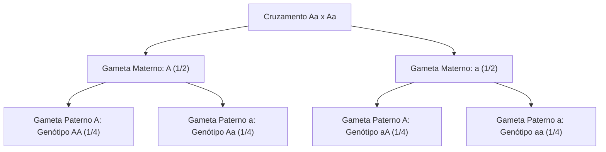
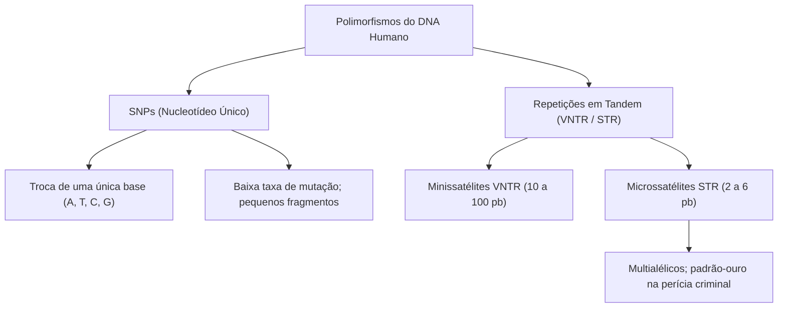
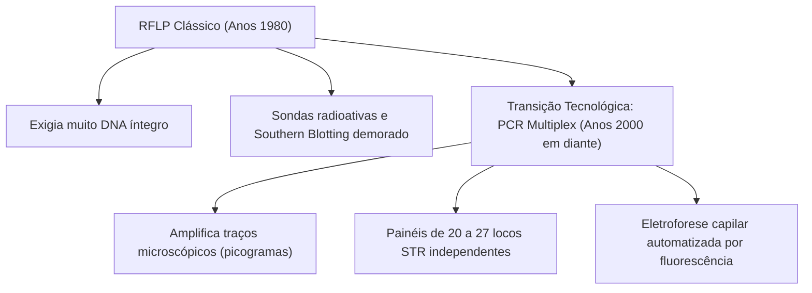
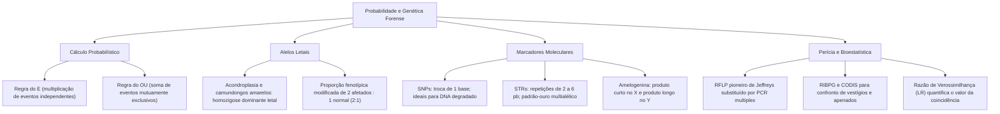

A Genética moderna combina a precisão do cálculo probabilístico com o poder analítico das tecnologias moleculares do DNA. Nas ciências periciais e na investigação científica, a elucidação de vínculos biológicos de parentesco e a identificação de vestígios em locais de crime tornaram o DNA um elemento de prova decisivo. Compreender as regras estatísticas da hereditariedade e as ferramentas de biologia molecular forense é indispensável para a formação técnica pericial.

> [!objetivos]
> - Aplicar os princípios de probabilidade (regras da multiplicação e da adição) na resolução de cruzamentos genéticos complexos.
> - Compreender a dinâmica dos alelos letais e suas repercussões nas proporções fenotípicas da descendência.
> - Diferenciar os marcadores moleculares de DNA polimórfico (SNPs, VNTRs e STRs) e justificar o uso pericial dos microssatélites.
> - Compreender a evolução metodológica da análise forense de DNA, do método clássico RFLP à PCR multiplex.
> - Analisar a formação de perfis genéticos, testes de paternidade e a interpretação estatística por razão de verossimilhança.

## Princípios de Probabilidade Aplicados à Genética

A transmissão dos genes fundamenta-se em eventos biológicos aleatórios. A meiose celular e o encontro dos gametas durante a fecundação configuram fenômenos probabilísticos. Neles, múltiplos resultados são possíveis dentro de um **espaço amostral** definido.

A probabilidade (P) de ocorrência de determinado evento corresponde à razão numérica entre o número de eventos favoráveis (m) e o número total de eventos possíveis e equiprováveis (n). Essa relação expressa-se pela equação básica P = m / n.

Dois princípios operacionais regem a resolução de problemas de probabilidade na genética:

1. **Regra da Multiplicação (Regra do "E"):** Aplica-se à ocorrência simultânea ou sucessiva de dois ou mais eventos **independentes**. Dois eventos são considerados independentes quando a concretização de um não altera a chance do outro. A probabilidade combinada é dada pelo produto das probabilidades individuais:
P(A e B) = P(A) x P(B)
Por exemplo, a chance de um casal conceber um filho do sexo feminino (probabilidade de 1/2) portador de albinismo recessivo (probabilidade de 1/4 para pais heterozigotos Aa x Aa) resulta do produto: 1/2 x 1/4 = 1/8 (12,5%).

2. **Regra da Adição (Regra do "OU"):** Aplica-se quando se busca a probabilidade de ocorrência de um evento **ou** de outro, sendo esses eventos **mutuamente exclusivos**. Nesses casos, a ocorrência de um evento impede a ocorrência simultânea do outro. A probabilidade conjunta corresponde à soma das probabilidades individuais:
P(A ou B) = P(A) + P(B)
Por exemplo, em um cruzamento entre heterozigotos (Aa x Aa), a probabilidade de gerar um descendente com fenótipo dominante decorre da soma: P(AA) + P(Aa) = 1/4 + 2/4 = 3/4 (75%).

> [!pegadinha]
> Cuidado com a independência dos nascimentos sucessivos. Se um casal já teve três filhos homens, a probabilidade de o quarto filho ser menina continua sendo rigorosamente de 1/2 (50%). Cada concepção constitui um evento biológico isolado. O histórico de partos passados não afeta a segregação cromossômica dos gametas!

> [!resolvido] Exemplo Prático de Probabilidade Combinada
> Um homem heterozigoto para o albinismo casa-se com uma mulher também heterozigota (Aa x Aa). Qual é a probabilidade de o primeiro filho do casal ser um menino albino?
> - Probabilidade de nascer uma criança do sexo masculino: 1/2;
> - Probabilidade de nascer uma criança com albinismo (aa): 1/4;
> - Como são eventos simultâneos e independentes, aplica-se a regra do E: 1/2 x 1/4 = 1/8 (12,5%).

| Regra Probabilística | Conectivo Lógico | Condição de Aplicação | Operação Matemática | Exemplo Prático |
| :--- | :---: | :--- | :---: | :--- |
| **Multiplicação** | "E" | Eventos independentes | Multiplicação: P(A) x P(B) | Nascer menino (1/2) E afetado (1/4) = 1/8 |
| **Adição** | "OU" | Eventos mutuamente exclusivos | Soma: P(A) + P(B) | Ter genótipo AA (1/4) OU Aa (2/4) = 3/4 |
| **Eventos Ordenados** | "E" com ordem | Sequência pré-determinada | Multiplicação simples | 1º menino (1/2) E 2º menina (1/2) = 1/4 |
| **Eventos Não Ordenados** | Combinação | Ordem indiferente | Soma das ordens possíveis | Um de cada sexo em dois partos = 1/2 |

## Alelos Letais e Desvios das Proporções Mendelianas

Os **alelos letais** são mutações que comprometem funções metabólicas ou estruturais vitais. Eles provocam a inviabilidade do embrião ou o óbito precoce do organismo portador antes da maturidade reprodutiva. Esse fenômeno introduz desvios nas proporções fenotípicas observadas na prole viva.

Em animais e humanos, os alelos letais manifestam-se predominantemente sob forma **dominante letal em homozigose**:
- O indivíduo homozigoto recessivo (aa) é fenotipicamente normal e saudável;
- O heterozigoto (Aa) sobrevive, mas manifesta a alteração anatômica ou fenotípica;
- O homozigoto dominante (AA) recebe dose dupla do alelo mutado. Esse indivíduo sofre letalidade durante o desenvolvimento embrionário.

O modelo biológico clássico reside na pelagem de camundongos amarelos. O cruzamento entre dois animais amarelos heterozigotos (Kk x Kk) gera no zigoto as proporções teóricas de 1 KK : 2 Kk : 1 kk. Contudo, os indivíduos KK morrem no útero e são reabsorvidos. A prole observada ao nascimento é composta exclusivamente por **2 camundongos amarelos (Kk) para 1 camundongo aguti (kk)**. Altera-se, assim, a proporção mendeliana de 3:1 para a proporção de 2:1.

Na espécie humana, exemplo de enorme relevância médica é a **acondroplasia**. Trata-se da forma mais comum de nanismo congênito desproporcional. A condição decorre de mutação no gene FGFR3. A presença do alelo mutado em heterozigose (Aa) determina o fenótipo do nanismo. Todavia, a homozigose dominante (AA) é letal in utero. Causa aborto espontâneo ou óbito neonatal por insuficiência respiratória grave.

> [!atencao]
> Todo indivíduo acondroplásico vivo é obrigatoriamente heterozigoto (Aa). Quando dois indivíduos acondroplásicos planejam ter filhos (Aa x Aa), a probabilidade de gerarem uma criança viva acondroplásica é de **2/3 (cerca de 66,7%)**. A classe homozigota dominante letal (AA) é descartada do espaço amostral dos nascidos vivos!

| Cruzamento Fictício | Genótipos Fecundados | Sobrevivência Pós-Natal | Proporção Observada |
| :--- | :--- | :--- | :--- |
| **Aa x Aa (Herança Normal)** | 1 AA : 2 Aa : 1 aa | Todos viáveis (4 classes) | 3 Dominantes : 1 Recessivo (3:1) |
| **Aa x Aa (Alelo Letal AA)** | 1 AA (morte) : 2 Aa : 1 aa | Apenas Aa e aa nascem vivos | 2 Afetados : 1 Normal (2:1) |
| **Aa x aa (Cruzamento-Teste)** | 1 Aa : 1 aa | Todos viáveis (50% de cada) | 1 Afetado : 1 Normal (1:1) |

## Fundamentos da Identificação Humana e Polimorfismos do DNA

A identificação individual consiste no procedimento técnico de demonstrar a identidade singular de um ser humano. O processo diferencia o indivíduo de todos os demais membros de sua espécie. Historicamente, os métodos periciais evoluíram através de paradigmas sucessivos:

1. **Antropometria de Bertillon (1870):** Baseava-se no registro métrico das dimensões ósseas do corpo humano. Revelou-se falha devido à existência de indivíduos com medidas corporais coincidentes. Também sofria com variações anatômicas ao longo da vida.
2. **Datiloscopia (Papiloscopia):** Fundamenta-se na análise das cristas papilares presentes nas polpas digitais. Atende plenamente aos postulados clássicos da identificação: **perenidade** (as cristas persistem até a putrefação cadavérica), **imutabilidade** (os desenhos não mudam com o tempo) e **variabilidade individual** (a diversidade de minúcias torna cada impressão digital única).
3. **Identificação Genética pelo DNA:** Atinge a resolução biológica definitiva. O genoma de dois seres humanos não aparentados é cerca de 99,9% idêntico. A fração restante de 0,1% abriga milhões de variações de sequência que individualizam cada ser humano. Apenas gêmeos univitelinos monozigóticos compartilham o mesmo DNA genômico nuclear.

Os polimorfismos de DNA úteis para fins periciais dividem-se em duas classes estruturais principais:

- **Polimorfismos de Nucleotídeo Único (SNPs):** Variações pontuais na sequência de bases nitrogenadas. Ocorrem aproximadamente uma vez a cada 300 a 1000 pares de bases ao longo do genoma. São predominantemente **bialélicos** (possuem apenas dois alelos possíveis em dado loco). Os SNPs destacam-se na análise de amostras biológicas severamente degradadas, carbonizadas ou fossilizadas. Nesses casos, exigem segmentos de amplificação muito reduzidos, com menos de 80 pares de bases.

- **Repetições em Tandem de Sequências Simples:** Regiões não codificantes caracterizadas por blocos de sequências nucleotídicas curtas repetidas consecutivamente em série. O número de unidades de repetição varia amplamente entre os indivíduos da população:
  - **Minissatélites (VNTR):** Blocos com unidades de repetição medindo entre **10 e 100 pares de bases** de comprimento;
  - **Microssatélites (STR):** Blocos com motivos de repetição medindo entre **2 e 6 pares de bases** (predominantemente tetranucleotídeos).

Os **STRs** consagram-se como o padrão-ouro internacional na genética forense contemporânea. Por possuírem dezenas de alelos na população humana, o número de combinações genotípicas para cada loco STR é muito elevado. Em um loco com 20 alelos distintos, existem 210 genótipos possíveis na população. Isso assegura extraordinário poder de discriminação estatística quando múltiplos locos são avaliados conjuntamente.

> [!exemplo] Variação Alélica em Locos Microssatélites
> Considere o loco STR denominado D16S539, localizado no cromossomo 16. O motivo de repetição desse loco é a sequência tetranucleotídica GATA. Um indivíduo pode herdar da mãe um alelo com 9 repetições [GATA]9 e do pai um alelo com 12 repetições [GATA]12, configurando o genótipo heterozigoto 9/12.

| Marcador Molecular | Unidade de Repetição | Número Típico de Alelos | Vantagem Pericial Principal |
| :--- | :--- | :---: | :--- |
| **SNP** | Troca de 1 base | 2 (bialélico) | Excelente para DNA altamente degradado ou antigo |
| **VNTR (Minissatélite)** | 10 a 100 bases | Múltiplos | Técnica histórica inicial (substituída por PCR) |
| **STR (Microssatélite)** | 2 a 6 bases | Múltiplos (multialélico) | Padrão mundial; altíssimo poder de individualização |

## Metodologias Forenses: Do RFLP Clássico à PCR Multiplex

A aplicação do DNA à justiça criminal teve início em 1983 com experimentos pioneiros conduzidos pelo geneticista britânico Sir Alec Jeffreys. Ele descobriu que sondas moleculares hibridizavam com regiões polimórficas de repetição no genoma humano. O processo produzia padrões de bandas em gel de eletroforese semelhantes a códigos de barras individuais. A técnica foi batizada de *DNA Fingerprint*.

> [!bizu] Curiosidade histórica da perícia de DNA
> A técnica de DNA Fingerprint foi aplicada judicialmente pela primeira vez no caso Narborough (Inglaterra, 1983-1986). A análise pericial permitiu inocentar um jovem suspeito que havia confessado falsamente os crimes. Paralelamente, possibilitou identificar e condenar o verdadeiro homicida em série (Colin Pitchfork) após a triagem em massa do sangue da população masculina da região.

A técnica pioneira utilizada por Jeffreys baseava-se no **RFLP (Polimorfismo de Comprimento dos Fragmentos de Restrição)** acoplado ao Southern Blotting. O DNA genômico purificado era clivado por enzimas de restrição. Em seguida, era submetido a eletroforese em gel para separar fragmentos por tamanho e transferido para membranas de náilon, sendo revelado com sondas radioativas. Todavia, o método RFLP apresentava severas desvantagens práticas: demandava grandes massas de DNA íntegro (mais de 100 nanogramas) e era incapaz de processar amostras forenses degradadas ou escassas.

Esse paradigma foi superado pela introdução da **Reação em Cadeia da Polimerase (PCR)** na tipagem de microssatélites (STRs). Os testes forenses contemporâneos operam por meio de **sistemas multiplex**. Neles, entre 20 e 27 locos STR distintos, situados em cromossomos homólogos diferentes, são amplificados simultaneamente em um único tubo de reação química.

Para que um marcador STR seja adotado internacionalmente na rotina forense, ele deve atender a critérios rigorosos:
1. Apresentar motivos de repetição de **quatro ou cinco pares de bases** (tetranucleotídeos). Isso minimiza erros de amplificação como o deslizamento da polimerase (*stutter bands*);
2. Gerar produtos de amplificação pequenos (entre 100 e 400 pares de bases). Isso permite sucesso analítico mesmo em amostras com DNA parcialmente fragmentado;
3. Estar localizado em **cromossomos diferentes** ou distantes entre si. Isso garante a segregação independente mendeliana, requisito essencial para a aplicação da regra do produto estatístico.

Os marcadores forenses são identificados por nomenclaturas padronizadas:
- Locos situados fora de genes recebem a letra D (de DNA), seguida do número do cromossomo, da letra S (indicando sequência única) e do número de ordem de descrição na literatura (por exemplo, **D21S11**, situado no cromossomo 21);
- Locos localizados no interior de íntrons de genes conhecidos recebem o acrônimo do gene correspondente (como **TH01**, localizado no gene da tirosina hidroxilase humana, ou **FGA**, no gene do fibrinogênio alfa).
- A identificação do sexo biológico do doador da amostra é realizada simultaneamente pela análise do gene da **Amelogenina**. O teste detecta um produto de 106 pares de bases no cromossomo X e um produto de 112 pares de bases no cromossomo Y. Indivíduos femininos geram um pico único (XX), enquanto indivíduos masculinos geram dois picos fluorescentes distintos (XY).

| Parâmetro Técnico | RFLP Tradicional | PCR-STR Contemporânea |
| :--- | :--- | :--- |
| **Tipo de Marcador** | Minissatélites VNTR longos | Microssatélites STR curtos |
| **Quantidade de DNA Exigida** | Elevada (> 100 ng de DNA íntegro) | Ínfima (< 0,5 ng, poucas células) |
| **Resistência à Degradação** | Nula (fragmentos grandes perdem-se) | Elevada (amplifica fragmentos curtos) |
| **Detecção dos Resultados** | Radioatividade ou quimioluminescência | Fluorescência em eletroforese capilar |
| **Tempo de Execução** | Várias semanas de bancada | Conclusão automatizada em poucas horas |

## Perfil Genético, Bancos de Dados e Interpretação Bioestatística

O procedimento de determinação do perfil genético de um vestígio biológico em laboratório pericial estrutura-se em quatro fases metodológicas sucessivas:
1. **Extração e Purificação do DNA:** Lise das membranas celulares e separação do material genético contra contaminantes e inibidores de PCR (como heme do sangue, melanina ou ácidos húmicos do solo);
2. **Quantificação Fluorométrica:** Medição exata da concentração de DNA humano presente na amostra para calibrar a quantidade ótima adicionada à reação;
3. **Amplificação Multiplex por PCR:** Síntese simultânea de milhões de cópias fluorescentes de todos os locos STR do painel padronizado;
4. **Eletroforese Capilar Automatizada:** Separação eletroforética de alta resolução em capilares de sílica com laser de leitura. O tamanho dos fragmentos fluorescentes é convertido em números inteiros de repetição, gerando o **eletroferograma** com os alelos do indivíduo.

Na **investigação de paternidade**, compara-se o perfil genético da criança com o de sua mãe biológica e o do suposto pai. Como o filho herda metade de seu genoma nuclear da mãe e metade do pai biológico, excluem-se inicialmente em cada loco os alelos maternos presentes no perfil do filho. O alelo remanescente em cada loco é denominado **alelo paterno obrigatório**. O suposto pai deve obrigatoriamente possuir esse alelo em todos os locos testados. A constatação de exclusões em múltiplos locos (habitualmente três ou mais) exclui categoricamente a paternidade biológica.

No âmbito criminal, o perfil obtido de um vestígio encontrado em cena de crime (sangue, esperma, saliva em bituca de cigarro) é confrontado com o perfil de suspeitos ou inserido em bancos de dados de perfis genéticos. No Brasil, vigora a **Rede Integrada de Bancos de Perfis Genéticos (RIBPG)**, alimentada pelo software CODIS (*Combined DNA Index System*). O sistema congrega perfis de condenados por crimes hediondos ou dolosos graves, restos mortais não identificados e amostras biológicas de familiares de pessoas desaparecidas.

A interpretação probatória da coincidência de perfis apoia-se no cálculo da **Frequência do Perfil Genético na População**. Em decorrência da localização independente dos locos STR, a probabilidade global do perfil genético completo (P) decorre da aplicação da regra do produto das frequências genotípicas de cada loco individual sob as premissas do Equilíbrio de Hardy-Weinberg:
- Para indivíduos homozigotos em dado loco (frequência p): P = p²;
- Para indivíduos heterozigotos em dado loco (frequências p e q): P = 2pq.

Ao multiplicar as frequências calculadas nos mais de vinte locos analisados, obtém-se frequentemente uma probabilidade combinada de coincidência ao acaso na ordem de 1 em 1 quintilhão.

O valor probatório forense dessa coincidência é formalizado perante o Poder Judiciário por meio da **Razão de Verossimilhança (LR - *Likelihood Ratio*)**, que compara duas hipóteses concorrentes:
- **Hipótese da Acusação (Hp):** O vestígio biológico encontrado pertence ao suspeito réu;
- **Hipótese da Defesa (Hd):** O vestígio biológico pertence a uma pessoa desconhecida qualquer da população, não aparentada ao suspeito.

A Razão de Verossimilhança corresponde matematicamente ao inverso da frequência populacional do perfil genético (LR = 1 / P). Um perfil cuja frequência calculada seja de 1 em 100 milhões gera uma LR de 100 milhões. Isso indica que os dados periciais são 100 milhões de vezes mais prováveis sob a hipótese de que a amostra biológica pertença efetivamente ao suspeito do que sob a hipótese de pertencer a outro indivíduo aleatório da população.

> [!esquema] Síntese da Interpretação Pericial por DNA
> - **Exclusão Pericial:** Se o perfil do suspeito discordar em um ou mais locos validados em relação ao vestígio da cena, ele é **excluído categoricamente** como fonte da amostra.
> - **Inclusão Pericial:** Se todos os locos coincidirem perfeitamente, calcula-se a **Razão de Verossimilhança (LR)** com base em dados de frequência populacional para quantificar a força científica da prova judicial.

| Aplicação Forense | Princípio Biológico Aplicado | Critério de Decisão Pericial |
| :--- | :--- | :--- |
| **Teste de Paternidade** | Herança meiótica biparental | Menino herda alelos obrigatórios da mãe e do pai |
| **Crime com Vítima** | Confronto de perfis de cena e suspeito | Coincidência total em 20 ou mais locos STR |
| **Rede de Bancos (CODIS)** | Rastreamento automatizado de haplótipos | Cruzamento de perfis de vestígios e apenados |
| **Amostras Degradadas** | Fragmentos curtos de ácidos nucleicos | Emprego prioritário de miniamplicons ou painéis de SNPs |

## Mapa do capítulo

### Para fixar

- **Regra do E:** Multiplicam-se as probabilidades de eventos genéticos simultâneos e independentes.
- **Regra do OU:** Somam-se as probabilidades de eventos mutuamente exclusivos na descendência.
- **Alelos letais dominantes em homozigose:** Causam morte in utero em homozigose (AA), alterando a proporção de nascidos vivos para 2:1. Destacam-se a acondroplasia e os camundongos amarelos.
- **Postulados da identificação:** Exigem perenidade, imutabilidade e variabilidade. A papiloscopia atende a esses requisitos e o DNA atinge a resolução genética definitiva.
- **Marcadores STR:** Microssatélites com repetições de 2 a 6 pares de bases (como tetranucleotídeos). Padrão-ouro da perícia criminal em virtude de sua natureza multialélica.
- **Marcadores SNP:** Variações pontuais de uma única base. Muito úteis em amostras forenses severamente degradadas por demandarem amplicons extremamente curtos.
- **Gene da Amelogenina:** Utilizado na identificação do sexo biológico; gera pico único na fêmea (XX) e pico duplo no macho (XY).
- **Razão de Verossimilhança (LR):** Inverso da frequência combinada do perfil genético populacional (LR = 1/P), expressando o grau de certeza probatória da coincidência genética em juízo.
