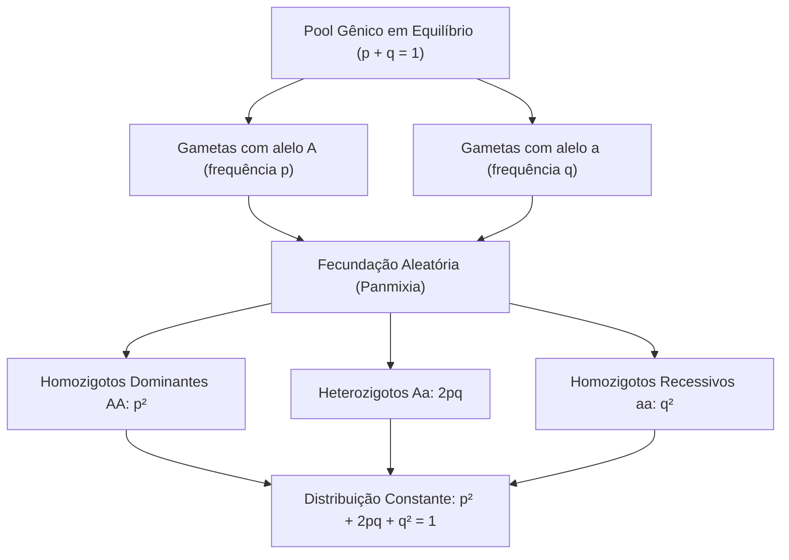
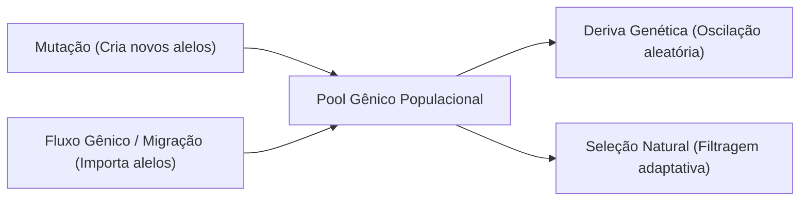
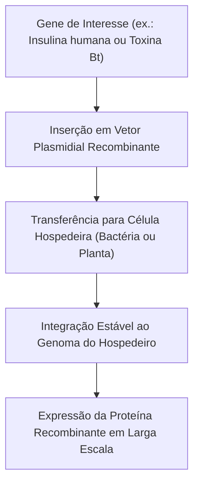

A Genética de Populações investiga a dinâmica temporal das frequências gênicas e genotípicas nas coletividades biológicas ao longo das gerações. Em vez de focar no cruzamento isolado de indivíduos, essa vertente estuda o comportamento do conjunto total de alelos compartilhados pelos membros reprodutivos de uma população. Por meio de modelos matemáticos e do estudo das forças evolutivas, a disciplina elucida os processos de especiação, adaptação ecológica e as bases da moderna biotecnologia molecular.

> [!objetivos]
> - Compreender o conceito de pool gênico e aplicar as equações do Equilíbrio de Hardy-Weinberg.
> - Reconhecer as premissas ecológicas e genéticas exigidas para a estabilidade populacional teórica.
> - Analisar os fatores evolutivos que alteram as frequências alélicas: mutação, migração, deriva genética e seleção natural.
> - Avaliar o impacto dos mecanismos de isolamento e dos sistemas de acasalamento na evolução de padrões anatômicos e fisiológicos.
> - Dominar as aplicações biotecnológicas contemporâneas: organismos transgênicos, biofármacos recombinantes e terapia gênica.

## O Teorema do Equilíbrio de Hardy-Weinberg

Em genética populacional, o conjunto completo de genes e alelos pertencentes a todos os indivíduos férteis de uma população em dado instante denomina-se **pool gênico** (ou fundo gênico). Para um loco dialélico contendo os alelos A e a, convenciona-se designar a frequência relativa do alelo dominante A pela letra `p` e a frequência do alelo recessivo a pela letra `q`. Como esses dois alelos representam a totalidade das variantes possíveis naquele loco na população diploide, estabelece-se a primeira identidade fundamental:
p + q = 1

Em 1908, o matemático britânico Godfrey Harold Hardy e o médico alemão Wilhelm Weinberg demonstraram independentemente que, sob condições específicas ideais, as frequências alélicas e genotípicas mantêm-se constantes de geração em geração. Esse modelo matemático de estabilidade é denominado **Teorema do Equilíbrio de Hardy-Weinberg**.

Para que uma população permaneça em equilíbrio ideal de Hardy-Weinberg, impõe-se a observância de premissas rigorosas:
1. **População infinitamente grande:** O número de indivíduos deve ser amplo o suficiente para que flutuações estatísticas por erro de amostragem (deriva genética) sejam desprezíveis;
2. **Panmixia estrita:** Os acasalamentos devem ocorrer de maneira perfeitamente aleatória, sem preferências por fenótipos, parentesco ou distâncias geográficas;
3. **Ausência de mutações:** Não deve haver surgimento de novos alelos nem reversão de alelos existentes;
4. **Ausência de fluxo gênico (migração):** Não ocorrem movimentos de entrada (imigração) ou saída (emigração) de indivíduos portadores de combinações gênicas;
5. **Ausência de seleção natural:** Todos os genótipos devem possuir idêntica fertilidade e taxa de sobrevivência, apresentando igual sucesso reprodutivo.

Quando essas premissas ideais são satisfeitas, o encontro ao acaso dos gametas masculinos e femininos portando os alelos A e a gera a distribuição genotípica binomial esperada para a geração seguinte:
p² + 2pq + q² = 1

Nessa formulação clássica:
- `p²` representa a frequência esperada de indivíduos homozigotos dominantes (AA);
- `2pq` expressa a frequência esperada de indivíduos heterozigotos (Aa);
- `q²` indica a frequência esperada de indivíduos homozigotos recessivos (aa).

> [!resolvido] Aplicação Médica do Teorema de Hardy-Weinberg
> Em uma população em equilíbrio, uma patologia autossômica recessiva atinge 1 em cada 10.000 recém-nascidos. Qual é a frequência de portadores sadios heterozigotos?
> 1. A frequência de indivíduos afetados corresponde a q²: q² = 1 / 10.000 = 0,0001;
> 2. Extraindo a raiz quadrada, obtém-se a frequência do alelo recessivo: q = 0,01 (1%);
> 3. Pela relação p + q = 1, calcula-se a frequência do alelo normal: p = 1 - 0,01 = 0,99 (99%);
> 4. A frequência de heterozigotos portadores é dada por 2pq: 2 x 0,99 x 0,01 = 0,0198 (aproximadamente 2% da população, ou 1 em cada 50 indivíduos). Note que alelos recessivos raros concentram-se esmagadoramente em heterozigotos!

No caso de genes localizados na porção não homóloga do cromossomo X, a aplicação do teorema requer ajuste nos homens. Como os machos mamíferos são hemizigotos (possuem apenas um cromossomo X), a frequência de homens afetados por uma anomalia ligada ao X coincide diretamente com a frequência do próprio alelo mutado na população (frequência de homens daltônicos = q). Já nas mulheres, por serem diploides para o X, a proporção de afetadas obedece ao termo quadrático (frequência de mulheres daltônicas = q²).

| Parâmetro Populacional | Expressão Matemática | Significado Prático |
| :--- | :---: | :--- |
| **Soma das Frequências Alélicas** | p + q = 1 | Totalidade de variantes no mesmo loco gênico |
| **Frequência de Homozigotos Dominantes** | p² | Indivíduos AA na geração resultante |
| **Frequência de Heterozigotos Portadores** | 2pq | Indivíduos Aa fenotipicamente normais |
| **Frequência de Homozigotos Recessivos** | q² | Indivíduos aa afetados por traço recessivo |
| **Homem com Caráter Ligado ao X** | q | Frequência genotípica idêntica à frequência alélica |
| **Mulher com Caráter Ligado ao X** | q² | Exige dose dupla do alelo recessivo no genótipo |

## Fatores Evolutivos e Padrões Anatômicos e Fisiológicos

Nas populações naturais reais, as premissas de Hardy-Weinberg quase nunca são integralmente cumpridas. As populações são finitas, ocorrem mutações, há movimentação de indivíduos e a sobrevivência é diferencial. Os agentes que promovem modificações direcionadas ou aleatórias nas frequências dos alelos são denominados **fatores evolutivos**:

1. **Mutação Gênica:** Constitui a **fonte primária originária** de toda a variabilidade genética biológica. Mutações criam alelos inéditos na população. Muito embora a taxa de mutação (designada por µ) seja quantitativamente reduzida por geração (variando entre 10⁻⁸ e 10⁻¹⁰ eventos por loco), a sua ocorrência contínua ao longo de milhões de anos introduz novidades fundamentais para a evolução adaptativa.

2. **Migração e Fluxo Gênico:** O deslocamento reprodutivo de indivíduos entre populações geográficas distintas transfere alelos de uma comunidade para outra. A entrada de imigrantes traz novos alelos ou altera a proporção das variantes locais. O fluxo gênico atua como força homogeneizadora, diminuindo as diferenças genéticas entre populações que antes estavam isoladas por barreiras ecológicas.

3. **Deriva Genética:** Consiste em oscilações puramente estocásticas (ao acaso) nas frequências alélicas, decorrentes de erro de amostragem meiótica em populações de tamanho finito. Diferente da seleção natural, a deriva não favorece alelos por critérios de adaptabilidade ecológica: alelos vantajosos podem ser eliminados por acidente e alelos deletérios podem ser fixados involuntariamente. A deriva é inversamente proporcional ao tamanho populacional, atuando com força devastadora em coletividades reduzidas. Manifesta-se em duas circunstâncias emblemáticas:
   - **Efeito Fundador:** Ocorre quando um pequeno contingente de indivíduos destaca-se da população ancestral para colonizar um novo território isolado (como o grupo humano que atravessou o Estreito de Bering para povoar as Américas). A nova população carrega apenas uma amostra restrita da diversidade original;
   - **Gargalo Genético (*Bottleneck*):** Ocorre quando uma catástrofe ambiental, epidemia ou predação severa dizima abruptamente a grande maioria dos indivíduos de uma população, restando poucos sobreviventes reprodutores que transmitem um patrimônio gênico empobrecido.

4. **Seleção Natural e Adaptação:** Processo pelo qual indivíduos portadores de variantes fenotípicas favoráveis apresentam maior sucesso reprodutivo em determinado nicho ecológico. A medida de sucesso evolutivo é denominada **aptidão darwiniana (*fitness*)**. A seleção natural é o motor que molda os **padrões anatômicos e fisiológicos dos seres vivos** ao longo do tempo evolutivo:
   - **Adaptações Fisiológicas:** Alterações na regulação metabólica, osmorregulação, síntese enzimática e transporte de oxigênio (a exemplo da retenção de água em animais de deserto e o aumento do hematócrito em altitudes);
   - **Adaptações Anatômicas:** Estruturas morfológicas homólogas (mesma origem embrionária adaptada a funções distintas, como a asa do morcego e o braço humano) e análogas (estruturas com origens embrionárias distintas que convergiram para a mesma função, como a asa da ave e do inseto por convergência evolutiva);
   - **Modalidades de Seleção:** Direcional (desloca a média fenotípica), estabilizadora (favorece os intermediários) e disruptiva (favorece os extremos, podendo deflagrar especiação).

> [!pegadinha]
> A aptidão (*fitness*) biológica não mede a força física bruta ou a longevidade isolada do organismo. Um animal muito forte e centenário que não gera descendentes férteis possui aptidão darwiniana rigorosamente igual a zero. A seleção natural atua premiando o número de descendentes viáveis deixados para a geração seguinte!

| Fator Evolutivo | Natureza do Mecanismo | Impacto na Variabilidade Genética |
| :--- | :--- | :--- |
| **Mutação** | Espontânea ou induzida | Criação originária de novos alelos |
| **Migração** | Movimento de indivíduos férteis | Homogeneização entre populações distintas |
| **Deriva Genética** | Flutuação aleatória por amostragem | Perda de alelos e fixação ao acaso |
| **Seleção Natural** | Reprodução diferencial adaptativa | Modela padrões anatômicos e fisiológicos |

## Sistemas de Acasalamento e Mecanismos de Isolamento

A premissa da panmixia presume que qualquer indivíduo maduro tenha idêntica chance de cruzar com qualquer parceiro do sexo oposto. Todavia, os sistemas reais de reprodução são fortemente moldados pelo comportamento animal e pela geografia:

No **acasalamento preferencial positivo**, indivíduos unem-se com parceiros que possuem fenótipos semelhantes aos seus. Em populações humanas, observa-se tendência de união preferencial por estatura semelhante ou traços étnicos. Por sua vez, no **acasalamento preferencial negativo**, parceiros procuram indivíduos fenotipicamente contrastantes. Estudos biológicos demonstram que mamíferos tendem a preferir parceiros com perfis olfativos associados a genes distintos no Complexo Principal de Histocompatibilidade (MHC). Esse mecanismo adaptativo maximiza a heterozigose do sistema imunológico da prole.

O **endocruzamento (ou consanguinidade)** ocorre quando indivíduos com laços de parentesco próximo acasalam-se entre si. O endocruzamento não altera por si só a frequência dos alelos da população, mas provoca profunda reorganização genotípica: ele **eleva acentuadamente a proporção de homozigotos** (tanto AA quanto aa) e reduz a proporção de heterozigotos (Aa). A consequência mais prejudicial do endocruzamento reside na **depressão por endogamia**, que expõe alelos recessivos deletérios raros.

Em contraposição, o cruzamento deliberado entre linhagens puras distintas produz híbridos heterozigotos dotados de acentuado vigor vegetativo e alta fertilidade, fenômeno denominado **heterose (ou vigor híbrido)**, amplamente empregado na agricultura industrial.

O processo de divergência evolutiva e formação de novas espécies exige **mecanismos de isolamento**:
- **Isolamento Geográfico:** Separação física de subpopulações por barreiras ecológicas intransponíveis (rios, montanhas, oceanos). Ao impedir o fluxo gênico, cada subpopulação acumula mutações independentes e sofre pressões seletivas distintas sob a ação da deriva genética.
- **Isolamento Reprodutivo:** Estágio culminante no qual as diferenças genéticas acumuladas impedem o cruzamento fértil entre os grupos. Divide-se em mecanismos **pré-zigóticos** (que impedem a fecundação, como isolamento ecológico, temporal, etológico ou mecânico) e **pós-zigóticos** (inviabilidade do embrião híbrido ou esterilidade do híbrido gerado, a exemplo do burro estéril resultante do cruzamento entre jumento e égua).
- **Isolamento pela Distância:** Gradiente contínuo no qual populações vizinhas cruzam mais frequentemente entre si do que com populações geograficamente distantes, originando uma variação gradual de frequências alélicas ao longo do território (clina).

> [!atencao]
> O isolamento geográfico não constitui por si só a especiação concluída. A especiação biológica definitiva consolida-se apenas quando se instala o **isolamento reprodutivo**. A partir desse momento, mesmo que a barreira geográfica seja removida e as populações voltem a coexistir no mesmo espaço físico, elas não conseguirão produzir descendentes férteis entre si!

| Mecanismo de Isolamento | Tipo de Barreira | Efeito Evolutivo Observado |
| :--- | :--- | :--- |
| **Geográfico** | Espacial física (montanhas, rios) | Interrupção do fluxo gênico entre subpopulações |
| **Pré-Zigótico** | Comportamental, sazonal ou mecânico | Impede o acasalamento ou a fecundação gamética |
| **Pós-Zigótico** | Genética ou citogenética | Inviabilidade ou esterilidade dos indivíduos híbridos |
| **Por Distância** | Espacial contínua | Estruturação de clinas genéticas regionais |

## Biotecnologia, Organismos Geneticamente Modificados e Terapia Gênica

O desenvolvimento das tecnologias de recombinação de DNA permitiu ao ser humano intervir ativamente no patrimônio genético de microrganismos, plantas e animais. Essa revolução biotecnológica fornece insumos estratégicos para a medicina, agricultura e indústria.

Impõe-se a compreensão precisa da distinção conceitual entre duas categorias técnicas:
- **Organismo Geneticamente Modificado (OGM):** Qualquer entidade biológica cujo genoma foi alterado por meio de técnicas de engenharia genética in vitro, incluindo a remoção deliberada de genes (animais *knockout*), duplicação de sequências ou silenciamento gênico;
- **Organismo Transgênico:** Uma subcategoria especializada de OGM. O transgênico é o organismo que recebeu e integrou estavelmente em seu genoma um ou mais genes funcionais **oriundos de uma espécie diferente** (gene forasteiro ou heterólogo), passando a expressar proteínas inéditas e transmitindo a característica aos descendentes.

A produção de cultivares agrícolas transgênicas utiliza métodos avançados de inserção gênica:
1. **Biobalística:** Partículas microscópicas de metais pesados inertes (ouro ou tungstênio) são recobertas com o DNA recombinante contendo o gene de interesse e disparadas sob alta pressão de gás hélio contra as células vegetais;
2. **Vetor Bacteriano (*Agrobacterium tumefaciens*):** Utiliza-se o plasmídeo Ti dessa bactéria do solo, que possui a capacidade natural de transferir segmentos de seu DNA para o núcleo da célula hospedeira vegetal. Essa ferramenta originou plantas transgênicas amplamente cultivadas, como a soja tolerante ao herbicida glifosato e o milho Bt, que expressa a toxina bacteriana da *Bacillus thuringiensis*, conferindo resistência contra lagartas pragas.

Na medicina moderna, a biotecnologia recombinante viabilizou a síntese de **biofármacos** de alta pureza. O gene humano da insulina, por exemplo, foi clonado e expresso em culturas da bactéria *Escherichia coli*, extinguindo o uso da antiga insulina extraída de pâncreas suíno e bovino que provocava reações alérgicas. De modo idêntico, produzem-se o hormônio do crescimento humano (hGH), a eritropoetina recombinante e fatores de coagulação sanguínea para hemofílicos.

A **terapia gênica** desponta como a fronteira curativa das doenças genéticas e oncológicas. A metodologia consiste na introdução de cópias saudáveis de genes funcionais em células de tecidos do paciente para substituir genes mutados inativos ou neutralizar genes causadores de anomalias. Para conduzir o gene terapêutico até o núcleo celular, utilizam-se **vetores virais geneticamente modificados** (desprovidos de virulência patogênica), com destaque para adenovírus, retrovírus e vírus adenoassociados (AAV).

> [!bizu] Modalidades de Terapia Gênica
> A terapia gênica pode ser executada por duas abordagens clínicas:
> - **In vivo:** O vetor viral contendo o gene corretor é injetado diretamente na corrente sanguínea ou no tecido-alvo do paciente;
> - **Ex vivo:** Células-tronco são colhidas do próprio paciente, submetidas à modificação genética em laboratório para corrigir o defeito e posteriormente reinfundidas no organismo do doente.

| Aplicação Biotecnológica | Mecanismo Operacional | Benefício Social e Econômico |
| :--- | :--- | :--- |
| **Soja Transgênica** | Gene de resistência a herbicidas | Facilitação do controle químico de plantas invasoras |
| **Milho Bt** | Síntese de endotoxina da bactéria *Bt* | Resistência biológica autônoma a insetos pragas |
| **Insulina Recombinante** | Clonagem e expressão do gene humano em *E. coli* | Fornecimento abundante e seguro para diabéticos |
| **Terapia Gênica** | Inserção de gene funcional via vetor viral | Tratamento definitivo de erros inatos e cegueira congênita |

## Mapa do capítulo

```mermaid Síntese de Genética de Populações e Biotecnologia
graph TD
    A["Genética Populacional e Biotecnologia"] --> B["Equilíbrio de Hardy-Weinberg"]
    A --> C["Forças Evolutivas e Adaptação"]
    A --> D["Acasalamento e Isolamento"]
    A --> E["Biotecnologia e Terapia"]

    B --> B1["p + q = 1 (frequências alélicas)"]
    B --> B2["p² + 2pq + q² = 1 (distribuição genotípica estável)"]
    B --> B3["Exige panmixia, população infinita e ausência de fatores evolutivos"]

    C --> C1["Mutação: fonte primária de alelos novos"]
    C --> C2["Migração: fluxo gênico homogeneizador"]
    C --> C3["Deriva genética: erro amostral ao acaso (fundador e gargalo)"]
    C --> C4["Seleção natural: molda padrões anatômicos e fisiológicos"]

    D --> D1["Endocruzamento: eleva homozigose e expõe alelos deletérios"]
    D --> D2["Isolamento geográfico e reprodutivo culminando em especiação"]

    E --> E1["Transgênico: OGM que incorpora gene funcional de outra espécie"]
    E --> E2["Biofármacos recombinantes: insulina e hormônios em bactérias"]
    E --> E3["Terapia gênica: correção de defeitos inatos por vetores virais"]
```

### Para fixar

- **Equilíbrio de Hardy-Weinberg:** As frequências alélicas (p + q = 1) e genotípicas (p² + 2pq + q² = 1) permanecem constantes em populações infinitas, panmíticas e livres de evolução.
- **Identificação de portadores:** A frequência de homozigotos recessivos (q²) permite estimar a taxa do alelo recessivo (q) e a proporção de heterozigotos sadios (2pq).
- **Mutação:** Fonte primária de novidades genéticas, introduzindo novos alelos com taxas reduzidas.
- **Deriva genética:** Flutuação aleatória de frequências em populações finitas; intensifica-se no efeito fundador e em gargalos populacionais.
- **Seleção natural e adaptação:** Molda padrões anatômicos e fisiológicos dos seres vivos ao premiar a aptidão darwiniana (sucesso reprodutivo diferencial).
- **Mecanismos de isolamento:** O isolamento geográfico separa populações fisicamente; a especiação consolida-se com a instalação definitiva do isolamento reprodutivo.
- **Endocruzamento:** Aumenta a proporção de homozigotos sem alterar as frequências dos alelos, podendo desencadear depressão por endogamia.
- **Transgênicos e terapia gênica:** Transgênicos incorporam genes de espécies distintas; a terapia gênica utiliza vetores virais para substituir genes mutados por cópias saudáveis.
