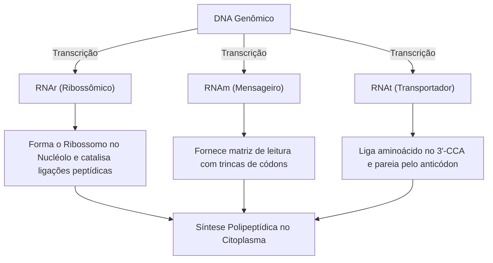

A Biologia Molecular investiga a base química e física dos fenômenos vitais, concentrando-se nas macromoléculas portadoras e executoras da informação genética. O entendimento detalhado dos ácidos nucleicos revolucionou as ciências biológicas ao desvendar como as instruções hereditárias são armazenadas, transmitidas e convertidas em funções celulares específicas. Nas provas, o conhecimento sólido da composição dos nucleotídeos, da arquitetura da dupla hélice do DNA, dos tipos de RNA e das minúcias da transcrição gênica constitui alicerce indispensável para a resolução de itens conceituais rigorosos.

> [!objetivos]
> - Identificar os componentes fundamentais dos nucleotídeos e as distinções bioquímicas entre DNA e RNA.
> - Caracterizar a estrutura, as peculiaridades e as funções celulares do RNAr, RNAm e RNAt.
> - Compreender a dinâmica da transcrição gênica e analisar as distinções operacionais entre procariontes e eucariontes.
> - Analisar o processamento do RNA mensageiro eucarioto e as características físico-químicas e topológicas da molécula de DNA.

## Estrutura Química dos Nucleotídeos

Os ácidos nucleicos foram identificados pioneiramente por Friedrich Miescher em 1869 no núcleo celular. Trata-se de macromoléculas poliméricas formadas pelo encadeamento ordenado de monômeros denominados nucleotídeos. Quando a estrutura apresenta apenas a pentose ligada covalentemente à base nitrogenada, desprovida de grupo fosfato, recebe a designação de nucleosídeo. A incorporação de grupos fosfato na posição 5' da pentose converte o composto em um nucleotídeo funcional.

Cada nucleotídeo compõe-se de três frações: uma pentose (monossacarídeo de cinco carbonos), uma base nitrogenada heterocíclica e um grupo fosfato. A base nitrogenada liga-se covalentemente ao carbono 1' da pentose por ligação N-glicosídica. O fosfato esterifica-se ao carbono 5' do açúcar. A hidroxila livre no carbono 3' funciona como sítio aceptor para o nucleotídeo seguinte. Na síntese polinucleotídica, a ligação fosfodiéster estabelece-se entre a hidroxila 3' do açúcar precedente e o fosfato 5' do nucleotídeo entrante, conferindo direcionalidade estrita 5' para 3' à fita.

As bases nitrogenadas dividem-se em duas famílias aromáticas. As purinas possuem dois anéis condensados e englobam adenina e guanina. As pirimidinas possuem um anel aromático simples de seis membros e englobam citosina, timina e uracila.

| Família Bioquímica | Anéis Aromáticos | Bases Nitrogenadas | Ocorrência Biológica |
| :--- | :--- | :--- | :--- |
| **Purinas (Bases Púricas)** | Dois anéis fundidos | Adenina (A) e Guanina (G) | Presentes no DNA e no RNA celular |
| **Pirimidinas (Bases Pirimídicas)** | Um anel hexagonal | Citosina (C), Timina (T) e Uracila (U) | Citosina em ambos; Timina no DNA; Uracila no RNA |

> [!atencao]
> As bancas examinadoras cobram frequentemente a polaridade 5' para 3'. A extremidade 5' é caracterizada pelo grupo fosfato livre, enquanto a extremidade 3' é marcada pela hidroxila (OH) livre ligada ao carbono 3' da pentose.

## Comparativo Bioquímico entre DNA e RNA

As duas classes de ácidos nucleicos exercem atribuições biológicas complementares. A principal divergência química reside na estrutura da pentose. O DNA contém a 2'-desoxirribose, que carece de um oxigênio no carbono 2', contendo apenas hidrogênio nessa posição. O RNA contém a D-ribose, dotada de um grupo hidroxila reativo ligado ao carbono 2'.

A presença da hidroxila 2' na ribose torna o RNA vulnerável à hidrólise alcalina, refletindo seu papel dinâmico na transmissão celular de sinais. Em contrapartida, a ausência de oxigênio no carbono 2' assegura estabilidade termodinâmica superior ao DNA, permitindo a preservação fidedigna do genoma. Além disso, a timina do DNA equivale quimicamente à 5-metiluracila; seu grupo metila facilita o reconhecimento de danos espontâneos da citosina pelas enzimas de reparo celular.

| Parâmetro Estrutural | Ácido Desoxirribonucleico (DNA) | Ácido Ribonucleico (RNA) |
| :--- | :--- | :--- |
| **Pentose** | 2'-desoxirribose (sem oxigênio no carbono 2') | D-ribose (hidroxila reativa no carbono 2') |
| **Bases Nitrogenadas** | Adenina, Guanina, Citosina e Timina | Adenina, Guanina, Citosina e Uracila |
| **Conformação Espacial** | Dupla fita helicoidal antiparalela | Fita simples com arranjos secundários locais |
| **Estabilidade Química** | Elevada estabilidade contra hidrólise celular | Meia-vida curta, elevada susceptibilidade a nucleases |

## Classes de RNA e suas Funções Celulares

Enquanto o DNA celular é predominantemente uma dupla hélice estável, o RNA é sintetizado como fita simples. Todavia, pareamentos intracadeia originam arranjos secundários e terciários (alças e grampos) que viabilizam funções catalíticas e estruturais.

No ambiente intracelular atuam três classes universais de RNA:

1. **RNA ribossômico (RNAr):** Representa mais de 80% do RNA celular. Associa-se a proteínas para formar os ribossomos. Nos eucariotos, sua montagem inicial ocorre no nucléolo. O RNAr exerce função catalítica de ribozima, forjando as ligações peptídicas durante a tradução.
2. **RNA mensageiro (RNAm):** Fita linear que transfere a mensagem dos genes nucleares para os ribossomos citoplasmáticos, organizada em trincas de códons.
3. **RNA transportador (RNAt):** Molécula pequena (70 a 90 nucleotídeos) em folha de trevo dobrada tridimensionalmente em L. Na extremidade terminal 3' (sequência CCA) acopla um aminoácido específico ativado por aminoacil-RNAt sintetase; em sua alça oposta exibe o anticódon complementar ao códon do RNAm.

O pareamento de bases no RNA segue a regra: adenina pareia com uracila por duas pontes (A=U) e guanina pareia com citosina por três pontes (G-C). O RNAt contém bases quimicamente modificadas (inosina e pseudouridina) que conferem flexibilidade no pareamento da terceira base.

> [!exemplo]
> Quando o RNA mensageiro traz o códon 5'-AGC-3', o RNA transportador pareia por meio da trinca complementar e antiparalela 3'-UCG-5' (lida convencionalmente como 5'-GCU-3'), posicionando com precisão o resíduo de serina na síntese proteica.

## Mecanismo da Transcrição Gênica

A transcrição é o mecanismo de polimerização de RNA orientado por molde de DNA. Não demanda iniciadores prévios (primers). A reação é catalisada pela RNA polimerase dependente de DNA, que polimeriza ribonucleotídeos exclusivamente no sentido 5' para 3', orientada pela leitura da fita molde de DNA no sentido antiparalelo 3' para 5'.

A fita de DNA que serve de referência física direta é denominada fita molde, antisense ou negativa (-). A fita oposta complementar da dupla hélice é designada fita codificadora, sense ou positiva (+). A sequência da fita codificadora coincide com a do RNA sintetizado, ressalvada a troca de timinas por uracilas.

A transcrição processa-se em três etapas:

1. **Iniciação:** A RNA polimerase reconhece regiões promotoras do DNA a montante do início da síntese. A ligação desemparelha cerca de 14 pares de bases, abrindo a bolha de transcrição.
2. **Alongamento:** A enzima desloca-se pela fita molde no sentido 3' para 5', incorporando ribonucleotídeos complementares na ponta 3'-OH do RNA nascente. Atrás da enzima, a dupla hélice de DNA recompõe-se espontaneamente.
3. **Terminação:** A polimerase encontra sequências de parada. Em bactérias, a cessação decorre de grampos ricos em GC (hairpin) no RNA ou do desemparelhamento gerado pela proteína Rho.

| Etapa da Transcrição | Dinâmica Bioquímica | Componentes Envolvidos |
| :--- | :--- | :--- |
| **Iniciação** | Reconhecimento do promotor e abertura da bolha | Promotor, RNA polimerase, abertura de fitas de DNA |
| **Alongamento** | Síntese contínua da fita de RNA no sentido 5' para 3' | Ribonucleotídeos ativados (rNTPs), leitura do molde 3' para 5' |
| **Terminação** | Desacoplamento da enzima e liberação do RNA transcrito | Sequências terminadoras, estrutura em grampo ou fator Rho |

> [!bizu]
> Grave a polaridade: a RNA polimerase caminha na fita molde de 3' para 5', sintetizando o RNA novo de 5' para 3'. O promotor estabelece qual fita do DNA servirá de molde.

## Transcrição em Procariontes e Eucariontes

A organização intracelular gera contrastes marcantes entre procariontes e eucariontes. Em bactérias, sem barreira nuclear, a fita de RNA mensageiro recém-emergente é acessada de pronto pelos ribossomos, configurando o acoplamento simultâneo entre transcrição e tradução.

Nos eucariotos, a carioteca impõe segregação compartimentada: a transcrição ocorre no núcleo, e o transcrito imaturo precisa de processamento antes de migrar pelos poros nucleares até o citoplasma. Esse arranjo impede o acoplamento direto e oportuniza níveis adicionais de controle genético.

Em procariontes, opera uma única RNA polimerase bacteriana associada a fatores sigma. Já as células eucarióticas utilizam três polimerases nucleares distintas:

- **RNA Polimerase I:** Atua no nucléolo sintetizando precursores dos RNAr maiores (28S, 18S e 5,8S).
- **RNA Polimerase II:** Opera no nucleoplasma transcrevendo genes que originam o RNA mensageiro.
- **RNA Polimerase III:** Sintetiza o RNA transportador, o RNAr 5S e pequenos RNAs estruturais.

O RNAm bacteriano costuma ser policistrônico (codifica múltiplos polipeptídeos em um operon), enquanto o RNAm eucarioto é predominantemente monocistrônico (um gene por fita).

| Aspecto Diferencial | Procariontes | Eucariontes |
| :--- | :--- | :--- |
| **Compartimentação** | Sem carioteca; transcrição acoplada à tradução citoplasmática | Com carioteca; transcrição nuclear e tradução citoplasmática |
| **RNA Polimerases** | Um tipo catalítico bacteriano associado ao fator sigma | Três classes nucleares especializadas (I, II e III) |
| **Natureza do Transcrito** | Comumente policistrônico em arranjos de operons | Predominantemente monocistrônico |
| **Processamento do RNA** | Ausente; fita utilizada diretamente na síntese | Amplo processamento: 5'-cap, cauda poli-A 3' e splicing |

## Processamento Pós-Transcricional do Pré-RNAm

Nos eucariotos, o produto primário da RNA polimerase II é o pré-RNA mensageiro. Para se tornar funcional, sofre três intervenções pós-transcricionais coordenadas no núcleo: adição do 5'-cap, cauda poli-A 3' e splicing.

O 5'-cap consiste na conjugação de uma 7-metilguanosina à extremidade 5' da fita por ligação atípica 5'-5' trifosfato. Essa cobertura previne a degradação precoce por exonucleases, viabiliza o trânsito pelo poro nuclear e ancora o ribossomo no início da tradução citoplasmática.

A cauda poli-A forma-se na extremidade 3'-OH pela ação da enzima poli-A polimerase, que acopla 100 a 250 adeninas sem molde de DNA. A cauda protege contra nucleases e modula a vida média e a tradução do RNA mensageiro.

O splicing remove as sequências não codificadoras (íntrons) e solda as sequências codificadoras (éxons). O evento é executado pelo spliceossomo, ribonucleoproteína formada por pequenos RNAs nucleares e proteínas (snRNPs).

> [!esquema]
> Pelo mecanismo do **splicing alternativo**, combinações distintas de éxons são unidas a partir do mesmo pré-RNAm. Assim, um único gene nuclear origina múltiplos RNAs mensageiros e diversas variantes proteicas funcionais em diferentes tecidos celulares.

## Estrutura Tridimensional e Propriedades do DNA

O arranjo tridimensional do DNA foi determinado em 1953 por James Watson e Francis Crick, valendo-se dos ensaios cristalográficos de Rosalind Franklin e Maurice Wilkins e dos dados quantitativos de Erwin Chargaff. O DNA configura uma dupla hélice dextrogira composta por duas fitas antiparalelas.

A fita orientada de 5' para 3' une-se à fita pareada orientada de 3' para 5'. O esqueleto hidrofílico de pentose e fosfato fica na face exterior, enquanto as bases nitrogenadas aromáticas hidrofóbicas alinham-se perpendicularmente ao eixo helicoidal interno.

O pareamento obedece à geometria estrita: adenina une-se a timina por duas pontes de hidrogênio (A=T), e guanina pareia com citosina por três pontes (G-C). Essa complementariedade fundamenta a regra de Chargaff, na qual a proporção de purinas iguala a de pirimidinas. A integridade da dupla fita decorre cumulativamente das pontes de hidrogênio e do empilhamento hidrofóbico das bases.

O enrolamento assimétrico da hélice delimita dois sulcos: o sulco maior e o sulco menor. O sulco maior facilita o reconhecimento sequencial por fatores transcricionais. O DNA adota ainda conformações polimórficas (formas A e Z) em função do grau de umidade e da composição primária.

| Conformação Estrutural | Sentido do Giro | Pares de Base por Volta | Ocorrência e Características |
| :--- | :--- | :--- | :--- |
| **Forma B (Watson-Crick)** | Dextrogira (direita) | Cerca de 10,5 pares | Conformação celular prevalente em solução fisiológica aquosa |
| **Forma A** | Dextrogira (direita) | Cerca de 11 pares | Duplexes híbridos DNA-RNA e preparações desidratadas |
| **Forma Z** | Levogira (esquerda) | Cerca de 12 pares | Sequências alternadas purina-pirimidina e regulação transcricional |

## Topologia, Desnaturação e Renaturação do DNA

As duas fitas de DNA podem ser separadas sem clivar as ligações covalentes fosfodiéster por meio da desnaturação térmica. O aquecimento ou soluções alcalinas rompem as pontes de hidrogênio e desfazem o empilhamento. A dissociação acarreta aumento na absorbância ultravioleta a 260 nm (efeito hipercromômico), pois fitas simples absorvem mais radiação.

A estabilidade da molécula é sintetizada pela temperatura de fusão (Tm), que corresponde ao limiar térmico no qual 50% das fitas encontram-se desnaturadas. Como pares G-C contêm três pontes de hidrogênio e fortes interações de empilhamento, amostras ricas em G-C possuem valores mais altos de Tm. Sob resfriamento gradativo ocorre renaturação (anelamento), princípio basilar da hibridação molecular e da PCR.

Topologicamente, o genoma celular é linear nos eucariotos e circular em plasmídeos bacterianos e organelas. O desenrolamento da dupla fita gera estresse torsional que é administrado pelas enzimas topoisomerases: a topoisomerase I cliva uma única fita sem gastar ATP, enquanto a topoisomerase II (como a DNA girase) cliva ambas as fitas consumindo ATP.

## Mapa do capítulo

```mermaid Síntese de Biologia Molecular e Ácidos Nucleicos
flowchart TD
    A["Ácidos Nucleicos e Biologia Molecular"] --> B["Estrutura Química dos Nucleotídeos"]
    A --> C["Classes de RNA e Funções"]
    A --> D["Mecanismos da Transcrição"]
    A --> E["Processamento e Topologia do DNA"]

    B --> B1["Monômero: pentose + fosfato 5' + base nitrogenada 1'"]
    B --> B2["Purinas (A, G - 2 anéis) e Pirimidinas (C, T, U - 1 anel)"]
    B --> B3["DNA com desoxirribose e timina; RNA com ribose e uracila"]

    C --> C1["RNAr: estruturação ribossômica no nucléolo e ação de ribozima"]
    C --> C2["RNAm: transporte de matriz codificadora com trincas de códons"]
    C --> C3["RNAt: adaptador com extremidade 3'-CCA e alça do anticódon"]

    D --> D1["RNA polimerase sintetiza no sentido 5' para 3' lendo molde 3' para 5'"]
    D --> D2["Fases: iniciação com abertura da bolha, alongamento e terminação"]
    D --> D3["Procarionte: acoplamento e operon; Eucarionte: compartimentado"]

    E --> E1["Processamento do pré-RNAm: 5'-cap, cauda poli-A 3' e splicing"]
    E --> E2["DNA em dupla hélice antiparalela (A=T com 2 pontes, G-C com 3 pontes)"]
    E --> E3["Propriedades: Tm proporcional a G+C e topoisomerases tipo I e II"]
```

### Para fixar

- **Nucleotídeos:** Subunidades monoméricas formadas por pentose, fosfato ligado ao carbono 5' e base nitrogenada no carbono 1'.
- **Bases Nitrogenadas:** Purinas apresentam anel duplo fundido (A e G); pirimidinas apresentam anel simples hexagonal (C, T e U).
- **Distinção DNA e RNA:** DNA possui 2'-desoxirribose e timina; RNA apresenta D-ribose com hidroxila reativa em 2' e uracila.
- **Funções dos RNAs:** RNAr catalisa ligações peptídicas no ribossomo, RNAm transporta códons e RNAt atua como adaptador via anticódon.
- **Polaridade da Síntese:** A RNA polimerase sintetiza a fita no sentido 5' para 3', efetuando a leitura da fita molde de DNA de 3' para 5'.
- **Diferenças de Domínio:** Procariontes apresentam transcrição acoplada à tradução citoplasmática; eucariontes separam núcleo e citoplasma.
- **Maturação Eucariótica:** O pré-RNAm recebe capeamento 5', cauda de poliadenilação 3' e remoção de íntrons com união de éxons.
- **Splicing Alternativo:** Mecanismo nuclear que combina éxons de formas variáveis, gerando múltiplas proteínas a partir de um gene.
- **Dupla Hélice do DNA:** Fitas antiparalelas com interior hidrofóbico unidas por pareamentos de hidrogênio (A=T e G-C) e empilhamento de bases.
- **Desnaturação e Tm:** Ponto térmico de dissociação de 50% das fitas duplas, cujo valor eleva-se proporcionalmente ao conteúdo de pares G-C.
