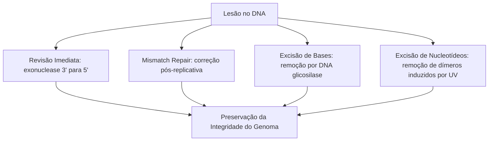

A duplicação fidedigna do genoma e a correta segregação dos cromossomos constituem pilares indispensáveis para a continuidade da vida e a estabilidade celular. O processo de replicação do DNA coordena enzimas que copiam o código com precisão extrema, minimizando a ocorrência de mutações. Paralelamente, o estudo da organização física da cromatina, da morfologia dos cromossomos e das anomalias genéticas fundamenta a compreensão de patologias de alto impacto biomédico e pericial, assunto frequente em provas.

> [!objetivos]
> - Compreender o modelo semiconservativo e a dinâmica da forquilha de replicação do DNA.
> - Diferenciar a síntese da fita líder da fita atrasada em fragmentos de Okazaki.
> - Analisar os mecanismos de fidelidade replicativa e as vias de reparo do DNA.
> - Caracterizar a arquitetura cromossômica, os níveis de cromatina e o cariótipo humano normal.
> - Identificar as anomalias numéricas e estruturais e o conceito dos genes e a expressão gênica.

## O Modelo Semiconservativo e a Forquilha de Replicação

A replicação do DNA é semiconservativa. Cada fita parental atua como molde direto para a montagem de uma nova cadeia complementar. Esse mecanismo foi comprovado em 1958 por Matthew Meselson e Franklin Stahl. Eles usaram isótopos de nitrogênio em bactérias submetidas à centrifugação em gradiente de densidade. Na primeira geração em meio N-14, todas as moléculas de DNA exibiram densidade intermediária híbrida. Na segunda geração, surgiram bandas distintas de densidade híbrida e densidade puramente leve. O ensaio provou conclusivamente que cada molécula-filha retém uma fita original intacta pareada com uma fita recém-sintetizada, descartando as hipóteses conservativa e dispersiva.

O evento inicia-se em origens de replicação específicas. Em bactérias, há uma origem única denominada oriC no cromossomo circular. A replicação ocorre de modo bidirecional a partir de duas forquilhas. Nos eucariotos, há milhares de origens simultâneas em cada cromossomo linear. Esse arranjo agiliza a duplicação total durante a fase S da intérfase celular.

A abertura da dupla fita requer enzimas especializadas integradas na forquilha:

1. **DNA Helicase:** Enzima que rompe as pontes de hidrogênio entre as bases nitrogenadas com gasto de ATP, separando as duas fitas.
2. **Proteínas SSB:** Proteínas de ligação à fita simples que recobrem o DNA desnaturado. Elas impedem que as fitas se reassociem precocemente.
3. **Topoisomerases (Girase bacteriana):** Aliviam o superenrolamento positivo e o estresse torsional à frente da forquilha, cortando e religando as fitas.

```mermaid Dinâmica das Enzimas na Forquilha de Replicação
flowchart LR
    DNA["Dupla Hélice Parental"] --> Topo["Topoisomerase: alívio da torção mecânica"]
    Topo --> Heli["Helicase: abertura de pontes de H com ATP"]
    Heli --> SSB["Proteínas SSB: estabilização da fita simples"]
    SSB --> Prima["Primase: síntese de primers de RNA"]
    Prima --> Pol["DNA Polimerase: síntese no sentido 5' para 3'"]
    Pol --> Liga["DNA Ligase: selamento fosfodiéster"]
```

## Síntese Semidescontínua e Enzimas Polimerases

As DNA polimerases apresentam duas propriedades fundamentais. Elas não iniciam cadeias do zero, necessitando de uma hidroxila 3'-OH inicial. Além disso, catalisam a polimerização exclusivamente no sentido 5' para 3'. O ataque ocorre a partir da hidroxila 3' sobre o fosfato alfa do desoxirribonucleotídeo entrante.

Para viabilizar a polimerização, a RNA primase produz um oligonucleotídeo iniciador de RNA (primer). O primer fornece a ponta 3'-OH livre para a DNA polimerase III iniciar a elongação.

Como as fitas são antiparalelas e a forquilha avança em sentido único, a síntese é semidescontínua:

- **Fita Líder (leading strand):** Sua fita molde orienta-se de 3' para 5' na direção da forquilha. A síntese é contínua no sentido 5' para 3', necessitando de apenas um primer.
- **Fita Atrasada (lagging strand):** Sua síntese é descontínua e caminha no sentido oposto ao avanço da forquilha. Ela ocorre pela formação de fragmentos de Okazaki. Cada fragmento necessita de um primer de RNA individual.

A DNA polimerase I remove os primers de RNA por sua atividade exonucleolítica 5' para 3' e reconstitui as lacunas com desoxirribonucleotídeos. A DNA ligase une os fragmentos vizinhos, forjando a ligação fosfodiéster com consumo de energia.

| Enzima Replicativa | Função Bioquímica Principal | Atividade Exonucleolítica |
| :--- | :--- | :--- |
| **DNA Helicase** | Rompe pontes de hidrogênio e abre a dupla hélice | Sem atividade nuclease |
| **RNA Primase** | Sintetiza primers curtos de RNA com extremidade 3'-OH | Sem atividade revisora |
| **DNA Polimerase III** | Principal enzima de síntese e elongação em bactérias | Exonuclease 3' para 5' revisora |
| **DNA Polimerase I** | Degradação de primers e recomposição de lacunas | Exonuclease 5' para 3' e 3' para 5' |
| **DNA Ligase** | Sela descontinuidades entre fragmentos de Okazaki | Sem atividade de polimerização |

> [!atencao]
> Grave a direcionalidade obrigatória: a polimerase lê a fita molde de 3' para 5', mas polimeriza a nova cadeia de 5' para 3'. Não existem enzimas que construam cadeias de ácidos nucleicos no sentido 3' para 5'.

## Mecanismos de Reparo e Fidelidade da Replicação

Durante a síntese primária, a DNA polimerase pode incorporar nucleotídeos incorretos por tautomeria passageira das bases. Para evitar a fixação de mutações, a enzima possui atividade de revisão (proofreading) mediada por um sítio de exonuclease 3' para 5'.

Ao detectar um pareamento errôneo, a polimerase interrompe a extensão. O sítio exonucleolítico cliva o nucleotídeo distorcido na ponta 3'. A enzima então retoma a polimerização correta. Essa revisão reduz drasticamente os erros residuais de cópia.

Após a passagem da forquilha, vias de reparo complementares atuam no núcleo:

- **Reparo de Malpareamento (MMR):** Reconhece pareamentos errôneos que escaparam à revisão da polimerase, clivando e corrigindo a fita recém-formada.
- **Reparo por Excisão de Bases (BER):** Corrige bases danificadas por oxidação ou desaminação. A DNA glicosilase remove a base alterada gerando sítio AP.
- **Reparo por Excisão de Nucleotídeos (NER):** Remove lesões que deformam a dupla hélice, como dímeros de pirimidina provocados por radiação ultravioleta (UV).

> [!bizu]
> O **xeroderma pigmentoso** é decorrente de falhas no reparo por excisão de nucleotídeos (NER). As células dos pacientes não conseguem excisar dímeros de timina induzidos pelo sol, provocando lesões e tumores precoces na pele.

## Estrutura e Condensação Cromossômica

O DNA nuclear eucarioto mede cerca de dois metros por célula. Para caber no núcleo microscópico, a molécula associa-se a proteínas formando a cromatina.

A unidade estrutural básica é o **nucleossomo**. Cada nucleossomo possui um núcleo octamérico formado por dois pares de cada histona (H2A, H2B, H3 e H4). Em torno do octâmero enrolam-se cerca de 147 pares de bases de DNA em duas voltas. As histonas são básicas, ricas em lisina e arginina. Suas cargas positivas ligam-se aos fosfatos negativos do DNA.

Entre nucleossomos fica o DNA ligador associado à histona H1. A histona H1 aproxima os nucleossomos, condensando o filamento na fibra de 30 nm. Essa fibra forma alças sobre um esqueleto proteico até a condensação do cromossomo metafásico.

A cromatina divide-se em dois estados funcionais:

- **Eucromatina:** Menos condensada e dispersa na intérfase. Abriga os genes ativos acessíveis à transcrição celular.
- **Heterocromatina:** Densa e inativa na transcrição. É **constitutiva** em centrômeros e telômeros repetitivos, e **facultativa** no corpúsculo de Barr (cromossomo X inativo feminino).

| Nível Estrutural | Componentes Centrais | Diâmetro Médio | Estado Funcional |
| :--- | :--- | :--- | :--- |
| **Dupla Hélice** | Desoxirribonucleotídeos pareados | 2 nm | Fita nua sem histonas |
| **Nucleossomo** | Octâmero de histonas com DNA enrolado | 11 nm | Eucromatina descondensada ativa |
| **Fibra Cromatínica** | Nucleossomos compactados pela histona H1 | 30 nm | Grau intermediário de empacotamento |
| **Cromossomo Metafásico** | Alças condensadas no esqueleto proteico | 1.400 nm | Condensação máxima para mitose |

> [!esquema]
> A inativação aleatória de um cromossomo X nas mulheres forma o corpúsculo de Barr. Trata-se de um exemplo clássico de heterocromatina facultativa, garantindo a compensação de dose entre indivíduos XX e XY.

## Morfologia dos Cromossomos e Cariótipo Humano

Na metáfase, a condensação cromossômica atinge seu auge. O cromossomo duplicado exibe duas cromátides-irmãs idênticas unidas no centrômero.

O centrômero abriga o cinetócoro, estrutura proteica em disco que liga as fibras do fuso mitótico. As extremidades terminais são os telômeros. Eles protegem as pontas cromossômicas contra a degradação e fusões anômalas ponta com ponta. Em cada ciclo replicativo celular, a remoção do último primer de RNA na extremidade 5' da fita atrasada deixa uma lacuna que a DNA polimerase convencional não consegue estender. Esse encurtamento progressivo é compensado em células-tronco e linhagens germinativas pela enzima telomerase, uma ribonucleoproteína que contém seu próprio molde interno de RNA para estender as repetições teloméricas.

O centrômero divide o cromossomo em braço curto (p) e braço longo (q), definindo quatro tipos morfológicos:

1. **Metacêntrico:** Centrômero no centro exato, com braços p e q iguais.
2. **Submetacêntrico:** Centrômero pouco deslocado, com braço p menor que q.
3. **Acrocêntrico:** Centrômero próximo da ponta, com braço p muito curto e satélites.
4. **Telocêntrico:** Centrômero na extremidade terminal absoluta, sem braço curto (inexistente no ser humano normal).

O cariótipo é o conjunto cromossômico característico de uma espécie. Células somáticas humanas normais são diploides (2n = 46 cromossomos), compreendendo 44 autossomos e 2 cromossomos sexuais (XX ou XY). Gametas são haploides (n = 23 cromossomos).

> [!exemplo]
> Para avaliar o cariótipo, linfócitos são cultivados e tratados com colchicina. Essa substância impede a formação do fuso e bloqueia as células na metáfase. Os cromossomos são corados e organizados em pares homólogos segundo tamanho e padrão de bandas.

## Anomalias Cromossômicas Numéricas e Estruturais

Alterações cromossômicas resultam de erros na gametogênese ou nas primeiras clivagens embrionárias. Elas subdividem-se em numéricas e estruturais.

As anomalias numéricas dividem-se em euploidias e aneuploidias. As euploidias envolvem a alteração de genomas completos (como triploidia 3n e tetraploidia 4n), sendo incompatíveis com a sobrevivência humana a termo. As aneuploidias afetam cromossomos isolados e originam-se principalmente por **não disjunção meiótica**. Os cromossomos ou cromátides falham em se separar na meiose I ou II, gerando gametas com cromossomos a mais ou a menos:

- **Síndrome de Down (Trissomia do 21):** Indivíduos com cariótipo 47,XX,+21 ou 47,XY,+21. Apresentam hipotonia muscular, prega palmar única, fendas palpebrais oblíquas e cardiopatias congênitas.
- **Síndrome de Turner (Monossomia do X):** Pacientes do sexo feminino com cariótipo 45,X. Apresentam baixa estatura, pescoço alado, tórax largo e ovários em fita com amenorreia primária.
- **Síndrome de Klinefelter (Cariótipo 47,XXY):** Homens que herdam um X extra. Apresentam estatura elevada, hipogonadismo, ginecomastia e azoospermia com infertilidade.

As anomalias estruturais derivam de quebras seguidas de uniões anômalas:

- **Deleção:** Perda de segmento, como na **Síndrome de Cri-du-chat** (deleção 5p- com choro característico).
- **Duplicação:** Segmento cromossômico repetido em duplicidade.
- **Inversão:** Rotação de 180 graus de um segmento entre duas quebras (paracêntrica sem centrômero ou pericêntrica com centrômero).
- **Translocação:** Troca entre cromossomos não homólogos. A **translocação Robertsoniana** ocorre pela fusão dos braços longos de acrocêntricos (como 14 e 21), gerando indivíduos com 45 cromossomos sadios com risco de prole com Down.

| Síndrome Genética | Natureza da Alteração | Cariótipo Típico | Manifestações Clínicas |
| :--- | :--- | :--- | :--- |
| **Síndrome de Down** | Trissomia autossômica (aneuploidia) | 47,XX,+21 ou 47,XY,+21 | Hipotonia, fenda palpebral oblíqua, cardiopatias |
| **Síndrome de Turner** | Monossomia sexual (aneuploidia) | 45,X | Sexo feminino, baixa estatura, pescoço alado, infertilidade |
| **Síndrome de Klinefelter** | Trissomia sexual (aneuploidia) | 47,XXY | Sexo masculino, ginecomastia, hipogonadismo |
| **Síndrome de Cri-du-chat** | Deleção estrutural de braço cromossômico | 46,XX,del(5p) ou 46,XY | Choro agudo ao nascer, microcefalia, déficit cognitivo |
| **Translocação Robertsoniana** | Fusão cêntrica entre acrocêntricos | 45 cromossomos no portador | Fenótipo normal no portador; risco de trissomia nos filhos |

## Os Genes e a Expressão Gênica no Dogma Central

O estudo detalhado da hereditariedade elucida os genes e a expressão gênica. Historicamente, postulou-se a hipótese de um gene para uma enzima, ampliada para um gene para um polipeptídeo.

Atualmente, gene é conceituado como uma sequência ordenada de nucleotídeos de DNA necessária para dirigir a síntese de um produto biológico funcional. Esse produto pode ser uma proteína enzimática ou estrutural, ou uma molécula de RNA regulador e catalítico. Esse produto pode ser uma proteína ou um RNA regulador e estrutural, como RNAr, RNAt e microRNAs. O local fixo do gene no cromossomo é o loco gênico (locus), e suas variantes alélicas formam os alelos da população.

Os genes e a expressão gênica coordenam-se segundo o **Dogma Central da Biologia Molecular**:

1. **Replicação:** O DNA direciona a síntese de si mesmo na fase S do ciclo celular.
2. **Transcrição:** A informação do DNA é copiada em uma fita complementar de RNA mensageiro.
3. **Tradução:** O ribossomo decodifica os códons do RNA mensageiro para sintetizar a cadeia polipeptídica.

O dogma admite vias especiais. Nos retrovírus, a enzima transcriptase reversa transcreve DNA a partir de um molde de RNA viral. Na pleiotropia, um único gene influencia múltiplos caracteres fenotípicos simultâneos.

> [!resolvido]
> **Questão Conceitual:** Uma célula somática humana feminina em metáfase mitótica normal apresenta qual quantitativo total de moléculas de DNA de dupla fita e cromátides?
> **Resolução:** A célula diploide humana normal tem 46 cromossomos. Após a fase S, cada cromossomo é formado por duas cromátides-irmãs unidas pelo centrômero. Assim, na metáfase mitótica existem 46 cromossomos duplicados, 92 cromátides-irmãs e 92 moléculas de DNA de fita dupla.

## Mapa do capítulo

```mermaid Síntese de Replicação do DNA e Citogenética
flowchart TD
    A["Replicação do DNA e Citogenética"] --> B["Forquilha Replicativa e Enzimas"]
    A --> C["Sistemas de Fidelidade e Reparo"]
    A --> D["Organização da Cromatina"]
    A --> E["Anomalias Cromossômicas"]

    B --> B1["Replicação semiconservativa no sentido 5' para 3'"]
    B --> B2["Fita líder contínua e fita atrasada em fragmentos de Okazaki"]
    B --> B3["Helicase, SSB, primase, DNA polimerases e ligase"]

    C --> C1["Proofreading por exonuclease 3' para 5' da polimerase"]
    C --> C2["Reparo NER com falha no xeroderma pigmentoso"]
    C --> C3["Reparo BER de bases e mismatch repair de pareamento"]

    D --> D1["Nucleossomo: octâmero de histonas H2A, H2B, H3, H4 com DNA"]
    D --> D2["Eucromatina ativa e heterocromatina condensada"]
    D --> D3["Cromossomos: metacêntrico, submetacêntrico, acrocêntrico"]

    E --> E1["Aneuploidias: Síndrome de Down (47,XX/XY,+21)"]
    E --> E2["Aneuploidias sexuais: Turner (45,X) e Klinefelter (47,XXY)"]
    E --> E3["Estruturais: deleção (Cri-du-chat 5p-) e translocações"]
```

### Para fixar

- **Modelo Semiconservativo:** Cada nova dupla hélice conserva uma fita parental intacta emparelhada com uma fita recém-sintetizada.
- **Direcionalidade da Síntese:** As DNA polimerases polimerizam exclusivamente de 5' para 3', promovendo ataque na ponta 3'-OH livre.
- **Fita Líder e Fita Atrasada:** A fita líder sintetiza-se de forma contínua; a fita retardada é descontínua em fragmentos de Okazaki.
- **Atividade de Revisão:** A exonuclease 3' para 5' da DNA polimerase corrige bases trocadas, elevando a fidelidade da cópia.
- **Xeroderma Pigmentoso:** Erro congênito no reparo por excisão de nucleotídeos (NER) que impede a remoção de dímeros de timina por UV.
- **Nucleossomos:** Unidades de cromatina formadas por octâmeros de histonas básicas circundados por cerca de 147 pares de bases de DNA.
- **Morfologia Cromossômica:** Classificação pela posição do centrômero em metacêntrico, submetacêntrico, acrocêntrico e telocêntrico.
- **Cariótipo Humano:** Células somáticas apresentam 46 cromossomos (44 autossomos e 2 sexuais); gametas apresentam 23 cromossomos.
- **Síndromes Numéricas:** Down (trissomia do 21), Turner (monossomia 45,X) e Klinefelter (trissomia sexual 47,XXY).
- **Expressão Gênica e Dogma Central:** A informação transita de DNA para RNAm e Proteína, abrangendo os genes e a expressão gênica celular.
