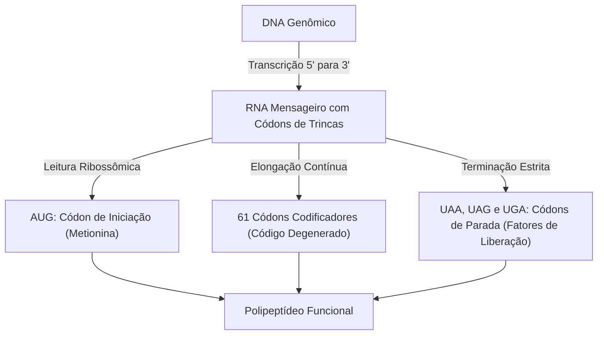
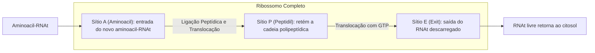
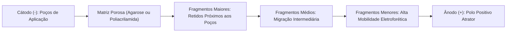

A síntese proteica é o processo celular central que traduz as sequências de nucleotídeos dos ácidos nucleicos na linguagem funcional dos aminoácidos. A correspondência entre o RNA mensageiro e a estrutura das proteínas é regida pelo código genético. Essa correspondência constitui uma das mais expressivas evidências da origem comum dos seres vivos. O conhecimento das mutações moleculares e o domínio de técnicas laboratoriais como a extração de ácidos nucleicos e a eletroforese consolidam as bases da perícia forense e da Tecnologia do DNA recombinante.

> [!objetivos]
> - Compreender a organização modular dos genes e o impacto do splicing alternativo na diversidade proteica.
> - Analisar as propriedades do código genético e correlacionar códons de iniciação e terminação.
> - Descrever minuciosamente as fases da tradução ribossômica e a dinâmica dos sítios catalíticos A, P e E.
> - Classificar os tipos de mutações gênicas e avaliar seus efeitos sobre a sequência polipeptídica.
> - Dominar os métodos de extração de DNA e os princípios operacionais da eletroforese na Tecnologia do DNA recombinante.

## Estrutura Modular dos Genes e Splicing

Nos organismos eucarióticos, a arquitetura dos genes não é contínua. Existe uma alternância entre segmentos codificadores e sequências intercalares não codificadoras. Os segmentos que contêm as instruções mantidas no RNA mensageiro maduro denominam-se **éxons**. As sequências intervenientes removidas durante o processamento do transcrito primário são chamadas de **íntrons**.

Além dos éxons e íntrons, a unidade gênica compreende regiões regulatórias. A montante do primeiro éxon localiza-se a região promotora. Ela é responsável pelo acoplamento da RNA polimerase e dos fatores basais de transcrição. Na extremidade oposta, sequências de terminação sinalizam o ponto de desacoplamento do complexo enzimático.

A presença de íntrons viabiliza o mecanismo de **splicing alternativo**. Nesse processo nuclear, os éxons de um mesmo pré-RNAm podem ser reunidos em combinações variadas. Como resultado, um único gene nuclear é capaz de codificar múltiplas variantes de RNA mensageiro maduro. Esse mecanismo gera diversas isoformas proteicas com propriedades biológicas distintas. Isso explica por que o genoma humano sintetiza uma diversidade imensa de polipeptídeos a partir de um número limitado de genes.

| Componente Gênico | Natureza Estrutural | Papel Funcional na Expressão |
| :--- | :--- | :--- |
| **Promotor** | Sequência regulatória a montante (5') | Sítio de ligação de fatores basais e da polimerase |
| **Éxons** | Sequências codificadoras conservadas | Preservadas no RNAm maduro para compor a matriz traduzida |
| **Íntrons** | Sequências intercalares não codificadoras | Removidas no núcleo pela ação do spliceossomo |
| **Sítio Terminador** | Sequência regulatória a jusante (3') | Sinaliza a parada da transcrição e a clivagem do pré-RNAm |

## O Código Genético: Propriedades e Mecânica

O código genético é o dicionário biológico universal da célula. Ele estabelece as regras de correspondência entre as trincas de nucleotídeos do RNA mensageiro, denominadas **códons**, e os vinte aminoácidos padrão. Como o RNA possui quatro bases distintas (A, U, C e G), o arranjo em trincas produz exatamente 64 combinações possíveis de códons.

O código genético apresenta três propriedades fundamentais:

1. **Organização em Trincas:** A leitura do RNA mensageiro é feita estritamente de três em três nucleotídeos, sem sobreposição de bases entre códons vizinhos.
2. **Degeneração ou Redundância:** Quase todos os aminoácidos são codificados por mais de um códon sinônimo. Contudo, o código não é ambíguo, pois cada códon específico determina apenas um único aminoácido.
3. **Universalidade Quase Absoluta:** O significado de cada trinca é idêntico em praticamente todos os seres vivos. Essa conservação evolutiva viabiliza as aplicações da Tecnologia do DNA recombinante entre espécies distintas.

Entre os 64 códons existentes, 61 especificam aminoácidos. A síntese proteica inicia-se universalmente pelo códon **AUG**. Ele codifica a metionina em eucariontes e a N-formilmetionina em bactérias. Os três códons restantes não codificam nenhum aminoácido: **UAA**, **UAG** e **UGA**. Essas trincas atuam como **códons de parada**, determinando o término da síntese da cadeia polipeptídica.

> [!bizu]
> Mnemônico para os três códons de parada no RNA mensageiro:
> - **UAA:** Você É Alto (*U Are Away*)
> - **UAG:** Você É Grande (*U Are Gone*)
> - **UGA:** Você É Gigante (*U Go Away*)
> Nenhum deles carrega aminoácido. A presença deles sinaliza o término da tradução.

## Mecanismo da Tradução Ribossômica

A tradução celular ocorre no interior dos **ribossomos**. Essas estruturas ribonucleoproteicas situam-se livres no citosol ou presas ao retículo rugoso. Cada ribossomo é formado por duas subunidades independentes. A subunidade menor acomoda o RNA mensageiro e inspeciona o pareamento dos códons. A subunidade maior catalisa as ligações peptídicas.

Antes de ingressar no ribossomo, cada aminoácido precisa ser ativado enzimaticamente e acoplado ao seu RNAt correspondente pela enzima aminoacil-RNAt sintetase, com consumo de ATP. Essa enzima garante a fidelidade traducional ao reconhecer tanto o aminoácido específico quanto a alça do anticódon. No ribossomo montado existem três sítios funcionais de ligação para moléculas de RNA transportador:

- **Sítio A (Aminoacil):** Sítio de entrada onde se instala o aminoacil-RNAt entrante.
- **Sítio P (Peptidil):** Sítio intermediário que retém o peptidil-RNAt acoplado ao polipeptídeo nascente.
- **Sítio E (Exit ou Saída):** Sítio que acomoda o RNAt descarregado antes de sua liberação para o citoplasma.

A síntese polipeptídica ocorre em três etapas sucessivas:

1. **Iniciação:** A subunidade menor liga-se ao RNA mensageiro. Em bactérias, o encaixe ocorre na sequência de **Shine-Dalgarno**. Nos eucariotos, a subunidade menor reconhece o **5'-cap** e desliza pela fita até o códon AUG. Em seguida, a subunidade maior acopla-se, posicionando o primeiro RNAt no sítio P.
2. **Elongação:** O aminoacil-RNAt correto entra no sítio A. A enzima **peptidil transferase**, uma ribozima intrínseca do RNAr da subunidade maior, forma a ligação peptídica. Em seguida, o ribossomo transloca-se três nucleotídeos na direção 5' para 3' com gasto de GTP. O RNAt descarregado vai para o sítio E e sai, enquanto o sítio A fica livre para o próximo ciclo.
3. **Terminação:** Ao surgir um códon de parada (UAA, UAG ou UGA) no sítio A, proteínas chamadas **fatores de liberação** ligam-se ao complexo. Elas clivam a ligação do polipeptídeo com o último RNAt, liberando a proteína e desfazendo o ribossomo.

| Etapa da Tradução | Eventos Bioquímicos Fundamentais | Fatores e Consumo Energético |
| :--- | :--- | :--- |
| **Iniciação** | Reconhecimento do RNAm (Shine-Dalgarno ou 5'-cap) e encaixe no AUG | Fatores IF ou eIF, hidrólise de GTP |
| **Elongação** | Entrada do aminoacil no sítio A, peptidil transferase e translocação | Fatores EF ou eEF, gasto de 2 GTP por ciclo |
| **Terminação** | Reconhecimento do códon de parada e liberação do polipeptídeo | Fatores de liberação RF ou eRF com GTP |

> [!atencao]
> A ligação peptídica é catalisada pelo próprio RNA ribossômico, atuando como ribozima. Múltiplos ribossomos podem ler simultaneamente a mesma fita de RNA mensageiro, compondo um polirribossomo (ou polissomo) que acelera a produção proteica.

## Mutações Gênicas e suas Repercussões Traducionais

Mutações são alterações permanentes na sequência de nucleotídeos do DNA que escapam ao reparo celular. Elas surgem espontaneamente por erros tautoméricos ou são induzidas por agentes mutagênicos físicos ou químicos.

Nas mutações pontuais por substituição de base, distinguem-se dois tipos de eventos:

- **Transição:** Troca entre bases da mesma família. Uma purina é substituída por outra purina (A por G ou G por A), ou uma pirimidina por outra pirimidina (C por T ou T por C).
- **Transversão:** Substituição de bases entre famílias distintas. Uma purina é trocada por uma pirimidina ou vice-versa (por exemplo, A trocada por C ou T trocada por G).

Quanto às repercussões funcionais na sequência de aminoácidos, as mutações dividem-se em:

1. **Mutação Silenciosa:** O códon alterado especifica o mesmo aminoácido devido à redundância do código. A sequência da proteína não muda.
2. **Mutação Missense (Sentido Trocado):** O novo códon codifica um aminoácido distinto. O exemplo clássico é a **anemia falciforme**. Nela, uma mutação no gene da beta-globina troca um resíduo de ácido glutâmico por valina, gerando hemoglobinas que se polimerizam sob hipóxia.
3. **Mutação Nonsense (Sem Sentido):** Um códon de aminoácido é convertido prematuramente em códon de parada. A síntese é interrompida antes da hora, originando uma cadeia polipeptídica truncada e inativa.
4. **Mutação por Mudança de Matriz (Frameshift):** Inserção ou deleção de bases em número não múltiplo de três. O enquadramento de leitura é deslocado, modificando todos os aminoácidos subsequentes.

| Tipo de Mutação | Mecanismo Molecular | Consequência na Proteína |
| :--- | :--- | :--- |
| **Silenciosa** | Troca por códon sinônimo | Nenhuma alteração na sequência do polipeptídeo |
| **Missense** | Troca por códon de outro aminoácido | Substituição de aminoácido (exemplo: anemia falciforme) |
| **Nonsense** | Criação precoce de códon de parada | Proteína truncada encurtada com perda funcional |
| **Frameshift** | Inserção ou deleção não múltipla de três | Deslocamento da leitura alterando todos os resíduos posteriores |

> [!exemplo]
> Na anemia falciforme, a alteração no sexto códon da beta-globina transforma o códon 5'-GAG-3' em 5'-GUG-3'. Essa troca pontual substitui o ácido glutâmico por valina. O aminoácido hidrofóbico desestabiliza a hemoglobina desoxigenada, deformando as hemácias em foice.

## Métodos de Extração e Purificação de DNA

A obtenção de DNA íntegro a partir de tecidos biológicos é o passo inicial de qualquer rotina molecular. Amostras como sangue, saliva, pelos e fragmentos ósseos são rotineiramente processadas em perícias e laboratórios. O isolamento envolve a lise celular, a digestão enzimática de proteínas e a purificação dos ácidos nucleicos.

Os principais procedimentos laboratoriais compreendem:

- **Extração Orgânica (Fenol-Clorofórmio):** Método padrão para amostras complexas. Emprega detergentes como o SDS para dissolver membranas, EDTA para quelar íons e inativar nucleases, e DTT para desfazer pontes dissulfeto em espermatozoides de crimes sexuais. A enzima **proteinase K** degrada as histonas. A mistura de fenol-clorofórmio isola o DNA na fase aquosa superior, sendo precipitado com álcool.
- **Extração por Resina Quelante (Chelex 100):** Utiliza resina quelante que aprisiona íons bivalentes (como Mg2+), inibindo nucleases celulares. A lise ocorre sob aquecimento a 100 °C. Após centrifugação, o sobrenadante com DNA em fita simples é utilizado em reações de PCR com rapidez e baixo custo.
- **Papel FTA:** Matriz de celulose impregnada com agentes de lise que aprisionam o DNA e inativam patógenos. As amostras biológicas podem ser guardadas em temperatura ambiente por anos sem degradação.
- **Fase Sólida em Colunas de Sílica:** Técnica amplamente utilizada na Tecnologia do DNA recombinante. O DNA adsorve à membrana de sílica em presença de sais caotrópicos e pH ácido. Após lavagens para retirada de impurezas, o material purificado é eluído em tampão levemente alcalino.

> [!esquema]
> Na **Tecnologia do DNA recombinante**, a extração de alta pureza por colunas de sílica ou lise alcalina permite recuperar plasmídeos bacterianos e fragmentos genômicos limpos. Esse nível de purificação é indispensável para que as enzimas de restrição consigam clivar os sítios alvos e a DNA ligase consiga inserir os genes de interesse nos vetores de clonagem.

## Eletroforese: Princípios, Matrizes e Tecnologia Recombinante

A eletroforese é a técnica padrão que separa macromoléculas de acordo com o tamanho, a conformação geométrica e a carga elétrica. O processo ocorre pela aplicação de uma corrente contínua em uma matriz porosa imersa em tampão condutor.

Os grupos fosfato da espinha dorsal dos ácidos nucleicos estão ionizados em pH biológico. Isso confere ao DNA uma **carga elétrica líquida negativa uniforme**. Por essa razão, os fragmentos migram invariavelmente do polo negativo (cátodo) para o **polo positivo (ânodo)**. A malha porosa do gel funciona como peneira molecular. Os fragmentos menores movem-se mais rapidamente pelos poros, enquanto os fragmentos maiores sofrem maior atrito e migram mais devagar.

Conforme a aplicação experimental, empregam-se duas matrizes principais:

- **Gel de Agarose:** Matriz obtida de polissacarídeos de algas marinhas. É amplamente empregada na Tecnologia do DNA recombinante para checar produtos de digestão por enzimas de restrição, bandas de PCR e construções plasmidiais entre 100 e 20.000 pares de bases.
- **Gel de Poliacrilamida:** Matriz sintética com poros microscópicos muito pequenos e regulares. Oferece alta resolução, conseguindo separar fitas que se diferenciam por apenas um único nucleotídeo.

Para mensurar o tamanho das bandas desconhecidas, corre-se um marcador de peso molecular (**ladder**) contendo fragmentos de tamanhos padronizados. A visualização das bandas requer agentes intercalantes fluorescentes como o **brometo de etídio** ou fluoróforos modernos. Sob radiação ultravioleta no transiluminador, essas moléculas emitem fluorescência alaranjada, revelando a localização dos fragmentos no gel.

Na análise confirmatória de fragmentos após a corrida em gel, técnicas clássicas como o Southern blot combinam a eletroforese com a transferência das fitas para membranas de náilon, hibridando sondas marcadas radioativamente ou com quimioluminescência. Na perícia contemporânea e na Tecnologia do DNA recombinante em escala avançada, utiliza-se a **eletroforese capilar**. O DNA marcado com fluoróforos percorre capilares ultrafinos sob alta voltagem, sendo lido por sensores ópticos a laser. Essa automação gera perfis genéticos digitais com absoluta reprodutibilidade e velocidade.

> [!resolvido]
> **Questão Conceitual:** Em uma cuba eletroforética contendo gel de agarose e tampão condutor, como migrarão dois fragmentos de DNA linear de 400 pb e 1.500 pb obtidos em um ensaio da Tecnologia do DNA recombinante?
> **Resolução:** Ambos os fragmentos migrarão em direção ao polo positivo (ânodo), pois o DNA possui carga líquida negativa conferida pelos grupamentos fosfato. O fragmento de 400 pb migrará mais rapidamente e alcançará distância maior no gel, enquanto o fragmento de 1.500 pb sofrerá maior resistência na trama de agarose e permanecerá mais próximo ao poço.

## Mapa do capítulo

```mermaid Síntese de Tradução, Mutações e Eletroforese
flowchart TD
    A["Expressão Proteica e Biologia Molecular Laboratorial"] --> B["Código Genético e Propriedades"]
    A --> C["Dinâmica da Tradução Ribossômica"]
    A --> D["Mutações Gênicas e Tipos"]
    A --> E["Extração e Eletroforese de DNA"]

    B --> B1["Leitura em trincas de códons no RNAm (5' para 3')"]
    B --> B2["Universalidade evolutiva e degeneração/redundância"]
    B --> B3["Iniciação AUG e parada UAA, UAG e UGA"]

    C --> C1["Ribossomo com sítios A (aminoacil), P (peptidil) e E (saída)"]
    C --> C2["Iniciação por Shine-Dalgarno bacteriano ou 5'-cap eucarioto"]
    C --> C3["Elongação com peptidil transferase do RNAr e translocação"]

    D --> D1["Transição (mesma família) versus transversão (famílias opostas)"]
    D --> D2["Silenciosa, missense (anemia falciforme) e nonsense"]
    D --> D3["Frameshift por inserções ou deleções não múltiplas de 3"]

    E --> E1["Extração por fenol-clorofórmio, Chelex 100, papel FTA e sílica"]
    E --> E2["DNA negativo migra para o polo positivo (ânodo)"]
    E --> E3["Tecnologia do DNA recombinante: análise de géis e ladders"]
```

### Para fixar

- **Íntrons e Éxons:** Éxons contêm sequências codificadoras mantidas no RNAm; íntrons são excisados no núcleo pelo spliceossomo.
- **Splicing Alternativo:** Combinação diferencial de éxons que permite a um único gene gerar múltiplas variantes polipeptídicas.
- **Propriedades do Código:** Organizado em trincas, degenerado (múltiplos códons por aminoácido) e praticamente universal.
- **Códons Reguladores:** AUG inicia a tradução codificando metionina; UAA, UAG e UGA atuam como sinais estritos de parada.
- **Sítios do Ribossomo:** Sítio A recebe o aminoacil-RNAt, sítio P ancora o peptídeo e sítio E descarrega o RNAt livre.
- **Peptidil Transferase:** Atividade enzimática catalítica do RNAr da subunidade maior que forja a ligação peptídica.
- **Mutações Pontuais:** Transições trocam bases da mesma família; transversões substituem purinas por pirimidinas ou vice-versa.
- **Impactos Funcionais:** Missense altera o aminoácido (anemia falciforme); nonsense gera parada precoce; frameshift altera o enquadramento.
- **Métodos de Extração:** Fenol-clorofórmio clássico com proteinase K e DTT; Chelex quelante de íons; papel FTA para guarda ambiente.
- **Migração Eletroforética:** DNA com carga negativa migra para o ânodo positivo, separando-se pelo atrito nos poros da matriz.
