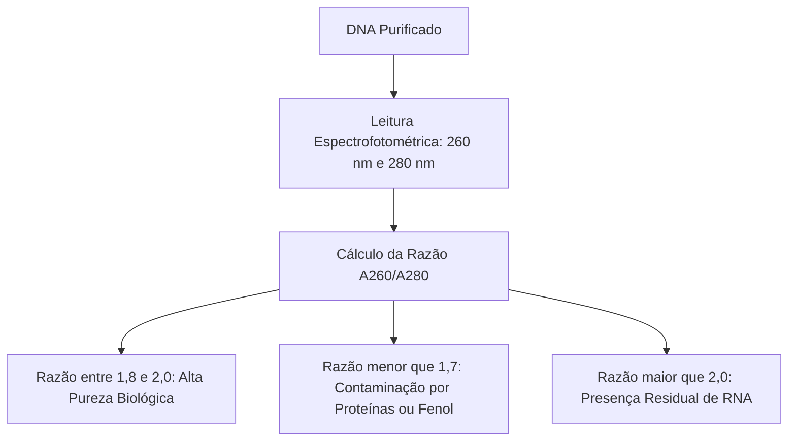
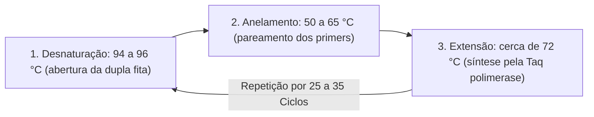
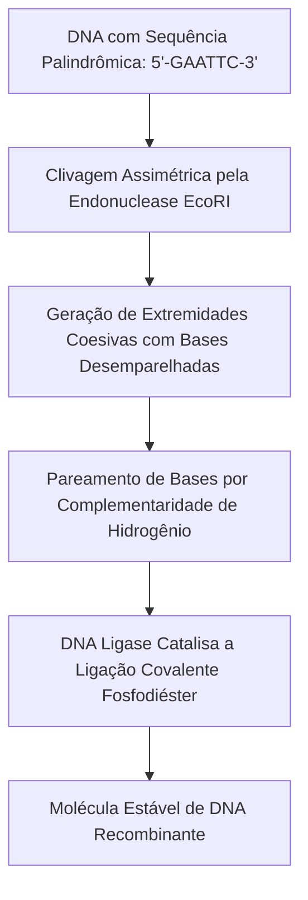
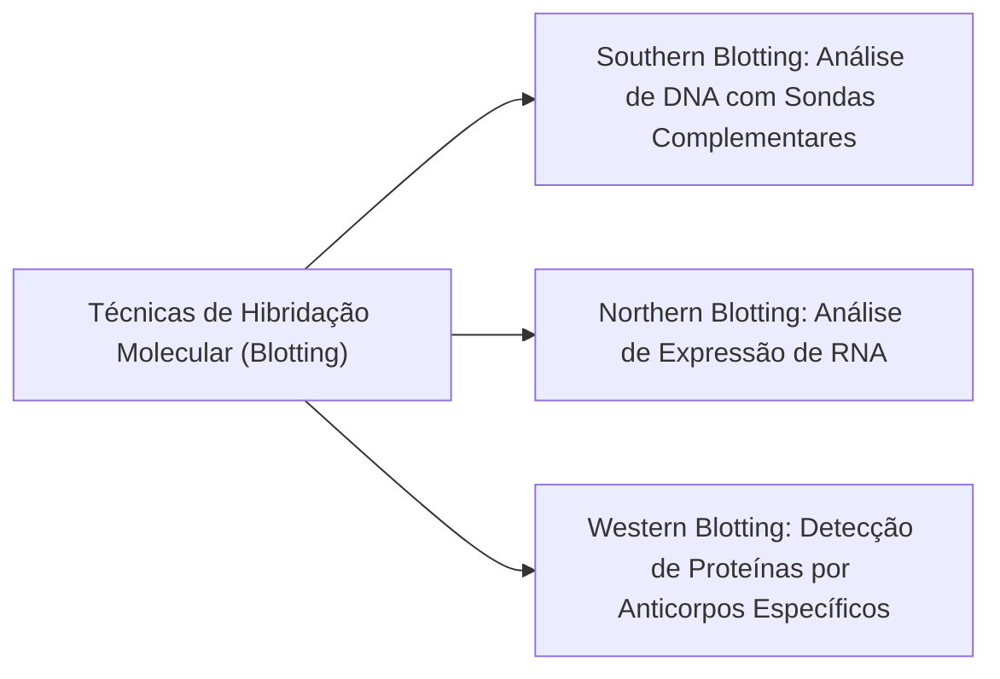

A Biotecnologia Molecular e a Engenharia Genética constituem a fronteira das ciências biológicas. Essas disciplinas capacitam o isolamento, a caracterização, a recombinação e a expressão do DNA em sistemas celulares heterólogos. Essas abordagens viabilizam a produção de biofármacos recombinantes em larga escala. Além disso, sustentam o desenvolvimento de lavouras geneticamente modificadas e a identificação genética pericial em segurança pública. O domínio dos princípios da PCR, das enzimas de restrição, da clonagem e da transgenia é decisivo em exames da área pericial.

> [!objetivos]
> - Compreender a quantificação e pureza de ácidos nucleicos por espectrofotometria e qPCR.
> - Descrever minuciosamente as etapas do ciclo da PCR e caracterizar suas principais variantes.
> - Analisar o papel das enzimas de restrição na construção de moléculas de DNA recombinante.
> - Diferenciar os métodos de sequenciamento gênico e as técnicas laboratoriais de blotting.
> - Caracterizar a clonagem molecular e a biotecnologia na produção de biofármacos e alimentos.

## Quantificação e Pureza de Ácidos Nucleicos

Após a extração de ácidos nucleicos, é fundamental quantificar a massa molecular obtida. Também se deve inspecionar o grau de pureza da preparação. A presença de impurezas celulares ou solventes residuais compromete a ação das DNA polimerases em etapas posteriores.

A **espectrofotometria UV** baseia-se na absorção de luz pelas bases nitrogenadas aromáticas. O pico máximo de absorção ocorre no comprimento de onda de 260 nanômetros (A260). A concentração do ácido nucleico é calculada pela **Lei de Lambert-Beer**. Essa lei estabelece a proporcionalidade entre absorbância óptica, coeficiente de absorção e espessura da cubeta.

A pureza do DNA extraído é avaliada pela razão espectrofotométrica entre 260 nm e 280 nm (A260/A280). As proteínas celulares contêm resíduos aromáticos que absorvem fortemente em 280 nm. Amostras de DNA de fita dupla puras apresentam razão A260/A280 entre 1,8 e 2,0. Razões abaixo de 1,7 revelam contaminação proteica ou fenólica. Razões acima de 2,0 sugerem a presença indesejada de RNA residual.

Na perícia forense utiliza-se a **PCR em tempo real (qPCR)** para quantificação absoluta. Essa técnica acompanha a emissão de fluorescência a cada ciclo da amplificação. A análise compara o ciclo limiar (Ct) da amostra com padrões conhecidos. O ensaio determina com exatidão a quantidade de DNA humano íntegro presente no vestígio.

| Método de Quantificação | Princípio Físico-Químico | Vantagens Operacionais | Limitações Práticas |
| :--- | :--- | :--- | :--- |
| **Espectrofotometria UV** | Absorbância em 260 nm (Lambert-Beer) | Leitura rápida e baixo custo operacional | Não diferencia DNA íntegro de degradado |
| **Fluorometria (Corantes)** | Emissão de luz por agentes intercalantes | Alta seletividade para fitas duplas | Exige calibração fluorométrica prévia |
| **qPCR (Tempo Real)** | Medição da fluorescência ciclo a ciclo | Específico para DNA humano em perícia | Maior custo de equipamentos e reagentes |

## A Reação em Cadeia da Polimerase (PCR)

A **Reação em Cadeia da Polimerase (PCR)** foi desenvolvida por Kary Mullis na década de 1980. Ela viabiliza a amplificação in vitro exponencial de trechos específicos de DNA a partir de quantidades microscópicas. A reação opera em um termociclador programável.

A mistura de reação necessita de componentes específicos em tampão aquoso. Exige o DNA molde com o alvo e um par de **primers** sintetizados quimicamente. Requer também desoxirribonucleotídeos livres (dNTPs) e íons magnésio (Mg2+) como cofatores enzimáticos. Por fim, emprega uma DNA polimerase estável ao calor, classicamente a **Taq polimerase**, isolada de *Thermus aquaticus*.

O ciclo térmico desdobra-se em três etapas:

1. **Desnaturação Térmica (94 a 96 °C):** O calor rompe as pontes de hidrogênio da dupla hélice. A molécula se abre em duas fitas simples de DNA sem quebra de ligações fosfodiéster.
2. **Anelamento dos Primers (50 a 65 °C):** A redução térmica permite que os primers pareiem nas extremidades do segmento-alvo. Essa temperatura fica cerca de 5 °C abaixo da Tm dos oligonucleotídeos.
3. **Extensão ou Polimerização (72 °C):** A temperatura atinge a faixa ideal da Taq polimerase. A enzima incorpora dNTPs no sentido 5' para 3' a partir dos primers, duplicando a região.

Ao término de cerca de trinta ciclos térmicos sucessivos, produzem-se exponencialmente bilhões de cópias fiéis do amplicon demarcado pelos primers. A eficiência teórica da reação duplica o material genético a cada volta, permitindo detectar vestígios biológicos invisíveis a olho nu. A metodologia gerou variantes de grande alcance técnico:

- **RT-PCR:** Emprega a transcriptase reversa para converter RNA mensageiro em DNA complementar (cDNA), amplificado a seguir pela Taq polimerase. É a ferramenta padrão no diagnóstico de vírus de RNA.
- **PCR Multiplex:** Utiliza diversos pares de primers no mesmo tubo. Amplifica múltiplos locos em simultâneo, sendo basilar na identificação forense de microssatélites (STRs).
- **Nested PCR:** Executa duas rodadas sequenciais de amplificação com primers internos para maximizar a sensibilidade analítica.

> [!bizu]
> Na perícia forense com DNA exíguo pode ocorrer o **alelo drop-out**, no qual um dos alelos de um heterozigoto falha em amplificar, forjando um falso homozigoto. A elevação excessiva de ciclos pode causar o **alelo drop-in**, que amplifica bandas inespecíficas ou contaminantes no ensaio.

## Enzimas de Restrição e a Tecnologia do DNA Recombinante

A **Tecnologia do DNA recombinante** nasceu a partir da descoberta das **enzimas de restrição**. Essas endonucleases atuam nas bactérias como defesa imunológica celular contra a invasão de bacteriófagos. A bactéria protege seu próprio genoma metilando bases específicas em seu DNA.

As endonucleases clivam o DNA em sequências nucleotídicas específicas dotadas de simetria rotacional. Essa sequência conservada é chamada de **palíndromo**. Nela, a ordem de bases de 5' para 3' em uma fita é idêntica à ordem na fita complementar oposta.

Ao quebrar as ligações fosfodiéster, as enzimas originam dois tipos de terminações:

- **Extremidades Coesivas (ou pegajosas):** Cortes assimétricos geram projeções curtas de fita simples desemparelhada. Essas extremidades facilitam a hibridação de fragmentos de diferentes origens cortados pela mesma enzima.
- **Extremidades Cegas (ou retas):** Cortes retos no centro da sequência geram extremidades sem projeções de fita simples.

Após o pareamento espontâneo de bases entre os fragmentos, a enzima **DNA ligase** forja a ligação fosfodiéster entre o 3'-OH e o 5'-fosfato. Essa ação sela a espinha dorsal e conclui a molécula de DNA recombinante.

| Enzima de Restrição | Micro-organismo de Origem | Sequência de Reconhecimento (5' para 3') | Tipo de Extremidade Gerada |
| :--- | :--- | :--- | :--- |
| **EcoRI** | *Escherichia coli* | G-AATTC | Coesiva (pontas 5' salientes) |
| **HindIII** | *Haemophilus influenzae* | A-AGCTT | Coesiva (pontas 5' salientes) |
| **BamHI** | *Bacillus amyloliquefaciens* | G-GATCC | Coesiva (pontas 5' salientes) |
| **SmaI** | *Serratia marcescens* | CCC-GGG | Extremidade Cega (blunt end) |

> [!exemplo]
> Para inserir um gene humano em um plasmídeo bacteriano, ambos são clivados com a endonuclease EcoRI. Como ambos geram as mesmas extremidades coesivas complementares (5'-AATT-3'), os fragmentos se reconhecem espontaneamente. A DNA ligase sela as descontinuidades, forjando o plasmídeo recombinante.

## Métodos de Sequenciamento de DNA e Técnicas de Blotting

O sequenciamento genético estabelece a ordem precisa das bases nitrogenadas em uma fita de ácido nucleico. O método enzimático clássico foi formulado por Frederick Sanger na década de 1970.

O **método de Sanger** baseia-se no emprego de didesoxinucleotídeos trifosfatados (ddNTPs). Essas moléculas artificiais carecem da hidroxila no carbono 3' da pentose. Quando a DNA polimerase incorpora um ddNTP, a ausência do 3'-OH impede a ligação com o nucleotídeo seguinte. Essa interrupção obrigatória encerra a extensão da fita naquele ponto exato. Como a reação contém uma mistura balanceada de dNTPs normais abundantes e uma fração reduzida de ddNTPs específicos, geram-se populações de fragmentos que terminam estatisticamente em cada posição de nucleotídeo da sequência original.

Nos sequenciadores capilares contemporâneos, cada ddNTP recebe um corante fluorescente distinto. A corrida eletroforética separa os fragmentos por tamanho, e um feixe de laser decodifica a sequência automaticamente. Plataformas de **Nova Geração (NGS)** realizam leituras massivas em paralelo. No sequenciamento por **nanoporos**, fitas passam por poros microscópicos e as bases são lidas por variações na corrente elétrica.

Na pesquisa e na rotina analítica utilizam-se técnicas consagradas de blotting:

- **Southern Blotting:** Detecta sequências específicas de DNA genômico clivadas por enzimas de restrição. O material separado em gel migra para membrana de náilon e hibridiza com sondas marcadas.
- **Northern Blotting:** Variante voltada para identificar e dosar moléculas de RNA, avaliando níveis teciduais de expressão gênica.
- **Western Blotting:** Procedimento imunológico para identificação de proteínas. Após separação eletroforética, as proteínas na membrana são reconhecidas por anticorpos específicos conjugados a reveladores químicos.

> [!atencao]
> Mnemônico para memorizar as técnicas de blotting: use a chave **SNOW DROP**:
> - **S**outhern analisa **D**NA;
> - **N**orthern analisa **R**NA;
> - **O** (letra nula sem correspondência);
> - **W**estern analisa **P**roteína.

## Clonagem Molecular, Vetores e Noções de Clonagem

A clonagem compreende a geração de cópias idênticas a partir de um molde original. Na **clonagem molecular**, um segmento de DNA é inserido em um vetor carreador autorreplicativo para multiplicação em células hospedeiras.

Os vetores mais difundidos são os **plasmídeos bacterianos**, pequenas moléculas de DNA circular extracromossômicas. Um plasmídeo de clonagem possui três regiões funcionais:

1. **Origem de Replicação (ori):** Assegura a duplicação autônoma no interior da bactéria hospedeira.
2. **Sítio de Clonagem Múltiplo (MCS):** Região sintética contendo alvos para diversas enzimas de restrição.
3. **Marcadores de Seleção:** Genes de resistência a antibióticos (como ampicilina). Permitem isolar as bactérias transformadas em meio com antibiótico.

| Categoria do Vetor | Natureza Molecular | Capacidade de Inserção | Aplicação Preferencial |
| :--- | :--- | :--- | :--- |
| **Plasmídeo** | DNA circular bacteriano | Até cerca de 10 a 15 kb | Clonagem rotineira e produção de proteínas |
| **Fago Lambda** | Genoma viral de fita dupla | Cerca de 15 a 23 kb | Construção de bibliotecas genômicas |
| **Cosmídeo** | Plasmídeo com sítios *cos* virais | Cerca de 40 a 50 kb | Clonagem de segmentos intermediários |
| **YAC** | Cromossomo artificial de levedura | De 100 a mais de 1.000 kb | Clonagem de megabases no Genoma Humano |

No âmbito celular e organísmico distinguem-se noções sobre clonagem:

- **Clonagem Reprodutiva:** Visa obter um indivíduo geneticamente idêntico ao doador. A técnica de **Transferência Nuclear de Células Somáticas (SCNT)** transfere o núcleo somático adulto para um oócito enucleado. O embrião resultante é implantado no útero de fêmea receptora. O marco pioneiro foi a ovelha Dolly em 1996.
- **Clonagem Terapêutica:** Interrompe o desenvolvimento no estágio de blastocisto para derivar **células-tronco embrionárias pluripotentes**. Essas linhagens originam tecidos histocompatíveis para regeneração celular, prevenindo rejeição imune em transplantes.

> [!esquema]
> A clonagem reprodutiva busca produzir um organismo completo (caso Dolly). A clonagem terapêutica utiliza o blastocisto para isolar células-tronco embrionárias pluripotentes para restaurar tecidos doentes sem implantação no útero.

## Biotecnologia na Produção de Fármacos e Alimentos

A engenharia genética permitiu a fabricação de proteínas de valor terapêutico em grande escala. Antes disso, proteínas vitais como a insulina eram obtidas de órgãos de porcos ou bois, com risco de reações imunes.

Em 1978, o gene da **insulina humana recombinante** foi clonado em bactérias *Escherichia coli*. Emprega-se cDNA (sem íntrons) acoplado a promotores bacterianos indutíveis. Quando a proteína demanda modificações pós-traducionais complexas, utilizam-se leveduras (*Saccharomyces cerevisiae*) para a síntese da **vacina recombinante contra hepatite B**. Células de mamíferos em cultura sintetizam eritropoietina e anticorpos monoclonais.

Na agricultura, os **organismos geneticamente modificados (OGMs)** recebem genes benéficos. São chamados de **transgênicos** quando incorporam genes de espécies filogeneticamente distintas. Na transgenia vegetal aplicam-se três métodos:

1. **Transformação por *Agrobacterium tumefaciens*:** Bactéria que transfere o segmento T-DNA de seu **plasmídeo Ti** para o genoma da planta. Os genes de patogenicidade são trocados pelo gene agronômico desejado.
2. **Biobalística:** Microesferas de ouro ou tungstênio revestidas de DNA recombinante são disparadas em alta velocidade contra o tecido vegetal íntegro.
3. **Eletroporação:** Pulsos de corrente elétrica permeabilizam protoplastos celulares sem parede para a entrada do vetor.

Entre os exemplos consolidados figuram a soja tolerante ao glifosato e o milho *Bt*. O milho *Bt* expressa a endotoxina de *Bacillus thuringiensis*, garantindo autoproteção contra pragas e reduzindo a pulverização de agrotóxicos.

> [!resolvido]
> **Questão Conceitual:** Por que a expressão de um gene eucariótico em bactérias *E. coli* requer o uso de cDNA gerado por transcriptase reversa a partir de RNAm maduro, e não do DNA genômico original?
> **Resolução:** As bactérias não possuem envoltório nuclear nem spliceossomo para processar íntrons. Se recebessem o DNA genômico com íntrons, as bactérias traduziriam sequências não codificadoras, gerando proteínas defeituosas. O cDNA é livre de íntrons, permitindo a tradução correta da proteína no hospedeiro procarioto.

## Mapa do capítulo

```mermaid Síntese de Biotecnologia Molecular e Engenharia Genética
flowchart TD
    A["Biotecnologia Molecular e Engenharia Genética"] --> B["Quantificação e Princípios da PCR"]
    A --> C["Enzimas de Restrição e Clonagem"]
    A --> D["Sequenciamento e Blotting"]
    A --> E["Biofármacos e Transgenia"]

    B --> B1["Espectrofotometria UV (A260/A280) e quantificação por qPCR"]
    B --> B2["Ciclos de PCR: desnaturação a 95 °C, anelamento e extensão a 72 °C"]
    B --> B3["Taq polimerase e variantes RT-PCR (cDNA) e multiplex"]

    C --> C1["Enzimas de restrição clivam palíndromos com pontas coesivas"]
    C --> C2["DNA ligase sela ligações fosfodiéster no vetor"]
    C --> C3["Plasmídeos com ori, MCS e resistência a antibióticos"]

    D --> D1["Sanger: ddNTPs terminadores sem hidroxila no carbono 3'"]
    D --> D2["NGS em paralelo e sequenciamento de quarta geração por nanoporos"]
    D --> D3["Blotting: Southern para DNA, Northern para RNA e Western para proteínas"]

    E --> E1["Insulina recombinante e vacinas expressas em bactérias e leveduras"]
    E --> E2["Clonagem reprodutiva por transferência nuclear (caso Dolly)"]
    E --> E3["Transgênicos: Agrobacterium tumefaciens (Ti) e biobalística"]
```

### Para fixar

- **Razão A260/A280:** Medida espectrofotométrica de pureza do DNA; valores ideais situam-se entre 1,8 e 2,0.
- **Ciclo da PCR:** Desnaturação térmica (95 °C), anelamento de primers específicos e extensão pela Taq polimerase (72 °C).
- **Variantes da PCR:** RT-PCR converte RNAm em cDNA via transcriptase reversa; qPCR quantifica o DNA por fluorescência.
- **Enzimas de Restrição:** Endonucleases bacterianas que clivam sequências palindrômicas gerando extremidades coesivas ou cegas.
- **DNA Recombinante:** Molécula forjada pela união de fragmentos de diferentes origens mediada pela ação da DNA ligase.
- **Método de Sanger:** Sequenciamento com didesoxinucleotídeos (ddNTPs) que interrompem a cadeia por ausência da hidroxila 3'.
- **Técnicas de Blotting:** Southern blotting hibridiza DNA; Northern analisa RNA; Western detecta proteínas por anticorpos.
- **Plasmídeos de Clonagem:** Vetores de DNA circular com origem de replicação, sítio múltiplo de clonagem e marca de seleção.
- **Clonagem por SCNT:** Transferência do núcleo de célula somática adulta para oócito enucleado (caso histórico da ovelha Dolly).
- **Transgenia Agronômica:** Inserção de genes heterólogos via plasmídeo Ti de *Agrobacterium tumefaciens* ou biobalística com microprojéteis.
