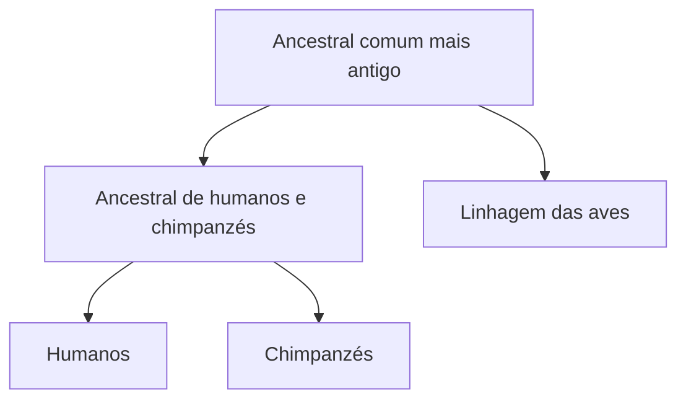

Este capítulo explica por que os seres vivos mudam ao longo do tempo e como a ciência prova isso. Começa pelas ideias de Lamarck e de Darwin, passa pelas evidências da evolução, pela teoria moderna e pelos tipos de seleção, e termina na filogenia, que desenha o parentesco entre os grupos. Na prova, o assunto aparece em questões que pedem a diferença entre conceitos parecidos: órgão homólogo e análogo, grupo monofilético e parafilético, seleção direcional e disruptiva.

> [!objetivos]
> - Distinguir a explicação de Lamarck da explicação de Darwin para a adaptação.
> - Classificar um órgão como homólogo, análogo ou vestigial.
> - Nomear os fatores evolutivos e os quatro tipos de seleção.
> - Reconhecer grupos monofiléticos, parafiléticos e polifiléticos numa árvore filogenética.

## O que é evolução

**Evolução biológica** é a mudança das características de uma população ao longo das gerações. A palavra descreve alteração, não melhoria. Uma característica que ajuda numa região quente e seca pode atrapalhar numa região fria e úmida. Por isso, dizer que um organismo é "mais evoluído" que outro é um erro de linguagem: todos os seres atuais têm a mesma idade evolutiva desde o ancestral comum.

O pensamento evolutivo procura explicações na natureza, e não em causas sobrenaturais. O biólogo Theodosius Dobzhansky resumiu isso numa frase famosa: nada na biologia faz sentido se não for à luz da evolução. Para acompanhar o capítulo, convém lembrar noções de genética (gene, alelo, mutação) e de ecologia (população, ambiente, nicho). Duas figuras marcam a história desse pensamento: Lamarck e Darwin.

## Lamarck e a herança do uso

O francês Jean-Baptiste Lamarck, no início do século 19, foi um dos primeiros a propor que as espécies mudam. Ele defendia duas ideias centrais:

- **Lei do uso e desuso:** o órgão muito usado se desenvolve, e o pouco usado se atrofia.
- **Lei da transmissão dos caracteres adquiridos:** o que o indivíduo ganha ou perde durante a vida passaria para os filhos.

Um exemplo moderno ajuda a ver o raciocínio. Se um soldado treina por anos e fica com braços fortes, a visão lamarckista diria que os filhos nascem musculosos por herança do treino. Hoje se sabe que isso não ocorre: a musculatura treinada não altera os gametas, e só mudanças no DNA dos gametas passam adiante. Por esse motivo, a transmissão dos caracteres adquiridos foi abandonada.

Lamarck tem, porém, um mérito: admitiu que o ambiente provoca mudanças lentas e graduais nos seres vivos e que elas levam à adaptação. Para a época, isso rompia com explicações sobrenaturais.

## Darwin e a seleção natural

Charles Darwin viajou pelo mundo a bordo do navio Beagle, coletou muitas espécies e reuniu as observações em *A origem das espécies*. A ideia central dele nasceu de uma comparação com a criação de animais e plantas.

Na **seleção artificial**, o ser humano escolhe quais indivíduos vão se reproduzir. Foi assim que agricultores, ao cruzar sempre as plantas de espigas mais cheias, chegaram ao milho atual. Darwin propôs que a natureza faz algo equivalente, sem escolha consciente. É a **seleção natural**.

O raciocínio tem quatro passos:

1. Os indivíduos de uma população **variam** entre si.
2. Parte dessas variações é **herdada** pelos descendentes.
3. O ambiente impõe uma **pressão seletiva**: nem todos sobrevivem e se reproduzem.
4. Os mais aptos deixam **mais descendentes**, e suas características ganham frequência na população.

> [!exemplo]
> Uma prefeitura aplica o mesmo inseticida durante anos contra mosquitos. Alguns mosquitos já nascem com uma variação que os torna resistentes. O inseticida mata os sensíveis e poupa os resistentes, que se reproduzem mais. Depois de poucas gerações, quase todos os mosquitos da cidade são resistentes. O inseticida não criou a resistência: apenas selecionou quem já a tinha.

O **darwinismo** defende que todas as espécies têm um **ancestral comum** e que a seleção natural é o mecanismo principal da mudança. Dois termos aparecem sempre juntos:

- **Adaptação:** ajuste de um indivíduo ou de uma população ao ambiente, resultado da seleção natural.
- **Adaptabilidade:** capacidade de deixar descendentes. Pesa mais que as outras características, porque um organismo muito adaptado que não se reproduz nada transmite.

> [!pegadinha]
> A banca apresenta a seleção natural como se o indivíduo "se esforçasse" para se adaptar, que é a lógica de Lamarck. Em Darwin, a variação já existe e o ambiente apenas seleciona. O indivíduo não muda a si mesmo para sobreviver.

| Aspecto | Lamarck | Darwin |
| --- | --- | --- |
| Origem da variação | Necessidade e uso do órgão | Variação já existente na população |
| Papel do ambiente | Provoca a mudança no indivíduo | Seleciona os mais aptos |
| Herança | Caracteres adquiridos passam aos filhos | Passam as variações herdáveis |
| Situação hoje | Abandonada | Base da teoria moderna |

## Evidências da evolução

A ciência reúne vários tipos de prova de que as espécies mudaram e têm parentesco. As três mais cobradas são fósseis, anatomia comparativa e genética.

### Fósseis

**Fóssil** é qualquer vestígio de organismo preservado, em geral mineralizado, em condições especiais. Os fósseis mostram que existiram seres diferentes dos atuais e que as espécies se sucederam no tempo. O *Archaeopteryx*, por exemplo, tinha penas e asas, mas também dentes e cauda longa com ossos, como os dinossauros. Ele é visto como forma de transição entre dinossauros e aves. Hoje, os fósseis também fornecem material para análises genéticas.

### Anatomia comparativa

Quando se comparam os corpos de animais diferentes, três situações aparecem:

- **Órgãos homólogos:** têm a mesma origem embrionária e estrutura básica semelhante, ainda que a função mude. A asa do morcego e a nadadeira do golfinho são homólogas, porque seguem o mesmo plano de ossos do braço. O processo que gera funções diferentes a partir de uma origem comum é a **divergência evolutiva**.
- **Órgãos análogos:** têm a mesma função, mas origem diferente. A asa de uma ave e a asa de uma abelha servem para voar, mas surgiram de estruturas distintas. O processo é a **convergência evolutiva**: ambientes semelhantes selecionam soluções parecidas.
- **Órgãos vestigiais:** restos de estruturas que eram úteis nos ancestrais e perderam função. O apêndice cecal humano é um exemplo.

Só a homologia indica parentesco. A analogia mostra apenas que o ambiente exigiu a mesma função.

### Genética

Os genes **Hox**, chamados homeóticos, comandam a formação das partes do corpo no embrião. Eles existem em moscas, aves e seres humanos e funcionam de modo tão parecido que um gene como o *Pax-6*, ligado ao olho, pode ser trocado entre espécies sem estragar o desenvolvimento. Essa conservação ao longo de milhões de anos reforça a ideia de ancestral comum.

> [!esquema] Evidências da evolução
> - **Fósseis:** sucessão de espécies e formas de transição.
> - **Homologia:** origem comum, funções que podem divergir.
> - **Analogia:** função comum, origens diferentes (convergência).
> - **Vestígios:** estruturas sem função, herdadas de ancestrais.
> - **Genes conservados:** Hox e *Pax-6* funcionam em espécies distantes.

## Teoria moderna da evolução

A **teoria sintética**, também chamada de **neodarwinismo**, une a seleção natural de Darwin com a genética. A seleção não cria variação: ela age sobre a variabilidade que já existe, produzida por três fatores:

1. **Mutação:** alteração aleatória do material genético, fonte de novos alelos.
2. **Recombinação gênica:** novas combinações de alelos, geradas pela segregação dos cromossomos e pelo *crossing over* na meiose.
3. **Seleção natural:** filtro que aumenta ou diminui a frequência de cada variante.

Esses são os **fatores evolutivos** que a prova costuma pedir. Um ponto essencial: a evolução ocorre em **populações**, nunca em indivíduos. Um indivíduo não evolui; muda a frequência dos alelos no conjunto.

### Tipos de seleção natural

A seleção pode atuar de quatro modos sobre uma característica que varia, como o tamanho do corpo.

| Tipo | O que favorece | Efeito sobre a população |
| --- | --- | --- |
| Direcional | Um dos extremos | A característica se desloca para esse extremo |
| Estabilizadora (balanceadora) | Os valores intermediários | A variação diminui |
| Disruptiva | Os dois extremos | A população tende a se dividir em dois grupos |
| Purificadora | Os que não têm mutação nociva | Elimina mutações deletérias |

> [!bizu]
> Imagine um gráfico em forma de sino. Direcional empurra o sino para um lado; estabilizadora o afina no meio; disruptiva o parte em dois picos; purificadora apara o que é nocivo.

## Filogenia

A **filogenia** estuda o parentesco evolutivo entre os grupos de seres vivos. O ponto de partida é o princípio darwiniano do ancestral comum. O resultado é uma **árvore filogenética**, em que cada bifurcação (nó) representa um ancestral comum.

Na figura, humanos e chimpanzés se separaram a partir de um ancestral que viveu entre 6 e 8 milhões de anos atrás. Portanto, **o ser humano não descende do chimpanzé**: os dois descendem de um ancestral extinto. Também não se deve ler a árvore como uma escada de progresso, pois nenhum ramo atual é "mais antigo" que outro.

### Apomorfia e sinapomorfia

- **Apomorfia:** novidade evolutiva, característica que surge em uma linhagem e a diferencia das demais. O tamanho de um ramo mostra o acúmulo de apomorfias, e não necessariamente o tempo.
- **Sinapomorfia:** apomorfia **compartilhada** por um grupo, em geral homóloga. O âmnio é uma sinapomorfia dos amniotas, grupo que reúne répteis, aves e mamíferos.

### Monofilético, parafilético e polifilético

Um **clado** ou **táxon** é um agrupamento de seres vivos. Ele pode ser de três tipos:

| Grupo | Composição | Exemplo |
| --- | --- | --- |
| Monofilético | O ancestral comum e **todos** os seus descendentes | Humanos e chimpanzés; os amniotas |
| Parafilético | O ancestral comum, mas **sem** um ou mais descendentes | Os répteis sem as aves |
| Polifilético | Reúne seres por características convergentes, **sem** ancestral comum exclusivo | Animais voadores, como aves, morcegos e insetos |

A classificação moderna busca grupos monofiléticos. Mesmo assim, nomes populares como "algas" reúnem linhagens distintas que compartilham o hábito aquático e a fotossíntese; por isso, "algas" não é um grupo monofilético.

> [!pegadinha]
> Dizer que um grupo é monofilético "porque seus membros são parecidos" está errado. O critério é a **ancestralidade**: o grupo precisa conter o ancestral e todos os seus descendentes. Semelhança por convergência produz grupos polifiléticos.

## Mapa do capítulo

A tabela reúne os conceitos que mais se confundem neste assunto.

| Conceito | Ideia central | Palavra-chave |
| --- | --- | --- |
| Lamarck | Uso e desuso; herança do adquirido | Abandonada |
| Darwin | Seleção natural sobre a variação | Pressão seletiva |
| Homologia | Origem embrionária comum | Divergência |
| Analogia | Mesma função, origens diferentes | Convergência |
| Teoria sintética | Seleção, mutação e recombinação | Populações |
| Seleção direcional | Favorece um extremo | Deslocamento |
| Seleção disruptiva | Favorece os dois extremos | Divisão |
| Monofilético | Ancestral e todos os descendentes | Clado |

### Para fixar

- Evolução é mudança ao longo das gerações, não melhoria.
- Lamarck propôs uso e desuso e herança dos caracteres adquiridos, ideia hoje abandonada.
- Darwin explicou a adaptação pela seleção natural: variação herdável, pressão seletiva e mais descendentes para os mais aptos.
- Órgãos homólogos têm origem comum (divergência); análogos têm função comum (convergência); vestigiais perderam a função.
- Genes conservados, como Hox e *Pax-6*, são evidência genética de ancestral comum.
- Os fatores evolutivos da teoria sintética são mutação, recombinação gênica e seleção natural.
- A evolução ocorre em populações, nunca em indivíduos.
- As seleções são direcional, estabilizadora, disruptiva e purificadora.
- Sinapomorfia é novidade evolutiva compartilhada e define clados.
- Grupo monofilético tem o ancestral e todos os descendentes; o parafilético exclui algum; o polifilético reúne por convergência.
