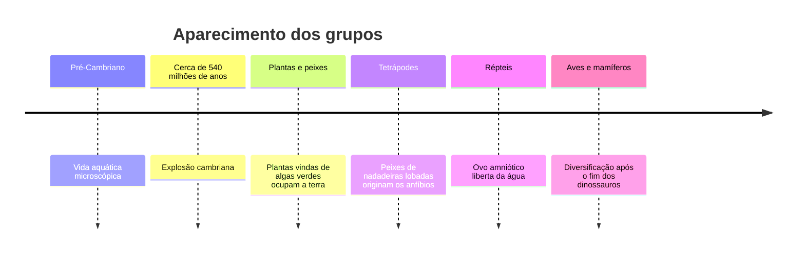

Este capítulo mostra como uma espécie se divide em duas, o que é uma espécie e quais barreiras impedem o cruzamento entre elas. Depois percorre a história da vida na Terra, dos primeiros seres aquáticos aos mamíferos, e termina na origem do ser humano. A prova costuma cobrar os tipos de especiação, os mecanismos de isolamento reprodutivo e a ordem de aparecimento dos grandes grupos.

> [!objetivos]
> - Diferenciar anagênese, cladogênese e especiação.
> - Identificar os quatro modos de especiação pela relação entre as populações.
> - Aplicar os conceitos de espécie e os tipos de isolamento reprodutivo a exemplos.
> - Ordenar no tempo os grandes grupos de animais e os ancestrais do ser humano.

## Como surgem as espécies

Os indivíduos de uma espécie nunca são idênticos: variam em altura, comportamento, fisiologia. Algumas variações aumentam as chances de reprodução e se espalham pela população; outras diminuem e tendem a desaparecer.

Dois processos explicam a diversificação da vida:

- **Anagênese** (modificação filética): uma população inteira muda ao longo do tempo, sem se dividir, por mutações e por alterações nas frequências dos alelos. Quem estuda essas frequências é a **genética de populações**.
- **Cladogênese:** uma população se divide em duas ou mais, que passam a acumular diferenças separadamente e, com o tempo, formam espécies novas.

A formação de espécies novas é a **especiação**. Para que ela ocorra, as populações precisam deixar de trocar genes. Esse estado se chama **isolamento reprodutivo**: se as populações voltarem a se encontrar, o cruzamento não gera descendentes viáveis e férteis.

### Modos de especiação

O que muda de um modo para outro é a relação geográfica entre as populações.

| Modo | Como ocorre | Exemplo hipotético |
| --- | --- | --- |
| Alopátrica | Barreira geográfica separa as populações | Um rio muda de curso e divide uma população de roedores |
| Simpátrica | Sem barreira geográfica, na mesma área | Insetos que passam a viver em plantas hospedeiras diferentes no mesmo campo |
| Peripátrica | Pequeno grupo ocupa um nicho novo e se isola | Poucas aves chegam a uma ilha e fundam nova população |
| Parapátrica | Nicho novo vizinho, com pouco contato com a população original | Plantas em solo contaminado ao lado do solo normal |

> [!bizu]
> Allo = "outro lugar" (separação geográfica); sim = "mesmo lugar"; peri = "periferia" (grupo pequeno na borda); para = "ao lado". Quem lembra o prefixo acerta o modo.

A **irradiação adaptativa** (ou radiação adaptativa) é outro processo apontado por Darwin. Grupos descendentes de um mesmo ancestral ocupam nichos diferentes e, com o tempo, dão origem a muitas espécies distintas. Os tentilhões de Galápagos, com bicos adaptados a sementes, insetos e frutos, são o exemplo clássico.

## O que é uma espécie

O conceito de espécie não é único, porque é mais uma necessidade humana de classificar do que uma realidade fixa da natureza. A tabela lista os cinco conceitos que a prova costuma citar.

| Conceito | Define espécie como | Limitação |
| --- | --- | --- |
| Morfológico | Grupo com forma semelhante | Falha com espécies crípticas e com dimorfismo sexual |
| Biológico | Grupo que se cruza e é isolado reprodutivamente dos outros | Não serve a organismos de reprodução assexuada ou a fósseis |
| Evolutivo | Linhagem que evolui separada das outras | Exige conhecer a história no tempo |
| Filogenético | Menor grupo com caracteres derivados e história comum | Difícil fixar os limites |
| Ecológico | Grupo que ocupa uma zona adaptativa própria | Zona adaptativa é difícil de definir |

Para fins de prova, adote a versão didática: **espécie é o conjunto de indivíduos semelhantes que se cruzam entre si e geram descendentes férteis**. Duas situações mostram os limites da semelhança:

- **Espécies crípticas:** são muito parecidas na aparência, mas pertencem a espécies diferentes.
- **Dimorfismo sexual:** machos e fêmeas da mesma espécie têm formas bem diferentes, e um observador poderia achar que são duas espécies.

> [!exemplo]
> O cavalo e o jumento são espécies diferentes. Cruzados, geram a mula, que é viva e saudável, mas estéril. Como o híbrido não deixa descendentes, os dois grupos continuam separados no sentido biológico, apesar de o cruzamento ocorrer.

**Subespécies** (ou raças) são populações da mesma espécie que se cruzam pouco por comportamento ou por ocuparem áreas diferentes. Suspeita-se que anteceda um processo de especiação em andamento.

### Isolamento reprodutivo

As barreiras que mantêm as espécies separadas se dividem conforme atuem antes ou depois da formação do zigoto.

| Tipo | Barreira | Exemplo |
| --- | --- | --- |
| Pré-zigótico: habitat | Vivem em ambientes diferentes e não se encontram | Anfíbios de lagoa e de mata |
| Pré-zigótico: sazonal | Épocas de reprodução diferentes | Plantas que florescem em meses distintos |
| Pré-zigótico: comportamental | Corte ou canto não atrai a outra espécie | Rãs com cantos diferentes |
| Pré-zigótico: mecânico | Órgãos reprodutores incompatíveis | Flores com formatos que só um polinizador alcança |
| Pré-zigótico: gamético | Gametas não se reconhecem nem se fundem | Esperma que não penetra o óvulo |
| Pós-zigótico | Há fecundação, mas o híbrido tem viabilidade ou fertilidade reduzida | Mula |

> [!atencao] Pré ou pós?
> Se **não houve fecundação**, o isolamento é pré-zigótico. Se **houve fecundação**, mas o híbrido morre cedo ou é estéril, o isolamento é pós-zigótico.

## História da vida na Terra

A Terra tem cerca de 4,6 bilhões de anos. O **Pré-Cambriano** vai do início do planeta até cerca de 540 milhões de anos atrás, e nele surgiram os primeiros seres vivos, todos aquáticos e microscópicos. Há cerca de 540 milhões de anos ocorreu a **explosão cambriana**, quando surgiram muitos grupos de animais com corpos complexos.

A ordem de conquista do ambiente é o que a prova mais cobra, e ela segue uma sequência.

1. **Plantas.** Descendem de algas verdes (clorofitas). Ao ocupar a terra, criaram alimento e ar com oxigênio para os animais.
2. **Peixes de nadadeiras lobadas** (sarcopterígios). Têm ossos na base das nadadeiras, que ajudam a sustentar o corpo. O celacanto, vivo hoje, pertence a esse grupo e por isso é chamado de "fóssil vivo".
3. **Anfíbios.** Foram os primeiros vertebrados a viver em terra firme, mas dependem da água para reproduzir. Atualmente há três ordens: **anuros** (sapos, rãs e pererecas), **ápodes** (cobras-cegas) e **urodelos** (salamandras).
4. **Répteis.** O **ovo amniótico**, com membranas que protegem o embrião e casca, tornou os animais independentes da água para se reproduzir. Os répteis também têm pele seca e respiração pulmonar, características que permitiram viver longe da água. Eles, incluindo os dinossauros, dominaram a era seguinte.
5. **Aves e mamíferos.** As aves são uma linhagem de dinossauros com penas. Os mamíferos descendem de uma linhagem que se separou da dos répteis há cerca de 300 milhões de anos, mas só se diversificaram depois que os dinossauros desapareceram, há cerca de 66 milhões de anos, após a queda de um grande asteroide.

Os primeiros mamíferos eram pequenos, noturnos e tinham olfato e audição muito apurados, o que os protegia dos grandes répteis. Duas inovações ajudaram na sobrevivência: a **endotermia** (produção interna de calor) e a **placenta**. Pela forma de gestação, dividem-se em **marsupiais** e **placentários**; o ser humano é placentário.

> [!pegadinha]
> A banca pode afirmar que os anfíbios são independentes da água porque vivem em terra. Eles ocupam o ambiente terrestre, mas **a reprodução e o desenvolvimento** dependem da água. A independência veio com o ovo amniótico, nos répteis.

## Evolução humana

O ser humano é um primata, parente próximo dos grandes macacos. Os mais próximos são o **chimpanzé** e o **bonobo**, seguidos pelo gorila e, mais distantes, pelo orangotango e pelos gibões. Gorilas, orangotangos e chimpanzés têm 48 cromossomos, e a nossa espécie, 46. Mesmo assim, cerca de 98 a 99% do genoma humano é semelhante ao do chimpanzé.

Em relação aos demais primatas, o ser humano se destaca por cinco características:

- encéfalo grande;
- dentição própria;
- polegar opositor, que permite a pegada de precisão;
- menor quantidade de pelos;
- adaptações ao **bipedismo**, o andar sobre duas pernas.

A sequência evolutiva, em linhas gerais, é a seguinte.

| Grupo | Época aproximada | Característica de destaque |
| --- | --- | --- |
| *Sahelanthropus* e *Orrorin* | 7 a 6 milhões de anos | Possíveis ancestrais iniciais; talvez bípedes |
| *Ardipithecus* | Cerca de 5 milhões de anos | Intermediário entre os primeiros e os australopitecos |
| *Australopithecus* | 4 a 2 milhões de anos | Bípede, de pequena estatura e crânio menor que o humano; *A. afarensis* é a espécie de "Lucy" |
| *Homo habilis* | Cerca de 2,4 milhões de anos | Primeiro do gênero *Homo*; ferramentas de pedra |
| *Homo erectus* | Cerca de 1,8 milhão de anos | Primeiro a sair da África |
| *Homo heidelbergensis* | Cerca de 600 mil anos | Ancestral do *H. sapiens* e do neandertal |
| *Homo sapiens* | Cerca de 300 mil anos | Surge na África e se espalha por todos os continentes |

O neandertal (*Homo neanderthalensis*) é uma linhagem extinta que coexistiu com o *Homo sapiens* na Europa e na Ásia. O *Homo sapiens* é o único primata presente em todos os continentes, exceto a Antártica. A associação de um cérebro desenvolvido com mãos livres pelo bipedismo permitiu criar ferramentas complexas, cultura, escrita e ciência.

> [!pegadinha]
> A conhecida imagem da "marcha do progresso", com um macaco curvado que vai se endireitando até chegar ao homem, está errada. A evolução **não é linear**: as espécies de hominídeos são ramos de uma árvore, e muitos coexistiram. O ser humano **não veio do macaco** atual; os dois têm um ancestral comum extinto.

## Mapa do capítulo

O quadro resume as comparações mais cobradas.

| Tema | Ponto central |
| --- | --- |
| Anagênese | Mudança de uma população, sem divisão |
| Cladogênese | Divisão em populações que originam espécies |
| Especiação | Exige isolamento reprodutivo |
| Alopátrica | Barreira geográfica |
| Simpátrica | Sem barreira geográfica |
| Isolamento pré-zigótico | Antes da fecundação |
| Isolamento pós-zigótico | Híbrido pouco viável ou estéril |
| Grupos no tempo | Plantas, peixes lobados, anfíbios, répteis, aves e mamíferos |
| Ser humano | *Homo sapiens*, ancestral comum com o chimpanzé |

### Para fixar

- Anagênese é a mudança de uma população; cladogênese é a divisão que gera novas populações.
- A especiação depende de isolamento reprodutivo.
- A especiação alopátrica ocorre com barreira geográfica; a simpátrica, sem ela.
- Radiação adaptativa é a diversificação de descendentes em vários nichos.
- Espécies crípticas são parecidas, mas distintas; o dimorfismo sexual faz uma espécie parecer duas.
- Isolamento pré-zigótico impede a fecundação; o pós-zigótico gera híbrido pouco viável ou estéril.
- Os anfíbios dependem da água para reproduzir; o ovo amniótico libertou os répteis.
- Aves descendem de dinossauros com penas; mamíferos têm endotermia e placenta, e se diversificaram após os dinossauros.
- O *Homo erectus* foi o primeiro a sair da África.
- O homem não veio do macaco: ambos têm ancestral comum.
