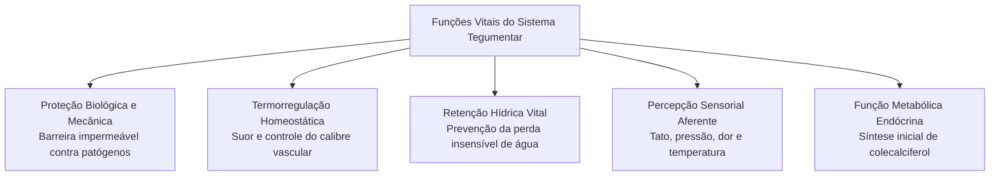
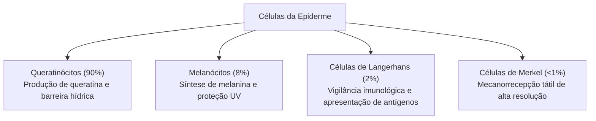
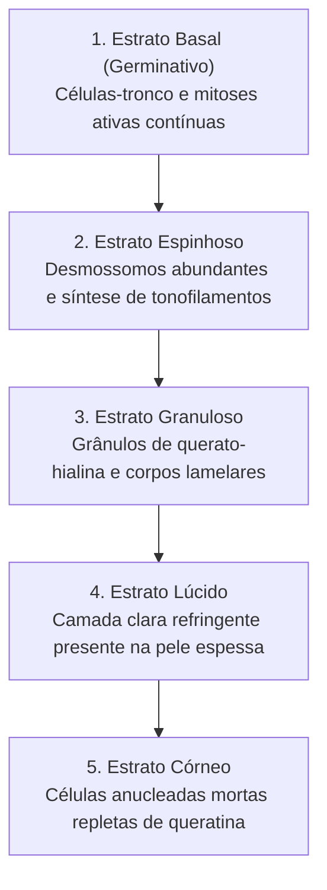
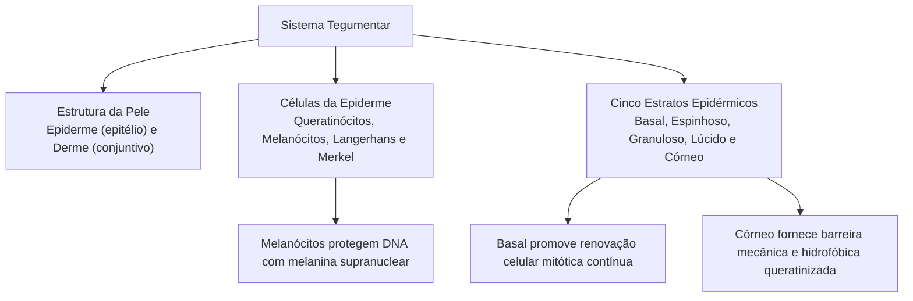

O sistema tegumentar constitui o envoltório biológico primário do organismo humano, exercendo papel protetor contra agentes agressores externos e atuando na manutenção da homeostase interna. Em atividades operacionais de salvamento, combate a incêndios e atendimento pré-hospitalar, o militar depara-se frequentemente com lesões térmicas, queimaduras e traumas físicos que comprometem diretamente a integridade da barreira cutânea.

> [!objetivos]
> - Compreender a organização geral da pele como órgão multifuncional essencial para a homeostase corpórea.
> - Caracterizar a arquitetura tecidual da epiderme e seus tipos celulares especializados.
> - Detalhar a estratificação histológica epidérmica, do estrato basal ao estrato córneo.
> - Analisar a dinâmica biológica da queratinização e os mecanismos de proteção contra a radiação solar.

## Introdução ao Sistema Tegumentar

O tegumento humano é o maior órgão do corpo em extensão e massa, representando aproximadamente dezesseis por cento do peso corporal total de um indivíduo adulto. Sua superfície média varia entre um vírgula cinco e dois metros quadrados. Esse revestimento atua na interface contínua entre o meio ambiente exterior e os tecidos fisiológicos internos, desempenhando funções vitais indispensáveis à sobrevivência dos vertebrados terrestres.

A pele desempenha múltiplas funções fisiológicas integradas:
1. **Barreira de Proteção Mecânica e Biológica:** impede a invasão de bactérias, vírus e fungos patogênicos, bloqueia a penetração de substâncias químicas tóxicas e amortece impactos mecânicos cotidianos.
2. **Prevenção da Desidratação:** a camada lipídica superficial e as junções intercelulares oclusivas minimizam a perda insensível de água por evaporação, viabilizando a adaptação biológica à vida terrestre em climas secos.
3. **Termorregulação Corporal:** controla a dissipação ou conservação de calor mediante a sudorese e variações no calibre do leito vascular periférico.
4. **Recepção Sensorial:** abriga terminações nervosas livres e corpúsculos táteis especializados que detectam estímulos térmicos, dolorosos, pressóricos e vibratórios do ambiente.
5. **Síntese Endócrina de Vitamina D:** participa da fotoconversão cutânea do 7-desidrocolesterol em colecalciferol sob o influxo de raios ultravioleta do tipo B.
6. **Excreção Metabólica:** elimina pequenas quantidades de água, eletrólitos, ureia e ácido úrico por meio da secreção do suor.

> [!esquema] Barreira Mecânica e Bioquímica da Pele
> A proteção cutânea opera por meio de três mecanismos bioquímicos sincronizados:
> - **Manto Lipídico Superficial:** emulsão hidrolipídica ácida com pH em torno de 4,5 a 5,5 que inibe a proliferação bacteriana e fúngica patogênica.
> - **Queratina Insolúvel:** rede proteica filamentosa densa resistente à digestão enzimática comum e à abrasão física.
> - **Secreção de Peptídeos Antimicrobianos:** produção de defensinas e dermcidinas pelas células epiteliais e glândulas sudoríparas.

## A Pele: Arquitetura Geral

Anatomicamente, a pele é formada por duas camadas fundamentais de origens embriológicas e naturezas histológicas distintas: a **epiderme** e a **derme**. Abaixo da derme situa-se a **hipoderme** (ou tecido celular subcutâneo), que funciona como base de ancoragem e amortecimento, embora não seja considerada histologicamente uma camada integrante da pele propriamente dita:

- **Epiderme:** camada epitelial superficial, derivada da ectoderme embrionária. Trata-se de um epitélio estratificado pavimentoso queratinizado, totalmente desprovido de vasos sanguíneos ou linfáticos próprios. Sua nutrição e oxigenação dependem exclusivamente da difusão de nutrientes a partir dos capilares sanguíneos presentes na derme subjacente.
- **Derme:** camada profunda de tecido conjuntivo denso e frouxo, de origem mesodérmica. É ricamente vascularizada, inervada e dotada de abundantes fibras colágenas e elásticas, conferindo resistência à tração e elasticidade à superfície corporal.

A junção entre a epiderme e a derme não é plana, mas ondulada e pregueada. As invaginações da derme em direção à epiderme formam as chamadas **papilas dérmicas**, que se interdigitam com as **cristas epidérmicas**. Essa conformação anatômica ondulada aumenta expressivamente a área de contato e adesão mecânica entre os dois tecidos, impedindo o descolamento da epiderme sob forças de atrito ou cisalhamento lateral. Na ponta dos dedos, essas cristas e papilas projetam-se externamente, originando as impressões digitais individuais.

| Parâmetro Comparativo | Epiderme | Derme | Hipoderme (Subcutâneo) |
|---|---|---|---|
| **Origem Embriológica** | Ectoderme superficial | Mesoderme | Mesoderme |
| **Tecido Predominante** | Epitélio pavimentoso queratinizado | Conjuntivo frouxo e denso não modelado | Adiposo unilocular e conjuntivo |
| **Vascularização** | Avascular (nutrição por difusão) | Ricamente vascularizada | Abundantemente vascularizada |
| **Função Principal** | Barreira mecânica, química e hídrica | Resistência mecânica e nutrição | Reserva energética e isolamento |

## A Epiderme e seus Tipos Celulares

A epiderme humana abriga quatro populações celulares principais com funções coordenadas:

1. **Queratinócitos (cerca de 85 a 90% das células):** são as células predominantes do epitélio. Produzem a queratina, uma proteína fibrosa insolúvel de alta resistência mecânica, e corpos lamelares ricos em glicolipídios que impermeabilizam a pele. Nascem por divisão mitótica nas camadas mais profundas e migram continuamente em direção à superfície, sofrendo diferenciação programada até se tornarem escamas córneas anucleadas.
2. **Melanócitos (cerca de 5 a 10% das células):** localizam-se na camada basal da epiderme, apoiados sobre a lâmina basal. Apresentam corpo arredondado e longos prolongamentos dendríticos que se insinuam entre os queratinócitos vizinhos. Produzem a melanina dentro de vesículas especializadas chamadas melanossomos.
3. **Células de Langerhans (cerca de 2 a 5% das células):** distribuem-se predominantemente no estrato espinhoso. São células dendríticas originárias da medula óssea que atuam como macrófagos apresentadores de antígenos. Capturam antígenos invasores e migram para os linfonodos regionais, ativando linfócitos T na resposta imune cutânea.
4. **Células de Merkel (menos de 1% das células):** situam-se na camada basal, em contato estreito com terminações nervosas expandidas. Atuam como mecanorreceptores sensoriais de adaptação lenta, responsáveis pela percepção do tato fino e discriminação de formas e texturas.

> [!atencao] Mecanismo da Doação Pigmentar dos Melanócitos
> A melanina produzida nos melanócitos é transferida para o interior dos queratinócitos por meio de um processo de secreção citócrina. Os queratinócitos fagocitam as pontas dos prolongamentos dendríticos dos melanócitos contendo melanossomos maduros. Uma vez dentro dos queratinócitos, os grânulos de melanina posicionam-se estrategicamente sobre a região supranuclear da célula, formando uma capa protetora que absorve a radiação ultravioleta e impede mutações no DNA celular causadas pelo sol.

> [!pegadinha] Número de Melanócitos versus Tom de Pele
> As bancas costumam afirmar que indivíduos de pele escura possuem maior quantidade absoluta de melanócitos do que indivíduos de pele clara. Isso é **falso**. O número total de melanócitos por unidade de área de pele é praticamente idêntico entre todas as etnias humanas. A variação na tonalidade da pele decorre da atividade funcional dos melanócitos: pessoas de pele escura produzem melanossomos maiores, mais abundantes, com síntese predominante de eumelanina mais escura, e degradam a melanina de forma mais lenta nos queratinócitos.

## Estratificação da Epiderme: Camadas Celulares

De acordo com a espessura da camada córnea, a pele é classificada macroscopicamente em pele fina (reveste quase todo o corpo) e pele grossa (presente nas regiões palmoplantares sujeitas a atrito intenso). A epiderme da pele espessa apresenta cinco estratos distintos, descritos a partir da profundidade em direção à superfície livre:

### Estrato Basal (ou Germinativo)

O estrato basal é a camada mais profunda da epiderme, assentada diretamente sobre a lâmina basal que a separa da derme. É constituído por uma única camada de células cúbicas ou prismáticas com núcleos volumosos e citoplasma basófilo. Trata-se da camada germinativa da epiderme, onde residem as células-tronco epiteliais dotadas de intensa atividade mitótica.

As divisões mitóticas contínuas do estrato basal fornecem novos queratinócitos para repor as células descamadas na superfície corporal. O tempo de renovação completa da epiderme humana é de aproximadamente vinte e oito a trinta dias. No estrato basal encontram-se intercalados os corpos celulares dos melanócitos e as células mecanorreceptoras de Merkel. Os queratinócitos basais ligam-se firmemente à lâmina basal subjacente por meio de especializações de membrana denominadas hemidesmossomos.

### Estrato Espinhoso

O estrato espinhoso situa-se imediatamente acima da camada basal, sendo composto por quatro a dez fileiras de queratinócitos poliédricos com núcleos centrais. À microscopia óptica convencional, essas células apresentam projeções citoplasmáticas curtas em formato de espinhos que tocam as células vizinhas. Esses espinhos correspondem a locais de ancoragem de inúmeros **desmossomos**, junções intercelulares de adesão mecânica reforçadas por feixes citoplasmáticos de queratina chamados tonofilamentos.

Essa rede desmossômica confere coesão tecidual à epiderme, permitindo que a pele resista a forças de tração, abrasão e pressão contínua sem que as células se separem. Entre as células do estrato espinhoso circulam os prolongamentos das células de Langerhans, encarregadas da vigilância imunológica contra antígenos invasores.

### Estrato Granuloso

O estrato granuloso é formado por três a cinco camadas de queratinócitos achatados, cujo citoplasma se encontra repleto de grânulos densos denominados **grânulos de querato-hialina**. Esses grânulos contêm proteínas estruturais cruciais, como a filagrina e a loricrina, que promovem a agregação densa e o empacotamento organizado dos filamentos de queratina no interior celular.

Além disso, as células dessa camada produzem **corpos lamelares**, vesículas repletas de lipídios polares (glicolipídios, colesterol e ceramidas). Os corpos lamelares fundem-se à membrana plasmática e descarregam seu conteúdo lipídico no espaço intercelular por exocitose. Essa matriz lipídica extracelular atua como uma barreira impermeabilizante hidrofóbica, impedindo a perda de água corporal e barrando a passagem livre de substâncias hidrossolúveis do meio exterior. Durante a passagem pelo estrato granuloso, os queratinócitos iniciam o processo de morte programada e degradação de suas organelas citoplasmáticas e núcleo.

> [!exemplo] Queimaduras Extensas e Perda da Barreira Hídrica
> Em vítimas de queimaduras graves de segundo e terceiro graus atendidas pelo Corpo de Bombeiros, a destruição da epiderme e do estrato granuloso anula a barreira lipídica impermeabilizante. Como consequência fisiológica imediata, o paciente perde volumes maciços de água por evaporação direta e extravasamento de plasma, desenvolvendo desidratação severa e choque hipovolêmico em poucas horas se não houver reposição hídrica intravenosa agressiva.

### Estrato Lúcido

O estrato lúcido é uma camada delgada, transparente e refringente, encontrada exclusivamente na epiderme da **pele espessa** das palmas das mãos e plantas dos pés. É composto por camadas de células achatadas, anucleadas e mortas, desprovidas de organelas celulares.

O citoplasma dessas células contém uma substância proteica gelatinosa e translúcida denominada **eleidina**, um estágio intermediário de transformação da querato-hialina em queratina madura. Os limites celulares entre os queratinócitos tornam-se indistintos nessa camada.

### Estrato Córneo

A camada córnea posiciona-se no topo da estratificação epitelial, apresentando espessura extremamente variável, desde poucas fileiras de células na pele fina das pálpebras até dezenas de camadas na pele espessa dos calcanhares. Essa camada é constituída inteiramente por células mortas, anucleadas, achatadas e secas, conhecidas como corneócitos ou escamas córneas.

O interior dos corneócitos é totalmente preenchido por filamentos cruzados de queratina rígida, embebidos em uma matriz proteica densa e circundados por uma espessa camada lipídica insolúvel. Na porção mais externa do estrato córneo, os desmossomos são digeridos por enzimas proteolíticas específicas, promovendo a **descamação contínua e imperceptível** das escamas celulares secas. Esse desprendimento remove microrganismos aderidos à superfície cutânea, renovando a linha de defesa física contra infecções.

> [!bizu] Resumo das Camadas da Epiderme (De Dentro para Fora)
> - **Basal:** mitoses contínuas, células-tronco, melanócitos e hemidesmossomos.
> - **Espinhoso:** desmossomos em profusão, tonofilamentos de queratina e células de Langerhans.
> - **Granuloso:** grânulos de querato-hialina e corpos lamelares impermeabilizantes.
> - **Lúcido:** presente apenas na pele espessa (palmas e plantas), contendo eleidina.
> - **Córneo:** células mortas anucleadas repletas de queratina rígida em constante descamação.

## Mapa do capítulo

### Para fixar

1. **Constituição da pele**: órgão formado por epiderme epitelial avascular externa e derme conjuntiva vascularizada interna, assentado sobre a hipoderme.
2. **Junção dermoepidérmica**: formada por papilas dérmicas e cristas epidérmicas interdigitadas que ampliam a adesão mecânica e originam as impressões digitais.
3. **Queratinócitos**: células epiteliais mais abundantes, responsáveis pela síntese contínua de queratina e corpos lamelares impermeabilizantes.
4. **Melanócitos e doação pigmentar**: células da camada basal que sintetizam melanina e a transferem aos queratinócitos para blindar o núcleo contra os raios UV.
5. **Células de Langerhans**: macrófagos dendríticos residentes no estrato espinhoso encarregados da apresentação de antígenos e defesa imune.
6. **Células de Merkel**: receptores táteis basais associados a terminações nervosas para percepção mecânica de alta sensibilidade.
7. **Estrato basal**: monocamada proliferativa com células-tronco em mitose ativa que garantem a renovação celular a cada vinte e oito dias.
8. **Estrato espinhoso**: múltiplas fileiras de queratinócitos unidas por fortes pontes de desmossomos que impedem o esgarçamento tecidual.
9. **Estrato granuloso**: local de síntese de filagrina em grânulos de querato-hialina e liberação de lipídios hidrofóbicos impermeabilizantes.
10. **Estrato lúcido e córneo**: o lúcido é restrito à pele espessa palmoplantar; o córneo compõe-se de escamas anucleadas mortas queratinizadas em constante descamação.
