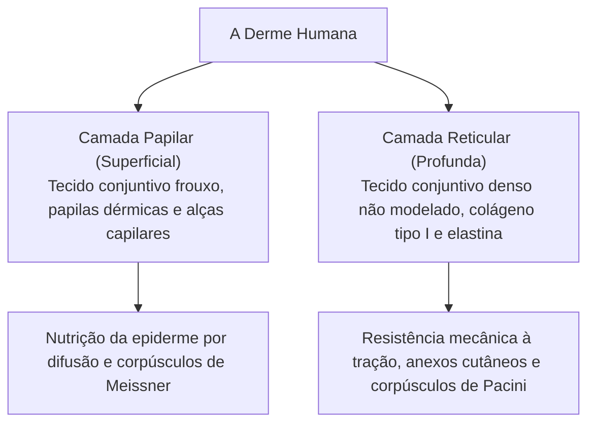
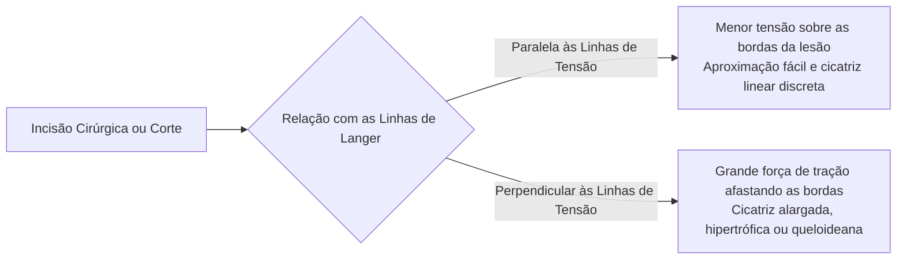
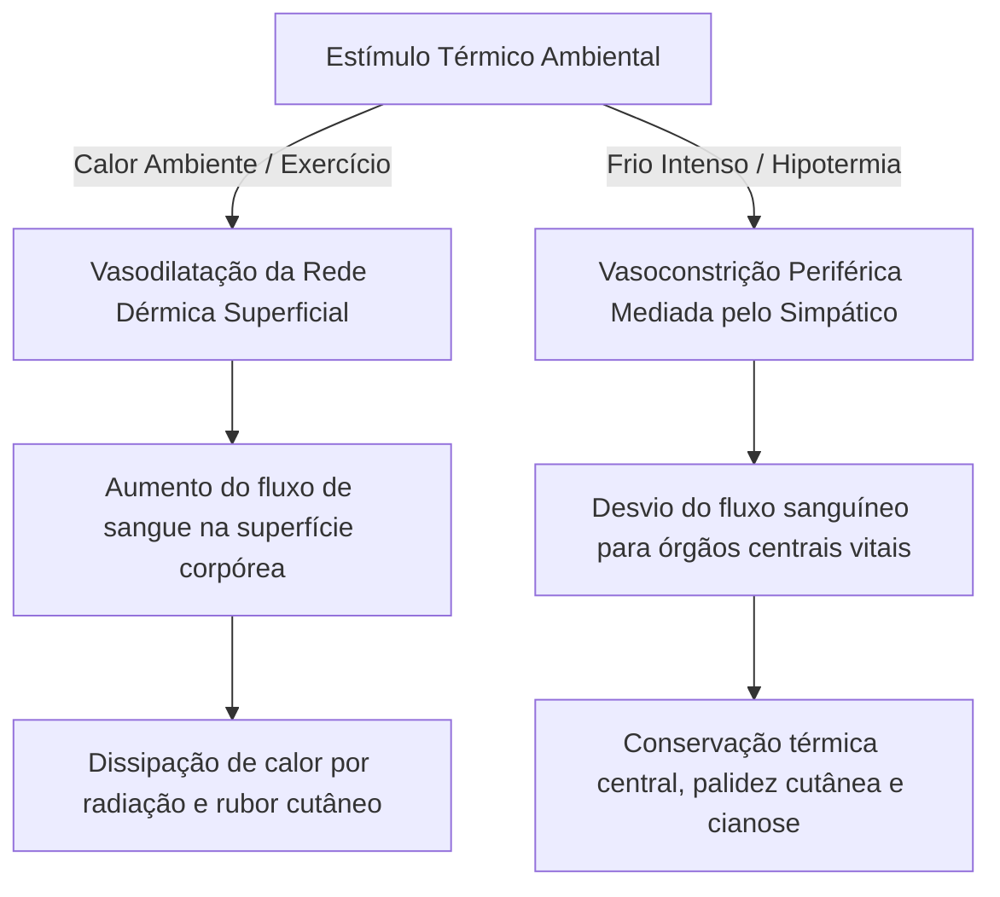
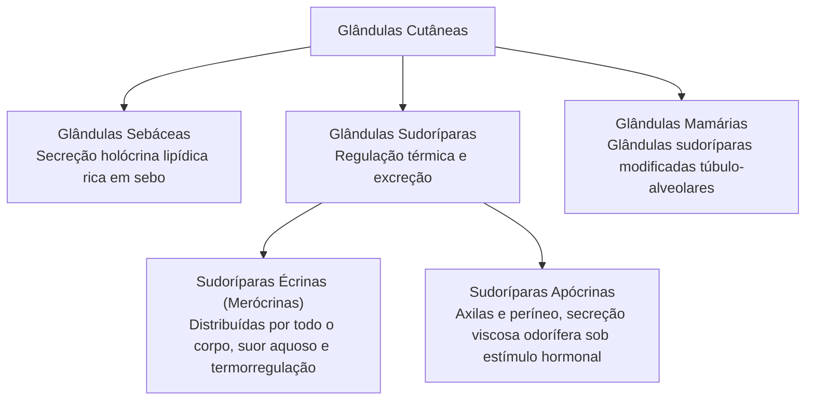
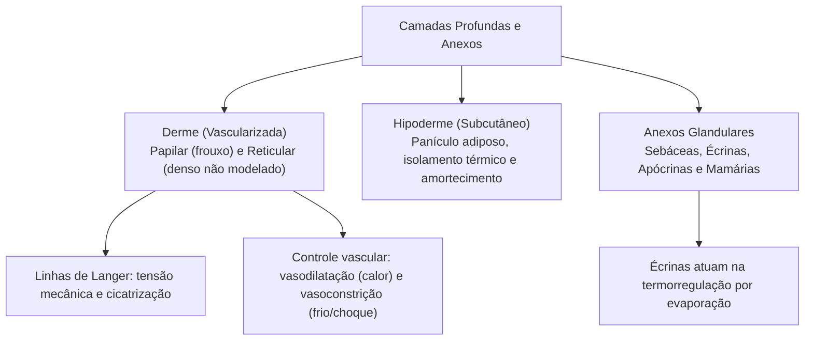

Abaixo do epitélio avascular da epiderme assenta-se a derme, uma espessa camada de sustentação conjuntiva ricamente vascularizada e inervada. Juntamente com a hipoderme e os anexos glandulares, ela desempenha papel decisivo na regulação da temperatura corpórea, na elasticidade da pele e na proteção biomecânica do corpo humano. O estudo dessas camadas profundas é vital para compreender o choque circulatório, as queimaduras de espessura parcial e a resposta tecidual aos traumas mecânicos cotidianos enfrentados nas ações de emergência pré-hospitalar.

> [!objetivos]
> - Diferenciar histologicamente a camada papilar da camada reticular da derme.
> - Compreender a importância cirúrgica e traumatológica das linhas de clivagem de Langer.
> - Analisar a circulação dérmica, as anastomoses arteriovenosas e a resposta vascular na termorregulação e no choque.
> - Descrever a estrutura da hipoderme e a classificação morfofuncional das glândulas sudoríparas, sebáceas e mamárias.

## A Derme: Estrutura Histológica

A derme é a camada conjuntiva sobre a qual repousa a epiderme, conferindo ao tegumento resistência mecânica à tração e grande flexibilidade elástica. Sua espessura varia conforme a região anatômica, sendo delgada nas pálpebras e espessa no dorso e nas plantas dos pés. A derme divide-se em duas camadas histológicas contínuas, sem limite nítido de separação: a camada papilar e a camada reticular.

### Camada Papilar

A camada papilar é a porção superficial da derme, delgada e constituída por **tecido conjuntivo frouxo**. Suas projeções digitiformes, denominadas papilas dérmicas, penetram entre as cristas epidérmicas, ampliando a área de contato e nutrição do epitélio sobrejacente.

Essa camada é abundante em fibroblastos, mastócitos e macrófagos, contendo delicadas fibras colágenas (predominantemente colágeno tipo III) e fibras elásticas finas. Na camada papilar distribuem-se alças capilares sanguíneas encarregadas de nutrir a epiderme e receptores sensoriais especializados, com destaque para os **corpúsculos de Meissner** (responsáveis pelo tato fino e discriminação tátil em áreas desprovidas de pelos).

### Camada Reticular

A camada reticular localiza-se profundamente à camada papilar, sendo consideravelmente mais espessa e constituída por **tecido conjuntivo denso não modelado**. Essa camada é caracterizada por espessos feixes de fibras colágenas do tipo I entrelaçados em várias direções, associados a uma densa rede de fibras elásticas grossas.

A matriz extracelular da camada reticular é rica em proteoglicanos e glicosaminoglicanos (como o ácido hialurônico e o sulfato de condroitina), substâncias altamente hidrofílicas que retêm grandes volumes de água, mantendo a turgência e hidratação da pele. Na camada reticular localizam-se os folículos pilosos, as glândulas sebáceas, as glândulas sudoríparas, vasos sanguíneos de maior calibre e os **corpúsculos de Pacini**, mecanorreceptores sensíveis à pressão profunda e vibrações rápidas.

## As Linhas de Clivagem (Linhas de Langer)

Na camada reticular da derme, os feixes de fibras colágenas e elásticas não se distribuem de modo totalmente aleatório. Eles tendem a se orientar paralelamente às linhas de maior tensão mecânica natural da pele, geradas pela movimentação muscular habitual e pelas dobras articulares. Esse arranjo ordenado origina as chamadas **linhas de clivagem** (ou linhas de Langer).

> [!esquema] Relação das Incisões com as Linhas de Clivagem de Langer
> - **Incisões Paralelas:** as fibras mantêm as margens unidas, impedindo que a ferida fique puxada por tensões, facilitando o fechamento de ferimentos.
> - **Incisões Perpendiculares:** as fibras tracionam as bordas, gerando feridas bocejantes que exigem maior esforço de cicatrização.

O conhecimento anatômico das linhas de clivagem possui imensa relevância na prática médica, cirúrgica e forense:
- **Incidência Cirúrgica Eletiva:** quando o cirurgião realiza uma incisão paralela à orientação das linhas de clivagem, as bordas da ferida mantêm-se naturalmente unidas pela tensão circundante, facilitando a sutura e gerando cicatrizes estéticas discretas.
- **Lesões Perpendiculares:** feridas traumáticas que cortam perpendicularmente as linhas de clivagem sofrem intensa tração mecânica lateral exercida pelas fibras elásticas, tendendo a se abrir espontaneamente. Essas lesões exigem suturas sob tensão e apresentam maior propensão à formação de cicatrizes hipertróficas ou queloides.

## A Circulação na Derme e a Termorregulação

A epiderme é avascular, de modo que toda a perfusão cutânea concentra-se na derme e na hipoderme. Pequenas artérias perfurantes irrigam a derme profunda e emitem ramificações organizadas em duas redes vasculares horizontais interligadas:
1. **Rede Vascular Subpapilar (Superficial):** situa-se na transição entre a camada papilar e a reticular, emitindo alças capilares verticais que sobem para cada papila dérmica para oxigenar os queratinócitos basais.
2. **Rede Vascular Profunda:** localiza-se na interface entre a derme reticular e a hipoderme, nutrindo as porções profundas dos anexos cutâneos e do tecido adiposo.

### Anastomoses Arteriovenosas e Glomos Cutâneos

Nas regiões corporais mais expostas ao ambiente externo (como a ponta dos dedos das mãos e pés, leito ungueal, lóbulos das orelhas e asas do nariz), existem comunicações vasculares diretas entre arteríolas e vênulas, denominadas **anastomoses arteriovenosas** (ou glomos cutâneos).

Esses canais vasculares possuem espessa túnica muscular inervada pelo sistema nervoso autônomo simpático. Quando os glomos estão abertos, o fluxo sanguíneo passa diretamente da arteríola para a vênula, sem percorrer a malha capilar lenta, acelerando a perda de calor em ambientes aquecidos. Em contrapartida, sob frio intenso, o estímulo simpático contrai fortemente essas anastomoses, restringindo o aporte sanguíneo periférico para priorizar a temperatura dos órgãos nobres vitais do tronco e da cabeça.

> [!exemplo] Termorregulação Dérmica em Dias de Calor Extremo
> Em dias quentes ou durante esforço físico extenuante, o centro termorregulador hipotalâmico estimula a vasodilatação das arteríolas cutâneas. O fluxo sanguíneo para a rede subpapilar aumenta expressivamente, permitindo que a pele clara assuma uma coloração avermelhada visível decorrente do maior aporte de hemoglobina oxigenada na superfície, facilitando a troca térmica com o ambiente por convecção e radiação.

> [!atencao] Resposta Vascular Cutânea no Choque Hipovolêmico
> Em situações de trauma grave, hemorragia aguda ou queimaduras extensas acompanhadas de choque hipovolêmico, o organismo deflagra uma descarga adrenérgica compensatória massiva. O sistema simpático provoca intensa vasoconstrição arteriolar periférica na derme, desviando o volume sanguíneo remanescente para o coração, pulmões e encéfalo. Como resultado clínico típico avaliado no atendimento pré-hospitalar pelo bombeiro militar, o paciente apresenta **pele fria, extremamente pálida, pegajosa e com tempo de enchimento capilar lentificado** (superior a dois segundos).

## A Hipoderme (Tecido Celular Subcutâneo)

A hipoderme situa-se imediatamente abaixo da derme reticular. Não faz parte da pele no sentido estrito, mas atua como elemento anatômico e funcional inseparável do tegumento. É constituída por tecido conjuntivo frouxo preenchido por lóbulos volumosos de **adipócitos** que formam o panículo adiposo, onde há acúmulo de gordura distribuído no abdômen, nas coxas e nas nádegas. Esse tecido adiposo unilocular é entremeado por septos fibrosos de sustentação que ligam a derme às fáscias musculares e ao periósteo ósseo subjacente.

A hipoderme desempenha três papéis fisiológicos capitais:
1. **Reserva Energética Metabólica:** armazena a maior quantidade de triacilgliceróis do organismo, mobilizáveis em situações de jejum prolongado.
2. **Isolamento Térmico:** as células de gordura são más condutoras térmicas, reduzindo a dissipação de calor interno para o meio ambiente frio.
3. **Proteção Mecânica contra Traumatismos:** amortece choques mecânicos e pressões sobre ossos e vísceras internas, além de conferir mobilidade à pele sobre as estruturas mais profundas.

## Anexos da Pele: Glândulas Cutâneas

Os anexos da pele originam-se de invaginações do epitélio epidérmico embrionário para o interior da derme. As glândulas cutâneas dividem-se em glândulas sebáceas, sudoríparas e mamárias:

### Glândulas Sebáceas

As glândulas sebáceas são glândulas acinosas ramificadas simples que desembocam habitualmente no colo dos folículos pilosos (aparelho pilossebáceo). Encontram-se distribuídas por quase toda a superfície corporal, com densidade máxima na face, couro cabeludo e fronte, estando totalmente ausentes nas palmas das mãos e plantas dos pés.

Seu modo de secreção é **holócrino**: as células glandulares acumulam gotículas lipídicas em seu citoplasma até que se rompem totalmente e morrem, constituindo o próprio produto de secreção, denominado **sebo**. O sebo é uma mistura de triglicerídeos, ceras, esqualeno e colesterol que lubrifica os pelos, mantém a flexibilidade da camada córnea e possui propriedades bacteriostáticas brandas. Sua produção é ativada por hormônios androgênicos na puberdade.

### Glândulas Sudoríparas

As glândulas sudoríparas são estruturas tubulares enoveladas simples que participam ativamente da termorregulação e da excreção aquosa. Elas se subdividem em dois tipos funcionais distintos:

1. **Glândulas Sudoríparas Écrinas (ou Merócrinas):**
   - Distribuem-se por praticamente toda a extensão do corpo humano, sendo especialmente densas nas palmas das mãos, plantas dos pés e fronte.
   - Seu ducto excretor abre-se diretamente na superfície da epiderme por meio de um poro sudoríparo.
   - O modo de secreção é merócrino (exocitose sem perda citoplasmática). Produzem um suor aquoso, hipotônico e incolor, composto por 99% de água, íons de cloreto de sódio, ureia e ácido lático.
   - Sua função primordial é a **termorregulação**: a evaporação do suor na superfície cutânea consome energia térmica do organismo, resfriando o corpo em ambientes quentes ou durante atividade física vigorosa. São inervadas por fibras colinérgicas do sistema nervoso simpático.

2. **Glândulas Sudoríparas Apócrinas:**
   - Possuem distribuição anatômica restrita, localizando-se nas axilas, aréolas mamárias, região perianal e órgãos genitais externos.
   - Seus ductos excretores não se abrem diretamente na pele livre, mas desembocam no canal do folículo piloso, acima da glândula sebácea.
   - Produzem uma secreção viscosa, leitosa e rica em proteínas e lipídios. Inicialmente inodora, essa secreção adquire odor característico quando decomposta pelas bactérias comensais da flora cutânea.
   - Não desempenham papel significativo na termorregulação. Iniciam sua atividade funcional na puberdade sob a influência de hormônios sexuais e respondem a estímulos emocionais e estresse adrenérgico.

### Adendo: Glândulas Mamárias

As glândulas mamárias constituem glândulas sudoríparas apócrinas especializadas e altamente modificadas, presentes em ambos os sexos, mas que se desenvolvem plenamente no sexo feminino durante a puberdade e a gravidez sob estímulo hormonal complexo (estrogênio, progesterona, prolactina e ocitocina).

Estruturam-se como glândulas túbulo-alveolares compostas divididas em quinze a vinte lobos glandulares separados por tecido conjuntivo denso e adiposo. Cada lobo possui um ducto lactífero independente que converge para a papila mamária (mamilo). Durante a lactação, a porção proteica do leite materno é liberada por secreção merócrina, enquanto a porção lipídica é eliminada pelo mecanismo apócrino, fornecendo imunoglobulinas maternas (como a IgA secretora) para a proteção do recém-nascido.

> [!bizu] Diferenciação Expressa das Glândulas Cutâneas
> - **Sebácea:** secreção holócrina (a célula se destrói ao secretar sebo lipídico), ausente nas palmas e plantas.
> - **Sudorípara Écrina:** merócrina, universal no corpo, suor aquoso termorregulador por evaporação.
> - **Sudorípara Apócrina:** axilas e períneo, ducto no folículo, secreção viscosa ativada na puberdade.
> - **Mamária:** sudorípara modificada túbulo-alveolar especializada na produção e ejeção do leite.

## Mapa do capítulo

### Para fixar

1. **Camada papilar**: porção superficial da derme em tecido conjuntivo frouxo, contendo papilas digitiformes, capilares e corpúsculos de Meissner.
2. **Camada reticular**: camada conjuntiva densa não modelada rica em feixes de colágeno I e elastina, conferindo resistência mecânica e turgor hídrico.
3. **Linhas de clivagem de Langer**: orientação predominante das fibras de colágeno na derme reticular, orientando incisões cirúrgicas para cicatrizes discretas.
4. **Termorregulação dérmica**: vasodilatação periférica para dissipar calor excedente e vasoconstrição periférica para preservar o calor central no frio.
5. **Glomos cutâneos**: anastomoses arteriovenosas musculares nas extremidades que desviam o sangue dos capilares para regulação térmica rápida.
6. **Choque hipovolêmico**: redistribuição adrenérgica do fluxo sanguíneo para órgãos nobres, resultando em pele fria, pálida e tempo de enchimento capilar lentificado.
7. **Hipoderme**: camada subcutânea de tecido adiposo unilocular com função de reserva calórica, isolamento térmico e absorção de impactos.
8. **Glândulas sebáceas**: glândulas holócrinas anexas aos folículos pilosos que secretam sebo lubrificante e protetor, ausentes nas palmas e plantas.
9. **Sudoríparas écrinas**: glândulas merócrinas universais que produzem suor aquoso hipotônico essencial para o resfriamento corporal por evaporação.
10. **Sudoríparas apócrinas e mamárias**: apócrinas restritas a axilas e períneo ativadas na puberdade; mamárias são glândulas sudoríparas modificadas para a lactação.
