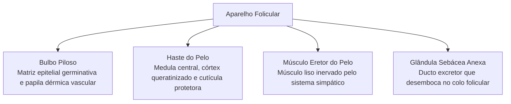
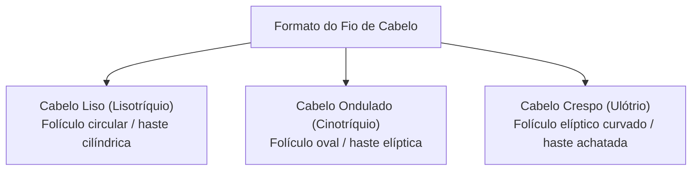
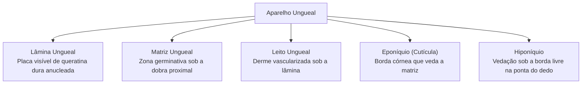
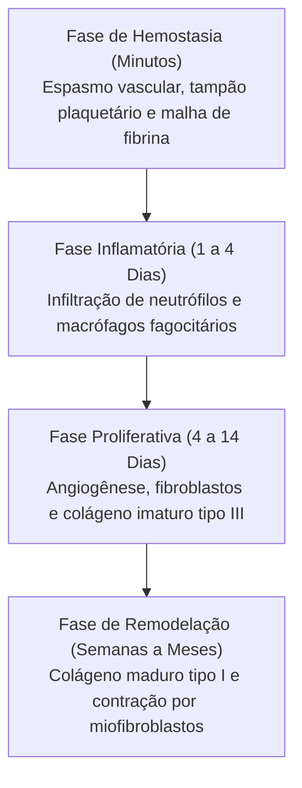
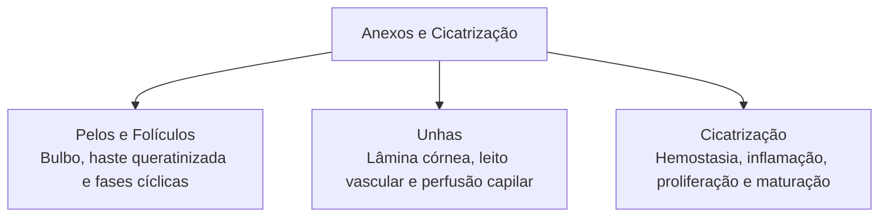

Os pelos e as unhas constituem anexos queratinizados especializados derivados da diferenciação epitelial da epiderme humana. Paralelamente às suas funções de proteção física e sensorial, o tegumento ostenta notável capacidade regenerativa contra agressões externas, coordenando as funções vitais dos seres vivos e sua relação com a adaptação a diferentes ambientes térmicos através de um processo ordenado de cicatrização tecidual.

> [!objetivos]
> - Compreender a estrutura histológica do folículo piloso e as fases do ciclo de crescimento do pelo.
> - Identificar a arquitetura anatômica do aparelho ungueal e sua correlação com a avaliação clínica da perfusão.
> - Analisar as diferenças morfológicas dos fios de cabelo e sua relação com a adaptação biológica ambiental.
> - Descrever as etapas coordenadas do processo de cicatrização e reparo tecidual cutâneo.

## Pelos e Cabelos: Anatomia e Fisiologia

Os pelos são estruturas filamentosas flexíveis formadas por células queratinizadas mortas compactadas, ausentes apenas nas palmas das mãos, solas dos pés e lábios. Atuam no isolamento térmico, proteção mecânica e percepção sensorial tátil por meio de terminações nervosas na base folicular. Sob atrito contínuo, a epiderme responde espessando camadas que originam calos superficiais protetores.

Cada fio desenvolve-se no interior de um **folículo piloso**, invaginação tubular epidérmica que atinge a derme profunda. A raiz profunda do pelo encontra-se rodeada pela bainha radicular epitelial interna e externa, cercada externamente por uma bainha dérmica conjuntiva. Sua base dilatada, o **bulbo piloso**, envolve a papila dérmica vascularizada, fonte de oxigênio e nutrientes vitais. As células germinativas adjacentes formam a matriz epitelial, onde mitoses contínuas produzem o crescimento da haste que se projeta além do poro superficial.

A haste do pelo compreende três zonas concêntricas:
1. **Medula:** eixo central frouxo, presente em fios grossos terminais.
2. **Córtex:** camada intermediária espessa com queratina dura e grânulos de melanina que determinam a cor.
3. **Cutícula:** lâmina externa de escamas celulares achatadas e transparentes, dispostas como telhas para vedar o fio.

Associado ao folículo situa-se o **músculo eretor do pelo**, feixe liso acionado pelo sistema simpático. Em dias frios ou sustos, ele puxa o folículo para cima, erguendo o fio (piloereção) e contraindo a pele circundante.

O crescimento capilar segue ciclos regulares:
- **Fase Anágena:** proliferação ativa das células da matriz e elongação do fio (dura anos).
- **Fase Catágena:** regressão de duas a três semanas com apoptose celular e retração do bulbo.
- **Fase Telógena:** repouso de três meses, culminando na queda do pelo antigo e início de novo ciclo.

## Diferenças Estruturais dos Fios e Pigmentação

As características morfológicas do cabelo integram as funções vitais dos seres vivos e sua relação com a adaptação a diferentes ambientes geográficos e climáticos. Em biologia evolutiva, a curvatura e a densidade capilar representam respostas adaptativas selecionadas para regulação térmica e proteção solar. O formato da secção transversal do folículo molda o padrão do fio: folículos circulares geram cabelos lisos cilíndricos; folículos ovais produzem fios ondulados; e folículos elípticos curvados geram cabelos crespos espiralados, cuja trama retém ar e protege o crânio contra a radiação solar intensa em zonas tropicais.

> [!esquema] Pigmentação Capilar e Envelhecimento
> A cor dos cabelos depende de dois pigmentos de melanina:
> - **Eumelanina:** confere tons escuros (castanhos e pretos), com alto poder fotoprotetor.
> - **Feomelanina:** pigmento rico em enxofre com tons claros (amarelados e avermelhados).
> - **Canície (cabelos brancos):** resulta da cessação mitótica dos melanócitos da matriz associada a microbolhas de ar na haste.

## As Unhas

Na ponta dorsal de cada dedo da mão e do pé, a unha atua como uma lâmina rígida de queratina dura compactada disposta sobre a falange distal. Essas estruturas proporcionam sustentação mecânica, ampliam a sensibilidade tátil da polpa digital e auxiliam na manipulação minuciosa de objetos.

A **lâmina ungueal** é secretada continuamente pela **matriz ungueal**, região germinativa situada na dobra proximal. As células proliferam, queratinizam-se intensamente e avançam sobre o **leito ungueal**, derme fortemente vascularizada que garante sustentação física e oxigenação. Na extremidade distal, sob a borda livre da unha, o **hiponíquio** constitui um espessamento epitelial que veda a junção contra a entrada de micro-organismos patogênicos.

> [!atencao] Avaliação Clínica do Leito Ungueal no Atendimento Pré-Hospitalar
> O leito ungueal abriga capilares sanguíneos abundantes visíveis através da lâmina translúcida. O tempo de enchimento capilar consiste em pressionar a polpa ungueal até empalidecer e soltar: a coloração rosada deve retornar em **menos de dois segundos**. Retardo superior sinaliza má perfusão tecidual, desidratação severa ou choque circulatório.

| Estrutura Ungueal | Posição Anatômica | Função Principal |
|---|---|---|
| **Lâmina Ungueal** | Dorso da falange distal | Anteparo mecânico e proteção |
| **Matriz Ungueal** | Porção proximal encoberta | Síntese e crescimento da lâmina |
| **Leito Ungueal** | Sob a placa córnea | Aderência mecânica e nutrição |
| **Eponíquio** | Margem da dobra proximal | Barreira protetora contra patógenos |
| **Hiponíquio** | Sob borda livre distal | Vedação contra infecções bacterianas |

## O Processo de Cicatrização Cutânea

A perda da integridade dérmica desencadeia uma sequência coordenada de reações inflamatórias e proliferativas destinadas a restaurar a homeostase e fechar a ferida contra agentes patogênicos externos. Por meio desse reparo, os tecidos lesionados recuperam sua função biológica protetora primordial.

### Fase de Hemostasia

Tem início imediato com a exposição do colágeno vascular ao sangue extravasado. Há vasoconstrição reflexa breve, agregação e ativação plaquetária, culminando na cascata que deposita uma malha insolúvel de fibrina sobre a lesão. Esse coágulo estanca o sangramento e origina a crosta protetora provisória.

### Fase Inflamatória

Estende-se do primeiro ao quarto dia pós-trauma. Mediadores solúveis locais provocam vasodilatação regional e aumento da permeabilidade vascular, gerando calor, rubor e inchaço. Os **neutrófilos** migram inicialmente por diapedese para destruir bactérias. Logo em seguida, os **macrófagos** assumem o controle, fagocitando restos celulares e secretando citocinas que coordenam as etapas regenerativas subsequentes.

### Fase Proliferativa

Ocorre entre quatro e catorze dias, restaurando a massa conjuntiva e o recobrimento epitelial por meio de três processos concomitantes:
- **Angiogênese:** formação de novos capilares estimulada por fatores de crescimento locais.
- **Fibroplasia e Tecido de Granulação:** intensa proliferação de fibroblastos com síntese abundante de proteoglicanos e **colágeno tipo III** imaturo, compondo um tecido conjuntivo jovem, rosado, vascular e úmido denominado tecido de granulação.
- **Reepitelização:** queratinócitos das bordas íntegras e dos restos foliculares começam a migrar sobre a malha de fibrina provisória. Conforme avançam em direção ao centro da lesão, as células proliferam e formarão uma nova camada epitelial contínua até interromperem o movimento por inibição por contato.

### Fase de Remodelação (Maturação)

Inicia-se por volta da terceira semana e persiste por meses. O tecido de granulação regride por apoptose celular, esmaecendo o rubor cicatricial. O evento determinante é a degradação do colágeno tipo III e sua substituição organizada por feixes resistentes de **colágeno tipo I**. Ao mesmo tempo, miofibroblastos contraem as margens lesionadas, aproximando as bordas e reduzindo a cicatriz definitiva.

> [!bizu] Síntese Rápida das Etapas da Cicatrização
> - **Hemostasia:** plaquetas agregadas e coágulo de fibrina.
> - **Inflamatória:** limpeza bacteriana e celular por neutrófilos e macrófagos.
> - **Proliferativa:** vasos novos, fibroblastos com colágeno tipo III e tecido de granulação.
> - **Remodelação:** substituição por colágeno tipo I resistente e retração por miofibroblastos.

## Mapa do capítulo

### Para fixar

1. **Folículo piloso**: estrutura invaginada epidérmica na derme contendo bulbo, papila vascular e matriz mitótica.
2. **Camadas do pelo**: medula central frouxa, córtex espesso rico em melanina e cutícula externa protetora.
3. **Músculo eretor do pelo**: músculo liso simpático que ergue a haste em dias frios ou momentos de alerta.
4. **Ciclo capilar**: fases sucessivas de crescimento ativo (anágena), involução celular (catágena) e repouso (telógena).
5. **Pigmentos foliculares**: predomínio de eumelanina nos cabelos escuros e feomelanina nos cabelos claros e ruivos.
6. **Lâmina ungueal**: placa resistente de queratina dura secretada continuamente pela matriz ungueal proximal.
7. **Perfusão capilar ungueal**: teste clínico em que o leito ungueal comprimido deve retornar à cor normal em menos de dois segundos.
8. **Hemostasia**: controle imediato da hemorragia por vasoespasmo reflexo, tampão de plaquetas e rede de fibrina.
9. **Tecido de granulação**: estroma transitório muito vascularizado rico em colágeno tipo III na fase proliferativa.
10. **Remodelação cicatricial**: maturação da cicatriz com deposição de colágeno tipo I e tração exercida por miofibroblastos.
