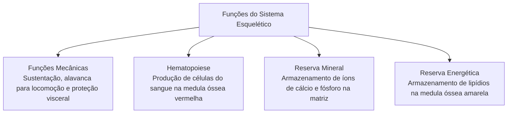
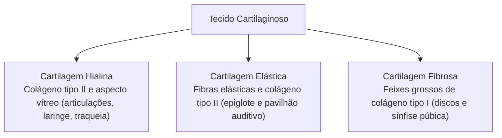
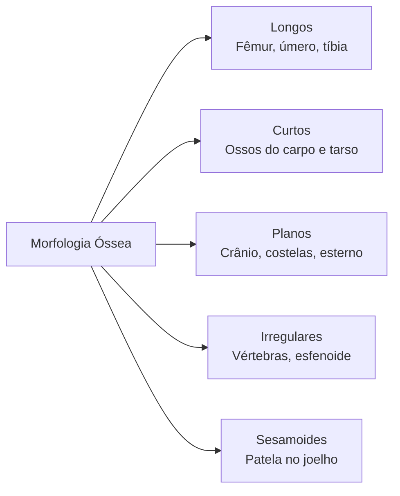
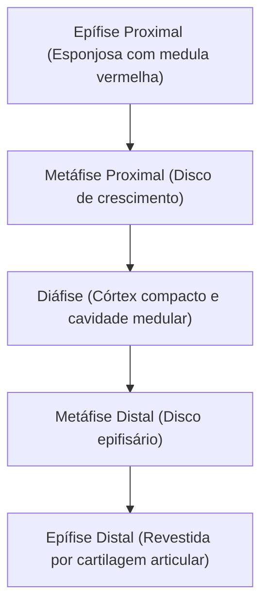
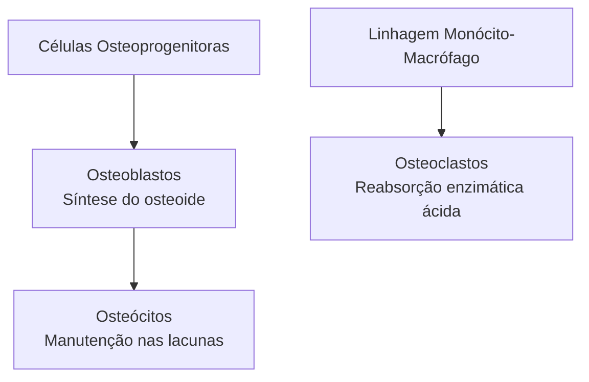
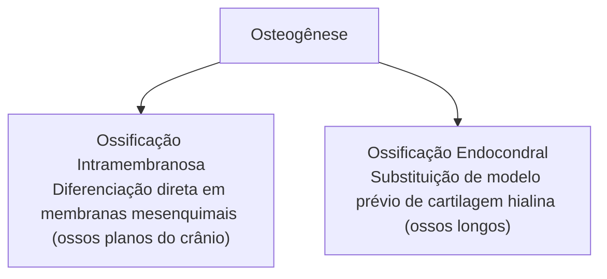
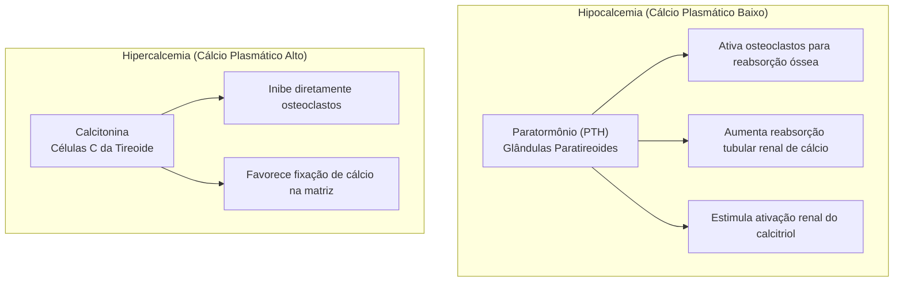
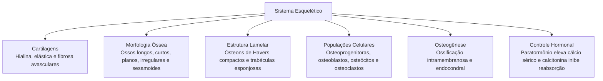

O sistema esquelético humano é uma estrutura osteocartilaginosa dinâmica essencial para a sobrevivência do organismo. Longe de constituir um arcabouço inerte, o tecido ósseo passa por constante renovação biológica, mantendo estreita integração funcional com as cartilagens, a medula óssea e o controle endócrino do cálcio plasmático. Compreender sua organização anatômica e celular permite entender a capacidade adaptativa do corpo ao estresse físico e às sobrecargas de treinamento.

> [!objetivos]
> - Compreender as funções mecânicas e metabólicas essenciais do esqueleto humano.
> - Diferenciar as três variedades de tecido cartilaginoso e sua reparação tecidual.
> - Caracterizar a classificação dos ossos e a estrutura microscópica dos ósteons.
> - Distinguir os mecanismos de osteogênese e a regulação hormonal do cálcio.

## Funções do Sistema Esquelético

O arcabouço esquelético de um adulto é formado por duzentos e seis ossos articulados. Suas funções biológicas ultrapassam a simples sustentação corporal, integrando processos vitais para múltiplos aparelhos orgânicos.

Em primeiro plano, os ossos atuam como suporte estrutural para tecidos moles e ancoragem firme para tendões musculares. Ao contrair, os músculos tracionam peças ósseas que atuam como alavancas mecânicas, gerando movimentos corporais e locomoção. Além disso, cavidades ósseas rígidas protegem vísceras vitais contra choques mecânicos externos, como o crânio protegendo o encéfalo, a caixa torácica resguardando coração e pulmões, e o canal vertebral abrigando a medula espinhal.

No âmbito metabólico, os ossos acumulam noventa e nove por cento do cálcio e oitenta e cinco por cento do fósforo corpóreo sob a forma de cristais minerais. O esqueleto funciona como reserva tampão contínua: libera íons de cálcio quando a concentração no sangue diminui e incorpora minerais quando há aporte alimentar suficiente.

O interior dos ossos contém ainda dois tecidos essenciais: a **medula óssea vermelha**, responsável pela produção das células sanguíneas (hematopoiese), e a **medula óssea amarela**, formada por adipócitos que armazenam triglicerídeos como reserva energética.

## O Tecido Cartilaginoso

A cartilagem é uma variedade especializada de tecido conjuntivo de consistência firme e elástica. Ela não possui vasos sanguíneos, vasos linfáticos nem inervação. Por isso, as células cartilaginosas dependem da difusão de nutrientes a partir dos tecidos vizinhos vascularizados.

A matriz cartilaginosa é sintetizada por células precursoras ativas denominadas **condroblastos**. Ao serem circundadas pela substância fundamental amorfa que secretam, diminuem sua taxa metabólica e passam a se chamar **condrócitos**, alojados em pequenas cavidades denominadas lacunas. A matriz é rica em proteoglicanos, ácido hialurônico e fibras colágenas, garantindo alta resistência mecânica à compressão.

Existem três classes de cartilagem no corpo humano:
- **Cartilagem Hialina:** variedade mais abundante, dotada de matriz vítrea e fibrilas delicadas de colágeno tipo II. Reveste articulações sinoviais móveis, forma anéis traqueais, cartilagens laríngeas, cartilagens costais e o esqueleto fetal temporário.
- **Cartilagem Elástica:** semelhante à hialina, mas com grande quantidade de fibras elásticas ramificadas. Apresenta alta flexibilidade, sendo encontrada no pavilhão auditivo, conduto auditivo externo e epiglote.
- **Cartilagem Fibrosa (Fibrocartilagem):** tecido denso contendo grossos feixes paralelos de colágeno tipo I. Suporta expressivas forças de compressão e tração. Localiza-se nos discos intervertebrais, na sínfise púbica e nos meniscos do joelho.

> [!atencao] Avascularidade Cartilaginosa e Regeneração em Traumas
> A maioria das cartilagens é recoberta por uma cápsula de conjuntivo denso vascularizado chamada **pericôndrio**. A cartilagem articular das articulações sinoviais não possui pericôndrio; seus condrócitos recebem nutrientes exclusivamente do líquido sinovial. Em razão da avascularidade e do baixo ritmo mitótico celular, lesões cartilaginosas em acidentes ou atividades operacionais têm regeneração biológica bastante lenta e limitada.

| Tipo de Cartilagem | Fibras Predominantes | Pericôndrio | Exemplos no Organismo |
|---|---|---|---|
| **Hialina** | Fibrilas de colágeno tipo II | Presente (exceto nas superfícies articulares) | Articulações sinoviais, traqueia, cartilagens costais |
| **Elástica** | Fibras elásticas e colágeno tipo II | Presente | Pavilhão auditivo externo, tuba auditiva, epiglote |
| **Fibrosa** | Feixes espessos de colágeno tipo I | Ausente | Discos intervertebrais, sínfise púbica, meniscos |

## Morfologia e Classificação dos Ossos

Os ossos apresentam formatos diversificados, refletindo as diferentes exigências biomecânicas do corpo humano:

- **Ossos Longos:** comprimento visivelmente maior que a largura e espessura. Apresentam corpo tubular cilíndrico e extremidades alargadas, como fêmur, úmero, rádio e tíbia.
- **Ossos Curtos:** possuem comprimento, largura e espessura semelhantes, adquirindo formato cuboide. São compostos por osso esponjoso envolvido por fina casca compacta, a exemplo dos ossos do carpo e do tarso.
- **Ossos Planos (Laminares):** delgados e achatados, oferecem proteção a órgãos vitais e grande área para fixação de músculos. Compreendem a escápula, o esterno, as costelas e os ossos da calota craniana. No crânio, a camada esponjosa entre duas lâminas compactas chama-se **díploe**.
- **Ossos Irregulares:** exibem arquitetura tridimensional complexa com múltiplas projeções e forames, como as vértebras e ossos da base craniana.
- **Ossos Sesamoides:** nódulos ósseos desenvolvidos no interior de tendões para reduzir atrito e potencializar o braço de alavanca mecânica. O principal exemplo corporal é a **patela**.
- **Ossos Suturais:** pequenos fragmentos supranumerários alojados ao longo das suturas do crânio.

Na estrutura macroscópica de um osso longo reconhecem-se três setores fundamentais:
- **Diáfise:** corpo central tubular formado por espessa parede de osso compacto em torno do canal medular.
- **Epífises:** extremidades articulares dilatadas compostas por osso esponjoso recoberto por cartilagem articular hialina.
- **Metáfise:** zona intermediária entre epífise e diáfise. Abriga o **disco epifisário** de cartilagem hialina em jovens, substituído pela **linha epifisária** mineralizada no adulto.

## Tecido Ósseo: Células e Estrutura Lamelar

A matriz óssea contém uma porção orgânica (trinta e cinco por cento) rica em fibras colágenas do tipo I e uma porção inorgânica (sessenta e cinco por cento) composta por cristais de hidroxiapatita de fosfato de cálcio. A dureza óssea decorre dessa íntima associação mineral e proteica.

Quatro tipos celulares atuam no tecido ósseo:
- **Células Osteoprogenitoras:** células-tronco do periósteo e endósteo que se multiplicam e geram osteoblastos.
- **Osteoblastos:** células que sintetizam o **osteoide** (matriz orgânica) e coordenam a precipitação de cálcio e fosfato.
- **Osteócitos:** células maduras aprisionadas em lacunas (**osteoplastos**). Seus prolongamentos viajam por túbulos finos denominados **canalículos ósseos**, comunicando-se por junções comunicantes e atuando como sensores de carga mecânica.
- **Osteoclastos:** células móveis gigantes e multinucleadas derivadas de macrófagos. Secretam ácido clorídrico e enzimas em lacunas de reabsorção (**lacunas de Howship**), degradando a matriz mineral e o colágeno.

> [!bizu] Revestimentos Ósseos: Periósteo e Endósteo
> - **Periósteo:** membrana fibrosa externa que recobre o osso compacto, fixada por **fibras de Sharpey**. Possui camada celular osteogênica interna e rica inervação sensitiva responsável pela dor em fraturas.
> - **Endósteo:** membrana celular interna que forra a cavidade medular, os canais vasculares e as trabéculas esponjosas.

Microscopicamente, o osso compacto organiza-se em unidades circulares chamadas **ósteons** ou **sistemas de Havers**. Cada ósteon é formado por lamelas concêntricas circundando um canal central de Havers com vasos e nervos. Canais perfurantes transversais de Volkmann cruzam a matriz sem lamelas próprias, interligando vasos do periósteo, canais de Havers e canal medular. O osso esponjoso, por sua vez, é constituído por trabéculas irregulares sem sistemas de Havers organizados, nutridas diretamente pela medula óssea vizinha.

## Formação Óssea e Dinamismo

O esqueleto embrionário origina-se por dois caminhos de osteogênese distintos:

### Ossificação Intramembranosa

Ocorre diretamente em membranas conjuntivas embrionárias sem molde cartilaginoso prévio. Origina os ossos planos da calvária craniana, parte da mandíbula e da clavícula. Células mesenquimais formam centros primários onde se diferenciam em osteoblastos produtores de osteoide calcificado. Espaços não ossificados entre os ossos do crânio do recém-nascido constituem as **fontanelas** (moleiras), que facilitam o parto e viabilizam o crescimento encefálico.

### Ossificação Endocondral

Responsável pela gênese da maioria dos ossos corporais, incluindo os ossos longos dos membros e vértebras. Um molde embrionário de cartilagem hialina sofre invasão vascular na diáfise, originando o centro de ossificação primário. Posteriormente surgem centros secundários nas epífises. A cartilagem permanece ativa no disco epifisário promovendo o crescimento longitudinal em estatura até o final da juventude.

> [!exemplo] Cicatrização de Fraturas
> Em fraturas ósseas, o reparo segue etapas coordenadas:
> 1. **Hematoma fraturário:** coágulo de fibrina inicial e processo inflamatório agudo nas primeiras horas.
> 2. **Calo fibrocartilaginoso mole:** proliferação de vasos e cartilagem unindo os topos ósseos fraturados.
> 3. **Calo ósseo duro:** substituição da cartilagem por osso trabecular esponjoso imaturo em poucas semanas.
> 4. **Remodelação final:** osteoclastos e osteoblastos restabelecem a arquitetura compacta segundo as linhas de estresse mecânico.

## Regulação Hormonal do Tecido Ósseo

O tecido ósseo sofre renovação ininterrupta. Cerca de dez por cento do esqueleto adulto é inteiramente remodelado a cada ano. Esse equilíbrio depende da carga física aplicada aos membros e do controle endócrino da calcemia sérica:

- **Paratormônio (PTH):** hormônio hipercalcemiante secretado pelas paratireoides quando os níveis de cálcio no sangue caem. Induz osteoblastos a secretarem fatores que multiplicam osteoclastos, promovendo a liberação de cálcio mineral para a corrente sanguínea. Reduz perdas renais de cálcio na urina e ativa o calcitriol.
- **Calcitonina:** hormônio hipocalcemiante produzido pelas células parafoliculares da tireoide em resposta à elevação do cálcio sérico. Inibe diretamente a reabsorção osteoclástica e favorece a fixação mineral na matriz.
- **Calcitriol (Vitamina D Ativa):** esteroide sintetizado na pele e ativado no fígado e rins. Promove a absorção de cálcio e fosfato na mucosa intestinal.

> [!esquema] Osteoporose e Hormônios Sexuais
> Estrogênios e testosterona estimulam osteoblastos e induzem a apoptose de osteoclastos, preservando a densidade óssea. Com a redução na menopausa, a destruição óssea passa a superar a síntese, propiciando a **osteoporose**, condição clínica caracterizada por porosidade acentuada e fragilidade a fraturas no colo do fêmur e coluna lombar.

| Hormônio | Glândula Produtora | Impacto na Calcemia | Ação Primária no Esqueleto |
|---|---|---|---|
| **Paratormônio (PTH)** | Paratireoides | Hipercalcemiante | Estimula a reabsorção mineral por osteoclastos |
| **Calcitonina** | Células C da Tireoide | Hipocalcemiante | Bloqueia a atividade dos osteoclastos |
| **Calcitriol** | Pele, Fígado e Rins | Hipercalcemiante | Aumenta a absorção intestinal de cálcio |
| **Estrogênio** | Ovários | Protetor ósseo | Freia a reabsorção osteoclástica na matriz |

## Mapa do capítulo

### Para fixar

- O esqueleto humano executa suporte físico, proteção visceral, hematopoiese na medula vermelha e reserva mineral.
- A cartilagem é tecido avascular nutrido por difusão do pericôndrio envolvente ou do líquido sinovial articular.
- As três variedades de cartilagem são a hialina (colágeno II), a elástica (fibras elásticas) e a fibrosa (colágeno I).
- Os ossos longos exibem diáfise cortical densa com canal medular e epífises esponjosas delimitadas por metáfises.
- Os osteoblastos secretam a matriz orgânica de osteoide, enquanto os osteócitos atuam como sensores de carga mecânica.
- Os osteoclastos são células multinucleadas derivadas de macrófagos que degradam a matriz mineral calcificada.
- O ósteon compacto é constituído por lamelas concêntricas ao redor de um canal vascular longitudinal de Havers.
- A ossificação pode ser intramembranosa direta em membranas mesenquimais ou endocondral por molde de cartilagem hialina.
- O paratormônio eleva a calcemia ativando osteoclastos, enquanto a calcitonina inibe a degradação da matriz óssea.
